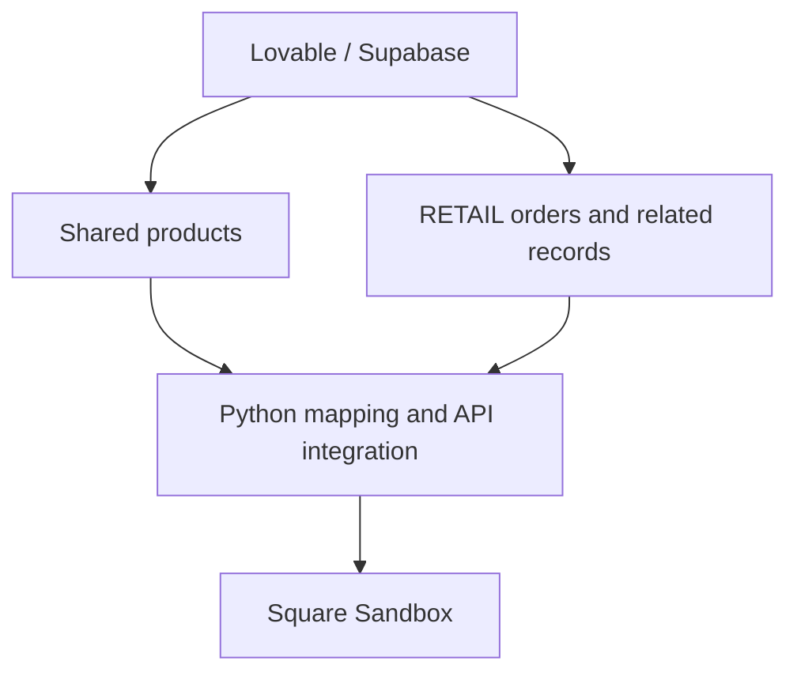
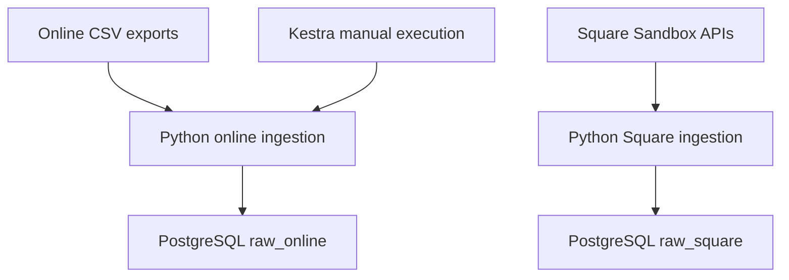
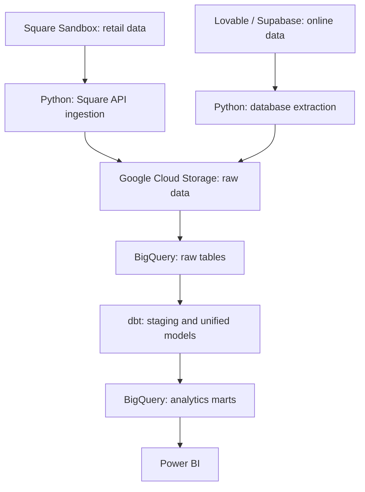
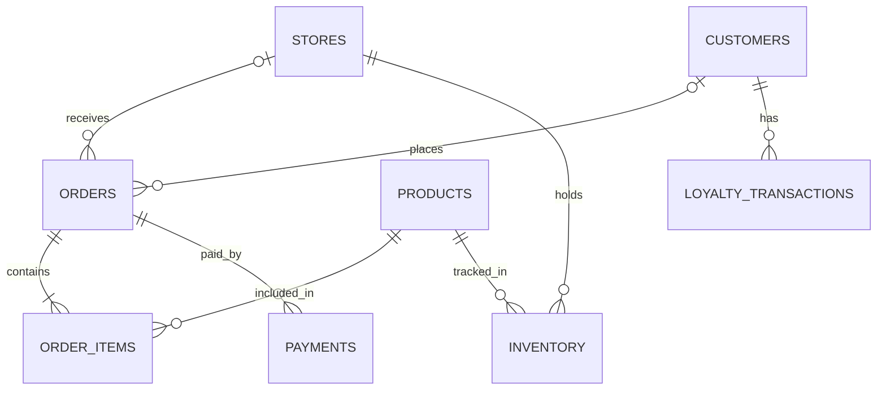
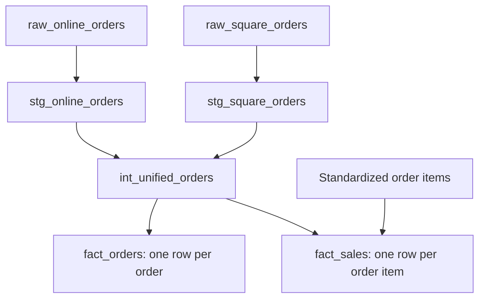

# 🍫 Charlie's Chocolate Factory — Omnichannel Retail Data Platform

> **A Data Engineering Portfolio Project for Retail & E-commerce Analytics**

An end-to-end data engineering project in progress that simulates how a retailer can combine physical-store and online sales data into a unified analytics platform.

The project models a fictional chocolate business using a Lovable online store and POS simulator, Square Developer Sandbox, Python ingestion pipelines, local PostgreSQL storage, and Kestra orchestration. GCS, BigQuery, dbt, and Power BI are planned downstream components.

Inspired by omnichannel chocolate retailers such as Purdys Chocolatier, it explores how online commerce data and offline POS data can be collected separately and integrated into a single analytics platform.

> **Disclaimer**
> This is an independent portfolio project using entirely synthetic data.
> It is not affiliated with Purdys Chocolatier or any other company, and does not reproduce any company's internal architecture.

### 🚀 Current Milestone

**An existing online-product Python pipeline now runs through Kestra and loads 15 rows into PostgreSQL, with ingestion timestamps and execution IDs for traceability.**

- Online CSV ingestion into `raw_online` and Square API ingestion into `raw_square` are implemented locally.
- Kestra execution and database verification are complete for **online products**; other pipelines and schedules are next.
- Cloud ingestion, cross-channel models, and dashboards remain planned.

_Last updated: October 30, 2026. Counts below are synthetic-data snapshots, not fixed production volumes._

---

## ✨ Project Overview

**Charlie's Chocolate Factory** is a fictional Canadian chocolate retailer with:

- 🏪 Multiple physical retail stores
- 🛒 A customer-facing online shop
- 👥 Customer accounts and rewards
- 📦 Product and inventory data
- 💳 Simulated orders and payment records

The source application was built with Lovable and stores both online and retail transactions. Orders are distinguished by their `channel`:

| Channel | Meaning | Current Analytics Input |
|---|---|---|
| `RETAIL` | Physical-store POS transactions | Square Sandbox APIs → PostgreSQL `raw_square` |
| `ONLINE` | E-commerce orders | Source CSV exports → PostgreSQL `raw_online` |

Python scripts populate Square Sandbox with shared products and retail-related test data. The local analytics pipeline collects retail data from Square APIs and online data from source CSV exports. Direct online database or API extraction is a future extension.

### 🌍 Real-World Scenario and Project Simulation

Because internal retail systems are not available, this project creates its own source environment.

| Retail Component | Project Implementation | Role |
|---|---|---|
| Customer-facing online store | Lovable Online Store | Generates online commerce data |
| Physical-store POS interface | Lovable POS Simulator | Generates synthetic retail transactions |
| External retail POS platform | Square Developer Sandbox | Stores retail test data through API integration |
| Central analytics platform | GCS / BigQuery / dbt — planned | Collects, standardizes, and integrates both channels |

Square Sandbox is a test environment; it does not represent a live store deployment or process real charges in this project.

### 🎯 Business Questions

- How does revenue compare between retail and online channels?
- Which physical stores perform best?
- Which products sell best across channels?
- What is the average order value by channel?
- How do identified customers shop across channels?
- How do sales vary by date and seasonal event?

Inventory monitoring and demand forecasting are future extensions.

---

## 🗺️ Project Roadmap — Six Phases

| Phase | Focus | Main Deliverables | Status |
|---|---|---|---|
| 1. 🏪 Source System Simulation | Create synthetic commerce sources | Online store, POS simulator, initial Square integrations and ID mappings | ✅ Initial scope complete; payments and inventory remain extensions |
| 2. 🐘 Local Data Ingestion & Storage | Collect each source separately | Online CSV pipelines, Square API extraction, PostgreSQL raw schemas | ✅ Implemented local scope; remaining validation tracked separately |
| 3. ⚙️ Workflow Orchestration | Run existing Python pipelines with Kestra | Docker task execution, table selection, execution metadata | 🚧 Online-product manual execution verified |
| 4. ☁️ Cloud Data Platform | Extend ingestion to GCP | GCS raw files and BigQuery raw tables | 📋 Planned |
| 5. 🧱 Transformation & Modeling | Standardize and integrate sources | dbt models, sales facts, dimensions, quality checks | 📋 Planned |
| 6. 📊 Analytics & Visualization | Turn unified data into metrics | Analytics marts and Power BI dashboard | 📋 Planned |

**Current focus:** Parameterize the Kestra workflow, verify all online tables, then extend orchestration to Square ingestion and add scheduling where appropriate.

Detailed progress and validation boundaries are recorded in [PROJECT_PROGRESS_KO.md](PROJECT_PROGRESS_KO.md) and [Phase 3 notes](docs/phase-3-kestra-orchestration-ko.md).

---

## 🏗️ Architecture

### 1. Prepare the Simulated Retail Environment

The Lovable application generates synthetic data for both channels. Only retail orders and their related records are selected for Square integration.

Shared product data is also loaded into Square.



This step prepares the simulated POS environment. It is separate from the downstream analytics ingestion pipeline.

### 2. Current Local Ingestion and Orchestration



The Kestra connection shown above is verified for online products only. Square ingestion currently runs through Python; its Kestra connection is a next step. Source preparation and analytics ingestion remain separate processes.

### 3. Target Cloud Architecture — Planned



> **Core idea:** Online commerce data and Square-based POS data are collected separately, then integrated in BigQuery into one unified omnichannel data model.

In the target architecture, both channels will pass through GCS and BigQuery raw tables before transformation. These cloud components and Power BI are not yet implemented.

### Data Boundaries

- Load shared products into Square for retail order references.
- Send only `RETAIL` orders to Square.
- Select related order items and payment records using the selected retail order IDs.
- Keep `ONLINE` orders in the source system; currently ingest CSV exports, with direct extraction planned.
- Collect retail sales from Square only when building the unified sales dataset.
- Do not ingest the original Lovable retail orders as additional sales.
- Preserve source IDs and Square ID mappings for reconciliation.

---

## 🛍️ Phase 1 — Source System Simulation

### Online Store

A mock chocolate e-commerce website was built using Lovable, with product browsing, product detail pages, a shopping cart, checkout, customer accounts, order history, and rewards / points.

It generates customers, products, orders, order items, payment records, customer addresses, and loyalty transactions. Online commerce data remains in the source database and is currently exported as CSV for local ingestion; direct extraction is planned.

### POS Simulator

The Lovable POS Simulator acts as the physical-store transaction interface. Python scripts select retail records, transform them into Square payloads, and submit them through Square APIs.

This is **source-system preparation**: Square is the destination at this stage. In Phase 2, Square becomes a source for local analytics ingestion.

### Physical Stores

| Store | Internal ID |
|---|---|
| 🏙️ Downtown Vancouver | `VAN001` |
| 🌆 Burnaby | `BUR001` |
| 🌉 Richmond | `RIC001` |

Internal store IDs are connected to Square Location IDs for retail scenarios. The three stores above illustrate the business setup; the later Sandbox API snapshot returned five active Locations, including test locations.

### Core Source Entities

| Entity | Purpose |
|---|---|
| `stores` | Physical retail locations |
| `products` | Shared product master data |
| `customers` | Registered customer profiles |
| `customer_addresses` | Customer address details |
| `orders` | Orders with `RETAIL` or `ONLINE` channel |
| `order_items` | Products and quantities in each order |
| `payments` | Simulated payment records |
| `inventory` | Stock records |
| `loyalty_transactions` | Customer reward activity |
| `loyalty_settings` | Reward configuration |
| `tax_settings` | Source tax configuration |

Online orders can have no physical `store_id`. Guest orders can have no `customer_id`.

These entities exist in the source environment, but not all are part of the initial Square integration or warehouse scope.

---

### Synthetic Data Generation

Synthetic test datasets support both `ONLINE` and `RETAIL` scenarios:

| Dataset | Contents |
|---|---|
| `products.csv` | Shared product catalog |
| `customers.csv` / `customer_addresses.csv` | Customer profiles and addresses |
| `stores.csv` | Physical store reference data |
| `orders.csv` / `order_items.csv` | Orders, sales channels, and line items |
| `payments.csv` | Simulated payment records |
| `loyalty_settings.csv` / `loyalty_transactions.csv` | Rewards configuration and activity |
| `tax_settings.csv` | Tax configuration |

---

## 🔌 Square Sandbox Integration

Square Sandbox represents the external retail POS platform.

### Integration Scope

| Source Data | Square Mapping | Status / Scope |
|---|---|---|
| Products | Catalog API | Implemented |
| Stores | Locations API | Location creation and mapping; verify coverage before order loading |
| Customers | Customers API | Implemented; use customers needed for retail scenarios |
| `RETAIL` orders and order items | Orders API | Order API extraction and PostgreSQL storage verified; detailed field and line-item reconciliation tracked separately |
| Retail payment scenarios | Payments API | Sandbox workflow to be implemented |
| Inventory | Inventory API | Future extension |
| `ONLINE` orders | Not sent to Square | Ingested from source CSV exports; direct extraction planned |

Payment integration will use a supported Sandbox workflow. Source payment records are synthetic and do not represent real charges.

### Product Integration — Implemented

1. Load the source product CSV into a Pandas DataFrame.
2. Check source fields and prepare product values.
3. Map source fields to the Square Catalog structure.
4. Check existing SKUs to avoid duplicate product creation.
5. Submit product payloads to Square Sandbox.
6. Save returned Square IDs for later synchronization.

### Example Product Mapping

| Source | Square Field | Example |
|---|---|---|
| Product name | `item_data.name` | Midnight Dark Chocolate Bar |
| SKU | `item_variation_data.sku` | `CCF-BAR-002` |
| Price | `price_money.amount` | `7.25` → `725` |
| Currency | `price_money.currency` | `CAD` |

### ID Mapping for Related Records

The integration maintains or will extend mappings for:

- Source product ID / SKU → Square Item and Item Variation IDs
- Internal store ID → Square Location ID
- Source customer ID → Square Customer ID
- Source order ID → Square Order ID

Product mapping must include the Item Variation ID used to reference a product variation in retail orders.

---

## 🧩 Source Data Relationships

The diagram below describes the intended logical relationships, rather than verified database constraints.



A store or registered customer is optional on an order, allowing online and guest purchases.

---

## 🐘 Phase 2 — Local Data Ingestion & Storage

Online and retail data are stored separately in a Docker-managed PostgreSQL database named `chocolate_db`.

### Online CSV Pipeline

| Input | Target Table | Selection Rule | Latest Shared Rows |
|---|---|---|---:|
| `products_export.csv` | `raw_online.products` | All products | 15 |
| `customers_export.csv` | `raw_online.customers` | `signup_channel = ONLINE` | 10 |
| `customer_addresses_export.csv` | `raw_online.customer_addresses` | Addresses linked to selected customers | 10 |
| `orders_export.csv` | `raw_online.orders` | `channel = ONLINE` | 14 |
| `order_items_export.csv` | `raw_online.order_items` | Items linked by the selected business `order_id` | 37 |

These row counts come from shared pipeline logs. Kestra and database verification are complete for products; full validation of all tables remains a separate task.

The pipeline separates CSV extraction, channel filtering, PostgreSQL loading, and orchestration. It uses **DELETE + INSERT within a transaction per table** to refresh the selected table while preserving its schema. A multi-table run is not one atomic transaction, and source duplicates are not automatically removed.

Customer selection currently uses signup channel while order selection uses purchase channel. Cross-channel customer coverage will be reviewed during integration modeling.

### Square API Pipeline

- Catalog, Customers, Locations, and Orders responses have been inspected.
- Customer upserts into `raw_square.customers` are implemented; the shared snapshot contained 20 customers.
- Order extraction across five active Locations returned 19 orders, and PostgreSQL storage was confirmed.
- Product, store, and order-item table coverage and full reconciliation are tracked separately rather than inferred from successful API queries.

### Local Execution

From the project root, with Python dependencies installed, CSV inputs available, and the schema and migrations applied:

```bash
pip install -r requirements.txt

# All supported online tables
python -m src.pipelines.online_to_postgres

# Products only
python -m src.pipelines.online_to_postgres --tables products
```

`--tables` selects the tables to **load**. The current implementation still reads and filters all five source CSV files, so all five inputs are required even for a product-only run. Running these commands replaces the selected tables' current rows with the CSV-derived data.

---

## ⚙️ Phase 3 — Workflow Orchestration with Kestra

The existing Python module runs in a temporary Docker task container managed by Kestra. No duplicate product-only Python pipeline is required.

### Verified Execution

1. Start the project services with Docker Compose after the Docker Desktop engine is running.
2. Open the local Kestra UI at `http://localhost:8080/`.
3. Execute the `online_products_to_postgres` flow in the `chocolate` namespace.
4. Kestra starts a Python 3.14.0 container, installs dependencies, and runs the existing module.
5. Confirm logs and inspect the database's ingestion metadata.

```bash
python -m src.pipelines.online_to_postgres --tables products
```

```text
[SUCCESS] raw_online.products loaded (15 rows)
[DONE] Online → PostgreSQL ingestion
Command succeed with exit code 0
```

The task container joins the Compose network, reads the project through a read-only bind mount, and connects to the database using the service hostname `postgres`. Windows-local Python uses `localhost` instead. The project database and Kestra's own PostgreSQL database are separate services with separate storage.

The current workflow is saved in Kestra UI. Its full configuration and the tested Windows mount path are documented in [Phase 3 notes](docs/phase-3-kestra-orchestration-ko.md); a portable, repository-managed workflow setup is a next step. A fresh Compose deployment does not automatically import the flow.

### Ingestion Metadata

| Column | Meaning |
|---|---|
| `ingested_at` | UTC timestamp generated for the current load |
| `orchestrator` | Project-defined execution label: `local` or `kestra` |
| `pipeline_run_id` | Local UUID or Kestra execution ID |

These columns are added to all five `raw_online` tables by `sql/migrations/001_add_ingestion_metadata.sql`. They are generated during loading, not copied from source CSVs or sent to Square. Product execution and database results have been confirmed; Kestra runs for the other tables remain pending.

Original `created_at` and `updated_at` values keep their source meaning. A recent ingestion timestamp does not prove the CSV itself is fresh. Full refresh retains the latest load metadata rather than the complete history of pipeline runs.

**Current boundary:** Manual execution is verified. Scheduled execution, Square orchestration, and automatic generation of fresh online exports are not yet implemented. Dependencies are installed on every run; a prebuilt project image is a possible later improvement.

---

## ☁️ Phase 4 — Cloud Data Platform · Planned


### Ingestion Scope

| Source | Extraction Method | Channel / Purpose |
|---|---|---|
| Square Sandbox | Python scripts calling Square APIs | Retail orders, customers, products, and supported payment records |
| Lovable / Supabase | Python database extraction | Online orders and related records |
| Shared source reference data | Database or controlled exports | Product, customer, and store ID reconciliation |

Raw extracts will first be stored in Google Cloud Storage, then loaded into separate BigQuery raw tables. Source records will remain traceable before any cross-channel merging.

### Example BigQuery Raw Tables

| Online Source | Square Source |
|---|---|
| `raw_online_orders` | `raw_square_orders` |
| `raw_online_order_items` | `raw_square_order_items` |
| `raw_online_customers` | `raw_square_customers` |
| `raw_online_payments` | `raw_square_payments` |
| `raw_online_products` | `raw_square_products` |

These are proposed logical tables. Nested API responses may be preserved in raw form and flattened during staging.

### Pipeline Requirements

- Preserve source IDs and extraction timestamps.
- Handle API pagination, errors, and retries.
- Make repeated loads safe without duplicating sales.
- Add incremental ingestion after the initial full load works.
- Reconcile record counts and sales totals with each source.
- Schedule and monitor repeatable pipeline runs with Kestra.

---

## 🧱 Phase 5 — Data Transformation & Modeling · Planned

Retail and online data will first be staged separately, then standardized into shared sales models.

| Layer | Purpose |
|---|---|
| Raw | Preserve extracted records from each source |
| Staging | Clean types, standardize fields, and retain source identifiers |
| Intermediate | Map IDs, join order items, and align channel schemas |
| Marts | Provide sales facts, dimensions, and business metrics |

### Channel Integration

Online and Square orders are cleaned separately, aligned to a common schema, and combined into a unified order model.



Every sales record retains a `channel` value of `ONLINE` or `RETAIL`, along with its source identifiers. Names below describe the planned models.

### Core Models

| Model | Grain / Purpose |
|---|---|
| `fact_orders` | One row per order for order totals, order counts, and average order value |
| `fact_sales` | One row per order item, including channel and source identifiers |
| `dim_product` | Shared product attributes |
| `dim_customer` | Mapped customer attributes where identity is available |
| `dim_store` | Physical-store attributes |
| `dim_date` | Calendar and seasonal attributes |

### Example Order-Level Fields

| Field | Purpose |
|---|---|
| `order_key` | Warehouse key unique across source systems |
| `source_system` / `source_order_id` | Traceability to the original order |
| `customer_key` / `store_key` | References to applicable dimensions |
| `channel` | `ONLINE` or `RETAIL` |
| `order_date` / `order_status` | Transaction date and lifecycle status |
| `subtotal` / `tax` / `total` | Order-level monetary amounts |

Product quantities belong in the order-item fact. Payment records are modeled separately where needed because one order may have multiple payments or payment methods.

### Modeling Rules

- Preserve `source_system`, `channel`, source order ID, and source order-item ID.
- Use mapped product identifiers to compare products across channels.
- Represent online orders without assigning them to a physical store.
- Keep guest purchases even when no customer ID is available.
- Match customers across systems using explicit ID mappings.
- Calculate order counts and average order value at the order level.
- Keep order totals and payment records from multiplying when joined to order items.
- Define consistent treatment of discounts, taxes, shipping, refunds, and order status before comparing revenue.

Cross-channel customer analysis will be limited to purchases with a reliable customer mapping.

---

## 📊 Phase 6 — Analytics & Visualization · Planned

| Mart | Business Question |
|---|---|
| `mart_daily_sales` | How are sales trending over time? |
| `mart_store_sales` | Which physical stores perform best? |
| `mart_online_sales` | How is the online shop performing? |
| `mart_product_performance` | Which products sell best across channels? |
| `mart_customer_metrics` | How do identified customers purchase? |
| `mart_channel_performance` | How do retail and online sales compare? |

A planned Power BI dashboard will show channel revenue, store rankings, product performance, order counts, average order value, and sales trends. Metrics will use the same definitions across both channels.

Inventory analytics will be added once stock ingestion and modeling are implemented.

---

## 🛠️ Tech Stack

| Layer | Technology | Status |
|---|---|---|
| Source application | Lovable / React / Supabase | In use |
| Data integration | Python / Pandas | In use |
| Retail simulation and extraction | Square Sandbox APIs | Source integration plus customer and order ingestion implemented |
| Local development | PyCharm | In use |
| Version control | Git / GitHub | In use |
| Containerization | Docker / Docker Compose | PostgreSQL, Kestra, and Python task containers in use |
| Local storage | PostgreSQL / SQLAlchemy / psycopg2 | Online and Square ingestion implemented |
| Cloud storage | Google Cloud Storage | Planned |
| Data warehouse | BigQuery | Planned |
| Transformation | dbt | Planned |
| Orchestration | Kestra | Online-product manual run and DB verification complete; schedules pending |
| Visualization | Power BI | Planned |

---

## 🚦 Project Status

### ✅ Implemented and Verified

- Synthetic online store and POS simulator with separate `ONLINE` and `RETAIL` channels
- Square Catalog and Customers integration with source ID mappings
- Square API inspection and customer / order PostgreSQL ingestion
- Online CSV ingestion with separated Extract / Transform / Load modules
- `raw_online` schema selection and per-table full refresh transactions
- CLI table selection through `--tables`
- Docker Compose services for project PostgreSQL, Kestra, and Kestra metadata PostgreSQL
- Environment-based database configuration and pinned direct Python dependencies
- Kestra Docker runner connectivity and project-file access checks
- Online-product ingestion through Kestra with 15 rows and database confirmation
- Ingestion metadata columns and migration SQL for execution traceability

### 🚧 Next — Extend and Validate Orchestration

- Parameterize table selection with Kestra inputs
- Verify all five online tables through Kestra
- Save workflow YAML in the repository and document fresh-environment setup
- Extend Kestra execution to Square ingestion
- Complete table-level data quality and ID-mapping reconciliation
- Consider scheduling, concurrent-run limits, and empty-input safeguards
- Review direct online source extraction and credential delivery

### 🗺️ Planned Cloud and Analytics Work

- Create GCP, GCS, and BigQuery resources
- Extend ingestion to cloud storage and raw warehouse tables
- Build dbt staging, integrated models, and analytics marts
- Add incremental ingestion and reconciliation checks
- Build Power BI dashboards
- Implement additional Sandbox payment scenarios; inventory remains an extension

### 🌱 Future Enhancements

- Inventory ingestion and replenishment monitoring
- Seasonal demand analysis
- Demand forecasting
- Near real-time ingestion using Pub/Sub or Kafka

---

## 📁 Repository Structure

Selected implemented paths are shown below; this is not a complete repository inventory. Cloud and dbt components will be added as they are implemented.

```text
chocolate-commerce-data-platform/
├── data/
│   ├── raw/
│   └── processed/
├── src/
│   ├── config/
│   ├── extract/
│   │   └── online/load_online_data.py
│   ├── transform/
│   │   └── online/filter_online_data.py
│   ├── square/
│   ├── load/postgres/
│   │   ├── connection.py
│   │   └── load_table.py
│   └── pipelines/
│       └── online_to_postgres.py
├── sql/
│   ├── schema/create_raw_online_tables.sql
│   ├── migrations/001_add_ingestion_metadata.sql
│   └── validation/validate_online_ingestion.sql
├── docs/
│   └── phase-3-kestra-orchestration-ko.md
├── docker-compose.yml
├── requirements.txt
└── README.md
```

Planned additions:

| Directory | Purpose |
|---|---|
| `dbt/` | Staging, intermediate models, marts, and data tests |
| `orchestration/kestra/` | Repository-managed workflow YAML |
| `dashboards/` | Power BI assets and screenshots |

Schema changes are applied manually at present. A new database needs the initial schema followed by migration SQL. An existing database needs only unapplied changes. Merely saving files under `sql/migrations` does not run them; no migration automation is configured.

Local raw exports and generated payloads are excluded from version control. Shareable synthetic samples belong in `data/sample/`.

---

## 🔐 Credentials

API and database credentials are configured through environment variables or a local `.env` file. The current Kestra task reads the project `.env` through its bind mount and overrides the database hostname for container networking.

```text
SQUARE_ACCESS_TOKEN=your_sandbox_token
CHOCOLATE_DB_PASSWORD=your_local_database_password
CHOCOLATE_DB_HOST=localhost
CHOCOLATE_DB_PORT=5432
CHOCOLATE_DB_USER=chocolate
CHOCOLATE_DB_NAME=chocolate_db
```

Keep `.env` and real credentials excluded through `.gitignore`. Any committed `.env.example` must contain placeholders only. Use `postgres` as the database host inside the project Docker network; use `localhost` for Windows-local execution. Secret-based task credential delivery is a future improvement.

---

## 💡 What I Am Learning

This project is being developed alongside my Data Engineering studies. Each stage applies a new concept to the same retail scenario.

| Topic | Application |
|---|---|
| Python / Pandas | Read, validate, and transform source data |
| API integration | Populate and extract data from Square Sandbox |
| PostgreSQL / SQLAlchemy | Store channel-specific raw data and manage transactional refreshes |
| Docker | Run databases, Kestra, and isolated Python task environments |
| GCP | Planned cloud storage and warehouse expansion |
| dbt | Standardize sources and build analytical models |
| Data quality | Reconcile records and prevent duplicate sales |
| Kestra | Run and monitor existing Python ingestion; scheduling is next |
| Power BI | Compare retail and online business performance |

Implementation decisions and learning progress are documented in `LEARNING_NOTES.md` and `LEARNING_NOTES_en.md`.

---

## 🎯 Project Goal

Build a reproducible pipeline that collects retail data from Square and online data from the e-commerce database, then combines them into consistent, traceable datasets for omnichannel analytics.

**Current:** CSV / API Ingestion → Local PostgreSQL, with Kestra verified for online products  
**Target:** Source Ingestion → Cloud Storage → Data Warehouse → Transformation → Analytics

### 🍫 Built with data, APIs, cloud tools — and a little chocolate.