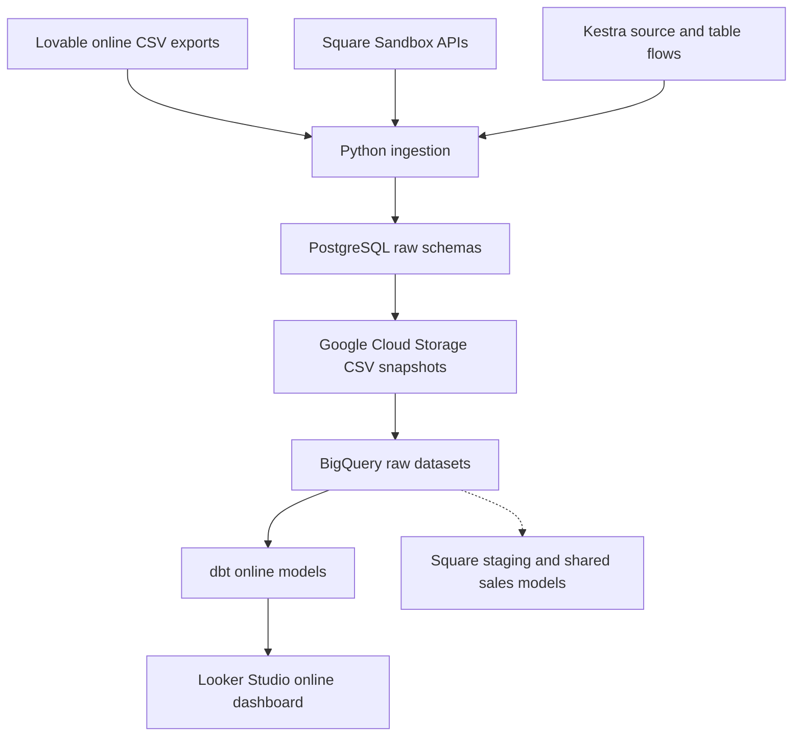

# 🍫 Charlie's Chocolate Factory — Omnichannel Retail Data Platform

**A data engineering portfolio project for retail and e-commerce analytics**

Charlie's Chocolate Factory is a fictional Canadian chocolate retailer with a Lovable online store, a POS simulator, and a shared product catalog. The project uses Python, PostgreSQL, and Kestra to bring online CSV exports and Square Sandbox data into BigQuery. dbt transforms warehouse data for analysis, and Looker Studio presents the first online sales reports.

**Current milestone (November 20, 2026):** Both source feeds have reached BigQuery. The online analytics demo has a verified dbt staging model, a product sales mart, and Looker Studio views for orders and product performance. Square POS data has been loaded and profiled. The next milestone is to validate completed POS sales and bring both channels into shared reporting models.

[Explore the online sales dashboard](https://datastudio.google.com/s/mVx1mF2GxU4) · [GitHub repository](https://github.com/smmhk/chocolate-commerce-data-platform)
[🌐 Explore the Project](https://chocolate-commerce-v0-1-en.vercel.app/) · [📊 Explore the Online Sales Dashboard](https://datastudio.google.com/s/mVx1mF2GxU4)

This independent project uses synthetic data and Square Developer Sandbox. It draws inspiration from omnichannel chocolate retailers such as Purdys Chocolatier and has no affiliation with them.

## 🏗️ Architecture



The Lovable POS simulator generates synthetic retail records. Python prepares Square payloads and preserves mappings for products, stores, customers, and orders. The analytics pipeline reads retail orders from Square and online orders from CSV exports. The planned shared sales models use one source per channel to avoid counting a retail order twice.

| Source channel | Analytics feed | Warehouse dataset |
|---|---|---|
| `ONLINE` | Lovable CSV exports filtered to online orders and related records | `raw_online` |
| `RETAIL` (POS) | Square Sandbox Catalog, Customers, Locations, and Orders APIs | `raw_square` |

The simulated store network includes Downtown Vancouver (`VAN001`), Burnaby (`BUR001`), and Richmond (`RIC001`). The Square Locations snapshot contains five records, and the sampled orders reference three distinct location IDs.

## 📍 Project status

| Phase | Verified progress | Next checkpoint |
|---|---|---|
| Source simulation | Online storefront and POS simulator; Square catalog, location, customer, and order integration | Generate and verify completed synthetic POS orders for the three stores |
| Local storage | Online CSV and Square API ingestion into separate PostgreSQL schemas | Improve recovery and cross-channel customer coverage |
| Orchestration | Kestra table flows and separate parent flows for Online and Square | Strengthen rerun checks and operational logging |
| Cloud ingestion | PostgreSQL → GCS → BigQuery loads for five Online and four Square tables | Revalidate counts and keys after the next POS refresh |
| dbt modeling | BigQuery connection and `stg_online_orders` verified; online product sales mart used by the dashboard | Test Online and Square staging; build shared order, line-item, and customer models |
| Reporting | Looker Studio online order and product views | Reconcile completed POS sales and validate channel and store comparisons |

Project tracking: [Kestra orchestration](https://smmhk21.atlassian.net/browse/CHOC-20) · [dbt analytics](https://smmhk21.atlassian.net/browse/CHOC-22) · [Pipeline refactoring](https://smmhk21.atlassian.net/browse/CHOC-28)

## 📊 Online analytics demo

The dashboard uses synthetic online data to show order counts, order amounts, monthly trends, top products by units sold, and units sold by category. The product view uses the BigQuery mart `mart_online_product_sales`.

One walkthrough example uses storefront order `CCF-WEB-000014`. The BigQuery result shows the order as `COMPLETED` with an order total of **CAD 80.72**. A separate dbt query result illustrates product quantities for **September 8, 2026**. The order total is an order-level measure. Units sold are aggregated from product lines.

The next reporting questions are how completed sales and average order value compare by channel, which stores and products perform best, and how identified customers shop across channels.

## 🔎 Warehouse snapshot and data quality

The following counts come from BigQuery profiling on **November 15, 2026**. Counts can change when synthetic data is refreshed.

| Online table | Rows | Square table | Rows |
|---|---:|---|---:|
| `orders` | 600 | `orders` | 19 |
| `order_items` | 1,544 | `catalog_objects` | 15 |
| `products` | 15 | `customers` | 175 |
| `customers` | 88 | `locations` | 5 |
| `customer_addresses` | 88 | | |

- **Online join keys.** All 1,544 online line items matched orders through the business `order_id` and products through `product_id`. All 88 address rows matched their customer by `customers.id`.
- **Square line-item grain.** All 47 sampled lines matched a nested Catalog Item Variation ID. The pair `(square_order_id, line_item_uid)` was unique across those lines.
- **Customer identity.** Of the 600 online orders, 278 matched the online customer table directly, 262 referenced a registered customer ID missing from that table, and 60 were guest orders. The 262 orders referenced 78 distinct IDs, all found in Square customer `reference_id`. The planned `unified_customer_id` model uses explicit source IDs and preserves guest and unresolved orders in order-level reporting.
- **POS sales eligibility.** All 19 sampled Square orders were `OPEN`, so they are excluded from completed sales. The simulated business date requires separate verification before POS sales trends are reported.

Related work: [Customer identity investigation](https://smmhk21.atlassian.net/browse/CHOC-41) · [Customer synchronization follow-up](https://smmhk21.atlassian.net/browse/CHOC-42)

## ⚙️ Pipeline and tooling

| Layer | Tools and implementation |
|---|---|
| Source preparation | Lovable / Supabase, Square Developer Sandbox, Python payload mapping |
| Local ingestion | Python, Pandas, SQLAlchemy, Docker, PostgreSQL |
| Orchestration | Kestra parent and table-level flows for each source |
| Cloud ingestion | Google Cloud Storage CSV snapshots and BigQuery raw tables |
| Transformation | dbt with the BigQuery adapter |
| Reporting | Looker Studio |
| Project tracking | Git, GitHub, Jira |

The online loader replaces each selected table's rows within a PostgreSQL transaction. The raw layer retains source identifiers and records load metadata such as `ingested_at`, `orchestrator`, and `pipeline_run_id` to trace a run. Validation compares GCS CSV snapshots with their BigQuery targets. Profiling in BigQuery checks the keys and relationships needed for dbt modeling.

The Kestra parent flows are `chocolate.online_raw_ingestion` and `chocolate.square_raw_ingestion`. Their child flows handle table-specific export, upload, load, and validation. Source CSV freshness and downstream analytics runs are separate from the raw ingestion run.

## 📁 Repository structure

| Path | Responsibility |
|---|---|
| `src/clients/square/` | Square API client and authentication configuration |
| `src/pipelines/source_to_square/` | Prepare synthetic retail data in Square Sandbox |
| `src/pipelines/ingestion/` | Load Online CSV and Square API data into PostgreSQL |
| `src/pipelines/export/` | Export PostgreSQL snapshots for downstream loading |
| `src/pipelines/validation/` | Compare GCS CSV snapshots with BigQuery tables |
| `src/snapshots/` | Shared snapshot and reconciliation logic |
| `chocolate_dbt/` | dbt project |
| `scripts/`, `tests/` | Inspection scripts and automated checks |
| `data/sample/`, `sql/`, `docs/` | Shareable samples, schema and migrations, and project documentation |

See the [repository structure guide](docs/REPOSITORY_STRUCTURE_KO.md) and [project progress notes](docs/PROJECT_PROGRESS_KO.md) for additional implementation detail.

## ▶️ Reproduce a verified step

For local online ingestion, start the project services with Docker Compose, apply the PostgreSQL schema and migrations, and make the five source CSVs available. Configure database credentials through local environment variables or an untracked `.env` file.

```bash
python -m pip install -r requirements.txt
python -m src.pipelines.ingestion.online.load_tables_to_postgres --tables products
```

This command replaces the current rows in the selected PostgreSQL target. The loader reads all five CSV inputs even when only products are selected.

To verify the first dbt model, use a Python environment with the BigQuery adapter installed, Google Cloud application default credentials, and the local dbt profile for the BigQuery project. The documented development target is `dbt_dev` in `us-east1`.

```bash
python -m pip install dbt-bigquery
gcloud auth application-default login
cd chocolate_dbt
dbt debug
dbt run --select stg_online_orders
```

Keep the Square Sandbox token, database password, and Google Cloud credentials in local configuration. Shareable synthetic samples belong in `data/sample/`.

## 🎯 Release goal

`v1.0.0` is the first release with a reproducible source-to-dashboard run and validated online and POS reporting. The remaining work is to verify completed POS orders and their business dates, finish and test the shared models, reconcile dashboard totals by channel, and document the run. The initial release focuses on orders and product sales. Payment and refund analysis, inventory, and demand forecasting are future extensions.
