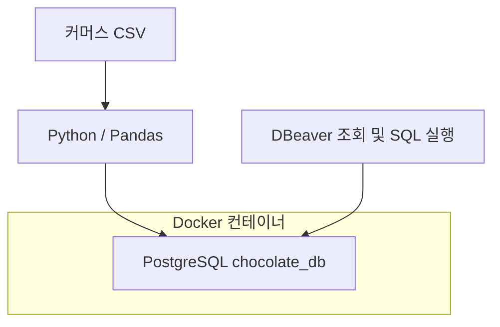
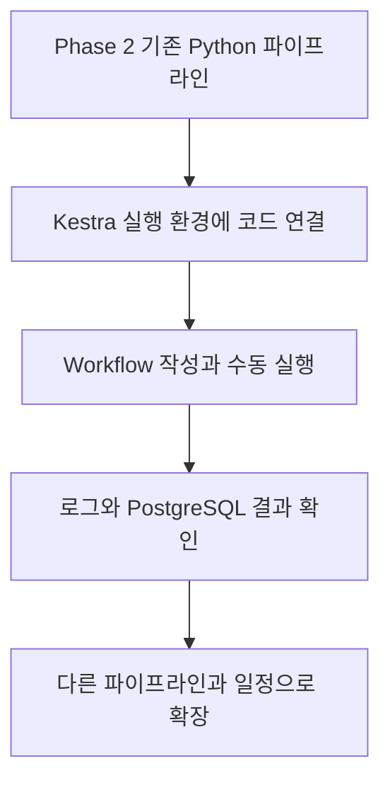
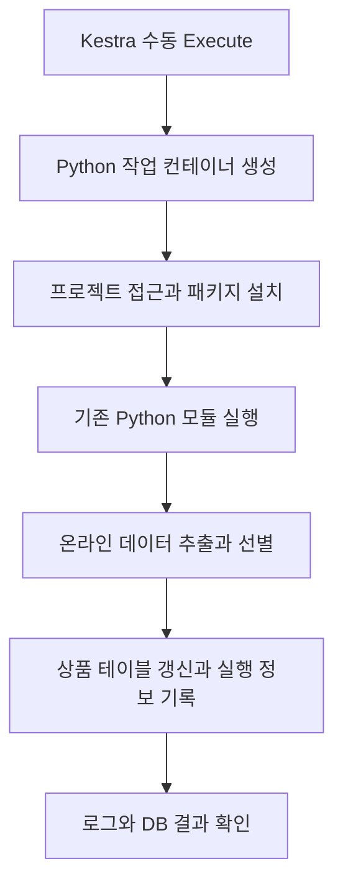

# 📌 프로젝트 진행 로그

이 문서는 **Charlie’s Chocolate Factory — Omnichannel Retail Data Platform Project**의 주요 작업 진행 상황과 다음 작업을 기록합니다.

> 최근 업데이트: 2026-10-30  
> 현재 위치: 기존 온라인 상품 파이프라인을 Kestra에서 수동 실행하고, PostgreSQL 적재와 실행 메타데이터 확인 완료  
> 다음 작업: Kestra inputs로 적재 대상 선택 → 온라인 전체 테이블 검증 → 필요 시 스케줄 추가

---

## 현재 진행 상태

| Phase | 내용 | 상태 |
|---|---|---|
| Phase 1 | Source System Simulation | ✅ 완료 — 기존 진행 기록 기준 |
| Phase 2 | Data Ingestion & Local Storage | ✅ 로컬 적재 완료 — 아래 확인 사항 별도 관리 |
| Phase 3 | Workflow Orchestration with Kestra | 🟡 진행 중 — 온라인 상품 수동 적재와 DB 결과 확인 완료 |
| Phase 4 | Cloud Data Platform | ⬜ 예정 — GCS 및 BigQuery |
| Phase 5 | Data Transformation & Modeling | ⬜ 예정 — 정제·표준화·통합 모델링 |
| Phase 6 | Analytics & BI | ⬜ 예정 — 분석 및 대시보드 |

> Phase 2는 **현재 구현한 온라인·Square 데이터의 로컬 수집과 적재**를 기준으로 완료로 표시합니다. 아래에 남은 검증 및 수집 범위 확인까지 모두 완료했다는 뜻은 아닙니다. GCP 작업은 Phase 4로 분리했습니다. 기존 Phase 3 모델링과 Phase 4 BI는 각각 Phase 5와 6으로 이동했습니다.

### Phase 2 세부 상태

| 작업 | 상태 |
|---|---|
| Docker 기반 로컬 PostgreSQL 환경 구성 및 DBeaver 연결 | ✅ 완료 |
| 온라인 CSV 적재 파이프라인 및 Extract / Transform / Load 역할 분리 | ✅ 완료 |
| `raw_online` 스키마 명시 및 적재 방식 수정 | ✅ 완료 |
| 검증 SQL 작성 | ✅ 완료 |
| 수정 후 전체 검증 SQL 결과 최종 대조 | 🔎 확인할 항목 |
| Square API 데이터 추출 및 `raw_square` 적재 | ✅ 주문 데이터까지 PostgreSQL 적재 확인 |
| Square 상품·매장 데이터별 세부 적재 및 검증 기록 | 🔎 구현 범위와 결과 확인 후 기록 |
| Python 컨테이너 실행 | ✅ Phase 3에서 Docker runner로 실행 확인 — 프로젝트 전용 이미지 제작은 이후 검토 |
| GCP / GCS / BigQuery 환경 및 수집 경로 | ⬜ Phase 4 예정 |

### Phase 3 세부 상태

| 작업 | 상태 |
|---|---|
| Docker Compose에 Kestra와 운영용 PostgreSQL 추가 | ✅ 완료 |
| Kestra UI와 hello 예제 실행 | ✅ `Mandy` 입력 및 SUCCESS 확인 |
| 기존 온라인 파이프라인의 `--tables` 옵션 추가 | ✅ 상품 선택 실행 성공 |
| 패키지 목록과 환경 변수 기반 DB 연결 | ✅ 준비 및 컨테이너 실행 검증 |
| Docker runner 네트워크와 프로젝트 폴더 연결 | ✅ 포트 연결·파일 접근 확인 |
| Kestra에서 온라인 상품 파이프라인 수동 실행 | ✅ `raw_online.products` 15행 적재 성공 |
| 적재 메타데이터 컬럼과 실행 ID 전달 | ✅ 추가 및 사용자 DB 결과 확인 |
| 온라인 전체 5개 테이블의 Kestra 실행 | ⬜ 다음 단계 |
| Square 수집 파이프라인의 Kestra 연결 | ⬜ 예정 |
| 스케줄과 동시 실행 제한 | ⬜ 미설정 — 필요에 따라 검토 |

**완료 범위는 온라인 상품의 Kestra 수동 실행입니다.** 로컬에서 전체 온라인 적재가 성공한 것과 Kestra에서 전체 테이블을 검증한 것은 구분합니다. 현재 온라인 입력은 CSV이며, 웹사이트의 최신 데이터를 자동으로 export하는 기능까지 구현한 것은 아닙니다.

---

# 2026-10-14

## ✅ 완료한 작업

### Phase 1 — Source System Simulation

기존 진행 로그에 기록된 완료 내용입니다.

- Lovable을 이용해 온라인 스토어 구축
- Lovable을 이용해 POS Simulator 구축
- 테스트용 커머스 데이터 생성
- Square Developer Sandbox 환경 구성
- Square API 연동
  - Products → Square Catalog API
  - Customers → Square Customers API
  - Stores → Square Locations API
  - Retail Orders → Square Orders API
- 내부 ID ↔ Square ID Mapping 구현

이 단계의 Square 연동은 **시뮬레이션 데이터를 Square에 등록하는 작업**입니다. 이후 **Square에서 분석용 데이터를 가져오는 작업**과 방향이 다릅니다.

### Phase 2 — Local Data Environment

- Docker Desktop 설치
- Docker Compose를 이용해 PostgreSQL 환경 구성
- 로컬 데이터베이스 `chocolate_db` 생성
- PostgreSQL과 DBeaver 연결
- PostgreSQL 컨테이너에 `localhost:5432`로 접속할 수 있는 환경 확인



Python과 DBeaver는 각각 PostgreSQL에 접속합니다. DBeaver는 데이터 저장 경로의 중간 단계가 아니라, 저장된 데이터를 확인하는 클라이언트입니다.

## 🧠 이번 작업에서 이해한 내용

- Docker는 PostgreSQL을 분리된 실행 환경에서 실행하고 관리하기 위해 사용합니다.
- PostgreSQL은 실제 데이터를 저장하고 조회하는 데이터베이스 관리 시스템입니다.
- DBeaver는 PostgreSQL에 접속해 데이터를 조회하고 SQL을 실행하는 도구입니다.
- Online 데이터와 Square POS 데이터는 각각 수집한 뒤, 나중에 BigQuery에서 통합할 계획입니다.

## ▶️ 당시 계획과 이후 진행

당시에는 상품 CSV를 시작으로 로컬 적재 흐름을 만드는 것이 가장 가까운 목표였습니다. 이후 온라인 데이터 5개에 대한 적재와 리팩토링, Square 데이터의 로컬 적재까지 진행했습니다.

---

# 2026-10-22

> 이전 기록 이후 진행한 온라인 적재 작업과 리팩토링·오류 수정을 함께 정리합니다. 모든 작업이 이날 처음 수행되었다는 의미는 아닙니다.

## ✅ 완료한 작업

### 1. 온라인 CSV → PostgreSQL 적재 구현

다음 원본 파일을 읽어 PostgreSQL의 `raw_online` 스키마에 적재하도록 구현했습니다.

| 원본 CSV | 대상 테이블 | 수집 조건 |
|---|---|---|
| `products_export.csv` | `raw_online.products` | 상품 전체 |
| `customers_export.csv` | `raw_online.customers` | signup_channel이 ONLINE인 고객 |
| `customer_addresses_export.csv` | `raw_online.customer_addresses` | 선별된 고객 ID에 연결된 주소 |
| `orders_export.csv` | `raw_online.orders` | channel이 ONLINE인 주문 |
| `order_items_export.csv` | `raw_online.order_items` | 선별된 주문번호에 연결된 주문상품 |

- 고객 주소 연결: `customers.id = customer_addresses.customer_id`
- 주문상품 연결: `orders.order_id = order_items.order_id`
- 주문상품은 `orders.id`가 아닌 **비즈니스 주문번호인 `orders.order_id`**로 연결합니다.
- 채널 비교 시 앞뒤 공백을 제거하고 대문자로 변환합니다.
- 비교를 위한 문자열 변환은 원본 컬럼 값을 직접 변경하지 않습니다.

현재 고객 수집 기준은 **온라인 가입 여부**, 주문 수집 기준은 **온라인 구매 여부**입니다. 매장에서 가입한 고객이 온라인 주문을 하면 주문은 포함되지만 고객은 제외될 수 있으므로, 향후 고객 통합 설계에서 검토합니다.

### 2. PostgreSQL 테이블 및 검증 SQL 준비

- `raw_online` 스키마와 테이블 구조 정의
- `sql/schema/create_raw_online_tables.sql` 작성·실행
- `sql/validation/validate_online_ingestion.sql` 작성
- 행 수, ID 누락·중복, 채널, 데이터 간 연결 관계를 확인하는 검증 흐름 마련

검증 SQL 작성과 모든 검증 결과 통과는 구분합니다. 수정 후 정확한 행 수 및 전체 검증 결과는 최종 대조할 항목으로 남깁니다.

### 3. 파이프라인 리팩토링

기존 `online_to_postgres.py`에 모여 있던 CSV 읽기와 필터링을 별도 파일로 분리했습니다.

| 파일 | 역할 |
|---|---|
| `src/extract/load_csv.py` | 기존 공통 CSV 읽기 |
| `src/extract/online/load_online_data.py` | 원본 CSV 5개 읽기 |
| `src/transform/online/filter_online_data.py` | 온라인 데이터 및 관련 행 선별 |
| `src/load/postgres/connection.py` | PostgreSQL 연결 엔진 생성 |
| `src/load/postgres/load_table.py` | 테이블 데이터 교체·저장 |
| `src/pipelines/online_to_postgres.py` | 전체 실행 순서 관리 |

- 새 `online` 폴더 두 곳에 빈 `__init__.py` 추가
- 읽기 파일의 위치 변경에 맞춰 프로젝트 루트 경로를 `parents[3]`으로 조정
- 모든 CSV 읽기와 필터링을 마친 뒤 DB 적재 시작
- 상품 → 고객 → 고객 주소 → 주문 → 주문상품 순서로 적재
- 작업 종료 시 `engine.dispose()`로 연결 풀 정리

```python
source_data = load_online_data()
online_data = filter_online_data(source_data)
# online_data의 각 DataFrame을 PostgreSQL에 적재
```

### 4. raw_online 저장 위치 문제 해결

**증상:** 성공 로그는 출력됐지만 DBeaver에서 확인한 `raw_online` 테이블에 데이터가 보이지 않았습니다.

**코드에서 확인한 문제:** 기존 `df.to_sql()`에 `schema`가 지정되지 않아 연결의 기본 스키마를 사용하고 있었습니다. 기본 스키마는 보통 `public`이지만, 최초 데이터의 실제 위치는 공유된 조회 결과가 없어 확정하지 않습니다.

**수정:**

- `schema="raw_online"` 명시
- 기존 `if_exists="replace"` 방식 변경
- 테이블 구조를 유지하도록 **DELETE + APPEND** 적용
- 동일한 연결의 `engine.begin()` 안에서 삭제와 삽입 실행
- 정상 종료 시 커밋, 오류 시 해당 테이블 변경 롤백
- 허용된 테이블 이름만 받도록 제한

수정 후 DBeaver에서 `raw_online`에 데이터가 적재된 것으로 확인했습니다. 현재 구현은 **TRUNCATE + APPEND가 아니라 DELETE + APPEND**입니다.

### 5. 적재 방식의 현재 범위

| 항목 | 현재 동작 |
|---|---|
| 적재 유형 | 대상 테이블 데이터를 전체 교체하는 Full Refresh |
| 테이블 구조 | 유지 |
| 재실행 | 이전 실행 결과 위에 데이터를 계속 누적하지 않음 |
| 원본 중복 | 자동 제거하지 않음 |
| 트랜잭션 | 테이블 하나의 DELETE + INSERT 단위 |
| 이력 보존 | PostgreSQL에 이전 적재 버전을 누적하지 않음 |

다섯 테이블 전체가 하나의 트랜잭션은 아닙니다. 뒤쪽 테이블에서 실패해도 앞서 커밋된 테이블은 유지됩니다. 외래 키를 적용할 때는 삭제·삽입 순서와 전체 트랜잭션 범위를 함께 검토해야 합니다.

## 📊 공유된 실행 결과

```powershell
python -m src.pipelines.online_to_postgres
```

리팩토링한 파이프라인에서 `[START]`부터 `[DONE]`까지 오류 없이 실행되는 로그를 확인했습니다.

| 데이터 | CSV에서 읽은 행 수 | 필터링 후 행 수 | 적재 로그의 행 수 |
|---|---:|---:|---:|
| Products | 15 | 15 | 15 |
| Customers | 20 | 10 | 10 |
| Customer Addresses | 20 | 10 | 10 |
| Orders | 36 | 14 | 14 |
| Order Items | 92 | 37 | 37 |

위 값은 공유된 실행 로그 기준입니다. 이후 스키마 수정 후 `raw_online` 적재를 확인했으며, 실제 테이블별 COUNT 결과는 아래 SQL로 최종 대조합니다. 원본 CSV가 달라지면 예상 행 수도 달라집니다.

```sql
SELECT 'products' AS table_name, COUNT(*) AS row_count
FROM raw_online.products
UNION ALL
SELECT 'customers', COUNT(*) FROM raw_online.customers
UNION ALL
SELECT 'customer_addresses', COUNT(*) FROM raw_online.customer_addresses
UNION ALL
SELECT 'orders', COUNT(*) FROM raw_online.orders
UNION ALL
SELECT 'order_items', COUNT(*) FROM raw_online.order_items;
```

`[SUCCESS]`와 `[LOAD]`는 적재 함수와 파이프라인이 각각 출력한 로그입니다. 두 줄이 보이는 것 자체가 중복 적재를 뜻하지 않습니다.

## 🧠 이번 작업에서 이해한 내용

- **Extract**: CSV를 읽어서 DataFrame으로 가져옵니다.
- **Transform**: 온라인 데이터와 관련된 행을 선별합니다.
- **Load**: PostgreSQL 테이블에 저장합니다.
- DataFrame은 Python 메모리의 표이며, DB에 저장하려면 별도의 적재 작업이 필요합니다.
- Database, Schema, Table은 서로 다른 계층입니다.
- `schema`를 생략하면 의도한 `raw_online`에 저장된다고 보장할 수 없습니다.
- `replace`는 테이블 자체를 다시 만들지만, DELETE 후 append는 기존 구조를 유지합니다.
- 리팩토링은 기존 필터 조건을 유지하면서 코드의 역할을 명확히 나누는 작업입니다.
- 성공 로그 외에도 **실제 DB·스키마·행 수·관계**를 확인해야 합니다.
- 현재 `raw_online`은 수집 범위를 필터링한 데이터이며, 모든 원본과 변경 이력을 그대로 보존하는 저장소는 아닙니다.

---

# 이후 진행 — Square API → PostgreSQL

> 기존 로그의 다음 작업이었던 Square 데이터 조회 및 적재를 이후 진행했습니다. 각 작업의 정확한 수행 날짜와 모든 테이블별 검증 결과는 이 기록에서 확정하지 않습니다.

## ✅ 진행한 작업

- Square API를 이용해 상품, 고객, 매장, 주문 데이터를 조회하며 응답 구조 확인
- Square 고객 데이터의 PostgreSQL `raw_square` 적재 및 upsert 구현
- Square 주문 데이터를 PostgreSQL에 저장하고 적재 확인
- Square 매장 정보의 저장 방법 검토 및 작업 진행

Square 상품과 매장 데이터의 **최종 테이블별 적재·검증 여부는 실제 코드와 DB 결과를 확인한 뒤 상세 기록**합니다. 주문 데이터가 저장된 사실만으로 모든 Square 테이블의 검증이 끝났다고 가정하지 않습니다.

### 공유된 Square 조회 결과

| 조회 대상 | 공유된 결과 |
|---|---|
| Catalog | 상품 15개 |
| Customers | 고객 20명 |
| Locations | ACTIVE 매장 5개 |
| Orders | 3개 매장에서 총 19개 조회 |

이 수치는 당시 Sandbox 조회 기준이며, 이후 데이터가 변경되면 달라질 수 있습니다. Square에 시뮬레이션 데이터를 **등록**했던 Phase 1과 Square에서 데이터를 **가져와 저장**한 Phase 2는 방향이 다릅니다.

---

# 2026-10-26 — Kestra 환경 및 학습

## ✅ 완료 및 진행 중인 작업

- Docker Compose에 Kestra 서비스 추가
- Kestra 실행 및 UI 접속 확인
- DE Zoomcamp 강의를 통해 Kestra 기본 개념 학습 중
- Workflow, task, execution, input, variable, output, trigger, concurrency의 역할 이해
- 강의의 예제 workflow는 Kestra 실행만으로 자동 생성되지 않고, 예제 YAML을 가져와 별도로 생성한다는 점 확인

**2026-10-26 당시에는** Kestra 환경과 개념 학습 단계였습니다. 이후 10월 29~30일에 기존 Python 파이프라인의 연결과 상품 수동 적재를 완료했으며, 상세 내용은 아래에 추가했습니다.

## 🧠 Phase 3의 목표

Phase 2에서 구현한 데이터 수집 파이프라인을 Kestra에서 실행하고 관리할 수 있도록 구성합니다. 우선 하나를 수동으로 실행하고 로그 및 DB 결과를 확인한 다음, 필요에 따라 다른 파이프라인과 자동 실행으로 확장합니다.



- `docker-compose.yaml`: Kestra와 PostgreSQL 같은 서비스를 실행하기 위한 설정
- **Kestra workflow YAML**: Kestra가 어떤 task를 어떻게 실행할지 정의하는 설정
- Kestra가 컨테이너에서 실행되므로, Python 코드와 패키지·설정·DB 연결에 실제 실행 환경이 접근할 수 있도록 별도 구성이 필요합니다.
- Kestra는 실행 상태와 로그를 확인하는 데 도움을 줍니다. 세부 데이터 건수 등은 코드나 task가 해당 정보를 기록해야 확인할 수 있습니다.
- 자동 실행은 workflow 저장만으로 시작되지 않습니다. Schedule trigger를 설정·활성화하고 Kestra가 실행 중이어야 합니다.

---

# 2026-10-29~30 — 기존 Python 파이프라인의 Kestra 연결

## ✅ 1. 실행할 경로와 모듈 확정

처음 적용 대상은 **온라인 상품 CSV → PostgreSQL `raw_online.products`**로 정했습니다.

| 구분 | 목적 |
|---|---|
| CSV → Square 등록용 JSON 및 API 전송 | Phase 1 원천 시스템 시뮬레이션 |
| Square Catalog 조회 | Square 상품 응답 구조 확인 |
| 온라인 CSV → `raw_online` | 이번 Kestra 적재 실습 경로 |

상품 전용 Python 파일을 추가하는 대신 기존 `src/pipelines/online_to_postgres.py`에 `argparse` 기반 `--tables` 옵션을 추가했습니다.

```bash
# 전체 온라인 테이블
python -m src.pipelines.online_to_postgres

# 상품만 선택
python -m src.pipelines.online_to_postgres --tables products
```

현재 `load_online_data()`와 `filter_online_data()`는 기존대로 CSV 5개를 읽고 선별합니다. **선택 옵션은 DB 적재 범위만 제한**하므로 상품만 선택해도 다른 데이터의 EXTRACT·TRANSFORM 로그가 나오는 것이 정상입니다. 적재 순서는 기존 `LOAD_ORDER`를 유지합니다.

로컬에서 상품 15행 적재가 성공한 뒤 동일 명령을 Kestra에 연결했습니다.

## ✅ 2. Python 실행 환경 준비

프로젝트 루트에 `requirements.txt`를 추가하고 로컬 성공 환경에 맞췄습니다.

```text
pandas==3.0.5
SQLAlchemy==2.1.4
psycopg2-binary==2.9.13
python-dotenv==1.2.3
```

Kestra 작업 이미지로 `python:3.14.0-slim`을 사용했습니다. Windows `.venv`와 작업 컨테이너는 별도 환경이므로 컨테이너에서 패키지를 설치합니다. 실제 Linux 컨테이너 설치와 실행이 성공했습니다.

`src/load/postgres/connection.py`는 고정 접속 정보를 환경 변수로 읽도록 변경했습니다. `.env` 로딩과 SQLAlchemy `URL.create()`를 사용합니다.

| 실행 위치 | DB 호스트 |
|---|---|
| Windows에서 직접 실행 | `localhost` |
| 프로젝트 네트워크의 Python 작업 컨테이너 | `postgres` |

현재 `.env`는 읽기 전용으로 연결된 프로젝트 폴더에서 읽습니다. Kestra가 전달한 환경 변수는 기본 `load_dotenv()`에 의해 덮어써지지 않습니다. 비밀번호는 문서나 Git에 기록하지 않습니다.

## ✅ 3. Docker runner 네트워크와 폴더 연결

확인한 서비스 구성:

| 서비스 | 이미지 | 역할 |
|---|---|---|
| `postgres` | `postgres:18` | 초콜릿 DB 운영 |
| `kestra_postgres` | `postgres:18` | Kestra 운영용 DB |
| `kestra` | `kestra/kestra:v1.1` | UI와 실행 관리 |

Windows에서는 Docker Desktop 엔진을 먼저 실행합니다. `docker compose up -d`는 엔진을 시작하는 명령이 아니라 프로젝트 컨테이너를 생성하거나 시작하는 명령입니다.

프로젝트 네트워크는 `docker network ls`로 확인했습니다.

```text
chocolate-commerce-data-platform_default
```

Docker 작업 컨테이너의 폴더 연결을 허용하도록 Compose의 `KESTRA_CONFIGURATION` 문자열 내부, 기존 `kestra:` 아래에 설정을 추가했습니다.

```yaml
kestra:
  plugins:
    configurations:
      - type: io.kestra.plugin.scripts.runner.docker.Docker
        values:
          volume-enabled: true
```

위 내용은 내부 설정 발췌입니다. Compose의 `services.kestra` 바로 아래에 넣지 않으며, 중복 `server:` 설정도 제거했습니다.

```bash
docker compose config --quiet
docker compose up -d kestra
```

작업 runner는 프로젝트 네트워크를 사용하고, 프로젝트 폴더를 `/project`에 읽기 전용으로 연결합니다. 처음의 Windows `C:/...` 형식은 docker-java Bind 파싱 오류가 발생해 다음 Linux 측 경로로 수정했습니다.

```yaml
taskRunner:
  type: io.kestra.plugin.scripts.runner.docker.Docker
  networkMode: chocolate-commerce-data-platform_default
  volumes:
    - "/run/desktop/mnt/host/c/Users/smmhk/PycharmProjects/chocolate-commerce-data-platform:/project:ro"
```

이 경로는 현재 Docker Desktop 환경에서 성공한 값입니다. 프로젝트 폴더의 읽기 전용 설정은 PostgreSQL에 네트워크로 데이터를 쓰는 것을 막지 않습니다.

## ✅ 4. 사전 검사 후 실제 상품 적재 성공

`check_python_environment` flow로 다음을 순차 확인했습니다.

| 검사 | 확인 결과 |
|---|---|
| Python 실행 | Python 3.14.0 실행 성공 |
| 네트워크 | `postgres:5432` TCP 연결 성공 |
| 파일 접근 | Python 모듈·상품 CSV·requirements.txt 존재 확인 |

이후 실제 적재용 flow인 `online_products_to_postgres`를 실행했습니다.

- task: `io.kestra.plugin.scripts.python.Commands`
- namespace: `chocolate`
- 준비 명령: `pip install -r /project/requirements.txt`
- 실행 명령: `cd /project && python -m src.pipelines.online_to_postgres --tables products`

2026-10-30 첫 적재 성공 로그의 핵심 결과:

```text
[INFO] Tables to load: products
[SUCCESS] raw_online.products loaded (15 rows)
[LOAD] products rows: 15
[DONE] Online → PostgreSQL ingestion
Command succeed with exit code 0
```

당시 전체 실행은 약 24초였으며 상당 부분은 패키지 설치에 사용됐습니다. 임시 작업 컨테이너는 종료 후 정리됐고, 초콜릿 DB와 Kestra 서비스는 유지됐습니다.



## ✅ 5. 적재 메타데이터와 실행 추적 추가

동일한 CSV를 로컬과 Kestra에서 실행하면 행 수와 상품 내용이 같아 실행 주체를 구분하기 어려웠습니다. 원본 `updated_at`은 상품 수정일이므로 재적재 시각으로 바뀌지 않습니다.

이를 구분하려고 `raw_online`의 5개 테이블에 다음 컬럼을 추가했습니다.

| 컬럼 | 타입 | 의미 |
|---|---|---|
| `ingested_at` | `TIMESTAMPTZ` | 적재 실행에서 생성한 UTC 시각 |
| `orchestrator` | `VARCHAR(50)` | 실행 경로 `local` 또는 `kestra` |
| `pipeline_run_id` | `VARCHAR(100)` | 로컬 UUID 또는 Kestra execution ID |

- 적용 테이블: products, customers, customer_addresses, orders, order_items
- Python에서 실행당 한 번 생성한 메타데이터를 각 적재 DataFrame의 복사본에 추가
- 로컬 기본값은 `local`, 실행 ID가 없으면 UUID 생성
- Kestra는 아래 환경 변수로 실행 경로와 execution ID 전달

```yaml
env:
  CHOCOLATE_DB_HOST: postgres
  PYTHONDONTWRITEBYTECODE: "1"
  PIPELINE_ORCHESTRATOR: kestra
  PIPELINE_RUN_ID: "{{ execution.id }}"
```

확인 SQL:

```sql
SELECT
    orchestrator,
    pipeline_run_id,
    ingested_at,
    COUNT(*) AS row_count
FROM raw_online.products
GROUP BY orchestrator, pipeline_run_id, ingested_at;
```

**사용자가 온라인 상품의 Kestra 적재 결과를 DB에서도 확인했습니다.** 메타데이터 추가 후 실행 ID와 시각의 실제 값은 별도로 공유되지 않았으므로 임의로 기록하지 않습니다. 다른 4개 테이블은 컬럼 추가와 Kestra 적재 완료를 구분합니다.

현재는 전체 갱신이므로 마지막 적재 정보만 남고, 과거 실행 전체 이력은 보관하지 않습니다. `ingested_at`은 Python에서 메타데이터를 생성한 시각이며 DB 커밋 시각 자체가 아닙니다. 오래된 CSV를 오늘 읽어도 이 값은 갱신되므로 원천 데이터의 최신성은 별도 판단해야 합니다.

## ✅ 6. 스키마 변경과 문서 관리

- DBeaver에서 온라인 5개 테이블의 컬럼 추가 ALTER를 실행했습니다.
- `already exists, skipping`은 `ADD COLUMN IF NOT EXISTS`에 따른 정상 안내입니다.
- 변경 SQL 파일을 `sql/migrations/001_add_ingestion_metadata.sql`로 관리하는 방향을 정했습니다. 이후 공유한 커밋 화면에서 이 파일과 `requirements.txt`가 새 파일로 표시된 것을 확인했습니다. 커밋 완료 여부는 별도 확인이 필요합니다.
- 최초 CREATE와 후속 ALTER를 순서대로 적용하도록 관리합니다. 파일 저장만으로 STG에 자동 실행되지 않으며 마이그레이션 도구는 아직 연결하지 않았습니다.
- Phase 3 상세 문서와 Entity Mapping 문서를 최신 진행 및 메타데이터 의미에 맞춰 업데이트했습니다.

관련 파일:

| 파일 | 변경 또는 역할 |
|---|---|
| `docker-compose.yml` | Kestra Docker runner 볼륨 허용 설정 |
| `requirements.txt` | 컨테이너 패키지 설치 목록 |
| `src/load/postgres/connection.py` | 환경 변수 기반 DB 연결 |
| `src/pipelines/online_to_postgres.py` | 테이블 선택 옵션과 실행 메타데이터 |
| `sql/migrations/001_add_ingestion_metadata.sql` | 적재 메타데이터 컬럼 추가 |
| `docs/phase-3-kestra-orchestration-ko.md` | Phase 3 상세 과정과 현재 workflow 설정 |
| Entity Mapping 문서 | 원천·Square 매핑과 분석용 적재 메타데이터 구분 |

실제 workflow는 Kestra UI에 저장되어 있습니다. 프로젝트의 YAML 파일로도 저장했는지는 아직 확인하지 않았습니다.

## 🧠 이번 작업에서 이해한 내용

- Kestra가 기존 Python 로직을 실행하고, Python이 실제 데이터 읽기와 DB 적재를 수행합니다.
- 코드 접근, 패키지 설치, 네트워크 연결, DB 인증은 서로 다른 준비·검증 항목입니다.
- 포트 연결 성공과 파일 존재 확인만으로 DB 적재 성공을 판단하지 않습니다.
- 같은 데이터를 재적재하면 행 수가 같으므로 실행 ID와 적재 시각이 추적에 도움이 됩니다.
- `ingested_at`은 원천 `updated_at`이나 `square_synced_at`과 의미가 다릅니다.
- 프로젝트 폴더를 읽기 전용으로 연결해도 DB 저장은 가능합니다.
- 이번 실행은 수동 실행이며, 스케줄 자동화와 최신 CSV 생성 자동화는 아직 별도 작업입니다.

---

## ▶️ 다음 작업

### Phase 3 — Kestra

- [ ] Kestra inputs로 적재 대상 테이블을 선택하도록 workflow 확장
- [ ] 온라인 전체 5개 테이블의 Kestra 적재와 메타데이터 검증
- [ ] 실제 workflow YAML을 프로젝트 파일로 저장하고 Git에서 관리
- [ ] 변경 코드·SQL·requirements·문서의 커밋 완료 여부 확인
- [ ] Square 수집 파이프라인의 Kestra 연결
- [ ] 필요에 따라 schedule trigger와 동시 실행 제한 설정
- [ ] 패키지를 미리 포함한 프로젝트 Docker 이미지의 필요성 검토
- [ ] 필요에 따라 Secret 전달, 빈 CSV 보호, 별도 실행 이력 관리 보완

### 함께 마무리할 확인 사항

- [ ] 수정 후 온라인 전체 테이블의 행 수와 기존 검증 SQL 결과 최종 대조
- [ ] Square 상품·고객·매장·주문 및 주문상품의 실제 테이블별 적재 범위와 검증 결과 기록
- [ ] 온라인 가입 고객과 온라인 구매 고객의 범위 검토
- [ ] 잘못된 스키마에 생성된 테이블이 있는지 확인 후 필요시 별도 정리
- [ ] Stores / Payments의 채널별 원천과 수집 범위 결정

### 이후 단계

- [ ] Phase 4: GCP 프로젝트 및 GCS 환경 구성
- [ ] Phase 4: BigQuery Raw Layer 및 수집 경로 구성
- [ ] Phase 5: 온라인·오프라인 데이터 정제·표준화·통합 모델링
- [ ] Phase 6: Power BI 분석 및 대시보드
- [ ] 클라우드 작업 구현 후 Kestra workflow 확장

## 🎯 현재 가장 가까운 목표

**상품 수동 적재의 성공 구성을 재사용해, Kestra에서 적재할 온라인 테이블을 선택하고 전체 데이터 적재까지 검증합니다.**

| 수집 경로 | 원천 | 로컬 목적지 | 현재 상태 |
|---|---|---|---|
| 온라인 | CSV Export | `raw_online` | 로컬 적재 완료, Kestra 상품 15행 적재 및 DB 확인 완료 |
| 오프라인 | Square Sandbox API | `raw_square` | 주문까지 로컬 적재 확인, Kestra 연결 예정 |

Kestra는 Phase 3에서 도입했으며 이후 GCS·BigQuery 및 모델링 작업에도 확장할 계획입니다. 현재까지의 성공 범위를 전체 파이프라인 자동화나 클라우드 적재 완료로 확대 해석하지 않습니다.
