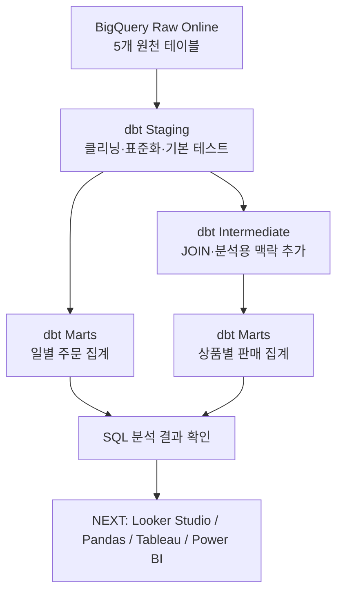

# 🍫 Chocolate Commerce — Online Intermediate & Marts 학습노트

> **기록일:** 2026-11-17  
> **프로젝트:** Charlie's Chocolate Factory / Chocolate Commerce Data Platform  
> **학습 범위:** Online Intermediate 모델링 → Marts → SQL 분석 결과 확인  
> **범위 종료 지점:** **시각화 직전** (Looker Studio/Data Studio, Pandas 그래프, Tableau, Power BI는 아직 시작하지 않음)  
> **환경:** Google BigQuery (`chocolate-data-platform.dbt_dev`), dbt Core 1.13.0-b1 / BigQuery adapter 1.12.3

---

## 0. 이번 학습의 핵심 요약

**데이터 엔지니어가 분석 가능한 데이터를 준비하면, 데이터 분석가는 그 데이터를 이용해 질문에 답한다.** 이번에는 Online 데이터를 활용해 그 흐름 중 **SQL로 분석 결과를 확인하는 부분까지** 진행했다.

- ✅ Online Staging 5개 모델: 통합 `dbt build` **25/25 성공** (View 5개 + 테스트 20개)
- ✅ `int_online_order_items_enriched`: View 1개 + 테스트 4개, **5/5 성공**
- ✅ JOIN 검증: 주문상품 **1,544행 유지**, 누락·중복·검증 컬럼 불일치 **0건**
- ✅ 주문 금액 공식의 *탐색 검증*: **600건 모두 일치**
- ⏸️ 복잡한 `int_online_order_financials` 구현은 **의도적으로 보류**
- ✅ `mart_online_daily_sales`의 전체 집계가 **580건 / CA$48,728.15**로 원천 상태별 집계와 일치
- ✅ `mart_online_product_sales`를 이용해 **베스트셀러 TOP 5와 카테고리별 성과 조회**
- ✅ 월별 완료 주문 분석: **20개 월 데이터**, 합계 **580건 / CA$48,728.15**
- ⏭️ 이후 계획: **Looker Studio(Data Studio) → Pandas EDA → Tableau → Power BI → Square 통합 확대**

> **정확성 메모:** 두 Mart의 BigQuery 조회 결과는 확인했다. 다만 이 대화에서 두 Mart에 대한 **`dbt build` 로그 자체는 공유되지 않았으므로** Mart의 자동 테스트 PASS를 확인했다고 기록하지 않는다. 최종 통합 빌드 로그는 별도로 남기자.

---

## 1. 데이터 계층과 역할 — 다시 구분하기



| 계층 | 이번에 맡은 역할 | 데이터 예시 |
|---|---|---|
| **Raw** | 원천 보존 | `raw_online.orders`, `raw_online.order_items` |
| **Staging** | 타입·문자열 표준화, 기본 품질 검증 | `stg_online_orders`, `stg_online_products` 등 5개 |
| **Intermediate** | 주문·주문상품·상품 JOIN 및 컬럼 보강 | `int_online_order_items_enriched` |
| **Marts** | 분석 질문에 바로 쓸 수 있는 집계 | `mart_online_daily_sales`, `mart_online_product_sales` |
| **Analytics** | 질문 작성, 집계 결과 해석 | 월별 추이, TOP 5, 카테고리 비교 |
| **Visualization** | 그래프/대시보드 제작 | **이번 기록의 범위 밖** |

### 용어 복습

- **Grain**: 테이블의 **한 행이 무엇을 의미하는지**. JOIN/집계 전에 먼저 정의해야 함.
- **`source()`**: BigQuery의 원천 테이블을 dbt Source 정의로 참조.
- **`ref()`**: 다른 dbt 모델을 참조. 모델 간 의존성을 dbt가 파악할 수 있음.
- **`LEFT JOIN`**: 왼쪽 데이터의 행을 우선 보존하면서 다른 테이블의 컬럼을 보강.
- **Data Test**: `unique`, `not_null`, `relationships` 같은 품질 규칙을 자동 확인.
- **Mart**: 분석·보고에 맞춰 사용하기 쉽게 준비한 모델. 꼭 복잡한 Fact/Dimension 구조일 필요는 없음.

---

## 2. 출발점: Online Staging 완료 상태

이전 단계에서 완료된 상태를 이번 학습의 입력으로 사용했다.

| Staging 모델 | 검증된 Raw ↔ Staging 행 수 | 주요 역할 |
|---|---:|---|
| `stg_online_orders` | 600 | 주문 상태·일자·금액 표준화 |
| `stg_online_order_items` | 1,544 | 주문상품 수량·단가·금액 보존 |
| `stg_online_products` | 15 | 상품명·분류·가격 표준화 |
| `stg_online_customers` | 88 | 고객 식별자·기본 정보 표준화 |
| `stg_online_customer_addresses` | 88 | 주소 필드 표준화 |

**통합 실행 결과:** View 5개 + Data Tests 20개 = **25/25 PASS**.

이미 확인한 올바른 참조 관계:

```sql
-- JOIN 시 주의: orders.id / products.id 가 아닌 비즈니스 키 사용
order_items.order_id   = orders.order_id
order_items.product_id = products.product_id
customer_addresses.customer_id = customers.id
```

**데이터 품질 이슈는 별도로 유지:** Online 주문 262건(서로 다른 78개 고객 ID)의 고객 참조가 `stg_online_customers`에 직접 매칭되지 않는다. Square Customers의 `reference_id`에서 78개 고객 ID를 모두 찾았지만, Online만 먼저 분석하는 이번 버전에서는 고객 ID를 임의로 바꾸거나 주문을 삭제하지 않았다.

---

## 3. Intermediate: `int_online_order_items_enriched`

### 3.1 왜 만들었나?

원본 주문상품에는 **무슨 상품을 얼마나 구매했는지**가 있지만, 분석할 때 자주 필요한 **주문 날짜·상태·채널**과 **현재 상품 카탈로그 정보**는 별도 테이블에 있다.

따라서 주문상품을 기준으로 주문·상품 정보를 한 행에서 볼 수 있게 만들었다.

| 항목 | 설계 |
|---|---|
| 파일 | `chocolate_dbt/models/intermediate/int_online_order_items_enriched.sql` |
| Grain | **주문상품 1행 = 결과 1행** |
| 입력 | `stg_online_order_items`, `stg_online_orders`, `stg_online_products` |
| JOIN | `LEFT JOIN` |
| 예상 / 검증 행 수 | 1,544 |
| Materialization | `view` |

### 3.2 SQL 모델

```sql
{{ config(materialized='view') }}

with order_items as (
    select * from {{ ref('stg_online_order_items') }}
),
orders as (
    select * from {{ ref('stg_online_orders') }}
),
products as (
    select * from {{ ref('stg_online_products') }}
),
enriched as (
    select
        oi.source_record_id as order_item_id,
        oi.order_id,
        oi.product_id,
        o.customer_id,

        o.channel,
        o.order_status,
        o.order_date,
        o.order_created_at,
        case
            when o.order_status = 'COMPLETED' then true
            else false
        end as is_completed_order,

        oi.sku,
        oi.product_name as product_name_at_order,
        oi.category as category_at_order,
        p.product_name as current_product_name,
        p.category as current_product_category,

        oi.quantity,
        oi.unit_price,
        oi.discount_amount,
        oi.line_total,
        p.price as current_catalog_price,
        p.active_status as current_product_active
    from order_items oi
    left join orders o
        on oi.order_id = o.order_id
    left join products p
        on oi.product_id = p.product_id
)
select * from enriched
```

**이 코드에서 기억할 것**

1. `oi`를 기준으로 조회하므로 기본 Grain은 주문상품이다.
2. 현재 데이터의 주문/상품 키가 고유하므로, JOIN 결과가 1,544행으로 유지되는지 검증할 수 있다.
3. `product_name_at_order`와 `current_product_name`을 구분했다. **판매 당시 정보와 현재 카탈로그 정보를 섞지 않기 위해서**다.
4. `is_completed_order`는 *현재 주문 상태*가 `COMPLETED`인지를 나타내는 편의 컬럼이다. 결제 정산 여부를 의미하지 않는다.

### 3.3 테스트 및 결과

```powershell
dbt build --select int_online_order_items_enriched
```

- View 생성 성공
- `order_item_id`: `unique`, `not_null` 통과
- `order_id`: `not_null` 통과
- `product_id`: `not_null` 통과
- **총 5/5 성공** (모델 1 + 테스트 4)

이후 `stg_online_order_items`와 Intermediate를 `order_item_id`로 대사한 결과:

| 검증 항목 | 실제 결과 |
|---|---:|
| `staging_rows` | 1,544 |
| `intermediate_rows` | 1,544 |
| `matched_rows` | 1,544 |
| `missing_in_intermediate` | 0 |
| `extra_in_intermediate` | 0 |
| `key_mismatches` | 0 |
| `value_mismatches` | 0 |

**배운 점:** dbt 모델의 생성·키 테스트와 JOIN 이후 행 수·값 보존 검증은 서로 다른 점검이다. 둘 다 확인해야 신뢰도를 높일 수 있다.

---

## 4. 주문 상태와 간단한 금액 검증

### 4.1 먼저 분석 범위를 정의했다

```sql
select
    order_status,
    count(*) as order_count,
    countif(order_completed_at is not null) as orders_with_completed_at,
    sum(total_amount) as total_order_amount
from `chocolate-data-platform.dbt_dev.stg_online_orders`
group by order_status
order by order_count desc;
```

실제 결과:

| 주문 상태 | 주문 건수 | `completed_at` 있음 | 상태별 주문금액 (CAD) |
|---|---:|---:|---:|
| `COMPLETED` | 580 | 580 | 48,728.15 |
| `REFUNDED` | 11 | 10 | 601.21 |
| `CANCELLED` | 9 | 0 | 762.73 |
| **합계** | **600** | **590** | **50,092.09** |

**이번 Online Analytics의 간단한 규칙:**

- 완료 주문 분석은 `order_status = 'COMPLETED'`만 사용한다.
- `REFUNDED` 및 `CANCELLED`는 Raw/Staging에서 **삭제하지 않는다**.
- 분석 금액 명칭은 **Completed Order Amount (완료 상태 주문금액)**로 통일한다.
- **최종 순매출(net revenue), 실제 입금액, 환불 차감 금액으로 해석하지 않는다.**
- `completed_at is not null`만으로 매출을 인정하면 환불 주문이 섞일 수 있다.

### 4.2 금융 모델은 만들지 않았지만 원천 계산식을 점검했다

주문 단위로 주문상품을 집계해 **기본 계산 관계가 맞는지** 조회했다.

```sql
with item_totals as (
    select
        order_id,
        count(*) as item_rows,
        sum(quantity * unit_price) as items_gross_amount,
        sum(discount_amount) as items_discount_amount,
        sum(line_total) as items_line_total
    from `chocolate-data-platform.dbt_dev.stg_online_order_items`
    group by order_id
),
order_financials as (
    select
        o.order_id,
        o.subtotal,
        o.discount_amount,
        o.tax_amount,
        o.shipping_amount,
        o.total_amount,
        i.item_rows,
        i.items_gross_amount,
        i.items_line_total,
        (o.subtotal
         - coalesce(o.discount_amount, 0)
         + coalesce(o.tax_amount, 0)
         + coalesce(o.shipping_amount, 0)) as calculated_order_total
    from `chocolate-data-platform.dbt_dev.stg_online_orders` o
    left join item_totals i on o.order_id = i.order_id
)
select
    count(*) as total_orders,
    countif(item_rows is null) as orders_without_items,
    sum(coalesce(item_rows, 0)) as total_item_rows,
    countif(abs(subtotal - items_gross_amount) <= 0.01)
        as subtotal_matches_item_gross,
    countif(abs(subtotal - items_line_total) <= 0.01)
        as subtotal_matches_line_total,
    countif(abs(total_amount - calculated_order_total) <= 0.01)
        as order_total_matches_formula,
    countif(
        subtotal is null or total_amount is null
        or items_gross_amount is null or items_line_total is null
    ) as orders_missing_key_amounts
from order_financials;
```

| 검증 | 결과 |
|---|---:|
| 전체 주문 | 600 |
| 주문상품 없는 주문 | 0 |
| 연결된 주문상품 행 | 1,544 |
| `subtotal = SUM(quantity × unit_price)` | 600/600 |
| `subtotal = SUM(line_total)` | 600/600 |
| `total = subtotal - order_discount + tax + shipping` | 600/600 |
| 주요 금액 누락 주문 | 0 |

**의사결정:** `int_online_order_financials`는 이 단계에서는 **보류**. 단순한 분석 학습이 우선이므로, 추가 금융 로직 없이 이미 검증된 주문 금액을 Marts에서 사용한다. 테스트 데이터를 기반으로 확인한 계산식이므로 다른 데이터에도 항상 성립한다고 가정하지 않는다.

---

## 5. Marts: 분석에 사용할 집계 테이블 2개

### 5.1 `mart_online_daily_sales`

**비즈니스 질문:** *날짜별로 완료된 주문은 몇 건이고, 주문금액은 얼마인가?*

- 소스: `stg_online_orders`
- Grain: **주문 생성일(밴쿠버 시간) 1일당 1행**
- 지표: `total_orders`, `total_order_amount_cad`
- `order_date`: **주문 완료일이 아니라 생성일**

```sql
{{ config(materialized='view') }}

select
    order_date,
    count(*) as total_orders,
    sum(total_amount) as total_order_amount_cad
from {{ ref('stg_online_orders') }}
where order_status = 'COMPLETED'
group by order_date
```

실제 Mart 조회 검증:

```sql
select
    sum(total_orders) as completed_orders,
    sum(total_order_amount_cad) as completed_order_amount_cad
from `chocolate-data-platform.dbt_dev.mart_online_daily_sales`;
```

| `completed_orders` | `completed_order_amount_cad` |
|---:|---:|
| **580** | **48,728.15** |

→ 앞서 주문 상태별 집계에서 확인한 `COMPLETED` 580건, CA$48,728.15와 일치.

### 5.2 `mart_online_product_sales`

**비즈니스 질문:** *어떤 상품이 가장 많이 팔렸고, 어떤 상품의 주문상품 금액이 높은가?*

- 소스: `int_online_order_items_enriched`
- Grain: **상품(`product_id`) 1개당 1행**
- 분석 범위: `COMPLETED` 주문의 주문상품만 포함
- 지표: `units_sold`, `order_count`, `item_amount_cad`

```sql
{{ config(materialized='view') }}

select
    product_id,
    max(product_name_at_order) as product_name,
    max(category_at_order) as category,
    sum(quantity) as units_sold,
    count(distinct order_id) as order_count,
    sum(line_total) as item_amount_cad
from {{ ref('int_online_order_items_enriched') }}
where is_completed_order = true
group by product_id
```

**주의할 점:** `MAX(product_name_at_order)`는 상품 ID 내 이름이 여러 개일 때 대표 문자열 하나를 선택하는 *단순화*다. 실제로 상품명 변경 이력을 추적하려면 별도 검증·모델링이 필요하다.

**또 다른 주의:** `item_amount_cad = SUM(line_total)`은 주문상품 금액의 합계다. 주문 전체 할인·세금·배송비가 반영된 `total_amount`와 동일하다고 가정하면 안 된다.

---

## 6. SQL로 확인한 실제 분석 결과 (시각화 이전)

### 6.1 분석 질문 A — 베스트셀러 TOP 5는?

```sql
select
    product_name,
    category,
    units_sold,
    order_count,
    item_amount_cad
from `chocolate-data-platform.dbt_dev.mart_online_product_sales`
order by units_sold desc
limit 5;
```

| 상품명 | 카테고리 | 판매 수량 | 포함 주문 수 | 주문상품 금액 (CAD) |
|---|---|---:|---:|---:|
| Midnight Dark Chocolate Bar | Chocolate Bars | **221** | 126 | 1,602.25 |
| Raspberry Truffle Collection | Truffles | 190 | 116 | **3,629.34** |
| Cookies & Cream Bar | Chocolate Bars | 182 | 105 | 1,264.90 |
| Golden Caramel Crunch | Chocolate Bars | 181 | 105 | 1,405.35 |
| Strawberry Chocolate Hearts | Seasonal | 181 | 110 | 2,805.50 |

**해석:** 수량 기준 1위는 Midnight Dark Chocolate Bar이지만, 이 TOP 5 안에서 금액이 가장 큰 상품은 Raspberry Truffle Collection이다. **많이 팔린 상품 = 금액이 가장 높은 상품**은 아니다.

### 6.2 분석 질문 B — 월별 완료 주문 추이는?

Daily Mart를 월 단위로 다시 묶어 조회했다.

```sql
select
    format_date('%Y-%m', order_date) as order_month,
    sum(total_orders) as completed_orders,
    round(sum(total_order_amount_cad), 2)
        as completed_order_amount_cad
from `chocolate-data-platform.dbt_dev.mart_online_daily_sales`
group by order_month
order by order_month;
```

| 월 | 완료 주문 | 주문금액 (CAD) |
|---|---:|---:|
| 2025-02 | 49 | 4,383.35 |
| 2025-04 | 6 | 696.24 |
| 2025-05 | 7 | 317.54 |
| 2025-06 | 11 | 733.76 |
| 2025-07 | 17 | 1,700.72 |
| 2025-08 | 13 | 910.09 |
| 2025-09 | 24 | 2,214.84 |
| 2025-10 | 18 | 1,763.76 |
| 2025-11 | 15 | 1,216.94 |
| 2025-12 | **121** | **9,265.54** |
| 2026-01 | 8 | 1,015.49 |
| 2026-02 | 60 | 5,174.94 |
| 2026-03 | 11 | 853.90 |
| 2026-04 | 73 | 6,283.09 |
| 2026-05 | 9 | 835.67 |
| 2026-06 | 17 | 1,581.02 |
| 2026-07 | 24 | 2,244.95 |
| 2026-08 | 21 | 1,437.78 |
| 2026-09 | 35 | 2,391.54 |
| 2026-10 | 41 | 3,706.99 |
| **합계** | **580** | **48,728.15** |

**해석:** 2025년 12월이 완료 주문 건수와 완료 주문금액 모두 1위다. 다음으로 2026년 4월과 2026년 2월의 주문금액이 높다.

**주의:** 2025년 3월이 결과에 없는 것은 현재 쿼리에서 해당 월에 `COMPLETED` 주문 행이 없기 때문이다. 대시보드에서 빈 달을 0으로 채우려면 날짜 테이블 등 추가 처리가 필요하다. 합성 테스트 데이터이므로 12월 급증을 실제 계절성·프로모션의 인과 효과라고 단정하지 않는다.

### 6.3 분석 질문 C — 카테고리별 판매량과 금액은?

```sql
select
    category,
    count(*) as product_count,
    sum(units_sold) as total_units_sold,
    round(sum(item_amount_cad), 2) as total_item_amount_cad
from `chocolate-data-platform.dbt_dev.mart_online_product_sales`
group by category
order by total_units_sold desc;
```

| 카테고리 | 판매된 상품 종류 | 판매 수량 | 주문상품 금액 (CAD) |
|---|---:|---:|---:|
| Chocolate Bars | 7 | **1,191** | 8,978.94 |
| Truffles | 4 | 665 | 12,504.59 |
| Seasonal | 2 | 335 | 9,107.60 |
| Gift Boxes | 2 | 332 | **13,668.00** |
| **합계** | **15** | **2,523** | **44,259.13** |

**해석:**

- **판매 수량 1위:** Chocolate Bars — 1,191개 (전체 2,523개의 약 47.2%).
- **주문상품 금액 1위:** Gift Boxes — CA$13,668.00 (판매 수량은 네 카테고리 중 가장 적음).
- 수량 중심 지표와 금액 중심 지표는 서로 다른 비즈니스 질문에 답한다.
- 주문상품 금액 **CA$44,259.13**과 완료 주문금액 **CA$48,728.15**는 지표 정의가 다르다. 주문 수준 할인, 세금, 배송비 등이 주문 총액에 반영되므로 **두 수치를 무조건 같게 만들지 않는다**.

---

## 7. 이번에 배운 SQL·dbt 개념 총정리

| 개념 | 학습한 내용 |
|---|---|
| `ref()` | dbt 모델 참조 및 의존성 관리 |
| `LEFT JOIN` | 주문상품 원천 행 보존하면서 주문·상품 정보 결합 |
| `CASE WHEN` | `COMPLETED` 주문 플래그 생성 |
| `GROUP BY` | 주문별 / 일별 / 상품별 / 카테고리별 집계 |
| `COUNT(*)` | 행/주문 건수 세기 |
| `COUNT(DISTINCT order_id)` | 특정 상품을 포함한 고유 주문 수 |
| `SUM(quantity)` | 판매 상품 개수 합계 |
| `SUM(line_total)` | 주문상품 금액 합계 |
| `SUM(total_amount)` | 주문 수준 완료 상태 주문금액 합계 |
| `FORMAT_DATE('%Y-%m', order_date)` | 날짜를 월 단위 문자열로 표시 |
| `MAX(product_name_at_order)` | 단순 대표 문자열 선택. 변경 이력에는 부적합할 수 있음 |
| `unique`, `not_null` | 키의 중복·누락 여부 자동 검증 |
| Raw/Staging/Intermediate 대사 | 모델 생성 성공과 별개로 행·값 보존 검증 |

### Grain이 헷갈릴 때는 이렇게 기억

| 모델 | **한 행**은 무엇인가? |
|---|---|
| `stg_online_orders` | 주문 1건 |
| `stg_online_order_items` | 주문상품 1줄 |
| `int_online_order_items_enriched` | 정보가 보강된 주문상품 1줄 |
| `mart_online_daily_sales` | 완료 주문의 **주문 생성일** 1일 |
| `mart_online_product_sales` | 상품 ID 1개 |

→ **같은 주문 데이터를 사용해도 Grain이 다르면 합계와 의미가 달라질 수 있다.**

---

## 8. 실제 작업에서 판단한 범위와 보류 사항

### 이번 버전에 의도적으로 포함하지 않은 것

- ⏸️ `int_online_order_financials`: 주문별 재계산 플래그, 세부 금융 검증 자동화
- ⏸️ 결제 처리/환불 차감/정산된 순매출 분석 (Payments는 v1.0 범위 밖)
- ⏸️ Online + Square 고객 통합, 재구매율 등 고객 식별 의존 분석
- ⏸️ POS 포함 채널별 매출 비교
- ⏸️ BI 시각화와 Python 그래프 생성

**왜 단순화했는가?** 이번 학습 목표는 `Staging → Intermediate → Marts → SQL 분석` 흐름을 익히는 것이므로, 이미 기본 금액 정합성이 확인된 테스트 데이터에 복잡한 회계 모델을 추가하지 않기로 결정했다.

### 개발 시 주의 및 추적할 사항

1. **고객 식별 문제:** Online 주문 262건(78개 고유 고객 ID)은 Online 고객 테이블과 직접 연결되지 않는다. Square 고객 식별 매핑은 추후 Intermediate 통합에서 다룬다.
2. **지표 용어:** `Completed Order Amount`는 실제 회계 매출·순매출이 아니다.
3. **상품명 대표값:** `MAX(product_name_at_order)`는 이름이 변경된 경우 정보를 잃을 수 있다.
4. **합성 데이터:** 추세와 패턴은 분석 연습용이며 실제 운영 환경의 원인·계절성을 입증하지 않는다.
5. **설정 경고:** `CustomKeyInConfigDeprecation`이 `dbt_project.yml`에서 발생했다. dbt 빌드를 막지는 않았지만 추후 설정을 정리해야 한다.
6. **Mart 빌드 증빙:** BigQuery 조회 결과는 확보했으나 Mart의 `dbt build` 테스트 PASS 로그는 별도 확인·보관이 필요하다.

---

## 9. 스스로 복습하기 — 질문과 답

<details>
<summary><strong>Q1. Staging과 Intermediate의 가장 큰 차이는?</strong></summary>

Staging은 원천별로 클리닝·표준화하고, Intermediate는 여러 모델을 JOIN하거나 분석용 의미를 추가한다.
</details>

<details>
<summary><strong>Q2. 주문 600건과 주문상품 1,544건을 JOIN했는데 왜 결과는 1,544건이어야 할까?</strong></summary>

주문상품을 기준으로 만든 모델이고 Grain이 주문상품 1줄이기 때문이다. JOIN으로 행이 누락되거나 증식하면 문제가 될 수 있다.
</details>

<details>
<summary><strong>Q3. `ref('stg_online_orders')`를 사용하는 이유는?</strong></summary>

테이블 경로를 직접 하드코딩하는 대신 dbt 모델을 참조해 모델 간 의존성과 개발 환경별 경로를 관리하기 위해서다.
</details>

<details>
<summary><strong>Q4. `COUNT(*)`와 `COUNT(DISTINCT order_id)`는 무엇이 다른가?</strong></summary>

전자는 결과 행 수, 후자는 서로 다른 주문 ID 개수다. 한 주문에 같은 상품이 여러 행으로 나타날 수 있다면 값이 달라질 수 있다.
</details>

<details>
<summary><strong>Q5. 상품 판매금액 총합과 주문 총액이 다른데 오류일까?</strong></summary>

반드시 오류는 아니다. 주문상품 금액과 주문 수준 총액은 할인·세금·배송비 등의 반영 범위가 다르므로 지표를 명확히 구분해야 한다.
</details>

<details>
<summary><strong>Q6. `REFUNDED` 주문에 `completed_at`이 있어도 왜 완료 주문 집계에서 제외했을까?</strong></summary>

이번 버전은 현재 `order_status='COMPLETED'`인 주문만 보고하는 규칙을 정했기 때문이다. `completed_at`의 존재만으로 현재 주문 상태를 대표할 수 없다.
</details>

<details>
<summary><strong>Q7. `int_online_order_financials`를 만들지 않은 것은 잘못일까?</strong></summary>

아니다. 모델의 목적과 현재 분석 범위에 따라 필요한 Intermediate만 만든다. 이번에는 금액 공식을 SQL로 프로파일링한 뒤 복잡한 자동화 모델을 보류했다.
</details>

<details>
<summary><strong>Q8. 분석 질문과 BI 대시보드는 같은 것일까?</strong></summary>

아니다. SQL/Pandas로 질문에 답하는 분석과, BI 도구로 그 지표를 지속적으로 확인·공유하는 작업은 연관되어 있지만 구분된다.
</details>

---

## 10. 다음 학습 체크리스트 — 아직 시작하지 않은 시각화

- [ ] `dbt build --select mart_online_daily_sales mart_online_product_sales` 실행 결과 보관
- [ ] **Looker Studio / Data Studio**: BigQuery `dbt_dev`의 두 Mart 연결
- [ ] 완료 주문·주문금액 KPI 카드, 월별 추이, TOP 5, 카테고리 차트 구성
- [ ] **Pandas EDA**: Mart 데이터를 DataFrame으로 불러와 분석 질문·그래프 작성
- [ ] **Tableau**: 동일 지표를 활용한 대시보드 재현
- [ ] **Power BI**: 동일 지표를 활용한 대시보드 재현
- [ ] 이후 Square Staging 및 Online + POS 통합 분석 확장

**세 가지 BI 도구에서 공통으로 사용할 데이터 계약:**

| 데이터 소스 | 공통 지표 | 정의 |
|---|---|---|
| `mart_online_daily_sales` | Completed Orders | 날짜별 `total_orders` 합계 |
| `mart_online_daily_sales` | Completed Order Amount | 날짜별 `total_order_amount_cad` 합계 |
| `mart_online_product_sales` | Units Sold | 상품별 `units_sold` 합계 |
| `mart_online_product_sales` | Product Line Amount | 상품별 `item_amount_cad` 합계 |

데이터셋: `chocolate-data-platform.dbt_dev`  
참고: 두 Mart의 Grain이 다르므로 BI에서 처음부터 무리하게 Blend/JOIN하지 말고 **각 차트에 적절한 Mart를 개별 연결**한다.

---

## 11. Git 기록 제안

추천 경로:

```text
chocolate_dbt/
  models/
    staging/        # 기존 Online 5개
    intermediate/   # int_online_order_items_enriched
    marts/          # mart_online_daily_sales / mart_online_product_sales

docs/
  dbt/
    learning-notes/
      2026-11-17_online_intermediate_marts_analysis.md
```

추천 커밋 메시지:

```text
docs(dbt): document online intermediate, marts and pre-visualization analysis
```

> **한 줄 복습:** *Raw를 클리닝한 Staging 데이터를 Intermediate에서 목적에 맞게 조합하고, Marts에서 집계해 SQL로 비즈니스 질문에 답하는 단계까지 완료했다. 다음은 동일한 지표를 시각화하고 활용하는 단계다.*
