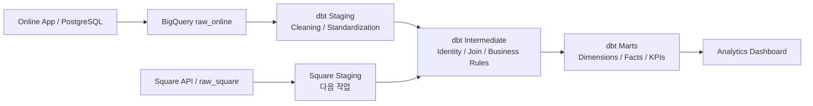

# 🍫 Chocolate Commerce — Online Staging v1.0 학습노트

> **작성일:** 2026-11-16  
> **프로젝트:** Charlie’s Chocolate Factory / Chocolate Commerce Data Platform  
> **주제:** BigQuery Raw 데이터를 dbt로 클리닝·표준화하고 품질 검증하기  
> **작업 범위:** `raw_online`의 5개 테이블 → `dbt_dev`의 5개 Staging View  
> **최종 상태:** ✅ 개별 빌드, Raw ↔ Staging 대사, 전체 통합 빌드 완료  
> **다음 작업:** Square Staging (JSON 파싱·Variation 매핑·금액 단위 표준화)

---

## 1. 오늘 한 일을 한 문장으로 정리하면

**Online 원천 데이터 5종을 BigQuery의 dbt Staging View로 표준화하고, 20개 자동 데이터 테스트와 테이블별 Raw ↔ Staging 비교 쿼리를 통해 기본 품질을 검증했다.**

완료한 모델:

1. `stg_online_orders`
2. `stg_online_order_items`
3. `stg_online_products`
4. `stg_online_customers`
5. `stg_online_customer_addresses`

**주의:** 여기서 '완료'는 **기본 Staging 규칙과 현재 정의한 테스트 범위**를 뜻한다. 주문 금액 계산의 비즈니스 타당성, Online ↔ Square 고객 통합 등 전체 분석 품질 문제까지 모두 해결했다는 의미는 아니다.

---

## 2. 파이프라인에서 지금 위치는?



### Discovery, Profiling, Cleaning, Validation의 차이

| 단계 | 핵심 질문 | 오늘 프로젝트에서 한 일 |
|---|---|---|
| **Source Discovery** | 어떤 데이터가 어디에 있나? | BigQuery 원천 테이블·컬럼·자료형 확인 |
| **Data Profiling** | 원천 데이터는 어떤 상태인가? | 행 수, NULL/중복, 고유 키, FK 연결 경로 조사 |
| **Data Cleaning / Standardization** | 값을 어떤 규칙으로 일관되게 표현하나? | `TRIM`, `NULLIF`, `UPPER`, `LOWER`, 타임존 날짜 파생 |
| **Data Validation / Testing** | 변환 결과가 기대한 규칙을 만족하나? | `unique`, `not_null`, `relationships`, Raw 대사 |

- **Profiling은 문제를 발견하는 과정**이며, **Cleaning은 정해진 변환 규칙을 적용하는 과정**이다.
- **Staging에서는 원본의 의미와 Grain을 유지**하고, 소스 간 고객 식별 및 복잡한 KPI 계산은 Intermediate/Marts로 미룬다.
- **Raw는 수정하지 않았다.** dbt가 BigQuery View를 생성하여 조회 시 변환을 적용한다.

---

## 3. 개발 환경과 실행 위치

| 항목 | 실제 확인된 설정 |
|---|---|
| 로컬 저장소 | `C:\Users\smmhk\PycharmProjects\chocolate-commerce-data-platform` |
| **dbt 프로젝트 루트** | `chocolate_dbt/` |
| dbt 설정 파일 | `chocolate_dbt/dbt_project.yml` |
| dbt Core | `1.13.0-b1` (사전 릴리스 버전) |
| BigQuery Adapter | `1.12.3` |
| Python | `3.14.0` |
| 인증 | OAuth |
| GCP Project | `chocolate-data-platform` |
| 실행 타깃 / Dataset | `dev` / `dbt_dev` |
| BigQuery Location | `us-east1` |

처음에 저장소 **최상위 디렉터리**에서 `dbt ls`를 실행했을 때:

```text
No dbt_project.yml found at expected path ...\chocolate-commerce-data-platform\dbt_project.yml
```

원인: dbt 명령어 실행 위치에 `dbt_project.yml`이 없었음. 아래 명령으로 실제 파일을 찾아 해결했다.

```powershell
Get-ChildItem -Path . -Filter dbt_project.yml -File -Recurse |
    Select-Object -ExpandProperty FullName

cd .\chocolate_dbt

dbt debug
dbt ls --resource-type source
dbt ls --resource-type model
```

`dbt debug` 결과: **All checks passed / Connection test OK**.

> `.venv/Lib/site-packages/dbt/include/...` 아래의 `dbt_project.yml`은 dbt 패키지 내부 파일이다. 실제 우리 프로젝트 설정이 아니다.

---

## 4. 구성한 dbt 파일과 모델 관계

> 아래는 이번 작업에서 사용한 **핵심 파일의 논리적 구조**다. 저장소 내에 다른 파일이 있을 수도 있다.

```text
chocolate-commerce-data-platform/
└── chocolate_dbt/
    ├── dbt_project.yml
    └── models/
        └── staging/
            ├── _online__sources.yml
            ├── _online__models.yml
            ├── stg_online_orders.sql
            ├── stg_online_order_items.sql
            ├── stg_online_products.sql
            ├── stg_online_customers.sql
            └── stg_online_customer_addresses.sql
```

### `sources.yml`과 `models.yml`의 역할

- **`_online__sources.yml`**: `source('online', 'orders')` 같은 Raw 원천의 위치와 이름을 등록한다.
- **`stg_*.sql`**: 실제 SQL 변환 정의. 파일마다 하나의 Staging 모델을 만든다.
- **`_online__models.yml`**: 모델/컬럼 설명, 자동 데이터 품질 테스트를 선언한다.
- **`dbt_project.yml`**: 프로젝트 이름, 모델 경로, 기본 materialization 등 프로젝트 설정을 관리한다.

Source 정의:

```yaml
version: 2

sources:
  - name: online
    database: chocolate-data-platform
    schema: raw_online
    tables:
      - name: orders
      - name: order_items
      - name: products
      - name: customers
      - name: customer_addresses
```

### `source()` vs `ref()` — 꼭 기억하기

```sql
-- BigQuery 원천 테이블 참조
from {{ source('online', 'orders') }}

-- dbt가 만든 다른 모델 참조
from {{ ref('stg_online_orders') }}
```

- `source()`는 **외부 원천 위치**를 가리킨다.
- `ref()`는 **dbt 모델 간 의존성**을 표현하며 dbt DAG의 연결에도 사용된다.
- `relationships` 테스트 역시 `ref('...')`를 이용해 대상 모델을 지정했다.

---

## 5. 적용한 공통 Cleaning 규칙

| 기법 | SQL 예시 | 목적 / 유의점 |
|---|---|---|
| 공백 제거 | `TRIM(order_id)` | 문자열 앞뒤 불필요한 공백 제거 |
| 빈 문자열 → NULL | `NULLIF(TRIM(order_id), '')` | 빈 값 표현 통일, `not_null` 테스트에 반영 |
| 코드값 대문자화 | `UPPER(NULLIF(TRIM(order_status), ''))` | `paid`, `PAID` 등 표기 일관성 개선(실제 상태값 범위는 별도 검증) |
| 이메일 소문자화 | `LOWER(NULLIF(TRIM(email), ''))` | 비교 가능한 이메일 표기 제공(고객 식별 키로 무조건 사용하지 않음) |
| 현지 날짜 파생 | `DATE(created_at, 'America/Vancouver')` | UTC Timestamp와 별도로 Vancouver 영업일 분석 가능 |
| 수치 보존 | `total_amount`, `unit_price` | Online 금액은 이미 `NUMERIC`이므로 임의로 100으로 나누지 않음 |
| Boolean 보존 | `active_status`, `is_default` | 원천 참/거짓 그대로 보존 |
| 원천 행 보존 | 필터 없는 `SELECT` | 정상 데이터 누락 방지; 삭제·임의 보정 금지 |

**`NULLIF(TRIM(...),'')`의 의미**

```sql
NULLIF(TRIM('   '), '')  -- NULL
NULLIF(TRIM('  A01 '), '') -- 'A01'
```

**타임존 주의:** `TIMESTAMP` 자체를 현지 시각으로 '수정'하는 것이 아니라, 같은 순간을 `America/Vancouver` 기준으로 해석한 날짜를 별도 컬럼으로 생성했다. 원본 Timestamp는 유지했다.

---

## 6. 테이블별 구현 내용과 실제 검증 결과

### 6.1 `stg_online_orders` — 온라인 주문

- **Source**: `raw_online.orders`
- **Grain**: 주문 1건 = 1행
- **식별자**: `id → source_record_id` (원천 PK), `order_id` (비즈니스 주문 ID)
- **주요 컬럼**: `customer_id`, `store_id`, `channel`, `customer_type`, `order_status`, `subtotal`, `discount_amount`, `tax_amount`, `shipping_amount`, `total_amount`, `item_count`, `order_created_at`, `order_completed_at`, `order_date`, Square 연동 ID, 파이프라인 메타데이터
- **핵심 Cleaning**: 문자열 공백 제거/빈 값 NULL; `channel`, `customer_type`, `order_status` 대문자화; Vancouver 현지 `order_date` 생성
- **원칙**: 비회원 주문의 `customer_id IS NULL`은 정상 가능성이 있으므로 `not_null` 테스트를 걸지 않는다.

대표 SQL:

```sql
{{ config(materialized='view') }}

with source as (
    select * from {{ source('online', 'orders') }}
), cleaned as (
    select
        nullif(trim(id), '') as source_record_id,
        nullif(trim(order_id), '') as order_id,
        nullif(trim(customer_id), '') as customer_id,
        upper(nullif(trim(channel), '')) as channel,
        upper(nullif(trim(order_status), '')) as order_status,
        total_amount,
        created_at as order_created_at,
        date(created_at, 'America/Vancouver') as order_date
        -- 실제 모델은 이 밖의 주문·연동·메타데이터 컬럼도 포함한다.
    from source
)
select * from cleaned
```

**dbt Tests: 4개 PASS**

- `source_record_id`: `unique`, `not_null`
- `order_id`: `unique`, `not_null`

**Raw ↔ Staging 대사 결과:**

| raw_rows | staging_rows | matched_rows | missing | extra | amount_mismatches |
|---:|---:|---:|---:|---:|---:|
| 600 | 600 | 600 | 0 | 0 | 0 |

### 6.2 `stg_online_order_items` — 온라인 주문상품

- **Source**: `raw_online.order_items`
- **Grain**: 주문상품 레코드 1건 = 1행
- **식별자**: `id → source_record_id`
- **주요 컬럼**: `order_id`, `store_id`, `product_id`, `sku`, `product_name`, `category`, `quantity`, `unit_price`, `discount_amount`, `line_total`, Square 연결 ID, 생성 시각, 파이프라인 메타데이터
- **핵심 Cleaning**: ID와 상품 속성 문자열 표준화; 주문 당시 단가·금액·수량은 그대로 보존

**중요한 FK 규칙 — Profiling에서 직접 검증한 관계**

```sql
order_items.order_id   = orders.order_id
order_items.product_id = products.product_id
```

`orders.id` 또는 `products.id`로 연결하면 안 된다. *비즈니스 ID와 내부 레코드 ID를 구분해야 한다.*

**dbt Tests: 6개 PASS**

- `source_record_id`: `unique`, `not_null`
- `order_id`: `not_null`, `relationships` → `stg_online_orders.order_id`
- `product_id`: `not_null`, `relationships` → `stg_online_products.product_id`

테스트 YAML의 핵심:

```yaml
- name: order_id
  data_tests:
    - not_null
    - relationships:
        arguments:
          to: ref('stg_online_orders')
          field: order_id

- name: product_id
  data_tests:
    - not_null
    - relationships:
        arguments:
          to: ref('stg_online_products')
          field: product_id
```

**Raw ↔ Staging 대사 결과:**

| raw_rows | staging_rows | matched_rows | missing | extra | key_mismatches | value_mismatches |
|---:|---:|---:|---:|---:|---:|---:|
| 1,544 | 1,544 | 1,544 | 0 | 0 | 0 | 0 |

> `value_mismatches=0`은 비교 대상인 `quantity`, `unit_price`, `discount_amount`, `line_total`이 원천과 동일하다는 뜻이다. `line_total` 계산 공식 자체의 정확성을 보증하는 것은 아니다.

### 6.3 `stg_online_products` — 온라인 상품

- **Source**: `raw_online.products`
- **Grain**: 상품 1개 = 1행
- **식별자**: `id → source_record_id`, `product_id` (비즈니스 상품 ID)
- **주요 컬럼**: `sku`, `product_name`, `category`, `description`, `image_key`, `price`, `is_best_seller`, `active_status`, Square 연동 및 메타데이터
- **핵심 Cleaning**: 문자열 표준화; Square sync 상태 대문자화; 금액과 플래그 유지
- **원칙**: 판매 중지(`active_status=FALSE`)된 상품도 Staging에서 제거하지 않는다.

**dbt Tests: 4개 PASS**

- `source_record_id`: `unique`, `not_null`
- `product_id`: `unique`, `not_null`

**Raw ↔ Staging 대사 결과:**

| raw_rows | staging_rows | matched_rows | missing | extra | attribute_mismatches | value_mismatches |
|---:|---:|---:|---:|---:|---:|---:|
| 15 | 15 | 15 | 0 | 0 | 0 | 0 |

### 6.4 `stg_online_customers` — 온라인 고객

- **Source**: `raw_online.customers`
- **Grain**: 원천 고객 1명/레코드 = 1행
- **식별자**: `id → customer_id`
- **주요 컬럼**: `customer_number`, `user_id`, `email`, `first_name`, `last_name`, `phone`, `customer_type`, `signup_channel`, `square_customer_id`, Square sync, 생성/수정 시각, 파이프라인 메타데이터
- **핵심 Cleaning**: `email` 소문자화; 고객 구분과 가입 채널 대문자화; 문자열 정리
- **원칙**: 이메일 고유성을 임의로 가정하지 않으며, 이메일을 통합 고객 PK로 쓰지 않는다.

**dbt Tests: 2개 PASS**

- `customer_id`: `unique`, `not_null`

**Raw ↔ Staging 대사 결과:**

| raw_rows | staging_rows | matched_rows | missing | extra | attribute_mismatches | timestamp_mismatches |
|---:|---:|---:|---:|---:|---:|---:|
| 88 | 88 | 88 | 0 | 0 | 0 | 0 |

**중요한 발견 — 별도 과제로 보류:**

- Online 주문 600건 중 `GUEST` 주문 60건은 `customer_id`가 NULL.
- `REGISTERED` 주문 중 278건은 Online 고객과 연결됐지만, **262건(고유 고객 ID 78개)**은 `raw_online.customers.id`와 연결되지 않았다.
- 별도 프로파일링에서 이 78개 고객 ID가 **Square 고객 `payload.reference_id`와 모두 매칭**되었다.
- 따라서 **Staging에서 주문을 삭제하거나 임의로 고객 ID를 덮어쓰지 않음**. `stg_online_customers` 자체에는 정상적으로 존재하는 88건만 보존.
- `orders.customer_id → stg_online_customers.customer_id`의 `relationships` 테스트는 현재 데이터 특성상 **의도적으로 등록하지 않았다.**
- 후속 고객 매핑: `stg_online_customers` + `stg_square_customers` → `int_customer_identity` → `dim_customers`.

### 6.5 `stg_online_customer_addresses` — 온라인 고객주소

- **Source**: `raw_online.customer_addresses`
- **Grain**: 고객주소 레코드 1건 = 1행 (한 고객에게 여러 주소 가능)
- **식별자**: `id → source_record_id`
- **고객 FK**: `customer_id → stg_online_customers.customer_id`
- **주요 컬럼**: `address_label`, `address_line1/2`, `city`, `province`, `postal_code`, `country`, `is_default`, `square_customer_id`, 생성 시각, 메타데이터
- **핵심 Cleaning**: 주·우편번호·국가 대문자화, 나머지 문자열 공백·빈 값 정리; `is_default` 보존
- **원칙**: 한 고객에 복수 주소가 가능하므로 `customer_id`에는 `unique`를 걸지 않는다.

**dbt Tests: 4개 PASS**

- `source_record_id`: `unique`, `not_null`
- `customer_id`: `not_null`, `relationships` → `stg_online_customers.customer_id`

**Raw ↔ Staging 대사 결과:**

| raw_rows | staging_rows | matched_rows | missing | extra | attribute_mismatches | timestamp_mismatches |
|---:|---:|---:|---:|---:|---:|---:|
| 88 | 88 | 88 | 0 | 0 | 0 | 0 |

> 고객 이메일·전화번호·상세주소는 개인정보. 디버깅/분석 결과 공유 시 원문을 포함하지 말고, Marts/대시보드에서는 필요한 정보만 제한적으로 노출한다.

---

## 7. 전체 모델 테스트 구성 — **정확히 20개**

| 모델 | `unique` | `not_null` | `relationships` | 총 개수 |
|---|---:|---:|---:|---:|
| `stg_online_orders` | 2 | 2 | 0 | 4 |
| `stg_online_order_items` | 1 | 3 | 2 | 6 |
| `stg_online_products` | 2 | 2 | 0 | 4 |
| `stg_online_customers` | 1 | 1 | 0 | 2 |
| `stg_online_customer_addresses` | 1 | 2 | 1 | 4 |
| **합계** | **7** | **10** | **3** | **20** |

### 각 테스트가 의미하는 것

**`not_null`**

- 컬럼에 NULL이 존재하면 실패. 문자열의 공백만 있는 경우도 `NULLIF(TRIM(...),'')` 덕분에 감지 가능.

**`unique`**

- 해당 컬럼에서 같은 값이 두 번 이상 등장하면 실패. `NULL` 방지는 별도 `not_null`을 병행해야 한다.

**`relationships`**

- 자식 테이블의 키 값이 부모 테이블의 지정 컬럼에 존재하는지 검사.
- 일반적으로 NULL 자체는 `relationships`로 검출되지 않으므로 필요할 때 `not_null`을 별도로 추가한다.
- 올바른 **FK 컬럼과 대상 비즈니스 ID**를 사용해야 한다.

### 테스트 PASS의 한계

- 현재 모델에서 정의한 규칙에 대한 PASS이지, **모든 비즈니스 품질 문제 해결**을 뜻하지 않는다.
- 테스트는 실행 시점의 데이터에 대한 검증이다. 새로운 Raw 적재가 발생하면 다시 실행해야 한다.
- `relationships` 테스트는 부모 레코드 존재를 검사할 뿐, 매출/할인/세금 계산의 진실성을 보증하지 않는다.

---

## 8. Raw ↔ Staging 대사를 별도로 수행한 이유

`dbt build`는 **모델을 생성하고 선언한 테스트를 실행**한다. 그 자체로 모든 원천 데이터의 손실 여부나 수치 동일성을 보증하지는 않는다.

그래서 각 테이블에서 다음 항목을 비교했다.

1. **원천·Staging 행 수**: 모델이 원천을 보존했는가?
2. **매칭 건수**: 동일한 원천 키가 양쪽에 존재하는가?
3. **누락/추가 행**: 변환 과정에서 행이 사라지거나 생겼는가?
4. **속성 값 일치**: 문자열 표준화 이후 기대값과 일치하는가?
5. **수량·금액·시각 일치**: 보존해야 할 필드 값이 바뀌지 않았는가?

### 재사용할 수 있는 대사 패턴 (축약 예시)

```sql
with raw_data as (
    select
        nullif(trim(id), '') as source_record_id,
        total_amount
    from `chocolate-data-platform.raw_online.orders`
),
staging_data as (
    select source_record_id, total_amount
    from `chocolate-data-platform.dbt_dev.stg_online_orders`
),
comparison as (
    select
        r.source_record_id as raw_id,
        s.source_record_id as staging_id,
        r.total_amount as raw_total,
        s.total_amount as staging_total
    from raw_data r
    full outer join staging_data s
      on r.source_record_id = s.source_record_id
)
select
    (select count(*) from raw_data) as raw_rows,
    (select count(*) from staging_data) as staging_rows,
    countif(raw_id is not null and staging_id is not null) as matched_rows,
    countif(raw_id is not null and staging_id is null) as missing_in_staging,
    countif(raw_id is null and staging_id is not null) as extra_in_staging,
    countif(
        raw_id is not null and staging_id is not null
        and raw_total is distinct from staging_total
    ) as amount_mismatches
from comparison;
```

**왜 `FULL OUTER JOIN`?**

- `INNER JOIN`만 쓰면 한쪽에만 존재하는 누락/추가 데이터를 결과에서 놓칠 수 있다.
- `FULL OUTER JOIN`은 양쪽의 모든 키를 살려서 누락·추가 건수를 분리한다.
- `IS DISTINCT FROM`은 NULL을 포함해 값을 비교할 때 유용하다 (`NULL` vs `NULL`은 불일치가 아님).
- 이 패턴은 **조인 키의 고유성/NULL 검증과 함께** 사용해야 중복 조인으로 행 수가 부풀지 않는다.

### 실제 대사 결과 요약

| 모델 | Raw | Staging | 매칭 | 누락 | 추가 | 비교 대상 불일치 |
|---|---:|---:|---:|---:|---:|---:|
| Orders | 600 | 600 | 600 | 0 | 0 | 0 |
| Order Items | 1,544 | 1,544 | 1,544 | 0 | 0 | 0 |
| Products | 15 | 15 | 15 | 0 | 0 | 0 |
| Customers | 88 | 88 | 88 | 0 | 0 | 0 |
| Customer Addresses | 88 | 88 | 88 | 0 | 0 | 0 |

**참고:** 표의 행 수를 합산한 수치는 서로 다른 테이블의 레코드 수를 더한 것이며, 주문 수 또는 고객 수와 동일한 개념이 아니다.

---

## 9. 오늘 마주친 오류와 배운 점

### 오류 A — `dbt_project.yml`을 찾을 수 없음

```text
No dbt_project.yml found at expected path ...
```

- **원인:** dbt 프로젝트 루트가 아닌 저장소 최상위에서 실행함.
- **해결:** `chocolate_dbt/` 디렉터리로 이동 후 `dbt debug`.
- **교훈:** dbt 명령은 기본적으로 **실제 `dbt_project.yml`이 있는 프로젝트 루트**에서 실행하자.

### 오류 B — 중복 테스트 이름으로 Compilation Error

```text
dbt found two data_tests with the name
"not_null_stg_online_order_items_product_id"
```

- **원인:** `_online__models.yml`에서 `stg_online_order_items.product_id`에 동일한 `not_null` 선언을 두 번 둠.
- **해결:** 기존 `product_id` 블록을 교체하여 `not_null` 1개 + `relationships` 1개만 유지.
- **교훈:** YAML 수정 시 새 블록을 무작정 덧붙이지 말고, **같은 컬럼 정의가 이미 있는지 확인한 뒤 병합**한다.

정상 예시:

```yaml
- name: product_id
  description: References the Online business product ID.
  data_tests:
    - not_null
    - relationships:
        arguments:
          to: ref('stg_online_products')
          field: product_id
```

### 경고 C — `CustomKeyInConfigDeprecation`

```text
Custom key `chocolate_dbt` found in `config`
```

- **상태:** `dbt parse`와 모든 `dbt build`가 통과했지만, 경고는 계속 발생.
- **원인 후보:** `dbt_project.yml`의 `config` 아래에 dbt가 더 이상 권장하지 않는 사용자 정의 키 배치.
- **다음 조치:** 실제 `dbt_project.yml` 내용을 검토하여 설정 의도에 맞게 이동/수정. **지금은 내용을 확인하지 않았으므로 정확한 수정안을 단정하지 않는다.**
- **별도 메모:** `dbt=1.13.0-b1`은 사전 릴리스. 이후 안정 버전과 어댑터 호환성을 점검할 가치가 있다.

---

## 10. 오늘의 주요 명령어 복습

```powershell
# 프로젝트 루트로 이동
cd .\chocolate_dbt

# 환경과 BigQuery 연결 점검
dbt debug

# 등록된 Source와 모델 확인
dbt ls --resource-type source
dbt ls --resource-type model

# SQL 및 YAML 파싱 점검
dbt parse

# 모델 하나만 빌드 + 관련 테스트
dbt build --select stg_online_orders

# 두 모델을 명시적으로 빌드
dbt build --select stg_online_orders stg_online_order_items

# 전체 Staging 모델과 테스트 빌드
dbt build --select path:models/staging
```

### `dbt build` vs `dbt run` vs `dbt test`

| 명령어 | 역할 |
|---|---|
| `dbt parse` | 프로젝트·리소스 정의를 파싱하여 구성 오류를 확인 |
| `dbt run` | 모델 생성/업데이트 (데이터 테스트는 별도로 실행해야 함) |
| `dbt test` | 등록된 테스트 실행 |
| **`dbt build`** | 선택한 모델을 빌드하고 관련 테스트도 실행 |

따라서 매번 `dbt run` 뒤에 `dbt test`를 각각 실행할 필요는 없다. 이번에는 **`dbt build`로 모델 생성과 테스트를 함께 수행**했다.

---

## 11. 최종 통합 빌드 — 실행 로그에 근거한 결과

실행 명령:

```powershell
dbt build --select path:models/staging
```

확인된 로그:

```text
Found 5 models, 20 data tests, 5 sources, 561 macros
Finished running 20 data tests, 5 view models in 38.44 seconds.
Completed successfully
Done. PASS=25 WARN=0 ERROR=0 SKIP=0 NO-OP=0 REUSED=0 TOTAL=25
```

| 지표 | 실제 결과 |
|---|---:|
| Source | 5개 (`raw_online`) |
| Staging View | 5개 |
| 자동 데이터 테스트 | 20개 |
| 전체 작업 | **25/25 성공** |
| 빌드 내 실패 | **0** |
| Raw ↔ Staging 대사 | **5개 테이블 모두 검증 통과** |

**로그의 `WARN=0`과 위의 Deprecation 경고는 모순이 아니다.** `Done. WARN=0`은 빌드 작업 결과의 WARN 건수이고, 설정 Deprecation 메시지는 별도의 경고이다.

또한 View 생성 로그의 `CREATE VIEW (0 processed)`는 해당 단계가 View 정의 생성이라는 의미이며, 데이터가 0행이라는 뜻이 아니다. 실제 데이터 테스트/대사 쿼리로 행 존재와 정합성을 확인했다.

---

## 12. 아직 남은 데이터 품질·설계 과제

| 과제 | 현재 판단 | 처리할 단계 |
|---|---|---|
| Online 주문의 등록 고객 참조 불일치 | 262주문 / 78개 ID, Square `reference_id`에서 매핑 발견 | Intermediate 고객 식별 통합; ETL 원인 개선은 별도 Jira |
| `total_amount` 구성 요소의 계산 검증 | 원천과 Staging 값이 일치한다는 사실만 검증 | Intermediate/Marts 비즈니스 규칙 검증 |
| `order_status`의 허용값·완료 주문 정의 | 대문자화만 적용, 상태별 의미/매출 인정 규칙은 미확정 | Intermediate/Marts |
| 이메일·주소 개인정보 노출 | Raw/Staging에서 필요한 원천 정보를 보존 | Marts 권한·컬럼 최소화 |
| `CustomKeyInConfigDeprecation` | 빌드 성공하나 설정 경고 존재 | dbt 프로젝트 설정 정리 |
| Square 연동 구조 | Square 별도 Raw 테이블 JSON 기반 | 다음 Square Staging |

**참고할 기존 Jira:**

- `CHOC-22`: Build dbt analytics models in BigQuery (상위 작업)
- `CHOC-41`: DQ-001 — Online 주문 고객 참조 불일치 조사
- `CHOC-42`: Online ↔ Square 고객 동기화·식별 매핑 개선 (v1.0 이후 백로그)
- `CHOC-30`: POS 가입 고객이 Online 추출에서 누락되는 가능성 관련 기존 리팩터링 작업

Jira: `https://smmhk21.atlassian.net/browse/CHOC-22`

> 기존 데이터 품질 이슈를 숨기거나 Raw 데이터를 임의로 바꾸지 않고, **발견 사실·현재 우회/통합 전략·장기 수정 과제**를 구분해 기록한다.

---

## 13. 다음 단계: Square Staging v1.0

Online이 끝났으므로, 다음에는 `raw_square`의 `payload` JSON을 다룬다.

예상 작업 방향:

1. `stg_square_locations` — 매장명, 상태, 타임존, 주소 추출
2. `stg_square_customers` — 고객 식별 필드와 `reference_id` 추출
3. `stg_square_catalog` — Catalog Item 및 nested Variation 추출
4. `stg_square_orders` — 주문 ID, 상태, 금액, 시각, 매장·고객 FK 추출
5. `stg_square_order_items` — `line_items[]` 전개 및 금액 단위 환산

이전에 프로파일링한 Square 주요 사실:

- Square 주문 **19건**, JSON line items **47행**.
- Square 주문은 현재 모두 `OPEN`. **완료된 매출로 임의 분류하지 않는다.**
- Line Item의 `catalog_object_id`는 최상위 Catalog Item ID가 아니라 **Variation ID**에 대응: 47/47 매칭.
- `(square_order_id, line_item_uid)` 조합은 47개 행에서 결측·중복 없이 고유함.
- Square `base_price_money.amount` 및 `total_money.amount`는 소액 통화 단위(센트)로 나타나므로 CAD 환산 시 **100으로 나누는 규칙**과 통화 정보를 함께 검증해야 한다.
- 추정이나 가짜 완료일 보정 없이 원본 상태·시각을 보존한다.

---

## 14. 복습 질문 — 스스로 답해 보기

1. `source()`와 `ref()`의 차이는 무엇인가?
2. `TRIM()`만 사용하지 않고 `NULLIF(TRIM(...), '')`를 사용한 이유는?
3. 주문상품에서 왜 `orders.id`가 아니라 `orders.order_id`를 참조했는가?
4. `relationships` 테스트가 통과했는데도 고객 식별 문제가 남아 있는 이유는?
5. `dbt build`가 성공해도 Raw ↔ Staging 대사를 따로 하는 이유는?
6. `COUNT(*)`가 같은 것만으로 행 누락이 없다고 확신할 수 없는 이유는?
7. Staging에서 `active_status=FALSE` 상품을 삭제하지 않는 이유는?
8. Online의 가격과 Square의 가격은 왜 서로 다르게 표준화해야 하는가?
9. 주문 상태를 대문자로 바꾸는 일과 완료 매출을 인정하는 일의 차이는?
10. 고객주소의 `customer_id`에 `unique` 테스트를 걸지 않은 이유는?

<details>
<summary>핵심 답안 힌트</summary>

- `source`는 외부 Raw, `ref`는 dbt 내부 모델 의존성.
- 공백 문자열을 실제 NULL로 표준화하면 검증이 쉬워진다.
- 비즈니스 키와 내부 레코드 ID는 서로 다르다.
- 테스트는 선언한 특정 관계에 대해서만 확인한다. Online 주문 고객 FK는 현재 테스트 대상에서 제외돼 있다.
- 행 수·매칭·값 비교를 별도로 해야 데이터가 그대로 보존됐는지 알 수 있다.
- 서로 다른 키를 가진 행이 같은 개수로 교체됐을 수도 있다.
- Staging은 원본 전체를 보존하고, 필터링/분석 기준은 뒤 단계에서 결정한다.
- Online은 이미 CAD `NUMERIC`, Square Money.amount는 센트 단위.
- 표기 표준화는 기술적 Cleaning이고 매출 인정은 비즈니스 규칙이다.
- 고객 한 명에 주소 여러 개가 있을 수 있다.

</details>

---

## 15. Git 기록 추천

**권장 커밋 메시지**

```text
feat(dbt): complete online staging models and data quality tests
```

학습노트만 별도로 커밋한다면:

```text
docs(dbt): document online staging v1.0 implementation and validation
```

**노트 보관 경로 예시**

```text
docs/dbt/learning-notes/2026-11-16_online_staging_v1.0.md
```

**현재 학습노트의 상태**: 오늘 채팅에서 실제 공유한 SQL, 명령어, 빌드 로그 및 검증 결과를 기준으로 정리함. 코드 블록 중 일부는 원리 설명용 축약 예시이며, 재현 가능한 **실제 전체 모델 소스의 진실 원천(Source of Truth)**은 Git 저장소의 `chocolate_dbt/models/staging/` 파일들이다.

---

**오늘의 핵심 교훈:** 데이터 엔지니어링에서 '클리닝 완료'란 SQL을 작성하는 것만이 아니다. **원천 구조 이해 → 변환 규칙 명시 → 모델 빌드 → 자동 품질 테스트 → Raw 대사 → 미해결 이슈 문서화**까지 연결돼야 재현 가능하고 신뢰할 수 있는 데이터 파이프라인이 된다.
