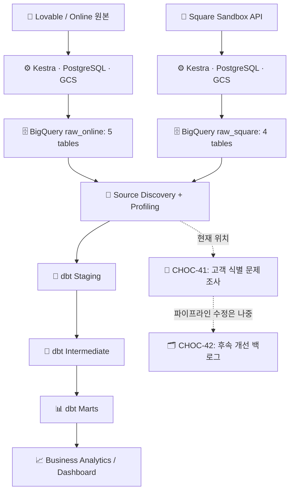
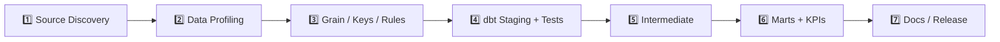
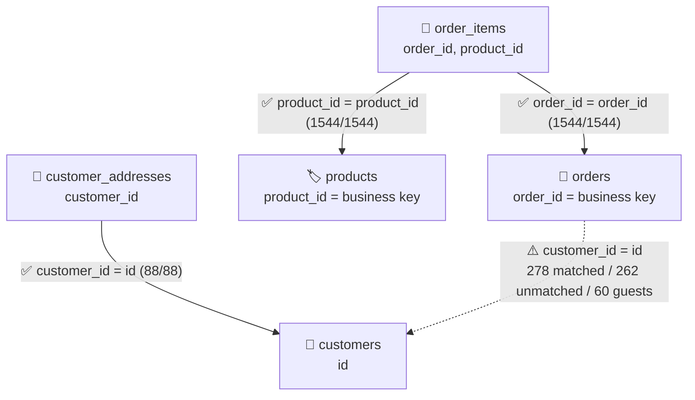
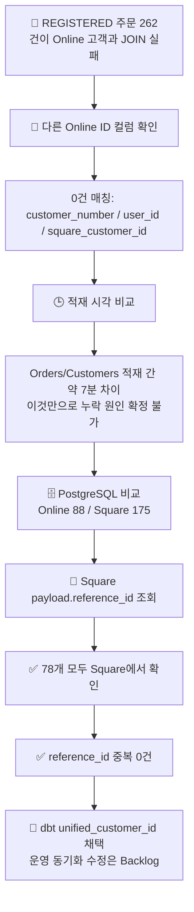
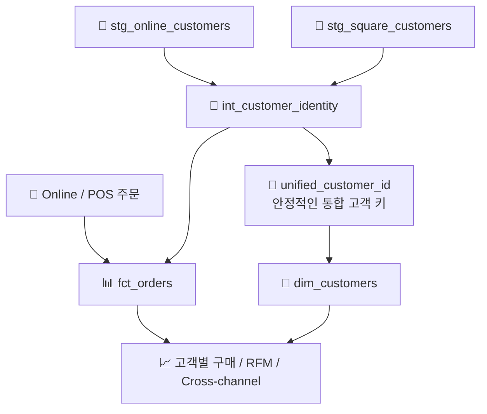
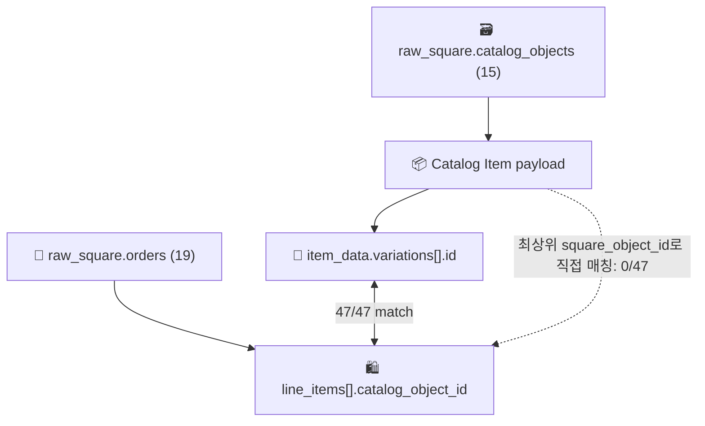

# 🍫 Charlie's Chocolate Factory — dbt Analytics v1.0 작업 기록

> **Work Log #01 (Updated) | Source Discovery · Data Profiling · Customer Identity · Square JSON/Grain 검증 · dbt 실행 환경 점검**  
> 📅 **작업일:** 2026-11-15 (America/Vancouver)  
> 🧭 **진행 상태:** Raw 구조·주요 참조/Grain 검증 완료 → 비즈니스 상태·날짜 정책 일부 보류 → dbt 프로젝트 경로 확인 필요 (모델 구현 전)  
> 📘 **기준 설계서:** `초콜릿_커머스_dbt_분석_설계서_v1.0.pdf` (v1.0, 11페이지)  
> 🧩 **관련 Jira:** [CHOC-22](https://smmhk21.atlassian.net/browse/CHOC-22) · [CHOC-41](https://smmhk21.atlassian.net/browse/CHOC-41) · [CHOC-42](https://smmhk21.atlassian.net/browse/CHOC-42)

---

## 📌 0. 오늘 한눈에 보기 (TL;DR)

> **오늘의 핵심:** BigQuery Raw 9개 테이블과 식별자·참조 관계를 검증하다 Online 주문의 고객 ID 미연결을 발견했다. 미연결된 78개 ID는 **Square 고객 `payload.reference_id`에서 모두 발견**되어, 운영 파이프라인 변경을 후속 Jira 백로그로 분리하고 **dbt의 `unified_customer_id` 매핑으로 분석을 계속하기로 결정**했다. 이어서 Square 주문 19건의 JSON, 고객 19건/주문상품 47줄 참조, Catalog **Variation ID** 연결, Line Item Grain까지 검증했다. 마지막에 dbt CLI를 저장소 루트에서 실행했을 때 **`dbt_project.yml` 경로 오류**가 발생했고, 현재 다음 액션은 dbt 프로젝트 실제 폴더 확인이다.

| 구분 | 오늘의 결과 | 상태 |
|---|---|:---:|
| BigQuery Raw 목록 확인 | Online 5개 + Square 4개 = **9개 물리 테이블** | ✅ |
| Raw 스키마 확인 | Online 정형 컬럼, Square `payload STRING` | ✅ |
| 행 수 확인 | Online 주문 **600**, Square 주문 **19** | ✅ |
| 주요 ID 고유성 | 확인한 **11개 키 후보 모두 NULL/빈값/중복 0** | ✅ |
| Order Item → Order/Product 참조 | 각각 **1,544/1,544건 정상** (정확한 키로 JOIN한 경우) | ✅ |
| Registered 고객 참조 불일치 | Online 주문 **262건 / 78개 고객 ID** | ⚠️ |
| Square에서 대체 참조 확인 | 78/78개가 `payload.reference_id`에서 발견 | ✅ |
| Square `reference_id` 중복 | **0행** | ✅ |
| Online 고객 ↔ Square 매핑 | **88/88명 매칭** | ✅ |
| 고객 통합 방식 | dbt `int_customer_identity` → `unified_customer_id` | ✅ 결정 |
| Online↔Square 주문 직접 식별자 검사 | Square 19건 모두 직접 매칭 **0건** (`square_order_id`, `reference_id` ↔ `id`/`order_id`) | ✅ 1차 |
| Square JSON 주문·상태 | 19건, **모두 `OPEN`**, 3개 Location 사용, Square API 생성일 2026-09-22 | ✅ / ⚠️ |
| Square 주문의 고객 FK | **19/19건** `raw_square.customers` 연결 | ✅ |
| Square 주문상품 FK | **47줄 모두 Catalog Variation ID**로 연결, 최상위 Catalog ID 직접 매칭 0 | ✅ |
| Square Line Item Grain | **47줄** 모두 UID·수량·단가·합계 존재, 복합 키 중복 0 | ✅ |
| 가상 영업일 추적 | 조회한 두 `simulated_order_at` 경로에서 모두 NULL; 추가 매핑 확인 필요 | ⚠️ |
| dbt CLI 확인 | 저장소 루트에서 `dbt_project.yml` 미발견 오류; **프로젝트 폴더 탐색 예정** | ⏭️ |
| dbt Staging 구현 | **아직 시작하지 않음** | ⏳ |

**주의:** 위 수치는 해당 날짜의 조회 스냅샷이다. 데이터 재적재 뒤에는 달라질 수 있다. `✅`는 *해당 검증 조건 통과*를 의미하지, 모든 데이터 품질 문제가 해결되었다는 뜻이 아니다. Square 주문이 Online 주문 ID와 매칭되지 않았다고 해서 **비즈니스상 독립 POS 판매가 입증된 것은 아니다**. 또한 Square의 `OPEN` 주문금액은 **완료 매출**로 계산하지 않는다.

---

## 🎯 1. 분석 범위와 이번 버전의 목표

### 1-1. v1.0에서 다룰 5개 논리적 데이터

| 논리적 데이터 | 의미 / Grain(한 행의 단위) |
|---|---|
| `orders` | 주문 **1건** |
| `order_items` | 한 주문의 상품 **1줄** |
| `products` | 상품/SKU **1개** |
| `customers` | 식별 가능한 고객 **1명/프로필** |
| `customer_addresses` | 고객 주소 **1건** |

**5개 논리적 분석 대상**과 **BigQuery에 존재하는 9개 물리적 Raw 테이블**은 다른 개념이다. 예를 들어 Square 주문의 상품행은 별도 테이블이 아니라 Square 주문 `payload` 안에 포함될 수 있어, Staging에서 펼치는 작업이 필요하다.

### 1-2. v1.0에서 할 일 / 하지 않을 일

✅ 할인 반영 **상품매출(Product Revenue)**, Online/POS 채널 비교, SKU/매장 비교, 재구매·RFM, 월별/동일 기간 YoY, 데이터 품질 테스트  
✅ `Raw → Staging → Intermediate → Marts → Analytics/Dashboard`  
🚫 Payments/실수취액/결제 실패/환불 분석은 **후속 버전**으로 보류  
🚫 이번 분석을 위해 운영 고객 동기화 파이프라인을 지금 수정하지 않음  
🚫 일부 고객 ID가 안 맞는다고 주문 데이터를 삭제하거나 임의로 다른 고객과 연결하지 않음

> **상품매출 정의:** `판매 당시 단가 × 수량 − 상품에 배분된 할인액` (세금·배송 제외, 환불 차감 전). 현재 Raw 스키마에서 **원가 컬럼을 확인하지 못했기 때문에** 실제 이익률 분석은 원가 데이터 확보/정의 후 진행한다.

### 1-3. 설계서 목표 vs 오늘 실제 확인된 규모

| 대상 | v1.0 설계서의 초기 목표 | 2026-11-15 실제 Raw | 이번 작업 결정 |
|---|---:|---:|---|
| Online 주문 | 600 | **600** | 현재 데이터 사용 |
| Square POS 주문 | 약 400 | **19** | 19건으로 우선 모델 검증·파일럿 분석 |
| Online 주문상품 | 전체 약 2,000~2,500행의 일부 | **1,544** | 현재 데이터 사용 |
| Online 상품 | 약 15~25 SKU | **15** | 현재 데이터 사용 |
| Online 고객 | 통합 기준 총 150~200명 목표 | **88** | Square 고객과 식별자 연결 |
| Square 고객 | 별도 고정 목표 없음 | **175** | 중복 인원 산정 주의 |
| Square 매장 | 별도 고정 목표 없음 | **5** | 분석할 POS 매장 범위 추후 확인 |

**결정 변경:** 기존 설계서의 POS 400건은 **v1.0 분석 완료의 필수 선행 조건으로 적용하지 않는다.** 먼저 19건으로 End-to-End 모델을 검증하고, 추후 주문을 확장하여 동일한 dbt 모델·테스트를 재실행한다. **Online 600 + Square 19 = 고유 주문 619건이라고 아직 말할 수 없다.** 지금까지 확인한 직접 ID 매핑이 0건이라는 사실만 확인했기 때문이다.

---

## 🗺️ 2. 데이터 아키텍처 — 지금 우리가 서 있는 곳



### 실무형 작업 순서



**왜 곧바로 dbt SQL부터 작성하지 않을까?** 실제 스키마와 JOIN Key가 확정되지 않으면 데이터가 조용히 누락되거나 매출이 중복 집계될 수 있기 때문이다. 먼저 원천에서 **어떤 데이터가 있는지, 한 행이 무엇인지, 어떤 키가 실제로 연결되는지** 확인한다.

---

## 🧪 3. 오늘의 작업 진행 타임라인

| 순서 | 작업 | 실행·검증 결과 | 배운 점 |
|---|---|---|---|
| 01 | `INFORMATION_SCHEMA.TABLES` | Raw **9개** | 분석 대상 5종과 실제 Raw 테이블 9개 구분 |
| 02 | `INFORMATION_SCHEMA.COLUMNS` | Online 정형 / Square `payload STRING` | 실제 데이터 타입부터 확인해야 함 |
| 03 | 각 테이블 `COUNT(*)` | Online 주문 600, Square 주문 19 등 | 목표 수량과 실제 적재량 구분 |
| 04 | 11개 식별자 NULL/빈값/중복 검사 | 모두 0 | 컬럼명만 보고 PK로 단정하지 않기 |
| 05 | `order_items`의 Order/Product FK 후보 비교 | `orders.order_id`, `products.product_id`가 **정확한 연결 키** | `id`와 비즈니스 ID는 다를 수 있음 |
| 06 | Online Orders → Customers 참조 검사 | **278 매칭 / 262 불일치 / 60 Guest** | INNER JOIN으로 주문이 사라질 수 있음 |
| 07 | 고객 유형별 원인 분리 | REGISTERED 미연결 **78개 고유 ID** | 주문 건수와 고객 수는 별개 |
| 08 | 다른 Online 고객 ID 후보 검사 | `customer_number`, `user_id`, `square_customer_id` 매칭 **0** | 같은 시스템의 다른 키도 확인 |
| 09 | Orders/Customers 적재 시각 비교 | 두 테이블 각각 파이프라인 실행 ID 1개, 적재 시간 약 7분 차이 | 적재 시각만으로 누락 원인 단정 불가 |
| 10 | PostgreSQL·Square 고객 개수 확인 | Online **88**, Square **175** | Online·Square는 다른 고객 소스 |
| 11 | 미연결 78개 ID를 Square `reference_id`로 탐색 | **78/78 매칭** | 교차 채널 ID Bridge의 필요성 |
| 12 | Square `reference_id` 중복 검사 | **0행** | 참조 ID의 고유성 확인 |
| 13 | Online 88명 ↔ Square 비교 | **88/88 매칭**, ID 충돌 0 | 고객 통합 기준 후보 확보 |
| 14 | 설계 결정·Jira 기록 | `unified_customer_id` 채택, 파이프라인 개선 백로그 분리 | 분석 지속과 운영 개선 분리 |
| 15 | Square↔Online 주문 식별자 1차 검사 | `square_order_id` 직접 매칭 **0/19** | 일치하는 외부 ID가 없어도 판매 중복이 없다고 단정하지 않기 |
| 16 | Square JSON 1차 검사 | 19건 전부 `OPEN`, 매장 ID **3개**, `line_items` 1~4줄/주문 | 원천 주문 상태와 유효 매출 정책 분리 |
| 17 | Square `reference_id` 재검증 | Online `id`·`order_id` 어느 쪽에도 **0/19 매칭** | 외부 참조 ID의 의미를 소스별로 확인 |
| 18 | 고객·가상 영업일·첫 상품 확인 | 고객 ID 19/19, 첫 상품 ID 19/19, 조회한 두 가상 날짜 경로는 모두 NULL | Square 서버 생성일을 가상 판매일로 대체하면 안 됨 |
| 19 | Square 고객 FK | **19/19 정상** | 주문 JSON의 `customer_id`는 Square 고객 PK로 연결 |
| 20 | Catalog 최상위 ID 직접 JOIN | **0/47 매칭** | `catalog_object_id`가 Catalog Item ID라고 가정하면 안 됨 |
| 21 | Catalog Variation 내부 ID JOIN | **47/47 매칭, 0 미연결** | `payload.item_data.variations[].id`가 실제 연결 키 |
| 22 | Square Line Item Grain/금액 필드 | UID 누락 0, 고유 `(order_id, uid)` 47, 중복 0, 수량·단가·합계 누락 0 | 상품행 Grain 검증 완료. `COUNT(DISTINCT STRUCT(...))` 오류는 `GROUP BY`로 수정 |
| 23 | `dbt ls` CLI 실행 | dbt=**1.13.0-b1**; 저장소 루트에 `dbt_project.yml` 없어 실패 | 프로젝트 디렉터리 확인이 먼저, SQL 오류가 아님 |

> **실행하지 않은 것:** 월별 미연결 고객 분포 SQL은 제안되었지만 **실행 결과를 공유받지 않았으므로 완료 처리하지 않는다.** Square `simulated_order_at`의 다른 보관 위치, 주문의 비즈니스상 중복, 주문 상태별 유효 매출 정책도 아직 최종 확정 전이다.

---

## 🧱 4. Raw 테이블 및 컬럼 구조 조사 결과

### 4-1. 물리적 테이블 인벤토리

| Dataset | Table | Rows | 핵심 컬럼 / 특이사항 |
|---|---|---:|---|
| `raw_online` | `customer_addresses` | 88 | `id`, `customer_id`, 주소, `ingested_at` |
| `raw_online` | `customers` | 88 | `id`, `customer_number`, `user_id`, `square_customer_id` |
| `raw_online` | `order_items` | 1,544 | `id`, `order_id`, `product_id`, `sku`, `quantity`, `unit_price`, `discount_amount`, `line_total` |
| `raw_online` | `orders` | 600 | `id`, `order_id`, `channel`, `customer_id`, `order_status`, `total_amount`, `square_order_id` |
| `raw_online` | `products` | 15 | `id`, `product_id`, `sku`, `price`, `square_catalog_object_id` |
| `raw_square` | `catalog_objects` | 15 | `square_object_id`, `object_type`, `payload STRING` |
| `raw_square` | `customers` | 175 | `square_customer_id`, `payload STRING` |
| `raw_square` | `locations` | 5 | `square_location_id`, `payload STRING` |
| `raw_square` | `orders` | 19 | `square_order_id`, `payload STRING` |

- ✅ Online `orders`의 내부 `id`와 비즈니스 `order_id`는 **서로 구분되는 컬럼**이다.
- ✅ Square는 `payload`를 **BigQuery STRING**으로 저장했다. 이후 JSON 필드를 다룰 때 `JSON_VALUE(payload, '$.field')` 등으로 추출해야 한다.
- ⚠️ `is_nullable = YES`는 스키마 메타데이터에 NULL이 허용된다는 의미일 뿐, *현재 실제 NULL이 있다는 뜻은 아니다.*
- ⚠️ Online `orders`의 `payment_method` 컬럼은 존재하지만, **Payments 이벤트/결제 분석은 이번 v1.0에서 제외**한다.
- ⚠️ 현재 확인한 Online `products` / `order_items`에는 원가 컬럼이 없다. 따라서 추정 Gross Profit 계산에 필요한 원가 정책은 나중에 확인한다.

### 4-2. 주요 Key 검증 결과

| 테이블 | 키 후보 | Rows | NULL | 빈값 | 중복 | 결과 |
|---|---|---:|---:|---:|---:|:---:|
| Online orders | `id` | 600 | 0 | 0 | 0 | ✅ |
| Online orders | `order_id` | 600 | 0 | 0 | 0 | ✅ |
| Square orders | `square_order_id` | 19 | 0 | 0 | 0 | ✅ |
| Online order_items | `id` | 1,544 | 0 | 0 | 0 | ✅ |
| Online products | `id` | 15 | 0 | 0 | 0 | ✅ |
| Online products | `product_id` | 15 | 0 | 0 | 0 | ✅ |
| Online customers | `id` | 88 | 0 | 0 | 0 | ✅ |
| Online customer_addresses | `id` | 88 | 0 | 0 | 0 | ✅ |
| Square catalog_objects | `square_object_id` | 15 | 0 | 0 | 0 | ✅ |
| Square customers | `square_customer_id` | 175 | 0 | 0 | 0 | ✅ |
| Square locations | `square_location_id` | 5 | 0 | 0 | 0 | ✅ |

**실무 메모:** `unique + not_null` 검증을 통과한 컬럼은 **현재 스냅샷에서 유일**하다는 뜻이다. 비즈니스상 영구 불변 PK인지 확인하려면 원천 시스템의 ID 발급/업데이트 정책도 알아야 한다.

---

## 🔗 5. Referential Integrity — 어떤 컬럼으로 JOIN해야 할까?

### 5-1. 테스트 결과 (실제 SQL 결과)

| 관계 후보 | 자식행 | 정상 매칭 | 미매칭 | 해석 |
|---|---:|---:|---:|---|
| `customer_addresses.customer_id → customers.id` | 88 | 88 | 0 | ✅ 사용 가능 |
| `order_items.order_id → orders.id` | 1,544 | 0 | 1,544 | ❌ 잘못된 후보 |
| `order_items.order_id → orders.order_id` | 1,544 | **1,544** | 0 | ✅ 사용 가능 |
| `order_items.product_id → products.id` | 1,544 | 0 | 1,544 | ❌ 잘못된 후보 |
| `order_items.product_id → products.product_id` | 1,544 | **1,544** | 0 | ✅ 사용 가능 |
| `orders.customer_id → customers.id` | 600 | 278 | **262** (ID 있음) | ⚠️ Guest 60건 별도 |

### 5-2. 검증된 Online 관계



**중요:** `order_items.order_id`는 `orders.id`가 아니라 **`orders.order_id`**와 JOIN해야 한다. 상품도 마찬가지로 `order_items.product_id = products.product_id`가 검증된 관계다.

### 5-3. 실무에서의 위험 — 잘못된 INNER JOIN

```sql
-- ❌ 고객 프로필이 없으면 주문이 사라질 수 있다.
SELECT *
FROM `chocolate-data-platform.raw_online.orders` o
INNER JOIN `chocolate-data-platform.raw_online.customers` c
  ON o.customer_id = c.id;
```

현재 스냅샷에서는 Online 주문 600건 중 고객 마스터에 연결되는 **278건만** 남게 될 위험이 있다. 나머지 **322건(Guest 60 + 비매칭 262)**을 무조건 삭제하면 매출이 과소 집계된다.

**권장 원칙:** 주문 Fact의 기준은 주문 자체로 유지하고, 고객 식별은 **LEFT JOIN + 매핑 검증 상태**를 통해 처리한다.

---

## 🚨 6. DQ-001 — 고객 참조 문제 발견과 조사 과정

### 6-1. 최초 발견

```text
Online orders: 600
├─ 🟢 REGISTERED / customers.id 매칭: 278건 (고유 ID 74개)
├─ 🟠 REGISTERED / customers.id 비매칭: 262건 (고유 ID 78개)
└─ ⚪ GUEST / customer_id 없음: 60건
```

| 고객 유형 | 주문 건수 | 서로 다른 고객 ID | 분류 |
|---|---:|---:|---|
| `ONLINE / REGISTERED / MATCHED` | 278 | 74 | 정상 직접 연결 |
| `ONLINE / REGISTERED / UNMATCHED_CUSTOMER_ID` | **262** | **78** | 원인 조사 대상 |
| `ONLINE / GUEST / MISSING_CUSTOMER_ID` | 60 | 0 | 비회원 정책 확인 대상 |

**포인트:** 262는 *주문 건수*이고 78은 *그 주문이 가리키는 서로 다른 고객 ID 수*이다. 같은 숫자처럼 취급하지 않는다.

### 6-2. 조사 흐름: 처음 가설 → 검증 → 판단 수정



**중간 가설:** 처음에는 Lovable → PostgreSQL → GCS → BigQuery 중 일부 고객이 누락되었다고 의심했다.  
**수정된 판단:** PostgreSQL Online 고객도 88행인 반면 Square에는 175행이 있고, 해당 78개 ID가 Square `reference_id`에 전부 존재했다. 그래서 지금은 *전체 소스에서 유실된 고객*이라고 단정할 수 없다. **소스별 고객 선정 필터/스냅샷/채널별 고객 정책**을 더 확인해야 한다.

추가로 기존 Jira [CHOC-30](https://smmhk21.atlassian.net/browse/CHOC-30)에는 `filter_online_data`가 **Online 가입 고객만 추출**하면서 **Online 주문은 구매 채널 기준으로 추출**하여, **POS 가입 고객의 Online 주문은 남지만 고객 레코드가 빠지는 경우**가 재현되었다고 기록되어 있다. 이는 이번 현상의 **강한 원인 후보**이지만, 오늘 발견한 262개 주문과 동일한 원인인지 실행별 추적은 아직 완료하지 않았다.

### 6-3. 적재 시각 조사

| 항목 | Online orders | Online customers |
|---|---|---|
| Rows | 600 | 88 |
| `COUNT(DISTINCT pipeline_run_id)` | 1 | 1 |
| `first_ingested_at` = `last_ingested_at` | 2026-11-15 00:48:54.105272 UTC | 2026-11-15 00:41:46.264552 UTC |
| 최초 원본 `created_at` | 2025-02-01 20:05:29 UTC | 2025-01-02 17:00:00 UTC |
| 최종 원본 `created_at` | 2026-10-31 22:00:02 UTC | 2026-09-14 20:01:37.697370 UTC |

`pipeline_runs = 1`은 *각 테이블에 서로 다른 실행 ID가 1종류씩 있다*는 뜻일 뿐 두 테이블이 같은 실행에서 생성되었다는 증거는 아니다.

### 6-4. Square에서 고객 ID를 찾아낸 결정적 증거

`raw_square.customers` 스키마: `square_customer_id STRING`, `payload STRING`, `ingested_at TIMESTAMP` 등.

| 조사 항목 | 실제 결과 |
|---|---:|
| Online에서 매칭 안 된 고유 고객 ID | **78** |
| Square 기본 ID(`square_customer_id`)와 직접 일치 | 0 |
| Square `JSON_VALUE(payload, '$.reference_id')`와 일치 | **78** |
| 어느 쪽에서도 안 찾은 ID | **0** |
| Square `reference_id` 중복 검사 | **0행** |

**해석:** Online 원본 주문의 `customer_id`와 Square JSON의 `reference_id`가 교차 채널 식별자 연결에 쓸 수 있음을 보여준다. **같은 사람의 동일성**을 추론하는 데 이메일/이름의 유사도를 사용하지 않는다.

### 6-5. Online 88명 전체와 Square 고객을 비교

| 검증 항목 | 결과 |
|---|---:|
| Online customers | **88** |
| Square `reference_id`와 매칭 | **88** |
| Square 미매칭 | 0 |
| `online.square_customer_id = square.square_customer_id` | 0 |
| 충돌하는 Square ID | 0 |

**주의:** 88명이 Square `reference_id`로 연결되었지만 `online.square_customer_id` 일치 0건/충돌 0건이 나온 것은 **온라인 쪽 해당 컬럼이 비어 있을 가능성**을 나타낸다. 실제 NULL/빈값 수는 별도 확인 필요. *양쪽 ID가 잘못되었다*고 곧바로 결론 내리지 않는다.

**수량 해석 주의:** Online 고객 테이블에 있는 88개 ID와 Online 주문에만 있는 78개 ID는 서로 겹치지 않으므로, **총 166개 식별자가 Square reference_id에 연결**된다. Square 고객 175명에서 **나머지 9명을 곧바로 POS 전용 고객으로 확정할 수는 없다**(Square 전용/다른 참조값/데이터 정책 등 미검증).

### 6-6. 현시점에 한 일 vs 하지 않은 일

- ✅ Key/FK 검사 결과를 확보했다.
- ✅ Square 참조 ID 존재 및 고유성을 확인했다.
- ✅ 분석용 고객 통합 모델의 방향을 정했다.
- ✅ 원인/영향과 후속 작업을 Jira에 기록했다.
- 🚫 Lovable/원천 데이터를 수정하지 않았다.
- 🚫 파이프라인을 수정하거나 재적재하지 않았다.
- 🚫 DQ-001을 **완전 해결됨**으로 판단하지 않았다.

---

## 🧩 7. 오늘 확정한 설계 결정 (Decision Log)

| ID | 결정 | 이유 / 제약 | 상태 |
|---|---|---|:---:|
| DEC-01 | **dbt v1.0은 현재 데이터로 분석까지 진행** | POS 19건도 모델·SQL 검증 가능. 표본 한계 명시 | ✅ |
| DEC-02 | Payments 분석 제외 | 5개 논리 테이블의 상품매출 중심 | ✅ |
| DEC-03 | Online/Square Raw는 원본 그대로 유지 | 소스 보존, 재현성 및 lineage 유지 | ✅ |
| DEC-04 | **고객 통합은 `unified_customer_id` 사용** | 양쪽 채널 구매를 같은 고객으로 집계 | ✅ |
| DEC-05 | `reference_id` 등 **명시적 매핑 키**만 사용 | 이름/이메일 유사성으로 임의 병합 금지 | ✅ |
| DEC-06 | Guest 및 미연결 주문을 매출 집계에서 삭제하지 않음 | 과소 집계 방지 | ✅ |
| DEC-07 | 실제 고객 동기화 파이프라인 개선은 **CHOC-42로 후순위** | 분석 우선, 별도 운영 개선으로 분리 | ✅ |
| DEC-08 | 기존 CHOC-30과 후속 작업 중복 방지 | 알려진 source selection 결함 재활용 | ✅ |
| DEC-09 | Square POS 400건 목표는 후속 데이터 확장 때 재검토 | v1.0 진행을 막지 않음 | ✅ |
| DEC-10 | **Square `OPEN` 주문을 완료 상품매출에서 제외** | 주문 존재/테스트 주문액과 확정 매출 구분; 원본 보존 | ✅ |
| DEC-11 | Square 상품 연결은 **Catalog Item Variation ID** 사용 | 47/47행이 중첩 `variations[].id`에서 매칭 | ✅ |
| DEC-12 | Square Line Item Grain = **`(square_order_id, line_item_uid)`** | 47/47 UID 존재·복합키 중복 0 | ✅ |
| DEC-13 | Square API 생성일과 분석용 가상 판매일 분리 | 확인된 두 simulated 필드는 비어 있음. 원래 테스트 영업일 추후 조사 | 🔎 |
| DEC-14 | dbt 프로젝트 **경로 확인 후** 기존 모델부터 조사 | 저장소 루트에는 `dbt_project.yml` 없음; 기존 모델 무턱대고 다시 만들지 않기 | ⏭️ |

### `unified_customer_id`란? — 예시

> 아래 `ON_001`, `SQ_101`, `CUST_001`은 **설명을 위한 가상 예시**다. 실제 BigQuery에서 나온 ID가 아니다.

| Online ID | Square ID | Unified ID | 고객 해석 |
|---|---|---|---|
| `ON_001` | `SQ_101` | `CUST_001` | 두 소스에 나타나는 동일 고객 |
| `ON_002` | `SQ_102` | `CUST_002` | 두 소스에 나타나는 동일 고객 |
| `NULL` | `SQ_103` | `CUST_003` | Square에서만 확인된 고객 |



**모델링 원칙:**

1. `stg_online_customers`: 온라인 고객 식별자·컬럼 정규화.
2. `stg_square_customers`: `payload`에서 `reference_id` 및 분석 필드 추출.
3. `int_customer_identity`: 확인된 `reference_id`↔Online 고객 ID↔Square 고객 ID의 연결 관계를 **1개 고객 = 1개 통합 키**로 관리.
4. `dim_customers`: 분석용 고객 차원; Square에만 존재하는 고객도 보존.
5. `fct_orders` 등에서는 원천 주문 ID/채널/상태를 유지하고, 고객 통합 키를 연결.

**아직 미확정:** `unified_customer_id`를 어떤 값으로 구성할지(우선순위·해시 입력·원천 ID 없는 고객·향후 ID 변경 정책)는 **구현 전에 Data Contract로 확정**해야 한다. 또한 POS 주문의 고객 ID가 Square 고객 테이블에 실제 어떻게 연결되는지도 JSON에서 확인해야 한다.

### 운영 동기화 vs 분석 통합 — 헷갈리지 않기

| 구분 | 운영 시스템 동기화 | dbt 분석 통합 |
|---|---|---|
| 목적 | 매장/온라인 주문 처리 시 고객 조회·등록 | 동일 고객의 채널별 구매를 하나로 집계 |
| 시스템 | Lovable ↔ Square API / 파이프라인 | BigQuery + dbt |
| 이번 v1.0 작업 | ❌ 보류 | ✅ 진행 |
| 추적 일감 | CHOC-42 | CHOC-22 |

⚠️ POS 고객이 Square에 있다고 해서 자동으로 온라인 **로그인 계정**이 생기는 것은 아니다. 회원 계정의 생성·인증 정책은 운영 시스템의 별도 결정이다.

---

## 🧱 8. 앞으로 구현할 dbt 모델과 Grain

| 계층 | 후보 모델 | **Grain** | 검증 포인트 |
|---|---|---|---|
| Raw | `raw_online.orders`, `raw_square.orders` | 소스 주문 레코드 1행 | 소스 ID와 적재 시각 보존 |
| Staging | `stg_online_orders` | Online 주문 1행 | 상태·날짜·ID 표준화 |
| Staging | `stg_square_orders` | Square 주문 1행 | JSON 파싱, `OPEN` 상태 보존, 매장/날짜 해석 |
| Staging | `stg_square_order_items` | Square 주문상품 1줄 | `(square_order_id, line_item_uid)` 유일성, 원 단위 변환 |
| Staging | `stg_square_catalog` / `stg_square_variations` | Catalog Item / Variation 각 1행 | 중첩 Variation ID를 Order Line의 catalog_object_id와 연결 |
| Staging | `stg_online_order_items` | Online 주문상품 1행 | 수량/가격/할인 검증 |
| Staging | `stg_online_customers` | Online 고객 1행 | Online 키·NULL 검사 |
| Staging | `stg_square_customers` | Square 고객 1행 | `reference_id`/Square ID 검증 |
| Intermediate | `int_customer_identity` | 통합 고객 1명당 1행(목표) | 명시적 ID 매핑·중복 없음 |
| Intermediate | `int_unified_orders` | **통합 주문 1건당 1행** | Online↔Square 이중 집계 방지 |
| Intermediate | `int_unified_order_items` | **주문상품 1줄당 1행** | 판매 시점 단가·할인 |
| Intermediate | `int_order_product_summary` | **주문 1건당 1행** | 상품행 합계 ↔ 주문 금액 대사 |
| Marts | `fct_orders`, `fct_sales` | 주문 / 주문상품 각각 분리 | 중복 매출 방지 |
| Marts | `dim_customers`, `dim_products`, `dim_stores` | 고객/SKU/매장 각 1행 | 다중 조인 폭발 방지 |
| Marts | `mart_monthly_sales`, `mart_customer_rfm` | 월/고객 분석단위 | 비즈니스 KPI 재현 |

**Grain을 지켜야 하는 이유:** 주문상품 3줄 × 동일 고객의 주소 2줄을 아무 생각 없이 JOIN하면 상품 판매행이 **6줄**이 될 수 있다. 주문 지표는 `fct_orders`, 판매상품 지표는 `fct_sales`처럼 **집계 단위를 분리**한다.

**현재 확인된 Square 규칙:**
- 주문 `state = OPEN` (19/19). Raw/Staging에는 그대로 보존하지만 **완료 판매 매출 KPI에서 제외**한다.
- 주문상품 `catalog_object_id`는 Catalog Item 최상위 ID가 아닌 **Variation ID**와 연결된다(47/47).
- `total_money.amount`, `base_price_money.amount`는 **센트**로 들어오므로 CAD 달러로 바꿀 때 `/ 100` 정책을 명확히 적용한다.
- Square API 기록일은 2026-09-22. 별도 분석 영업일이 아직 확인되지 않아 **2025~2026년의 임의 날짜로 분배하지 않는다**.

---

## 🗂️ 9. Jira 이슈 및 작업 관리

| Jira | 제목 / 역할 | 지금의 처리 방향 |
|---|---|---|
| [CHOC-22](https://smmhk21.atlassian.net/browse/CHOC-22) | Build dbt analytics models in BigQuery | **현재 우선 작업** |
| [CHOC-41](https://smmhk21.atlassian.net/browse/CHOC-41) | DQ-001: Online 등록 고객 참조 불일치 조사 | 증거/검증 SQL 기록, 원인 확인은 추적 지속 |
| [CHOC-30](https://smmhk21.atlassian.net/browse/CHOC-30) | POS 가입 고객이 Online 주문에서 참조될 때 고객/주소 필터 누락 | **이미 등록된 구체적 코드 개선 작업**; CHOC-42에서 중복 작업 금지 |
| [CHOC-42](https://smmhk21.atlassian.net/browse/CHOC-42) | Improve Online ↔ Square customer synchronization and identity mapping | **v1.0 분석 이후 Backlog** |

### CHOC-41 — Data Quality Issue로 남기는 이유

- 데이터가 `INNER JOIN`에서 사라지면 **고객 KPI뿐 아니라 매출 KPI도 왜곡**될 수 있다.
- Raw 고객/주문 수정 없이 모델로 해결 가능한 **분석 차원의 연결**과, 실제 소스 필터·동기화 개선이 필요한 **파이프라인 차원의 원인**을 구분해야 한다.
- 수정 전/후 **동일한 검증 SQL**을 재실행하면 개선 효과를 재현할 수 있다.

### CHOC-42 — 지금 안 하고 나중에 할 일

- 고객 필드별 Source of Truth(원천 책임 시스템) 정의.
- Online → Square 및 POS → Online 고객 식별/연계 정책 설계.
- 원천 필터·동기화·재실행(idempotency)·중복 생성 방지·회귀 테스트.
- 개인정보 최소화, 인증 계정과 고객 프로필 분리.

---

## 🧰 10. 재현 가능한 SQL 노트 (BigQuery)

> 아래 쿼리는 모두 **읽기 전용**이다. 프로젝트 ID: `chocolate-data-platform`. 실행 전 BigQuery에서 예상 스캔 비용을 확인할 것. 결과를 나중에 비교할 수 있도록 **실행일/스크린샷/Row Count/SQL 버전**을 Jira 또는 이 파일에 기록한다.

### SQL-01. Raw 테이블 목록 확인 ✅

```sql
SELECT 'raw_online' AS dataset_name, table_name, table_type
FROM `chocolate-data-platform.raw_online.INFORMATION_SCHEMA.TABLES`
UNION ALL
SELECT 'raw_square', table_name, table_type
FROM `chocolate-data-platform.raw_square.INFORMATION_SCHEMA.TABLES`
ORDER BY dataset_name, table_name;
```

**결과:** Online 5개 / Square 4개 / 총 9개, 모두 BASE TABLE.

### SQL-02. 컬럼 구조 확인 ✅

```sql
SELECT table_schema, table_name, ordinal_position,
       column_name, data_type, is_nullable
FROM `chocolate-data-platform.raw_online.INFORMATION_SCHEMA.COLUMNS`
UNION ALL
SELECT table_schema, table_name, ordinal_position,
       column_name, data_type, is_nullable
FROM `chocolate-data-platform.raw_square.INFORMATION_SCHEMA.COLUMNS`
ORDER BY table_schema, table_name, ordinal_position;
```

**결과:** Online 정형 컬럼 / Square 고객·주문 등 `payload STRING`.

### SQL-03. 참조 무결성 확인 — Order Items → Orders ✅

```sql
SELECT
  COUNT(*) AS order_item_rows,
  COUNTIF(o.order_id IS NOT NULL) AS matched_order_items,
  COUNTIF(o.order_id IS NULL) AS unmatched_order_items
FROM `chocolate-data-platform.raw_online.order_items` i
LEFT JOIN `chocolate-data-platform.raw_online.orders` o
  ON i.order_id = o.order_id;
```

**결과:** `order_item_rows=1544`, `matched_order_items=1544`, `unmatched_order_items=0`.

### SQL-04. Registered / Guest 고객 참조 상태 확인 ✅

```sql
WITH classified AS (
  SELECT
    o.channel,
    o.customer_type,
    o.customer_id,
    CASE
      WHEN o.customer_id IS NULL OR TRIM(o.customer_id) = ''
        THEN 'MISSING_CUSTOMER_ID'
      WHEN c.id IS NOT NULL THEN 'MATCHED'
      ELSE 'UNMATCHED_CUSTOMER_ID'
    END AS customer_fk_status
  FROM `chocolate-data-platform.raw_online.orders` o
  LEFT JOIN `chocolate-data-platform.raw_online.customers` c
    ON o.customer_id = c.id
)
SELECT
  channel, customer_type, customer_fk_status,
  COUNT(*) AS order_count,
  COUNT(DISTINCT customer_id) AS distinct_customer_ids
FROM classified
GROUP BY 1, 2, 3
ORDER BY 1, 2, 3;
```

**결과:** Guest 60 / Registered Matched 278 (74 IDs) / Registered Unmatched 262 (78 IDs).

### SQL-05. 미연결 Online 고객이 Square `reference_id`에 존재하는지 ✅

```sql
WITH unmatched_online AS (
  SELECT DISTINCT o.customer_id
  FROM `chocolate-data-platform.raw_online.orders` o
  LEFT JOIN `chocolate-data-platform.raw_online.customers` c
    ON o.customer_id = c.id
  WHERE o.customer_type = 'REGISTERED'
    AND o.customer_id IS NOT NULL
    AND TRIM(o.customer_id) <> ''
    AND c.id IS NULL
),
square_customers AS (
  SELECT DISTINCT
    square_customer_id,
    NULLIF(TRIM(JSON_VALUE(payload, '$.reference_id')), '') AS reference_id
  FROM `chocolate-data-platform.raw_square.customers`
)
SELECT
  COUNT(*) AS unmatched_online_customer_ids,
  COUNTIF(s.square_customer_id IS NOT NULL) AS matched_in_square,
  COUNTIF(s.square_customer_id IS NULL) AS still_unmatched
FROM unmatched_online u
LEFT JOIN square_customers s
  ON u.customer_id = s.reference_id;
```

**결과:** 78 / 78 / 0. (뒤이어 `reference_id` 중복 0행 검증 완료.)

### SQL-06. Square `reference_id` 중복 확인 ✅

```sql
WITH square_customers AS (
  SELECT
    square_customer_id,
    NULLIF(TRIM(JSON_VALUE(payload, '$.reference_id')), '') AS reference_id
  FROM `chocolate-data-platform.raw_square.customers`
)
SELECT
  reference_id,
  COUNT(*) AS customer_rows,
  COUNT(DISTINCT square_customer_id) AS distinct_square_ids
FROM square_customers
WHERE reference_id IS NOT NULL
GROUP BY reference_id
HAVING COUNT(*) > 1
    OR COUNT(DISTINCT square_customer_id) > 1
ORDER BY customer_rows DESC;
```

**결과:** **0행** (매핑 중복 없음).

### SQL-07. Online 고객 88명 ↔ Square 매핑 확인 ✅

```sql
WITH online_customers AS (
  SELECT id AS online_customer_id, square_customer_id
  FROM `chocolate-data-platform.raw_online.customers`
),
square_customers AS (
  SELECT
    square_customer_id,
    NULLIF(TRIM(JSON_VALUE(payload, '$.reference_id')), '') AS reference_id
  FROM `chocolate-data-platform.raw_square.customers`
)
SELECT
  COUNT(*) AS online_customers,
  COUNTIF(s.square_customer_id IS NOT NULL) AS matched_to_square,
  COUNTIF(s.square_customer_id IS NULL) AS not_matched_to_square,
  COUNTIF(o.square_customer_id = s.square_customer_id) AS consistent_square_ids,
  COUNTIF(o.square_customer_id IS NOT NULL AND s.square_customer_id IS NOT NULL
          AND o.square_customer_id <> s.square_customer_id) AS conflicting_square_ids
FROM online_customers o
LEFT JOIN square_customers s
  ON o.online_customer_id = s.reference_id;
```

**결과:** `88 / 88 / 0 / 0 / 0`.

### SQL-08. Online↔Square 주문 ID 직접 연결 1차 확인 ✅

```sql
WITH online_square_ids AS (
    SELECT DISTINCT TRIM(square_order_id) AS square_order_id
    FROM `chocolate-data-platform.raw_online.orders`
    WHERE NULLIF(TRIM(square_order_id), '') IS NOT NULL
)
SELECT
    COUNT(*) AS square_orders,
    COUNTIF(o.square_order_id IS NOT NULL) AS linked_online_orders,
    COUNTIF(o.square_order_id IS NULL) AS unlinked_square_orders
FROM `chocolate-data-platform.raw_square.orders` s
LEFT JOIN online_square_ids o
  ON s.square_order_id = o.square_order_id;
```

**실행 결과:** `square_orders=19`, `linked_online_orders=0`, `unlinked_square_orders=19`.

Square의 외부 주문 참조 ID와 Online 두 키 후보도 비교했다.

```sql
WITH square_orders AS (
  SELECT
    square_order_id,
    NULLIF(TRIM(JSON_VALUE(payload, '$.reference_id')), '') AS reference_id
  FROM `chocolate-data-platform.raw_square.orders`
)
SELECT
  COUNT(*) AS square_orders,
  COUNTIF(s.reference_id IS NULL) AS missing_reference_id,
  COUNTIF(o1.id IS NOT NULL) AS matched_online_id,
  COUNTIF(o2.order_id IS NOT NULL) AS matched_online_order_id,
  COUNTIF(o1.id IS NULL AND o2.order_id IS NULL) AS unmatched_reference_ids
FROM square_orders s
LEFT JOIN `chocolate-data-platform.raw_online.orders` o1
  ON s.reference_id = o1.id
LEFT JOIN `chocolate-data-platform.raw_online.orders` o2
  ON s.reference_id = o2.order_id;
```

**실행 결과:** `19 / 0 / 0 / 0 / 19` (컬럼 순서대로). **현재 검사한 ID로는 연결되지 않음.** 다른 매핑·원천 생성 이력 없이는 POS 독립 판매로 확정하지 않는다.

### SQL-09. Square 주문 JSON 개요: 상태·매장·상품 수·금액 ✅

```sql
SELECT
  square_order_id,
  JSON_VALUE(payload, '$.source.name') AS source_name,
  JSON_VALUE(payload, '$.location_id') AS location_id,
  JSON_VALUE(payload, '$.state') AS order_status,
  JSON_VALUE(payload, '$.created_at') AS square_created_at,
  JSON_VALUE(payload, '$.reference_id') AS reference_id,
  ARRAY_LENGTH(JSON_QUERY_ARRAY(payload, '$.line_items')) AS line_item_count,
  SAFE_CAST(JSON_VALUE(payload, '$.total_money.amount') AS INT64) AS total_amount_cents
FROM `chocolate-data-platform.raw_square.orders`
ORDER BY square_order_id;
```

**결과 요약:** 19건 모두 Square Sandbox source, `OPEN` 19/19, `location_id`는 **3개 고유값**, 주문당 1~4개 line item, `reference_id`는 `CCF-...` 형태, Square 생성일은 2026-09-22 UTC. `total_amount_cents`는 INT64 센트 단위로 조회됨. **Sandbox `source_name`만으로 실제 POS 단말 판매임을 보증할 수 없다.**

### SQL-10. Square 주문의 고객/날짜/첫 상품 확인 ✅

```sql
SELECT
  square_order_id,
  JSON_VALUE(payload, '$.customer_id') AS square_customer_id,
  JSON_VALUE(payload, '$.state') AS order_status,
  JSON_VALUE(payload, '$.closed_at') AS closed_at,
  JSON_VALUE(payload, '$.simulated_order_at') AS simulated_order_at,
  JSON_VALUE(payload, '$.metadata.simulated_order_at') AS metadata_simulated_order_at,
  JSON_VALUE(payload, '$.line_items[0].catalog_object_id') AS first_catalog_object_id,
  JSON_VALUE(payload, '$.line_items[0].quantity') AS first_item_quantity
FROM `chocolate-data-platform.raw_square.orders`
ORDER BY square_order_id;
```

**실행 결과:** 고객 ID 및 첫 상품 ID 19/19 존재; 모든 주문 `OPEN`; `closed_at`, 두 가상 영업일 경로는 모두 NULL. **첫 번째 상품의 variation ID가 19건 모두 동일**했지만, 이 결과만으로 주문 내 모든 상품이 동일하다고 해석할 수 없음.

### SQL-11. Square 주문 FK — 고객 19/19, Catalog 최상위 직접 매칭 0/47 ✅

```sql
WITH customer_check AS (
    SELECT 'Customers' AS check_type,
           COUNT(*) AS total_rows,
           COUNTIF(c.square_customer_id IS NOT NULL) AS matched_rows,
           COUNTIF(NULLIF(TRIM(JSON_VALUE(o.payload, '$.customer_id')), '') IS NULL) AS missing_keys
    FROM `chocolate-data-platform.raw_square.orders` o
    LEFT JOIN `chocolate-data-platform.raw_square.customers` c
      ON JSON_VALUE(o.payload, '$.customer_id') = c.square_customer_id
),
item_check AS (
    SELECT 'Catalog Objects' AS check_type,
           COUNT(*) AS total_rows,
           COUNTIF(c.square_object_id IS NOT NULL) AS matched_rows,
           COUNTIF(NULLIF(TRIM(JSON_VALUE(item, '$.catalog_object_id')), '') IS NULL) AS missing_keys
    FROM `chocolate-data-platform.raw_square.orders` o
    CROSS JOIN UNNEST(JSON_QUERY_ARRAY(o.payload, '$.line_items')) AS item
    LEFT JOIN `chocolate-data-platform.raw_square.catalog_objects` c
      ON JSON_VALUE(item, '$.catalog_object_id') = c.square_object_id
)
SELECT *, total_rows - matched_rows - missing_keys AS unmatched_keys FROM customer_check
UNION ALL
SELECT *, total_rows - matched_rows - missing_keys AS unmatched_keys FROM item_check;
```

| check_type | total_rows | matched_rows | missing_keys | unmatched_keys |
|---|---:|---:|---:|---:|
| Customers | 19 | 19 | 0 | 0 |
| Catalog Objects (top-level ID) | 47 | 0 | 0 | 47 |

**처음 가설:** Catalog 객체 15개의 최상위 ID로 JOIN이 가능할 것. → **검증 결과 0/47**이므로 JOIN 키 가정을 수정했다. **이는 주문상품 누락 확정이 아니다.**

### SQL-12. Square Catalog Item Variation ID로 다시 검증 ✅

```sql
WITH square_line_items AS (
  SELECT o.square_order_id,
         JSON_VALUE(item, '$.catalog_object_id') AS catalog_object_id
  FROM `chocolate-data-platform.raw_square.orders` o
  CROSS JOIN UNNEST(JSON_QUERY_ARRAY(o.payload, '$.line_items')) AS item
),
catalog_items AS (
  SELECT square_object_id, object_type, payload
  FROM `chocolate-data-platform.raw_square.catalog_objects`
),
catalog_variations AS (
  SELECT DISTINCT JSON_VALUE(variation, '$.id') AS variation_id
  FROM catalog_items c
  CROSS JOIN UNNEST(JSON_QUERY_ARRAY(c.payload, '$.item_data.variations')) AS variation
)
SELECT
  COUNT(*) AS total_line_items,
  COUNTIF(c.square_object_id IS NOT NULL) AS matched_top_level,
  COUNTIF(v.variation_id IS NOT NULL) AS matched_variations,
  COUNTIF(c.square_object_id IS NULL AND v.variation_id IS NULL) AS still_unmatched
FROM square_line_items li
LEFT JOIN catalog_items c ON li.catalog_object_id = c.square_object_id
LEFT JOIN catalog_variations v ON li.catalog_object_id = v.variation_id;
```

| total_line_items | matched_top_level | matched_variations | still_unmatched |
|---:|---:|---:|---:|
| 47 | 0 | **47** | **0** |



**핵심:** 주문상품의 `catalog_object_id`는 이 데이터에서는 **Catalog Item Variation ID**다. dbt Staging에서는 Catalog의 중첩 `variations[]`를 펼친 표준화 모델이 필요하다. (중복 Variation ID도 추후 데이터 증가 시 테스트할 것.)

### SQL-13. Square Line Item Grain·금액 필수 컬럼 검증 ✅

최초 시도에서 `COUNT(DISTINCT STRUCT(square_order_id, line_item_uid))`를 사용해 BigQuery 오류 발생:

```text
Aggregate functions with DISTINCT cannot be used with arguments of type STRUCT
```

**수정:** 두 키 조합을 `GROUP BY`로 묶어 행 수와 중복을 계산했다.

```sql
WITH square_line_items AS (
    SELECT
        o.square_order_id,
        JSON_VALUE(item, '$.uid') AS line_item_uid,
        JSON_VALUE(item, '$.catalog_object_id') AS variation_id,
        SAFE_CAST(JSON_VALUE(item, '$.quantity') AS NUMERIC) AS quantity,
        SAFE_CAST(JSON_VALUE(item, '$.base_price_money.amount') AS NUMERIC) AS unit_price_cents,
        SAFE_CAST(JSON_VALUE(item, '$.total_money.amount') AS NUMERIC) AS line_total_cents
    FROM `chocolate-data-platform.raw_square.orders` o
    CROSS JOIN UNNEST(JSON_QUERY_ARRAY(o.payload, '$.line_items')) AS item
),
key_counts AS (
    SELECT square_order_id, line_item_uid, COUNT(*) AS rows_per_key
    FROM square_line_items
    WHERE NULLIF(TRIM(line_item_uid), '') IS NOT NULL
    GROUP BY square_order_id, line_item_uid
)
SELECT
    COUNT(*) AS total_line_items,
    COUNTIF(NULLIF(TRIM(line_item_uid), '') IS NULL) AS missing_line_item_uid,
    (SELECT COUNT(*) FROM key_counts) AS distinct_order_line_keys,
    (SELECT COALESCE(SUM(rows_per_key - 1), 0) FROM key_counts) AS duplicate_key_rows,
    COUNTIF(quantity IS NULL) AS missing_quantity,
    COUNTIF(unit_price_cents IS NULL) AS missing_unit_price,
    COUNTIF(line_total_cents IS NULL) AS missing_line_total
FROM square_line_items;
```

| total_line_items | missing_line_item_uid | distinct_order_line_keys | duplicate_key_rows | missing_quantity | missing_unit_price | missing_line_total |
|---:|---:|---:|---:|---:|---:|---:|
| **47** | **0** | **47** | **0** | **0** | **0** | **0** |

✅ 현재 스냅샷에서 **Square Line Item Grain = `(square_order_id, line_item_uid)`**, 모든 행에 수량/단가/상품합계 필드 존재. 가격은 센트로 보존하고 Staging에서 CAD 금액으로 변환한다. **금액 합계가 주문 합계와 맞는지(할인/세금/배송 고려)까지 검증한 것은 아니다.**

### SQL-14. dbt 실행 환경 점검 — 실패 원인 기록 ⚠️

작업 위치: `C:\Users\smmhk\PycharmProjects\chocolate-commerce-data-platform` (PowerShell / `.venv`).

실행한 명령어:

```powershell
dbt ls --resource-type source
dbt ls --resource-type model
```

두 명령어 모두 다음 오류로 실패했다.

```text
Running with dbt=1.13.0-b1
Runtime Error
  No dbt_project.yml found at expected path
  C:\Users\smmhk\PycharmProjects\chocolate-commerce-data-platform\dbt_project.yml
```

**판단:** SQL 모델이나 Raw 데이터 문제 아님. 현재 실행 위치가 `dbt_project.yml`이 있는 dbt 프로젝트 폴더인지 확인해야 한다. **프로젝트 파일이 저장소 전체에 없다고 확정된 것은 아니다.**

PowerShell에서 **저장소 루트 기준으로** 실행할 다음 명령:

```powershell
Get-ChildItem -Path . -Filter dbt_project.yml -File -Recurse |
    Select-Object FullName
```

출력에 예를 들어 `...\<dbt-project-folder>\dbt_project.yml`이 나오면 그 폴더로 이동하거나 `--project-dir`을 명시한다.

```powershell
# 아래 경로는 '예시'다. 실제 검색 결과 경로를 사용한다.
Set-Location .\<dbt-project-folder>
dbt ls --resource-type source
dbt ls --resource-type model

# 또는 저장소 루트에서 명시적으로 지정:
# dbt ls --project-dir ".\<dbt-project-folder>" --resource-type model
```

프로젝트 파일을 찾지 못하면 현재 브랜치/폴더 구조와 `git status`를 먼저 확인하고, **기존 프로젝트를 임의로 덮어쓰거나 새로 생성하지 않는다.**

---

## 📚 11. 오늘의 학습 포인트 (나중에 복습할 때!)

| 용어 | 내 프로젝트 예시 | 기억할 문장 |
|---|---|---|
| **Source Discovery** | Raw 테이블 9개·컬럼 타입 확인 | “SQL 작성보다 원천 구조 이해가 먼저.” |
| **Grain** | Order 1건 vs Order Item 1줄 | “한 행이 무엇을 뜻하는지 먼저 정한다.” |
| **Primary Key 후보** | `orders.order_id`, `order_items.id` | “지금 고유함과 영구적인 키 정책은 다르다.” |
| **Foreign Key Integrity** | `order_items.order_id → orders.order_id` | “컬럼 이름만 보고 JOIN을 결정하지 않는다.” |
| **Data Profiling** | COUNT, NULL, DISTINCT, FK 매칭 | “모델을 만들기 전에 데이터 특성을 측정한다.” |
| **Data Quality Incident** | DQ-001, 262건 주문 참조 문제 | “발견 → 근거 수집 → 영향 구분 → 정책 결정.” |
| **Identity Resolution** | Online ID ↔ Square `reference_id` | “동일 고객은 통합 키로 분석한다.” |
| **Nested JSON / UNNEST** | `orders.payload.line_items[]`, `catalog_objects.item_data.variations[]` | “배열을 펼쳐야 FK를 검증할 수 있다.” |
| **Variation vs Item** | 47개 주문상품은 최상위 Catalog ID가 아니라 Variation ID를 참조 | “API 데이터 구조에 맞춰 JOIN한다.” |
| **Order State / Revenue** | Square `OPEN` 19건 | “주문 데이터와 완료 매출을 섞지 않는다.” |
| **Composite Key** | `(square_order_id, line_item_uid)` | “Grain을 정의하고 조합 키의 고유성을 검증한다.” |
| **dbt Project Root** | `dbt_project.yml` 위치가 명령 실행 위치와 다름 | “CLI 실행 위치를 먼저 확인한다.” |
| **Idempotency** | 동일 Square API 재수집 시 중복 없음 | “같은 파이프라인을 재실행해도 결과가 망가지지 않아야 한다.” |
| **Left Join vs Inner Join** | 고객 없는 주문 322건 보존 | “Dimension 연결 실패로 판매 Fact를 잃지 않는다.” |
| **Data Contract** | 채널/상태/ID/날짜 규칙 문서화 | “소스 필드의 의미를 미리 합의한다.” |

### 💭 오늘 내가 설명할 수 있어야 하는 것

1. 왜 `order_items.order_id = orders.id`가 아니라 `orders.order_id`로 JOIN하는가?
2. Registered 주문 262건이 미매칭인데 왜 고객 ID는 78개인가?
3. 왜 Square 고객 175명 + Online 고객 88명을 263명이라고 계산하면 안 되는가?
4. `reference_id`가 고유하다는 사실과 실제 한 사람을 정확히 가리킨다는 사실은 어떻게 다른가?
5. 파이프라인 동기화를 고치지 않고도 왜 dbt에서 `unified_customer_id`로 분석을 진행할 수 있는가?
6. `INNER JOIN customers`가 왜 매출을 과소 집계할 수 있는가?
7. 왜 Square 주문상품 47행이 Catalog 최상위 ID에서는 0건, Variation ID에서는 47건 매칭되었는가?
8. 왜 `OPEN` 상태 주문금액과 완료 상품매출을 분리해야 하는가?
9. `COUNT(DISTINCT STRUCT(...))` 에러를 `GROUP BY`로 어떻게 해결했는가?
10. 왜 dbt 명령은 `dbt_project.yml`이 있는 프로젝트 폴더에서 실행해야 하는가?

---

## 🏁 12. 다음 세션 시작 체크리스트

- [x] Raw 테이블·스키마·주요 Row Count 확인
- [x] 주요 PK/FK 후보 및 Online Order Items → Orders/Products 연결 검증
- [x] Online 고객 참조 문제 및 Square `reference_id` 매핑 경로 발견
- [x] `unified_customer_id` 채택 및 고객 동기화 파이프라인 개선을 CHOC-42로 분리
- [x] Online↔Square 주문 ID 직접 비교: Square 19건 모두 매칭 없음 (비즈니스상 독립 주문 여부는 여전히 검증 전)
- [x] Square 주문 JSON 요약: 19건 전부 OPEN, 3개 매장 Location, 2026-09-22 생성
- [x] Square 주문 고객 FK: 19/19 매칭
- [x] Square Catalog Variation FK: 주문상품 47/47 매칭
- [x] Square Line Item Grain·UID/금액 필드: 47행 고유성·필수값 통과
- [x] `dbt ls` 시도 및 `dbt_project.yml` 미발견 오류 기록
- [ ] **PowerShell에서 dbt_project.yml 실제 위치 확인** (`SQL-14`)
- [ ] 올바른 프로젝트 폴더에서 `dbt ls --resource-type source` 및 `model` 재실행
- [ ] 기존 `sources.yml` 및 모델 파일 점검, 새로 만들 항목만 구분
- [ ] 주문 상태/분석 날짜/금액·할인·세금 정책 Data Contract 작성
- [ ] Square 가상 영업일 별도 보관 여부와 완성 주문 시뮬레이션 정책 조사 (현재 OPEN 19건)
- [ ] `dbt` Sources/Staging SQL + `unique`/`not_null`/`relationships` 테스트 작성
- [ ] `int_customer_identity` 및 통합 주문·상품 모델 구현
- [ ] 매출/고객 Marts, 분석 KPI와 대시보드 검증

**다음 시작 위치:** **`SQL-14` (dbt 프로젝트 파일 위치 확인)** → 기존 모델 목록 조회 → `sources.yml`과 Staging 모델 구현. 파이프라인 수정은 여전히 CHOC-42 후속 백로그다.

---

## 🌿 13. Git 관리 팁

추천 저장 위치 (레포지토리 루트 기준):

```text
chocolate-commerce-data-platform/
├── README.md
├── docs/
│   └── dbt/
│       └── worklogs/
│           └── 2026-11-15_dbt_v1.0_worklog_KO.md  ← 이 문서
├── src/
└── ...
```

**현재 문서 내용은 학습 및 작업 이력**이므로 실제 dbt 모델 파일과 분리해 관리한다. 향후 작업할 때마다 새로운 날짜 문서를 추가하거나, 이 파일 상단에 그날의 `Update` 섹션을 남길 수 있다.

```bash
# 프로젝트 루트에서 실행
mkdir -p docs/dbt/worklogs
# 다운로드한 Markdown 파일을 위 폴더로 복사한 뒤

git add docs/dbt/worklogs/2026-11-15_dbt_v1.0_worklog_KO.md
git commit -m "docs(dbt): document v1.0 profiling and customer identity findings"
git push
```

> 💡 Mermaid 다이어그램과 Emoji는 GitHub Markdown 뷰어에서 확인할 수 있다. JSON 고객 payload, 실명·전화번호·이메일, API 키 등 **개인정보/비밀값은 이 학습 기록이나 Git에 넣지 않는다.**

---

### 📝 후속 업데이트 기록란

| 날짜 | 변경 사항 | 관련 Jira | 검증 SQL/PR |
|---|---|---|---|
| 2026-11-15 | Source Discovery, Customer Identity 조사, dbt 통합 정책 결정 | CHOC-22 / 41 / 42 | SQL-01 ~ SQL-07 |
| 2026-11-15 (추가) | Order ID 1차 비교, Square OPEN 19건, 고객 FK 19/19, Catalog Variation 47/47, Line Item Grain 47/47 | CHOC-22 / 41 | SQL-08 ~ SQL-13 |
| 2026-11-15 (추가) | `dbt ls` 시도 시 프로젝트 루트 오류 확인. dbt 모델은 아직 구현 전 | CHOC-22 | SQL-14 |
| YYYY-MM-DD | (다음 세션 결과 작성) |  |  |

*끝. 다음 작업은 결제 분석이나 운영 파이프라인 변경이 아니라 **dbt 프로젝트 경로 확인 → 기존 Sources/Models 점검 → Staging 구현**이다.*
