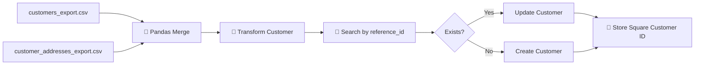
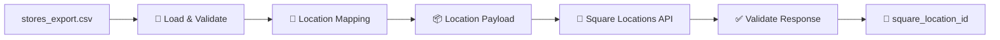
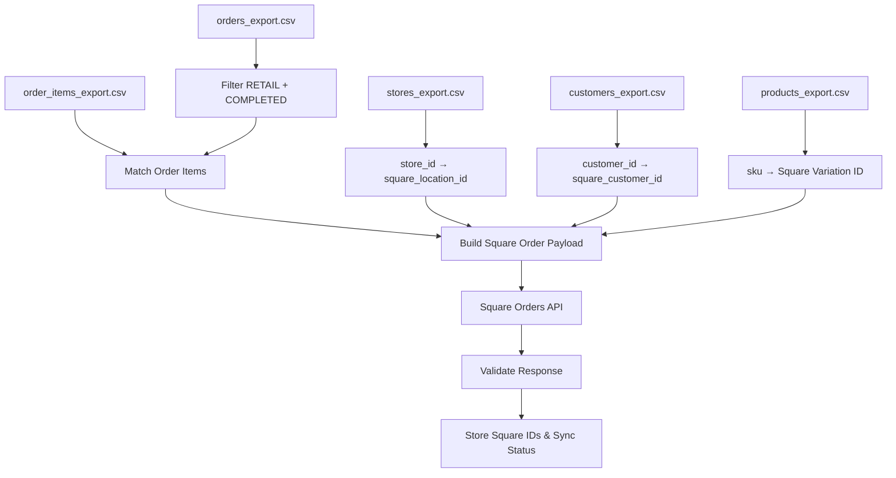
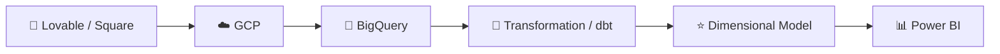

# Entity Mapping

## Lovable → Square

| Lovable Entity | Square Resource | Status |
|---|---|---|
| products | Catalog | ✅ Completed |
| customers | Customers | ✅ Completed |
| customer_addresses | Customers | ✅ Completed |
| stores | Locations | ✅ Completed |
| orders | Orders | ✅ Completed |
| order_items | Order Line Items | ✅ Completed |
| payments | Payments | ⏭️ Out of Scope |
| loyalty_settings | Loyalty | ⏭️ Out of Scope |
| loyalty_transactions | Loyalty | ⏭️ Out of Scope |
| tax_settings | Catalog Tax | ⏭️ Out of Scope |

> 💡 The Square integration phase focuses on the core commerce entities required to demonstrate API-based ingestion, transformation, entity mapping, synchronization, and response validation. Payment, loyalty, and tax synchronization are intentionally excluded from the current scope so the project can move forward into the cloud data engineering phase.

---

# 🔄 Square API Integration Flow

The Lovable commerce data is exported as CSV files, transformed with Python and Pandas, mapped to Square API schemas, and synchronized with Square Sandbox.


The same integration pattern is reused across multiple commerce entities.

```text
Products  → Square Catalog API
Customers → Square Customers API
Stores    → Square Locations API
Orders    → Square Orders API
```

---

# 📦 Product Integration

Product data exported from Lovable is transformed into the structure required by the Square Catalog API.

### 📋 Process

| Step | Process | Description |
|---:|---|---|
| 1 | 📄 Export | Export product data from Lovable as CSV |
| 2 | 🐼 Load | Load source data into Pandas |
| 3 | 🔍 Validate | Check missing values, duplicate SKUs, and source quality |
| 4 | 🧩 Map | Map Lovable fields to Square Catalog objects |
| 5 | 🧹 Transform | Convert source values into Square-compatible formats |
| 6 | 🔎 Duplicate Check | Search Square by SKU before creating a new object |
| 7 | 📦 Build Payload | Construct `ITEM` and `ITEM_VARIATION` payloads |
| 8 | 🔗 Sync | Send objects through the Square Catalog API |
| 9 | ✅ Validate | Validate Square API responses |
| 10 | 💾 Store Mapping | Save Square-generated catalog object IDs |

### 🧩 Example Field Mapping

| Lovable Source Field | Square Target Field | Transformation Rule |
|---|---|---|
| `name` | `item_data.name` | Convert to a non-empty string |
| `description` | `item_data.description` | Replace missing values with an empty string |
| `sku` | `item_variation_data.sku` | Convert to string and validate uniqueness |
| `price` | `price_money.amount` | Convert CAD to cents |
| — | `price_money.currency` | Set to `CAD` |
| `is_active` | `present_at_all_locations` | Convert to Boolean |

#### Price Transformation Example

```text
12.50 CAD → 1250
```

Square stores monetary values using the smallest currency unit, so Canadian dollar values are converted to cents before being sent to the API.

### 🔑 Product ID Mapping

Square-generated IDs are stored alongside the original Lovable identifiers.

| Source Field | Stored Square Field |
|---|---|
| `product_id` | `square_catalog_object_id` |
| `sku` | Square Item Variation ID |
| sync result | `square_sync_status` |
| sync timestamp | `square_synced_at` |

This mapping prevents duplicate object creation and allows future updates to target existing Square objects.

---

# 👤 Customer Integration

Customer records and customer address data are combined and synchronized through the Square Customers API.



### Key Implementation Details

- Customer and address records are merged before transformation.
- The default customer address is included in the Square payload.
- Lovable customer identifiers are preserved using Square `reference_id`.
- Existing Square customers are searched before creating new records.
- Existing customers can be updated instead of duplicated.
- Square customer IDs and synchronization metadata are written back to the source dataset.

### Customer Mapping

| Lovable | Square |
|---|---|
| `id` | `reference_id` |
| customer name | `given_name` / `family_name` |
| email | `email_address` |
| phone | `phone_number` |
| default address | `address` |
| — | `square_customer_id` |

---

# 🏪 Store Integration

Lovable store records are synchronized with Square Locations.



Each store is mapped to a physical Square location.

### Location Configuration

```text
type      = PHYSICAL
timezone  = America/Vancouver
country   = CA
province  = BC
```

Store information such as the store name, street address, city, province, postal code, and timezone is transformed into the format expected by Square.

The generated `square_location_id` is stored and later used to associate orders with the correct retail location.

---

# 🧾 Order Integration

Completed retail orders are synchronized through the Square Orders API.

Only orders matching the following conditions are included:

```text
channel      = RETAIL
order_status = COMPLETED
```



### Order Entity Resolution

Before an order can be sent to Square, local identifiers are resolved into the corresponding Square identifiers.

| Source Identifier | Square Identifier |
|---|---|
| `store_id` | `square_location_id` |
| `customer_id` | `square_customer_id` |
| `sku` | Square Item Variation ID |
| `order_id` | `reference_id` |

Guest orders can be created without a Square customer ID.

---

# 🔐 Idempotency & Duplicate Protection

Order creation uses deterministic idempotency keys.

Example:

```text
ccf-sandbox-order-CCF-000004-v1
```

This reduces the risk of duplicate Square orders when a pipeline is retried.

The pipeline also checks locally stored synchronization fields before processing previously completed orders.

```text
square_sync_status = SUCCESS
square_order_id     = <Square Order ID>
```

Successfully synchronized orders are skipped during future executions.

---

# 💾 Request / Response Recovery

Square order requests and responses are stored locally for validation and recovery.

Example:

```text
data/processed/
├── CCF-000004_request.json
└── CCF-000004_response.json
```

Before retrying a request, the pipeline verifies that the newly generated payload matches the previously stored payload.

If the Square response has already been received but the local CSV update failed, the stored response can be reused to complete the local synchronization process without creating another Square order.

---

# ✅ Order Response Validation

After Square creates an order, the pipeline validates the returned data before marking the synchronization as successful.

Validation includes:

- Square `reference_id` matches the original Lovable `order_id`
- Square `location_id` matches the mapped store location
- Original line item IDs match Square line item UIDs
- Catalog object IDs are captured for each order item

Square-generated values are then written back to the source datasets.

### Orders

```text
square_order_id
square_customer_id
square_location_id
square_sync_status
square_synced_at
square_sync_error
```

### Order Items

```text
square_line_item_uid
square_catalog_object_id
```

---

# 🛡️ Pipeline Reliability

The Square synchronization layer includes several safeguards designed to make repeated pipeline execution safer.

### Implemented Controls

- Duplicate source order validation
- Existing synchronization detection
- Square ID lookup validation
- Deterministic idempotency keys
- Request payload persistence
- Response persistence
- Previous request comparison
- Partial-failure recovery
- Response entity validation
- Atomic-style CSV replacement using temporary files

These controls help demonstrate production-oriented data engineering concepts beyond simply sending API requests.

---

# ⏭️ Deferred Square Integrations

The following entities are intentionally excluded from the current Square synchronization scope:

```text
Payments
Loyalty Settings
Loyalty Transactions
Tax Settings
```

The original Lovable data remains available for downstream analytics and cloud ingestion.

The purpose of the Square phase is to demonstrate a reusable integration pattern across the core commerce entities rather than reproduce every operational capability available in Square.

---

# ✨ Square Integration Summary

The Square integration layer now supports the core commerce workflow across products, customers, stores, and completed retail orders.

```text
Lovable
   │
   ├── Products ──────────→ Square Catalog
   ├── Customers ─────────→ Square Customers
   ├── Stores ────────────→ Square Locations
   └── Retail Orders ─────→ Square Orders
             │
             ▼
      ID Mapping & Validation
             │
             ▼
      Synchronization Metadata
```

The pipeline demonstrates:

- Python/Pandas-based ingestion
- Source-to-target schema mapping
- API payload transformation
- REST API integration
- Entity ID resolution
- Idempotent order creation
- Duplicate prevention
- Data validation
- Failure recovery
- Synchronization metadata management

With the operational API integration layer completed, the next stage of the project focuses on building the cloud data platform using **Google Cloud Platform and BigQuery**.

