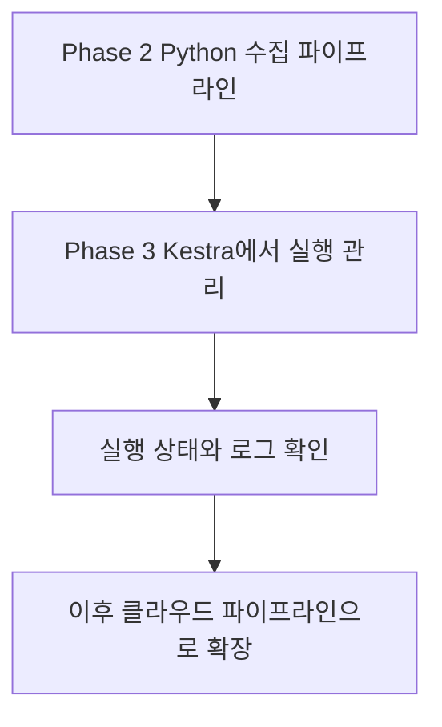
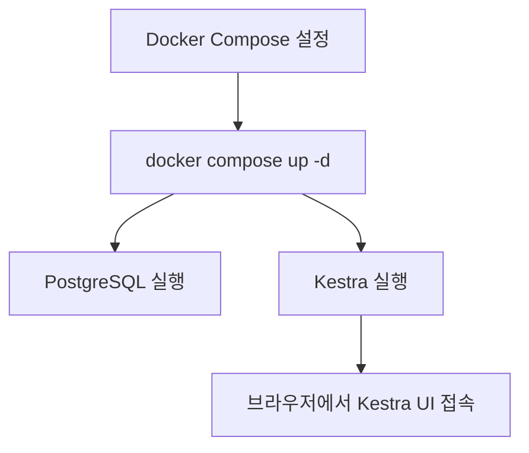
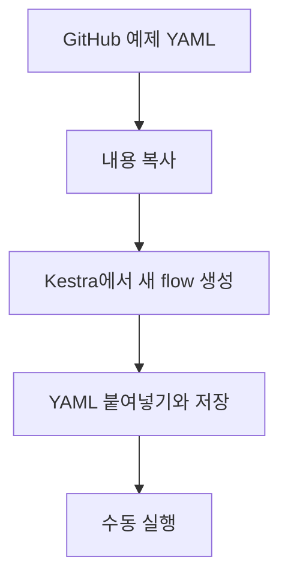
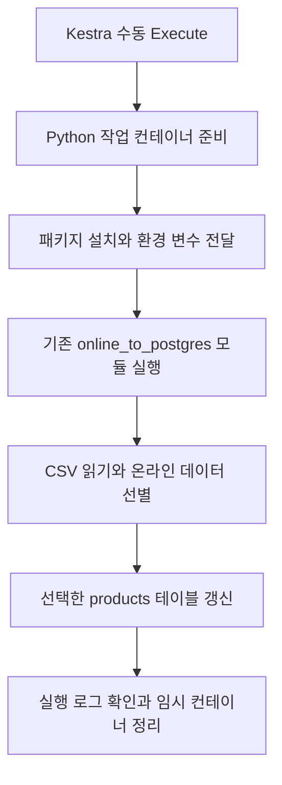

# 🍫 Phase 3 — Kestra를 이용한 파이프라인 실행 관리

> 프로젝트: Charlie’s Chocolate Factory — Omnichannel Retail Data Platform  
> 현재 상태: 온라인 5개·Square 4개 테이블의 개별 Kestra Flow 수동 실행 성공  
> 최종 업데이트: 2026-10-30  
> 다음 단계: DB 메타데이터·재실행 검증 → 개별 Flow를 호출하는 상위 Flow 구성 → 스케줄 검토

---

## 1. Phase 3를 시작한 이유

Phase 2에서는 온라인 CSV와 Square API에서 데이터를 수집해 로컬 PostgreSQL에 저장하는 작업을 진행했습니다. Square 주문 데이터까지 PostgreSQL에 저장된 것을 확인했습니다.

지금까지는 터미널에서 Python 명령어를 직접 실행했습니다. 앞으로는 **Kestra를 이용해 기존 데이터 파이프라인을 실행하고, 실행 상태와 로그를 확인하는 방법**을 배우려고 합니다.



Phase 3의 첫 목표는 **기존 Python 파이프라인 하나를 Kestra에서 수동으로 실행하고 결과를 확인하는 것**입니다. 그 후 필요에 따라 다른 파이프라인과 자동 실행으로 확장할 계획입니다.

> 업데이트: 온라인 5개와 Square 4개 테이블의 개별 Flow 실행에 성공했습니다. 상위 Flow 연결과 스케줄에 의한 자동 실행은 아직 진행하지 않았습니다.

---

## 2. Docker Compose에 Kestra 추가

초콜릿 프로젝트에서 사용하던 Docker Compose 설정 파일에 **Kestra 서비스 설정**을 추가했습니다. PostgreSQL과 Kestra를 Docker Compose로 함께 실행할 수 있는 환경을 준비했습니다.

| 실제 서비스 이름 | 이미지 | 역할 |
|---|---|---|
| `postgres` | `postgres:18` | 초콜릿 프로젝트 DB인 `chocolate_db` 운영 |
| `kestra_postgres` | `postgres:18` | Kestra의 워크플로 및 실행 상태 관리용 DB |
| `kestra` | `kestra/kestra:v1.1` | UI 제공과 워크플로 실행 관리 |

두 PostgreSQL 서비스는 목적과 저장 볼륨이 분리되어 있습니다. Kestra 작업용 Python 컨테이너는 task 실행 시 별도로 생성됩니다.

각 역할은 다음과 같습니다.

| 구성 요소 | 역할 |
|---|---|
| Docker Compose 설정 파일 | 어떤 서비스를 어떤 설정으로 실행할지 정의 |
| PostgreSQL | 프로젝트 데이터를 저장하는 데이터베이스 |
| Kestra | Workflow를 실행하고 실행 상태와 로그를 관리하는 도구 |

확인한 설정:

- Kestra UI: `http://localhost:8080/`
- 프로젝트 PostgreSQL 공개 포트: `5432:5432`
- 프로젝트 네트워크: `chocolate-commerce-data-platform_default`
- 영구 볼륨: `chocolate_postgres_data`, `kestra_postgres_data`, `kestra_data`, `kestra_tmp`
- Docker 소켓 연결: `/var/run/docker.sock:/var/run/docker.sock`

Windows에서는 Docker Desktop의 엔진이 먼저 실행 중이어야 합니다. `docker compose up -d`는 엔진을 켜는 명령이 아니라 프로젝트 컨테이너를 생성하거나 시작하는 명령입니다. Docker Desktop 창이 보이지 않아도 백그라운드 엔진이 실행 중이면 사용할 수 있습니다.

### 실행 명령어

프로젝트의 Compose 설정을 이용해 다음 명령어로 서비스를 시작했습니다.

```bash
docker compose up -d
```

| 부분 | 의미 |
|---|---|
| `docker compose` | Compose 설정을 이용해 여러 서비스를 관리 |
| `up` | 설정된 서비스를 생성하거나 시작 |
| `-d` | 터미널을 계속 점유하지 않고 백그라운드에서 실행 |

이후 PostgreSQL과 Kestra를 실행하고, 브라우저에서 Kestra UI에 접속했습니다.



---

## 3. 두 종류의 YAML 구분하기

이번 과정에서는 서로 역할이 다른 YAML을 사용했습니다.

| 파일 또는 설정 | 위치 | 역할 |
|---|---|---|
| Docker Compose YAML | 초콜릿 프로젝트 | PostgreSQL과 Kestra 등 서비스를 어떻게 실행할지 정의 |
| Kestra workflow YAML | GitHub 예제에서 복사해 Kestra UI에 저장 | Kestra가 어떤 작업을 어떤 순서로 실행할지 정의 |

**Docker Compose는 Kestra 프로그램을 실행하고, workflow YAML은 실행된 Kestra에게 할 일을 알려줍니다.**

Kestra를 실행했다고 DE Zoomcamp의 예제 workflow가 자동으로 나타나는 것은 아닙니다. 예제 내용을 별도로 Kestra에 등록해야 합니다.

---

## 4. 강의 예제 workflow 가져오기

DE Zoomcamp 저장소의 `02-workflow-orchestration/flows` 폴더에는 강의에서 사용하는 여러 YAML 예제가 있습니다. 이번에는 **Kestra 기본 개념을 배우는 hello 예제**를 사용했습니다.

1. GitHub에서 강의 예제 YAML을 열었습니다.
2. YAML 내용을 복사했습니다.
3. Kestra UI에서 새 flow를 만들었습니다.
4. 예제 YAML을 편집기에 붙여넣고 저장했습니다.
5. 저장한 flow를 직접 실행했습니다.



**Save**는 workflow의 정의를 Kestra에 저장하는 것이고, **Execute**는 저장한 workflow를 실제로 한 번 실행하는 것입니다.

---

## 5. 첫 번째 workflow 실행 결과 🎉

실행할 때 이름 input에 **`Mandy`**를 입력했습니다. 실행 결과는 **SUCCESS**로 표시되었습니다.

```text
입력값: name = Mandy
        ↓
Kestra가 예제 workflow 실행
        ↓
실행 결과: SUCCESS ✅
```

이 실행을 통해 다음을 확인했습니다.

- Kestra UI에서 예제 workflow를 저장할 수 있습니다.
- 실행할 때 input을 입력할 수 있습니다.
- 실행한 workflow의 상태를 Kestra에서 확인할 수 있습니다.
- 현재 Kestra 환경에서 이 강의 예제를 성공적으로 실행했습니다.

**SUCCESS는 해당 예제 실행이 성공했다는 뜻입니다.** 초콜릿 프로젝트의 Python 코드 실행이나 Square·PostgreSQL 연결까지 검증했다는 의미는 아닙니다.

### 추가로 살펴볼 실행 화면

아래는 복습할 항목이며, 개별 화면을 모두 확인했다고 가정하지 않습니다.

- [ ] **Logs**: 이름을 사용한 메시지와 각 task의 로그 살펴보기
- [ ] **Outputs**: Return task가 만든 결과 확인하기
- [ ] **Gantt**: Sleep task의 대기 시간과 각 task의 실행 시간 보기
- [ ] **Topology**: task 구성과 연결 관계 살펴보기
- [ ] 필요하면 다른 이름으로 다시 실행해 execution 기록 비교하기

> 로그의 세부 문구와 output 값은 실제 실행 화면에서 확인합니다.

---

## 6. 초콜릿 프로젝트의 Docker 환경에서 강의 예제가 실행된 이유

이번 hello 예제는 **맨디의 Python 프로젝트 파일을 실행하는 예제는 아니었습니다.** 이름을 받아 메시지를 만들고, 로그를 기록하고, 결과를 만들거나 잠시 기다리는 등 Kestra의 기본 기능을 연습하는 예제입니다.

```text
이번 hello 예제에 필요했던 것
    ✅ 실행 중인 Kestra
    ✅ 예제 YAML에서 사용하는 task 기능
    ✅ 실행할 때 입력한 이름

이번 예제에서 별도로 실행하지 않은 것
    — 초콜릿 프로젝트의 Python 파이프라인
    — Square API 수집 작업
    — 초콜릿 데이터의 PostgreSQL 적재 작업
```

Kestra가 초콜릿 프로젝트의 Compose 설정을 통해 실행되더라도, 강의의 독립적인 예제 workflow를 Kestra에 등록해 실행할 수 있습니다. 다만 **아무 Docker 컨테이너나 켜져 있으면 되는 것은 아니며**, Kestra가 실행 중이고 예제에서 사용하는 기능을 사용할 수 있어야 합니다.

---

## 7. 강의에서 배운 주요 개념

| 개념 | 쉬운 설명 | 이번 예제와 연결 |
|---|---|---|
| **Workflow / Flow** | 전체 작업을 적어둔 계획 | Kestra에 저장한 hello 예제 |
| **Task** | 계획 안의 개별 작업 | Log, Return, Sleep 등 |
| **Execution** | Workflow를 실제로 한 번 실행한 기록 | `Mandy`를 입력하고 실행한 기록 |
| **Input** | 실행할 때 전달하는 값 | `name`에 입력한 `Mandy` |
| **Variable** | Workflow 안에서 이름을 붙여 정의한 값 | 입력값을 이용한 메시지 구성 |
| **Output** | Task가 만든 결과 | Return task의 결과를 이후 task에서 사용 |
| **Trigger** | 자동 실행을 시작하는 조건 | 강의의 schedule 예제 |
| **Concurrency** | 같은 workflow의 동시 실행 제한 | 강의에서 최대 2개 실행 시연 |

강의에서 trigger는 자동으로 실행되지 않도록 비활성화한 예제로 설명했습니다. Concurrency 시연의 실제 설정은 **동시 실행 2개**였으며, 세 번째 실행은 제한으로 실패했습니다.

---

## 8. 첫 실습 경로 선택과 Python 실행 옵션 추가

### 데이터 출처와 코드 역할 구분

| 코드 또는 경로 | 역할 | 이번 적재 대상 여부 |
|---|---|---|
| `products_pipeline.py` | 상품 CSV를 Square 등록용 JSON으로 변환 | 아니요 |
| `inspect_square_catalog.py` | Square Catalog API 조회와 출력 | 아니요 |
| `online_to_postgres.py` | 온라인 CSV 읽기 → 선별 → PostgreSQL 저장 | **이번 실행 대상** |
| Square API → `raw_square` | 매장 POS 분석 데이터 수집 | 고객·매장·주문·카탈로그 개별 Flow 실행 성공 |

이번에는 **온라인 상품 CSV → `raw_online.products`** 경로부터 적용했습니다. 상품 전용 파일을 별도로 만들 필요는 없었으며, 기존 파이프라인에 적재 대상을 선택하는 옵션을 추가했습니다.

```bash
# 기존 방식대로 전체 테이블 적재
python -m src.pipelines.online_to_postgres

# 상품만 적재
python -m src.pipelines.online_to_postgres --tables products

# 여러 테이블 선택
python -m src.pipelines.online_to_postgres --tables customers customer_addresses
```

`argparse`의 `--tables`, `nargs="+"`, `choices=LOAD_ORDER`로 입력을 받고, 사용자가 입력한 순서와 관계없이 기존 `LOAD_ORDER` 순서대로 선택한 테이블을 적재합니다.

**현재 옵션은 적재 범위만 조절합니다.** `load_online_data()`와 `filter_online_data()`를 그대로 재사용하므로 CSV 5개를 모두 읽고 선별하지만, DB 갱신은 선택한 테이블에만 수행합니다. 상품만 실행하더라도 원본 CSV 5개가 모두 필요합니다.

### 로컬 실행으로 먼저 검증

| 데이터 | 추출 행 수 | 변환 후 행 수 | 상품 선택 실행의 DB 적재 |
|---|---:|---:|---|
| products | 15 | 15 | 15행 |
| customers | 20 | 10 | 실행하지 않음 |
| customer_addresses | 20 | 10 | 실행하지 않음 |
| orders | 36 | 14 | 실행하지 않음 |
| order_items | 92 | 37 | 실행하지 않음 |

로컬에서 `--tables products` 실행이 성공한 뒤 동일한 명령을 Kestra에 연결했습니다.

---

## 9. 컨테이너에서 사용할 Python과 DB 설정 준비

### 패키지 목록

Windows `.venv`는 작업 컨테이너로 자동 전달되지 않습니다. 프로젝트 루트에 `requirements.txt`를 만들고, 로컬에서 성공한 버전을 기록했습니다.

```text
pandas==3.0.5
SQLAlchemy==2.1.4
psycopg2-binary==2.9.13
python-dotenv==1.2.3
requests
```

- `pandas`: CSV와 DataFrame 처리
- `SQLAlchemy`: DB 연결과 SQL 실행
- `psycopg2-binary`: PostgreSQL 드라이버
- `python-dotenv`: `.env` 설정 읽기
- `requests`: Square API HTTP 호출. Square Flow 실행 중 누락 오류를 확인한 뒤 추가했습니다. 현재 직접 버전을 고정하지 않았습니다.

Kestra 작업에는 `python:3.14.0-slim` 이미지를 사용했고, 실제 Linux 컨테이너에서 위 패키지 설치와 파이프라인 실행 성공을 확인했습니다. 의존 패키지인 NumPy 등도 pip가 함께 설치했습니다. 전이 의존성 전체를 잠근 lock 파일은 아직 별도로 구성하지 않았습니다.

### 환경 변수로 DB 연결 정보 분리

`src/load/postgres/connection.py`에서 고정된 접속 정보를 환경 변수로 읽도록 변경했습니다. `load_dotenv()`와 SQLAlchemy `URL.create()`를 사용합니다.

| 변수 | 기본값 또는 용도 |
|---|---|
| `CHOCOLATE_DB_USER` | `chocolate` |
| `CHOCOLATE_DB_PASSWORD` | 필수 비밀번호이며 값은 문서에 기록하지 않음 |
| `CHOCOLATE_DB_HOST` | 로컬 기본값 `localhost`, 작업 컨테이너에서는 `postgres` |
| `CHOCOLATE_DB_PORT` | `5432` |
| `CHOCOLATE_DB_NAME` | `chocolate_db` |

`localhost`는 프로그램이 실행되는 환경 자신을 가리킵니다. Windows에서 직접 실행하면 공개된 포트를 통해 `localhost:5432`에 연결하고, 같은 Docker 네트워크의 작업 컨테이너에서는 서비스 이름인 `postgres:5432`에 연결합니다.

현재는 프로젝트 폴더 안의 `.env`를 Python이 읽습니다. 기본 `load_dotenv()`는 이미 전달된 환경 변수를 덮어쓰지 않으므로 Kestra에서 지정한 `CHOCOLATE_DB_HOST=postgres`가 유지됩니다. 인증 정보는 Git에 커밋하지 않습니다. Kestra Secret을 통한 명시적 전달은 이후 개선 항목입니다.

---

## 10. Kestra Docker 작업 실행 환경 연결

### 작업 컨테이너의 폴더 연결 허용

Compose의 **`environment` → `KESTRA_CONFIGURATION` 문자열 내부 → 기존 `kestra:` 아래**에 다음 설정을 추가했습니다.

```yaml
kestra:
  plugins:
    configurations:
      - type: io.kestra.plugin.scripts.runner.docker.Docker
        values:
          volume-enabled: true
```

위 코드는 내부 설정 발췌이며 Compose 전체 파일이 아닙니다. 기존 `server`, `repository`, `storage`, `queue` 등은 유지했습니다.

주의한 점:

- `services.kestra`의 직접 속성으로 `plugins`를 추가하지 않습니다.
- 내부 `server:` 설정이 중복되지 않도록 정리했습니다.
- `docker compose config --quiet`는 Compose 구조 검사이며 내부 설정 문자열 전체까지 검증하지는 않습니다.

```bash
docker compose config --quiet
docker compose up -d kestra
```

설정 반영 후 `kestra_postgres`가 Healthy, `kestra`가 Started인 것을 확인하고 UI에 다시 접속했습니다.

### 네트워크 확인

```bash
docker network ls
```

프로젝트 네트워크 이름을 확인하고 작업 runner에 지정했습니다.

```yaml
taskRunner:
  type: io.kestra.plugin.scripts.runner.docker.Docker
  networkMode: chocolate-commerce-data-platform_default
```

### 프로젝트 폴더 연결과 Windows 경로 오류 해결

처음 사용한 `C:/Users/...:/project:ro`는 docker-java의 Bind 파서에서 오류가 발생했습니다. Docker Desktop의 Linux 측 경로로 변경한 뒤 정상 연결됐습니다.

```yaml
volumes:
  - "/run/desktop/mnt/host/c/Users/smmhk/PycharmProjects/chocolate-commerce-data-platform:/project:ro"
```

| 부분 | 의미 |
|---|---|
| `/run/desktop/mnt/host/c/...` | 이번 Docker Desktop 환경에서 확인된 호스트 프로젝트 경로 |
| `/project` | Python 작업 컨테이너에서 보이는 경로 |
| `ro` | 프로젝트 파일을 읽기 전용으로 연결 |

이 경로는 다른 컴퓨터의 Docker 환경에서는 달라질 수 있습니다. 읽기 전용은 연결한 파일에 대한 제한이며, 네트워크로 접근하는 PostgreSQL에 쓰는 것은 가능합니다.

---

## 11. 단계별 사전 검사와 결과

`check_python_environment`라는 flow를 만들어 검사를 진행했습니다. 먼저 Python과 네트워크를 검사했고, 이후 script를 파일 검사로 교체했습니다.

| 검사 | 성공 로그 | 확인 범위 |
|---|---|---|
| Python 실행 | `[PYTHON] 3.14.0 ...` | 작업 컨테이너에서 Python 실행 가능 |
| DB 포트 연결 | `[SUCCESS] PostgreSQL port is reachable` | `postgres:5432` TCP 연결 가능 |
| 프로젝트 파일 | `[FOUND] ...` 3개 | 지정한 파일 존재 확인 |

파일 검사 결과:

```text
[FOUND] /project/src/pipelines/online_to_postgres.py
[FOUND] /project/data/raw/products_export.csv
[FOUND] /project/requirements.txt
[DONE] Project file access check
```

포트 검사는 DB 인증이나 적재 성공을 의미하지 않고, 파일 존재 검사도 패키지 import나 CSV 내용 검증까지 수행하지 않습니다. 이를 구분한 뒤 실제 적재로 넘어갔습니다.

작업 후 `Container deleted`, `Volume deleted`는 임시 작업 자원의 정상 정리 로그입니다. 프로젝트 PostgreSQL의 영구 볼륨 삭제를 의미하지 않습니다. `Captured 0 output file(s)`는 별도 결과 파일을 수집하지 않았다는 뜻이며 DB 적재 실패를 의미하지 않습니다.

---

## 12. 온라인 상품의 Kestra 적재 성공

### 실제 적재 workflow

파일 검사 flow와 별도로 실제 실행용 flow를 사용했습니다. 아래 YAML은 이후 추가한 실행 메타데이터 전달까지 반영한 현재 구성입니다.

```yaml
id: online_products_to_postgres
namespace: chocolate

tasks:
  - id: load_products
    type: io.kestra.plugin.scripts.python.Commands

    containerImage: python:3.14.0-slim

    taskRunner:
      type: io.kestra.plugin.scripts.runner.docker.Docker
      networkMode: chocolate-commerce-data-platform_default
      volumes:
        - "/run/desktop/mnt/host/c/Users/smmhk/PycharmProjects/chocolate-commerce-data-platform:/project:ro"

    env:
      CHOCOLATE_DB_HOST: postgres
      PYTHONDONTWRITEBYTECODE: "1"
      PIPELINE_ORCHESTRATOR: kestra
      PIPELINE_RUN_ID: "{{ execution.id }}"

    beforeCommands:
      - pip install -r /project/requirements.txt

    commands:
      - cd /project && python -m src.pipelines.online_to_postgres --tables products
```

| 설정 | 역할 |
|---|---|
| `containerImage` | Python 3.14.0 실행 환경 |
| `taskRunner` | 별도 Docker 작업 컨테이너 사용 |
| `env` | DB 호스트와 실행 식별 정보 전달 |
| `PYTHONDONTWRITEBYTECODE` | 읽기 전용 폴더에 `.pyc` 캐시 생성을 시도하지 않게 설정 |
| `beforeCommands` | 실행 전 필요한 패키지 설치 |
| `commands` | 프로젝트 루트에서 기존 Python 모듈 실행 |

### 실제 실행 로그

2026-10-30 실행에서 패키지 설치 후 다음 로그를 확인했습니다. 아래는 **메타데이터 추가 전 첫 적재 성공 로그**의 발췌입니다.

```text
[START] Online → PostgreSQL ingestion
[INFO] Tables to load: products
[EXTRACT] products rows: 15
[EXTRACT] customers rows: 20
[EXTRACT] customer_addresses rows: 20
[EXTRACT] orders rows: 36
[EXTRACT] order_items rows: 92
[TRANSFORM] products rows: 15
[TRANSFORM] customers rows: 10
[TRANSFORM] customer_addresses rows: 10
[TRANSFORM] orders rows: 14
[TRANSFORM] order_items rows: 37
[SUCCESS] raw_online.products loaded (15 rows)
[LOAD] products rows: 15
[DONE] Online → PostgreSQL ingestion
Command succeed with exit code 0
```

로그 기준 전체 실행은 약 24초였고, 상당 부분은 패키지 설치에 사용됐습니다. 매번 패키지를 설치하는 현재 구성을 사용하고 있으며, 패키지를 미리 포함한 Docker 이미지로 바꾸는 것은 아직 진행하지 않았습니다.

### 실제 실행 구조



Kestra는 실행 순서와 상태를 관리하고, 실제 CSV 읽기와 DB 저장은 기존 Python 코드가 수행합니다. 아직 예약 실행 트리거는 없습니다.

---

## 13. 적재 메타데이터로 실행 추적

### 기존 날짜와 행 수만으로 부족했던 이유

같은 CSV를 PyCharm과 Kestra에서 각각 실행하면 상품 내용과 행 수가 같습니다. 따라서 `COUNT(*) = 15`만으로는 어떤 실행이 적재했는지 구분하기 어렵습니다.

원본의 `created_at`, `updated_at`은 상품의 생성·수정 시각입니다. CSV 값을 그대로 저장하므로 다시 적재해도 오늘 날짜로 바뀌지 않습니다. 이를 적재 시각과 구분하기 위해 다음 컬럼을 추가했습니다.

| 컬럼 | PostgreSQL 타입 | 의미 |
|---|---|---|
| `ingested_at` | `TIMESTAMPTZ` | 이번 파이프라인 적재 시각을 UTC로 생성 |
| `orchestrator` | `VARCHAR(50)` | 실행 경로 식별값인 `local` 또는 `kestra` |
| `pipeline_run_id` | `VARCHAR(100)` | 로컬 UUID 또는 Kestra execution ID |

컬럼 이름은 프로젝트의 명명 규칙이며 특정 도구의 필수 표준은 아닙니다. `local`은 오케스트레이터 제품명이 아니라 이 프로젝트에서 직접 실행을 나타내는 값입니다.

### DB 컬럼 추가

공통 적재 함수를 사용하는 `raw_online`의 5개 테이블에 동일한 컬럼을 추가했습니다.

```sql
ALTER TABLE raw_online.products
    ADD COLUMN IF NOT EXISTS ingested_at TIMESTAMPTZ,
    ADD COLUMN IF NOT EXISTS orchestrator VARCHAR(50),
    ADD COLUMN IF NOT EXISTS pipeline_run_id VARCHAR(100);
```

같은 변경을 `customers`, `customer_addresses`, `orders`, `order_items`에도 적용했습니다. DBeaver에서 컬럼이 이미 존재한다는 안내가 나왔고, 이는 `IF NOT EXISTS`에 의해 재추가를 건너뛴 정상 메시지입니다. 기존 행의 메타데이터는 다음 적재 전까지 NULL일 수 있습니다.

### Python 실행 단위 메타데이터

`online_to_postgres.py`에서 한 번의 실행에 공통으로 사용할 값을 생성하도록 변경했습니다.

```python
import os
from datetime import datetime, timezone
from uuid import uuid4

# run() 안에서 한 번 생성
ingested_at = datetime.now(timezone.utc)
orchestrator = os.getenv("PIPELINE_ORCHESTRATOR", "local")
pipeline_run_id = os.getenv("PIPELINE_RUN_ID") or str(uuid4())
```

위 발췌의 세 대입문은 실제 `run()` 본문 들여쓰기 수준에 맞춰 배치합니다. 각 테이블 적재 전에는 원본 DataFrame의 복사본에 같은 값을 추가합니다.

```python
df = online_data[table_name].copy()
df["ingested_at"] = ingested_at
df["orchestrator"] = orchestrator
df["pipeline_run_id"] = pipeline_run_id
```

`load_table.py`는 전달받은 DataFrame을 저장하는 기존 구조를 유지합니다. 상품만 별도로 `ingested_at`을 덮어쓰는 중복 코드는 두지 않습니다. 여기서 시각은 메타데이터 생성 시각이며 DB 커밋 완료 시각 자체는 아닙니다.

### 확인 SQL

```sql
SELECT
    orchestrator,
    pipeline_run_id,
    ingested_at,
    COUNT(*) AS row_count
FROM raw_online.products
GROUP BY orchestrator, pipeline_run_id, ingested_at;
```

DB의 실행 ID를 Kestra execution ID와 대조하면 해당 실행으로 저장된 데이터를 추적할 수 있습니다. 사용자가 **Kestra를 통한 온라인 상품 적재 결과를 DB에서도 확인했다**고 최종 확인했습니다. 메타데이터 추가 후의 실제 실행 ID와 날짜 값은 대화에 별도로 제공되지 않았으므로 이 문서에 임의로 기입하지 않습니다.

전체 컬럼을 개별적으로 보려면 `SELECT * FROM raw_online.products;`를 사용합니다. `SELECT products AS products`는 PostgreSQL에서 행을 하나의 복합 값으로 표시할 수 있어 개별 컬럼 확인에 적절하지 않았습니다.

### 현재 적재 방식의 한계

- 기존 행 삭제 후 새 데이터를 넣는 전체 갱신 방식입니다. 재실행 시 중복 누적 대신 같은 데이터를 다시 채웁니다.
- 삭제와 삽입은 한 테이블 단위 트랜잭션이며, 전체 5개 테이블을 묶은 단일 트랜잭션은 아닙니다.
- 행에는 마지막 적재 메타데이터만 남으며 과거 실행 이력 전체를 보존하지 않습니다.
- 같은 오래된 CSV를 다시 읽어도 적재 시각은 새로 생성됩니다. 최근 적재 시각이 원천 데이터의 최신성을 보장하지 않습니다.
- 별도 실행 이력 테이블과 빈 CSV 보호 등은 이후 필요에 따라 보완할 수 있습니다.

---

## 14. 스키마 변경 SQL 관리 방향

개발 중 컬럼을 추가하면 현재 DB에는 `ALTER TABLE`을 실행해야 합니다. 기존 `CREATE TABLE IF NOT EXISTS` 정의를 수정하는 것만으로 이미 존재하는 테이블의 컬럼이 추가되지는 않습니다.

이번에 정한 관리 방향:

1. 최초 테이블 생성 SQL을 유지합니다.
2. 컬럼 추가 변경은 별도 SQL 파일로 관리합니다.
3. 현재는 DBeaver에서 해당 변경 SQL을 직접 실행합니다.
4. 빈 DB를 만들 때는 최초 CREATE 후 변경 SQL을 순서대로 실행합니다.
5. 이미 초기 구조가 있는 STG에는 미적용 변경만 실행합니다.

변경 파일의 제안 경로:

```text
sql/migrations/001_add_ingestion_metadata.sql
```

이 파일의 실제 저장과 Git 커밋 완료 여부는 별도 확인이 필요합니다. 폴더에 파일을 저장하는 것만으로 DEV나 STG에서 자동 실행되지 않습니다. Flyway 같은 마이그레이션 도구나 배포 단계는 아직 구성하지 않았습니다.

**이미 적용한 버전별 마이그레이션 파일은 유지하고 새 변경 파일을 추가**하는 방향입니다. 최신 구조를 요약하는 별도 생성 파일과 순차 실행용 이력 파일은 역할을 구분합니다. 앞서 생성 SQL에도 컬럼을 반영하라는 안내가 있었으므로, 실제 파일을 변경했다면 빈 DB에서 CREATE와 ALTER가 일관되게 적용되도록 정리합니다.

---

## 15. 현재 위치와 다음 단계

### 완료한 작업

- [x] Docker Compose로 프로젝트 DB와 Kestra 환경 실행
- [x] hello 예제에서 `Mandy` 입력과 SUCCESS 확인
- [x] 온라인 상품 CSV → PostgreSQL 경로를 첫 적용 대상으로 선택
- [x] 기존 파이프라인에 `--tables` 선택 옵션 추가
- [x] 로컬에서 상품만 15행 적재 성공
- [x] `requirements.txt`와 환경 변수 기반 DB 연결 준비
- [x] Docker runner의 볼륨 연결 허용 설정
- [x] Python 작업 컨테이너의 프로젝트 네트워크 연결 확인
- [x] Python 3.14.0 실행과 PostgreSQL 포트 연결 성공
- [x] Windows 경로 오류 해결 후 프로젝트 파일 접근 확인
- [x] Kestra에서 기존 Python 모듈 실행과 상품 15행 적재 성공
- [x] 온라인 5개 테이블의 적재 메타데이터 컬럼 추가
- [x] 실행 시각과 실행 ID를 기록하도록 Python 및 workflow 설정 변경
- [x] 사용자가 DB에서 Kestra 온라인 상품 적재 결과 최종 확인

### 다음 작업

- [ ] 실제 workflow YAML을 프로젝트 파일로도 저장하고 Git에서 관리
- [ ] 변경 SQL 파일 저장 및 코드·설정 변경의 Git 커밋 여부 확인
- [ ] Kestra `inputs`로 적재할 테이블을 선택하도록 확장
- [x] 온라인 5개 테이블을 각각 개별 Kestra Flow로 실행 성공
- [x] Square 고객·매장·주문·카탈로그 개별 Kestra Flow 실행 성공
- [x] Square 로더와 파이프라인에 실행 메타데이터 전달·저장 적용
- [ ] 9개 테이블의 DB 메타데이터 및 재실행 전후 결과 최종 검증
- [ ] 기존 개별 Flow를 호출하는 상위 Flow 구성 및 전체 실행 검증
- [ ] 전체 갱신 작업의 동시 실행 제한과 데이터 검증 필요성 검토
- [ ] 필요 시 스케줄 트리거 설정
- [x] Square API 수집 파이프라인 4개의 Kestra 연결
- [ ] 필요에 따라 실행 이력 테이블·Secret 전달·패키지 포함 이미지로 개선
- [ ] 이후 GCS 및 BigQuery 기반 클라우드 ELT 확장

> **현재 완료 범위는 온라인 5개·Square 4개의 개별 Flow 수동 실행 성공입니다.** 사용자가 전체 성공을 확인했습니다. 9개 Flow를 묶은 상위 Flow, 예약 실행, GCP 적재는 아직 완료하지 않았습니다. 모든 테이블의 DB 검증 SQL 결과 및 재실행 비교 결과는 별도로 제공되지 않았습니다.

---

## 16. 이번 작업에서 정리한 핵심 개념

| 구분 | 의미 |
|---|---|
| Docker Desktop 실행 | Docker 엔진을 사용 가능한 상태로 준비 |
| Compose `up -d` | 프로젝트 서비스 컨테이너 생성 또는 시작 |
| Kestra UI 접속 | 실행 중인 Kestra의 웹 화면 열기 |
| Workflow Save | 작업 정의 저장 |
| Workflow Execute | 수동으로 실행 한 번 생성 |
| Trigger | 조건에 따른 자동 실행이며 현재 미설정 |
| Network 연결 | 컨테이너에서 DB 서비스에 접근 |
| Volume 연결 | 컨테이너에서 호스트 코드와 CSV 접근 |
| `requirements.txt` | 패키지 설치 목록이며 실행 환경 자체는 아님 |
| 원본 `updated_at` | 원천 데이터가 수정된 시각 |
| `ingested_at` | 분석용 DB에 이번 적재를 준비하며 생성한 시각 |
| `pipeline_run_id` | 적재 결과와 실행 기록을 연결하는 식별자 |

이 문서는 첨부한 초기 Phase 3 기록을 유지하면서, 2026-10-29~30 대화에서 확인한 설정·코드 변경·로그와 사용자의 완료 확인을 반영했습니다. 비밀번호와 API 토큰은 기록하지 않았습니다.


---

## 17. 온라인 개별 Flow 확장 완료 — 2026-10-30

상품 Flow의 실행 환경을 재사용하고 Flow ID, Task ID, `--tables` 값만 변경해 나머지 온라인 테이블까지 확장했습니다.

| Flow ID | 적재 테이블 | 실행 결과 |
|---|---|---|
| `online_products_to_postgres` | `raw_online.products` | 성공 |
| `online_customers_to_postgres` | `raw_online.customers` | 성공 |
| `online_customer_addresses_to_postgres` | `raw_online.customer_addresses` | 성공 |
| `online_orders_to_postgres` | `raw_online.orders` | 성공 |
| `online_order_items_to_postgres` | `raw_online.order_items` | 성공 |

각 Flow는 `online_to_postgres --tables <테이블명>`을 실행합니다. 별도 실행이므로 테이블마다 execution ID가 달라도 정상입니다. 온라인 전체를 한 번에 실행하는 상위 Flow는 아직 만들지 않았습니다.

### 재실행 시 저장 방식 확인

제공된 `load_table.py`를 확인했습니다. 허용된 테이블에 대해 `DELETE` 후 `df.to_sql(..., if_exists="append")`로 다시 채웁니다. 두 작업은 같은 `engine.begin()` 연결 안에서 수행합니다.

- 같은 CSV로 재실행해도 행이 누적되지 않는 전체 교체 방식입니다.
- 삽입 실패 시 해당 테이블의 삭제도 롤백됩니다.
- 테이블 간 전체 원자성을 보장하는 구조는 아닙니다.
- 빈 DataFrame을 적재하면 기존 행이 삭제되어 테이블이 비워질 수 있습니다.
- 위 내용은 코드 검토 결과이며, 재실행 전후 행 수 비교를 실제 수행했다고 기록하지 않습니다.

## 18. Square API 파이프라인의 Kestra 실행 완료 — 2026-10-30

온라인 개별 Flow 실행을 마친 뒤 Square 고객 → 매장 → 주문 → 카탈로그 순서로 확장했습니다. 사용자는 최종적으로 모두 성공했다고 확인했습니다.

| Flow ID | 실행 Python 모듈 | 대상 테이블 | 상태 |
|---|---|---|---|
| `square_customers_to_postgres` | `src.pipelines.square_customers_to_postgres` | `raw_square.customers` | 성공 |
| `square_locations_to_postgres` | `src.pipelines.square_locations_to_postgres` | `raw_square.locations` | 성공 |
| `square_orders_to_postgres` | `src.pipelines.square_orders_to_postgres` | `raw_square.orders` | 성공 |
| `square_catalog_to_postgres` | `src.pipelines.square_catalog_to_postgres` | `raw_square.catalog_objects` | 성공 |

Square의 주문 상품 정보는 현재 주문 JSON 원본 안에 저장합니다. 이번 작업에서 별도 Square 주문 상품 테이블을 만든 것은 아닙니다.

### 18.1 DB 메타데이터 컬럼 준비

기존 네 테이블에는 모두 `ingested_at`이 있었습니다. 고객에는 `orchestrator`, `pipeline_run_id`도 이미 `TEXT` 타입으로 존재했습니다. 다른 테이블에는 두 컬럼을 추가했습니다.

기존 온라인 메타데이터 ALTER SQL 뒤에 Square 구문을 추가하는 방향으로 정리했으며, 통합 파일명으로 `sql/migrations/add_pipeline_metadata_columns.sql`을 제안했습니다. 실제 저장 파일명 및 Git 커밋 완료는 확인되지 않았습니다.

```sql
ALTER TABLE raw_square.customers
    ADD COLUMN IF NOT EXISTS ingested_at TIMESTAMPTZ,
    ADD COLUMN IF NOT EXISTS orchestrator VARCHAR(50),
    ADD COLUMN IF NOT EXISTS pipeline_run_id VARCHAR(100);

ALTER TABLE raw_square.locations
    ADD COLUMN IF NOT EXISTS ingested_at TIMESTAMPTZ,
    ADD COLUMN IF NOT EXISTS orchestrator VARCHAR(50),
    ADD COLUMN IF NOT EXISTS pipeline_run_id VARCHAR(100);

ALTER TABLE raw_square.orders
    ADD COLUMN IF NOT EXISTS ingested_at TIMESTAMPTZ,
    ADD COLUMN IF NOT EXISTS orchestrator VARCHAR(50),
    ADD COLUMN IF NOT EXISTS pipeline_run_id VARCHAR(100);

ALTER TABLE raw_square.catalog_objects
    ADD COLUMN IF NOT EXISTS ingested_at TIMESTAMPTZ,
    ADD COLUMN IF NOT EXISTS orchestrator VARCHAR(50),
    ADD COLUMN IF NOT EXISTS pipeline_run_id VARCHAR(100);
```

`IF NOT EXISTS`는 기존 컬럼을 건너뛰며 타입을 변경하지 않습니다. 따라서 고객의 기존 `TEXT` 컬럼은 그대로 유지됩니다. SQL을 파일에 저장하는 것만으로 DB에 적용되지 않으며 DBeaver에서 실제 실행하고, 수동 커밋 모드라면 Commit해야 합니다. 최초 생성 SQL의 반영 여부는 별도 확인 항목입니다.

### 18.2 Python 파이프라인과 로더 변경

네 파이프라인 모두 API 조회 후, DB 저장 전에 다음 값을 한 번 생성합니다.

```python
ingested_at = datetime.now(timezone.utc)
orchestrator = os.getenv("PIPELINE_ORCHESTRATOR", "local")
pipeline_run_id = os.getenv("PIPELINE_RUN_ID") or str(uuid4())
```

각 로더에 다음 키워드 인자를 전달하도록 변경했습니다.

```python
ingested_at=ingested_at,
orchestrator=orchestrator,
pipeline_run_id=pipeline_run_id,
```

로더는 `datetime` 타입의 `ingested_at`과 문자열 두 개를 필수 키워드 인자로 받습니다. 기존 `CURRENT_TIMESTAMP` 대신 전달받은 시각을 저장하고, INSERT 및 ON CONFLICT UPDATE 양쪽에 세 컬럼을 반영했습니다.

| 데이터 | Upsert 기준 키 | 유지한 원본 저장 방식 |
|---|---|---|
| 고객 | `square_customer_id` | `payload` JSONB |
| 매장 | `square_location_id` | `payload` JSONB |
| 주문 | `square_order_id` | `payload` JSONB |
| 카탈로그 | `square_object_id` | `object_type` 및 `payload` JSONB |

메타데이터는 원본 JSON 내부에 삽입하지 않고 별도 컬럼으로 저장합니다. 같은 ID를 다시 적재하면 원본과 마지막 실행 메타데이터를 갱신합니다. 원천에서 사라진 ID를 자동 삭제하는 동기화 방식은 아니며, 실행 이력 전체를 보존하지도 않습니다. 각 로더는 `engine.begin()`으로 전달된 행들을 하나의 트랜잭션에 저장하고, 파이프라인은 `finally`에서 `engine.dispose()`를 호출합니다.

주문 파이프라인은 `src.square.location.list_locations()`로 매장을 조회한 뒤 각 매장의 `search_orders(location_ids=[...])` 결과를 모아 한 번에 저장하는 기존 구조를 유지했습니다. 매장이 없으면 오류를 발생시킵니다. 매장 모듈명은 실제 파일명에 맞춰 단수형 `location`을 사용합니다.

### 18.3 Kestra Flow 구성

고객 Flow를 기준으로 아래 환경을 재사용했습니다.

```yaml
id: square_customers_to_postgres
namespace: chocolate

tasks:
  - id: load_square_customers
    type: io.kestra.plugin.scripts.python.Commands
    containerImage: python:3.14.0-slim

    taskRunner:
      type: io.kestra.plugin.scripts.runner.docker.Docker
      networkMode: chocolate-commerce-data-platform_default
      volumes:
        - "/run/desktop/mnt/host/c/Users/smmhk/PycharmProjects/chocolate-commerce-data-platform:/project:ro"

    env:
      CHOCOLATE_DB_HOST: postgres
      PYTHONDONTWRITEBYTECODE: "1"
      PIPELINE_ORCHESTRATOR: kestra
      PIPELINE_RUN_ID: "{{ execution.id }}"

    beforeCommands:
      - pip install -r /project/requirements.txt

    commands:
      - cd /project && python -m src.pipelines.square_customers_to_postgres
```

나머지 Flow에서는 Flow ID, Task ID와 실행 모듈을 해당 데이터용으로 변경했습니다. 매번 별도 작업 컨테이너를 준비하고 `requirements.txt`를 설치합니다. 기존 프로젝트 설정을 통해 Square API 인증과 DB 연결을 사용했으며 인증 값은 문서에 기록하지 않습니다.

### 18.4 오류와 해결 기록

| 발생 위치 | 실제 오류 | 해결 |
|---|---|---|
| 고객 모듈 import | `ModuleNotFoundError: No module named 'requests'` | `requirements.txt`에 `requests` 추가 후 재실행 성공 |
| 매장 DB 저장 | `column "orchestrator" of relation "locations" does not exist` | 대상 DB에 매장 ALTER SQL 적용 후 재실행 성공 |
| 주문 DB 저장 | `column "orchestrator" of relation "orders" does not exist` | 주문 ALTER SQL 실행·커밋 안내 후 사용자가 전체 성공 확인 |

고객 오류는 API 호출 전 import 단계에서 발생했습니다. 매장·주문 오류는 조회 이후 DB 저장 단계에서 발생했으며 실패한 저장 트랜잭션은 롤백됩니다. `Command failed with exit code 1`은 종료 결과이므로 원인은 그보다 앞선 Python traceback에서 확인했습니다.

실패 당시 로그에서 확인한 조회 결과:

- 매장: 5개 조회 성공
- 주문: Burnaby 8개, Downtown Vancouver 5개, Richmond 6개, 나머지 두 매장 0개로 총 19개 조회 성공

이 수치는 실패 당시 추출 로그 기준입니다. 재실행 성공 로그의 행 수나 카탈로그 객체 수를 새로 확인한 값으로 간주하지 않습니다.

### 18.5 DB 검증 SQL

각 테이블에서 다음 패턴으로 확인합니다. `customers`를 `locations`, `orders`, `catalog_objects`로 바꿔 재사용할 수 있습니다.

```sql
SELECT
    orchestrator,
    pipeline_run_id,
    ingested_at,
    COUNT(*) AS row_count
FROM raw_square.customers
GROUP BY orchestrator, pipeline_run_id, ingested_at
ORDER BY ingested_at DESC;
```

`orchestrator = 'kestra'`이고 실행 ID가 해당 Flow의 execution ID와 일치하는지 확인합니다. 별도 Flow 실행이므로 네 테이블의 ID가 서로 다른 것은 정상입니다. 전체 성공은 사용자가 확인했으며, 각 테이블의 검증 SQL 결과가 모두 제공된 것은 아닙니다.

## 19. 상위 Flow 구성 직전의 체크포인트

- [x] 온라인 5개 개별 Flow 실행 성공
- [x] Square 4개 개별 Flow 실행 성공
- [x] Square API용 `requests` 의존성 추가
- [x] 온라인·Square 실행 메타데이터 기록 코드 적용
- [x] 온라인 전체 교체 및 Square Upsert 저장 방식 코드 확인
- [ ] 9개 테이블의 DB 메타데이터 최종 대조
- [ ] 재실행 전후 행 수와 중복 여부 실측 검증
- [ ] 기존 개별 Flow들을 호출하는 상위 Flow 작성
- [ ] 전체 실행 순서·실패 전파·동시 실행 정책 검토
- [ ] 수동 전체 실행 검증 후 스케줄 및 재시도 정책 검토
- [ ] 변경한 SQL·Python·YAML 파일 저장 및 Git 커밋 확인

**현재는 개별 Flow 실행 완료 지점이며, 상위 Flow는 아직 작성하지 않았습니다.** 이번 문서 업데이트는 이 지점까지의 작업을 기록합니다.
