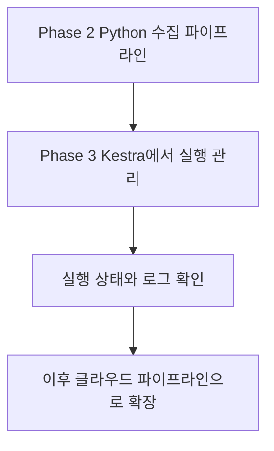
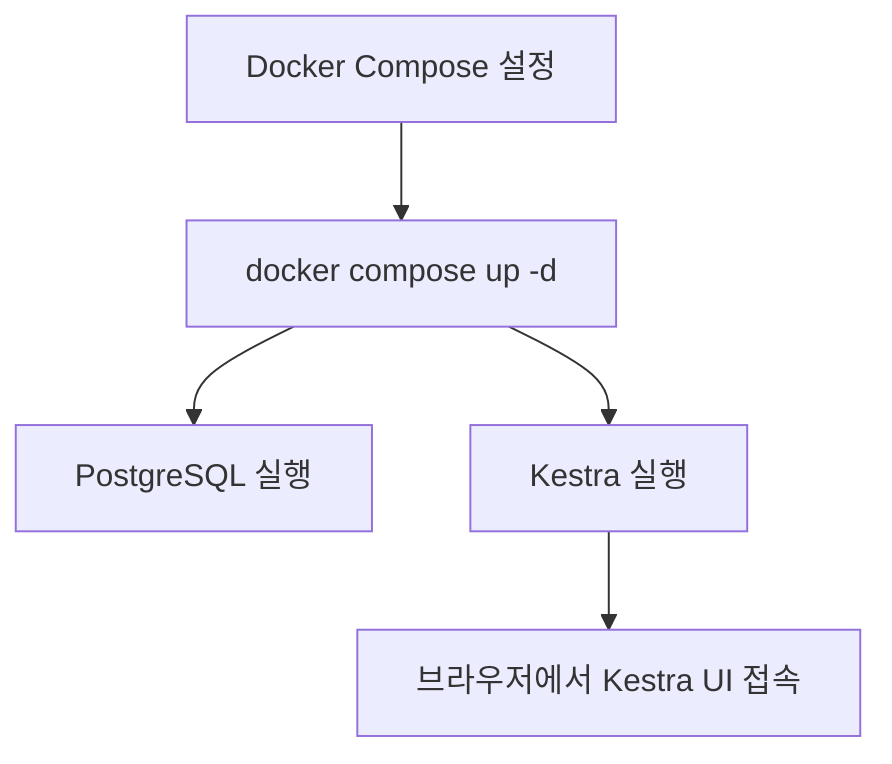
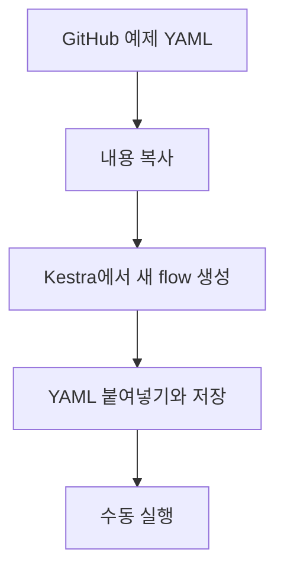
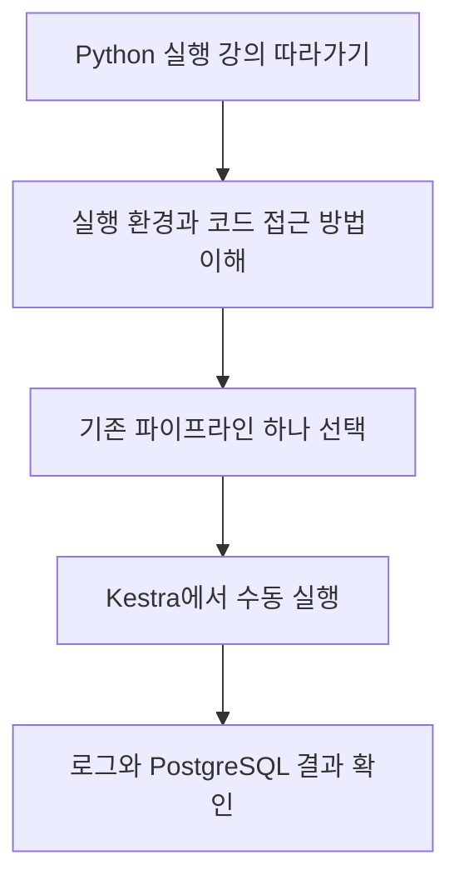

# 🍫 Phase 3 — Kestra를 이용한 파이프라인 실행 관리

> 프로젝트: Charlie’s Chocolate Factory — Omnichannel Retail Data Platform  
> 현재 상태: Kestra 환경 실행 및 첫 번째 연습용 workflow 실행 성공  
> 다음 단계: 실행 결과를 살펴보고 Python 실행 강의 학습

---

## 1. Phase 3를 시작한 이유

Phase 2에서는 온라인 CSV와 Square API에서 데이터를 수집해 로컬 PostgreSQL에 저장하는 작업을 진행했습니다. Square 주문 데이터까지 PostgreSQL에 저장된 것을 확인했습니다.

지금까지는 터미널에서 Python 명령어를 직접 실행했습니다. 앞으로는 **Kestra를 이용해 기존 데이터 파이프라인을 실행하고, 실행 상태와 로그를 확인하는 방법**을 배우려고 합니다.



Phase 3의 첫 목표는 **기존 Python 파이프라인 하나를 Kestra에서 수동으로 실행하고 결과를 확인하는 것**입니다. 그 후 필요에 따라 다른 파이프라인과 자동 실행으로 확장할 계획입니다.

> 현재 Python 파이프라인을 Kestra에 연결하거나 자동 실행한 것은 아직 아닙니다.

---

## 2. Docker Compose에 Kestra 추가

초콜릿 프로젝트에서 사용하던 Docker Compose 설정 파일에 **Kestra 서비스 설정**을 추가했습니다. PostgreSQL과 Kestra를 Docker Compose로 함께 실행할 수 있는 환경을 준비했습니다.

```text
초콜릿 프로젝트의 Docker Compose 설정
    ├── PostgreSQL 서비스
    └── Kestra 서비스
```

각 역할은 다음과 같습니다.

| 구성 요소 | 역할 |
|---|---|
| Docker Compose 설정 파일 | 어떤 서비스를 어떤 설정으로 실행할지 정의 |
| PostgreSQL | 프로젝트 데이터를 저장하는 데이터베이스 |
| Kestra | Workflow를 실행하고 실행 상태와 로그를 관리하는 도구 |

> 실제 서비스 이름, 이미지 버전, 포트, 볼륨 및 네트워크 설정은 이 기록에서 확인되지 않았습니다. 자세한 값은 프로젝트의 실제 Compose 파일을 기준으로 확인합니다. Kestra 내부 저장에 사용하는 DB와 초콜릿 데이터가 저장되는 DB의 관계도 실제 설정 확인 전에는 단정하지 않습니다.

### 실행 명령어

프로젝트의 Compose 설정을 이용해 다음 명령어로 서비스를 시작했습니다.

```bash
docker compose up -d
```

| 부분 | 의미 |
|---|---|
| `docker compose` | Compose 설정을 이용해 여러 서비스를 관리 |
| `up` | 설정된 서비스를 생성하거나 시작 |
| `-d` | 터미널을 계속 점유하지 않고 백그라운드에서 실행 |

이후 PostgreSQL과 Kestra를 실행하고, 브라우저에서 Kestra UI에 접속했습니다.



---

## 3. 두 종류의 YAML 구분하기

이번 과정에서는 서로 역할이 다른 YAML을 사용했습니다.

| 파일 또는 설정 | 위치 | 역할 |
|---|---|---|
| Docker Compose YAML | 초콜릿 프로젝트 | PostgreSQL과 Kestra 등 서비스를 어떻게 실행할지 정의 |
| Kestra workflow YAML | GitHub 예제에서 복사해 Kestra UI에 저장 | Kestra가 어떤 작업을 어떤 순서로 실행할지 정의 |

**Docker Compose는 Kestra 프로그램을 실행하고, workflow YAML은 실행된 Kestra에게 할 일을 알려줍니다.**

Kestra를 실행했다고 DE Zoomcamp의 예제 workflow가 자동으로 나타나는 것은 아닙니다. 예제 내용을 별도로 Kestra에 등록해야 합니다.

---

## 4. 강의 예제 workflow 가져오기

DE Zoomcamp 저장소의 `02-workflow-orchestration/flows` 폴더에는 강의에서 사용하는 여러 YAML 예제가 있습니다. 이번에는 **Kestra 기본 개념을 배우는 hello 예제**를 사용했습니다.

1. GitHub에서 강의 예제 YAML을 열었습니다.
2. YAML 내용을 복사했습니다.
3. Kestra UI에서 새 flow를 만들었습니다.
4. 예제 YAML을 편집기에 붙여넣고 저장했습니다.
5. 저장한 flow를 직접 실행했습니다.



**Save**는 workflow의 정의를 Kestra에 저장하는 것이고, **Execute**는 저장한 workflow를 실제로 한 번 실행하는 것입니다.

---

## 5. 첫 번째 workflow 실행 결과 🎉

실행할 때 이름 input에 **`Mandy`**를 입력했습니다. 실행 결과는 **SUCCESS**로 표시되었습니다.

```text
입력값: name = Mandy
        ↓
Kestra가 예제 workflow 실행
        ↓
실행 결과: SUCCESS ✅
```

이 실행을 통해 다음을 확인했습니다.

- Kestra UI에서 예제 workflow를 저장할 수 있습니다.
- 실행할 때 input을 입력할 수 있습니다.
- 실행한 workflow의 상태를 Kestra에서 확인할 수 있습니다.
- 현재 Kestra 환경에서 이 강의 예제를 성공적으로 실행했습니다.

**SUCCESS는 해당 예제 실행이 성공했다는 뜻입니다.** 초콜릿 프로젝트의 Python 코드 실행이나 Square·PostgreSQL 연결까지 검증했다는 의미는 아닙니다.

### 추가로 살펴볼 실행 화면

아래는 복습할 항목이며, 개별 화면을 모두 확인했다고 가정하지 않습니다.

- [ ] **Logs**: 이름을 사용한 메시지와 각 task의 로그 살펴보기
- [ ] **Outputs**: Return task가 만든 결과 확인하기
- [ ] **Gantt**: Sleep task의 대기 시간과 각 task의 실행 시간 보기
- [ ] **Topology**: task 구성과 연결 관계 살펴보기
- [ ] 필요하면 다른 이름으로 다시 실행해 execution 기록 비교하기

> 로그의 세부 문구와 output 값은 실제 실행 화면에서 확인합니다.

---

## 6. 초콜릿 프로젝트의 Docker 환경에서 강의 예제가 실행된 이유

이번 hello 예제는 **맨디의 Python 프로젝트 파일을 실행하는 예제는 아니었습니다.** 이름을 받아 메시지를 만들고, 로그를 기록하고, 결과를 만들거나 잠시 기다리는 등 Kestra의 기본 기능을 연습하는 예제입니다.

```text
이번 hello 예제에 필요했던 것
    ✅ 실행 중인 Kestra
    ✅ 예제 YAML에서 사용하는 task 기능
    ✅ 실행할 때 입력한 이름

이번 예제에서 별도로 실행하지 않은 것
    — 초콜릿 프로젝트의 Python 파이프라인
    — Square API 수집 작업
    — 초콜릿 데이터의 PostgreSQL 적재 작업
```

Kestra가 초콜릿 프로젝트의 Compose 설정을 통해 실행되더라도, 강의의 독립적인 예제 workflow를 Kestra에 등록해 실행할 수 있습니다. 다만 **아무 Docker 컨테이너나 켜져 있으면 되는 것은 아니며**, Kestra가 실행 중이고 예제에서 사용하는 기능을 사용할 수 있어야 합니다.

---

## 7. 강의에서 배운 주요 개념

| 개념 | 쉬운 설명 | 이번 예제와 연결 |
|---|---|---|
| **Workflow / Flow** | 전체 작업을 적어둔 계획 | Kestra에 저장한 hello 예제 |
| **Task** | 계획 안의 개별 작업 | Log, Return, Sleep 등 |
| **Execution** | Workflow를 실제로 한 번 실행한 기록 | `Mandy`를 입력하고 실행한 기록 |
| **Input** | 실행할 때 전달하는 값 | `name`에 입력한 `Mandy` |
| **Variable** | Workflow 안에서 이름을 붙여 정의한 값 | 입력값을 이용한 메시지 구성 |
| **Output** | Task가 만든 결과 | Return task의 결과를 이후 task에서 사용 |
| **Trigger** | 자동 실행을 시작하는 조건 | 강의의 schedule 예제 |
| **Concurrency** | 같은 workflow의 동시 실행 제한 | 강의에서 최대 2개 실행 시연 |

강의에서 trigger는 자동으로 실행되지 않도록 비활성화한 예제로 설명했습니다. Concurrency 시연의 실제 설정은 **동시 실행 2개**였으며, 세 번째 실행은 제한으로 실패했습니다.

---

## 8. 다음 단계: Python 파이프라인 연결

강의에서 다음으로 Python 코드를 Kestra workflow에서 실행하는 방식을 배웁니다. 그 후 초콜릿 프로젝트에 적용할 때는 실제 실행 환경을 확인해야 합니다.



확인할 항목:

- [ ] Kestra의 실제 task 실행 환경이 프로젝트 Python 코드에 접근할 수 있는지
- [ ] Python과 필요한 패키지를 사용할 수 있는지
- [ ] 필요한 환경 변수와 Square API 설정을 안전하게 전달할 수 있는지
- [ ] 해당 실행 환경에서 PostgreSQL에 연결할 수 있는지
- [ ] 실행 로그와 실제 DB 적재 결과가 예상과 일치하는지
- [ ] 필요에 따라 자동 실행 일정과 동시 실행 제한을 설정할지

Kestra를 켰다고 해서 프로젝트 파일이 실행 환경에 자동으로 보이는 것은 아닙니다. 또한 workflow를 저장했다고 자동 실행되는 것은 아닙니다. 자동 실행하려면 적절한 trigger 설정과 실행 중인 Kestra 환경이 필요합니다.

---

## 9. 현재 위치 체크리스트

- [x] Phase 2에서 온라인·Square 데이터의 로컬 PostgreSQL 적재 진행 및 Square 주문 저장 확인
- [x] Docker Compose 설정에 Kestra 추가
- [x] `docker compose up -d`로 PostgreSQL과 Kestra 실행
- [x] Kestra UI 접속
- [x] 강의의 hello 예제 YAML을 Kestra에 저장
- [x] `name`에 `Mandy`를 입력해 실행
- [x] 해당 execution의 SUCCESS 확인
- [ ] 예제 execution의 로그·output·Gantt 등 상세 복습
- [ ] Python 실행 강의 따라가기
- [ ] 초콜릿 프로젝트의 Python pipeline을 Kestra에서 실행
- [ ] 실제 데이터 적재와 로그 검증
- [ ] 필요 시 자동 실행 설정

> 이 문서는 대화에서 확인된 작업을 기반으로 작성했습니다. 실제 Compose 설정이나 workflow YAML의 세부 내용은 별도 확인하지 않았습니다.
