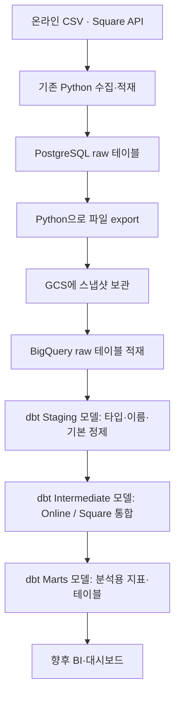
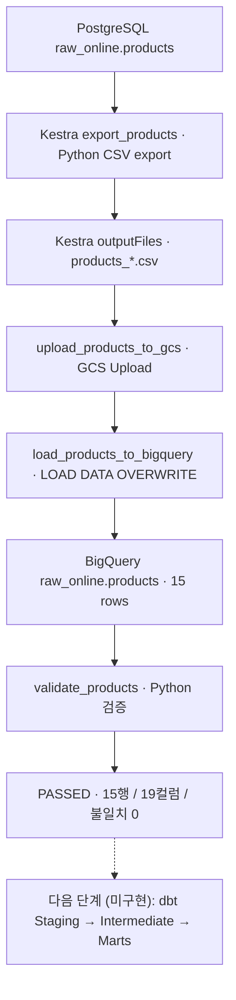

# ☁️ Phase 4 — GCS · BigQuery 적재 및 dbt 모델링

Charlie’s Chocolate Factory — Omnichannel Retail Data Platform

> 시작일: 2026-10-31  
> 최종 업데이트: **2026-11-11 (밴쿠버 현지 기준)**  
> 현재 상태: 🟢 **Phase 4A — Online Products, Square Locations·Customers 적재 및 검증 성공** / **Phase 4B(dbt)는 설계 완료, 구현 전**  
> 이번 업데이트: Locations 추출·검증 공통화, Square Customers Kestra 실행 성공, 테이블별 Flow와 소스별 상위 Flow 구성 계획 반영

이 문서는 Charlie’s Chocolate Factory의 **Phase 4 구현 방향, 학습 기록, 실제 완료 여부**를 함께 관리한다.
기존 문서에서는 Phase 4를 GCS·BigQuery raw 적재까지만 다루고 dbt 모델링을 Phase 5로 분리했지만,
**2026-11-05 이후의 결정에 따라 Phase 4를 `4A. Cloud Ingestion`과 `4B. dbt Transformation & Modeling`으로 확장**했다.

> **현재 구현 범위:** `raw_online.products`, `raw_square.locations`, `raw_square.customers`는 Kestra에서 PostgreSQL → CSV → GCS → BigQuery → Python 검증 경로를 실행했다.
> Products는 15행·19개 컬럼 비교에서 불일치 0건이었다. Locations는 BigQuery에서 전체 5행, 고유 매장 ID 5개, 잘못된 JSON 0건을 확인했다. Locations 공통화와 Customers 추가 이후 Kestra 실행 성공은 사용자가 확인했다. 고객 행 수와 최종 실행 ID는 이 문서에 기록할 로그가 아직 없다.
> Square Catalog Objects·Orders와 Online 나머지 4개 테이블은 후속 범위다. 별도로 진행한 Federated Query, IAM, dbt 학습은 프로젝트 구현 범위와 구분한다.

---

## 1. Phase 4를 시작하는 시점

### 이전 단계에서 완료한 작업

- [x] 온라인 CSV 데이터를 Python으로 선별하여 PostgreSQL에 적재
- [x] Square API에서 상품·고객·매장·주문을 조회하여 PostgreSQL에 적재
- [x] 적재 메타데이터 `ingested_at`, `orchestrator`, `pipeline_run_id` 추가
- [x] 온라인 5개와 Square 4개 테이블의 개별 Kestra Flow 실행 확인
- [x] Kestra 상위 Flow에서 9개 적재 작업의 전체 순차 실행 성공 확인

위 실행 성공은 이전 작업과 대화에서 확인한 결과다. 이번 설계 기록을 작성하면서 DB·API·Kestra를 다시 실행한 것은 아니다.

### 2026-11-11 기준 상태 요약

| 항목 | 상태 | 확인 내용 / 다음 작업 |
|---|---|---|
| Online / Square → PostgreSQL 적재 | ✅ 이전 단계 완료 | Online 5개, Square 4개 raw 테이블 보유 |
| Kestra 개별 Flow 및 상위 Flow | ✅ 이전 단계 완료 | 9개 원본 적재 작업의 Kestra 실행 기록 |
| 공통 Python Logging | ✅ Products 검증 코드에서 동작 확인 / 🟡 전체 파이프라인 반영 범위는 추가 확인 | `run_logging.py` 호출, 단계별 로그와 실행 ID 확인. 과거 Patch가 다른 파이프라인에 모두 반영됐는지는 확인되지 않음 |
| PostgreSQL → CSV export | ✅ **Products 완료** | `src.pipelines.postgres_to_file` 실행 |
| GCS 파일 업로드 | ✅ **Products 완료** | Kestra GCS Upload 태스크 성공 |
| BigQuery raw 적재 | ✅ **Products 완료** | `chocolate-data-platform.raw_online.products`에 15행 |
| Python 적재 검증 | ✅ **Products 완료** | CSV 15행 ↔ BigQuery 15행, 19개 컬럼, 불일치 0, `validation=passed` |
| Jira CHOC-5 / CHOC-6 | ✅ Done | 원본·대상 비교 및 데이터 품질 검증 기록 |
| Square Locations | ✅ 적재·검증 완료 | `raw_square.locations`, BigQuery 기본 점검 5 / 5 / 0, 공통 추출·검증 적용 |
| Square Customers | ✅ Kestra 실행 성공 | `raw_square.customers`, 동일 실행의 CSV와 BigQuery 행을 고객 ID로 비교 |
| Jira CHOC-4 / CHOC-7 | ✅ 완료 | Products 상위 작업 및 문서 정리 |
| Square 후속 적재 | 🟡 진행 중 | CHOC-12의 Catalog Objects 및 CHOC-13의 Orders |
| Online 후속 적재 | ⬜ 대기 | CHOC-15 하위의 고객·고객 주소·주문·주문 상품 |
| dbt 초기화·BigQuery 연결 | ⬜ 미구현 | `dbt init`, `dbt debug` 예정 |
| dbt Staging → Intermediate → Marts | 🟡 설계 결정, 미구현 | BigQuery SQL 모델과 데이터 테스트 작성 |

**확인 범위:** 이 문서는 사용자가 공유한 Kestra YAML, Python 검증 코드, 공유된 실행 로그, BigQuery 조회 결과, 사용자가 확인한 Kestra 결과와 Jira 상태를 기준으로 업데이트했다. GitHub 원격 저장소의 실제 커밋 내용은 여기서 직접 검사하지 않았다.

### 현재 PostgreSQL 저장 범위

| 스키마 | 테이블 | 저장 형태 |
|---|---|---|
| `raw_online` | `products` | 상품 전체를 컬럼 형태로 저장 |
| `raw_online` | `customers` | ONLINE 가입 고객 선별 |
| `raw_online` | `customer_addresses` | 선별된 고객에 속한 주소 |
| `raw_online` | `orders` | ONLINE 채널 주문 선별 |
| `raw_online` | `order_items` | 선별된 주문에 속한 주문상품 |
| `raw_square` | `catalog_objects` | ITEM 객체와 하위 variations를 JSONB payload로 저장 |
| `raw_square` | `customers` | 고객 JSONB payload |
| `raw_square` | `locations` | 매장 JSONB payload |
| `raw_square` | `orders` | 주문 및 중첩 주문상품 등을 JSONB payload로 저장 |

두 영역 모두 적재 메타데이터를 기록한다. 온라인의 선별과 일부 타입 적용은 이미 수행했지만, 두 채널의 분석용 정제·표준화·통합이 완료된 상태는 아니다.

---

## 2. 이번에 확정한 데이터 이동 방향

**기존 PostgreSQL raw 테이블을 클라우드 수집 원천으로 사용한다.**



- **구현 완료:** Online·Square → PostgreSQL 수집 흐름과 Products, Square Locations·Customers의 BigQuery 적재·검증.
- **Phase 4A (Cloud Ingestion):** Square Catalog Objects·Orders와 Online 4개 테이블을 확장할 계획.
- **Phase 4B (dbt Transformation):** BigQuery raw → Staging → Intermediate → Marts 및 데이터 품질 테스트는 **미구현**.
- **후속 작업:** Marts 기반 분석·시각화 및 포트폴리오 정리.

Kestra에서 테이블별 Flow가 export → GCS Upload → BigQuery LOAD DATA → 검증을 순서대로 실행한다. 테이블별 Flow를 검증한 뒤 소스별 상위 Flow에서 호출할 계획이다.

---

## 3. 질문을 통해 정리한 핵심 개념

### 3.1 PostgreSQL은 GCS 업로드의 필수 중간 단계인가

**아니다.** 원본 CSV를 GCS에 직접 올리거나, Python으로 Square API를 조회한 결과를 바로 GCS에 저장하는 경로도 가능하다.

Zoomcamp는 로컬 PostgreSQL 적재와 Docker 실행 환경을 먼저 다루고, Kestra로 실행 관리·스케줄·과거 기간 재처리 등을 학습한 뒤 클라우드로 확장하는 구성이다. 따라서 로컬 PostgreSQL 단계는 GCS 사용의 기술적 필수 조건이 아니라, 수집·저장·실행 관리를 학습하고 검증한 단계로 이해한다.

이 프로젝트에서는 이미 만든 로컬 파이프라인을 활용하여 **PostgreSQL을 다음 클라우드 파이프라인의 수집 원천으로 삼는 설계**를 선택했다. 이 선택이 모든 e-commerce DE 프로젝트에 필수라는 뜻은 아니다.

### 3.2 운영 DB와 이번 PostgreSQL은 같은 역할인가

구분해야 한다. 온라인 서비스와 POS에는 주문을 접수하고 관리하는 원천 시스템이 있다. 이번 로컬 PostgreSQL은 그곳에서 이미 발생한 데이터를 가져와 저장하는 수집·분석용 영역이다.

“온라인·POS 주문은 반드시 이 PostgreSQL에 적재해야 하므로 만들었다”는 설명 대신, **“로컬 수집·적재를 구현한 뒤 그 결과를 클라우드 분석 환경으로 확장한다”**고 설명한다.

### 3.3 GCS에 보관할 파일은 어떤 의미의 원본인가

이번 설계에서 GCS에 올리는 파일은 **PostgreSQL raw 테이블에서 추출한 스냅샷**이다.

| 비교 | 최초 수집 CSV 또는 API 응답 | 이번 Phase 4의 export 파일 |
|---|---|---|
| 추출 출처 | 원천 파일 또는 Square API | PostgreSQL raw 테이블 |
| 온라인 선별 | 원천에 여러 채널이 함께 있을 수 있음 | 기존 ONLINE 선별 결과 반영 |
| 적재 메타데이터 | 원천 자체에는 없을 수 있음 | PostgreSQL에 기록한 값 포함 |
| 설명 방식 | 수집 당시 원본 | DB 추출 시점의 스냅샷 |

따라서 export 파일을 “최초의 손대지 않은 원본 CSV”라고 부르지 않는다. **분석용 정제 전 데이터에 가깝지만, 기존 수집 과정의 선별·타입 적용·메타데이터가 반영된 데이터**다.

현재 테이블은 온라인 전체 교체 및 Square ID Upsert 방식이다. 이번에 export하는 데이터는 그 시점의 테이블 상태이며, 이전 실행의 모든 데이터 버전을 자동으로 복원한 이력은 아니다.

### 3.4 메타데이터를 추가하면 클리닝 완료 데이터인가

아니다. `ingested_at`, `orchestrator`, `pipeline_run_id`는 데이터를 언제 어떤 실행으로 적재했는지 설명하는 정보다. 이 컬럼을 붙였다는 것과 결측·중복·금액·ID 기준을 정리했다는 것은 별개다.

PostgreSQL에 있는 기존 메타데이터는 원래 적재 실행을 설명한다. **export 실행 ID나 GCS 업로드 시각과는 다른 의미**이므로 export할 때 기존 값을 새 실행 정보로 무조건 덮어쓰지 않는다.

**실제 확인(2026-11-10):** BigQuery의 15행은 `pipeline_run_id = GBcIYLgRyHcJoj4V54ju6`, `orchestrator = kestra`, `ingested_at = 2026-11-06 23:27:41.549447 UTC`로 조회됐다. 반면 11월 10일 Python 검증 로그의 Kestra 실행 ID는 `2Z0flTytQqWEwI8vvZPFdx`다. **둘이 다른 것은 원본 적재 메타데이터를 유지하기 때문일 가능성이 있으나, 정확한 생성 위치는 추후 코드로 확인한다.** GCS 객체 경로의 `{{ execution.id }}`는 해당 export/업로드 실행을 구분하는 역할을 한다. 필요하면 `loaded_at` 또는 별도 manifest 등으로 단계별 이력을 분리한다.

### 3.5 원본 보관과 Python·Kestra는 서로 다른 선택인가

아니다. 원본에 가까운 파일을 보관하면서 Python으로 수집·업로드를 수행하고 Kestra로 실행을 관리할 수 있다.

| 구성 요소 | 이번 설계에서 맡는 역할 |
|---|---|
| PostgreSQL | export할 현재 raw 데이터 보관 |
| Python | DB 조회 및 export 파일 생성 |
| Kestra | 단계 실행·의존 순서·성공과 실패 관리 |
| GCS | export 파일 보관 |
| BigQuery | raw 적재 및 dbt SQL 변환 결과(View/Table 등) 저장·실행 |
| dbt | BigQuery 위에서 SQL 기반 정제·모델 의존성·테스트 관리 |
| Git / GitHub | Python·Kestra·dbt 프로젝트 소스 버전 관리 |

---

## 4. CSV export와 Square JSONB 처리 방향

### 온라인 데이터

온라인 테이블은 이미 일반 컬럼으로 구성되어 있어 **Products부터 CSV export를 구현·검증했다**. `raw_online.products`의 19개 컬럼을 내보내고, NULL 마커(`\N`), 숫자·불리언·타임스탬프·문자열 표현을 Python 검증 코드에서 정규화하여 비교한다. BigQuery에서는 CSV 헤더를 건너뛰고 사전에 정의한 스키마로 로드한다. 나머지 온라인 테이블로 확장할 때도 ID 문자열, 인코딩, 줄바꿈, NULL/시간 형식을 별도로 확인한다.

### Square 데이터

**Square 테이블도 CSV로 export하여 GCS에 올릴 수 있다.**

예를 들어 CSV에는 Square ID, `payload`, 적재 메타데이터를 함께 담을 수 있다. 이때 `payload` JSON은 CSV 한 칸 안에 문자열로 저장되고, 내부의 주문상품 배열이나 금액이 자동으로 별도 컬럼으로 펼쳐지지는 않는다.

| 확인 항목 | 필요한 처리 |
|---|---|
| CSV quoting | JSON의 따옴표·쉼표·줄바꿈이 필드를 깨뜨리지 않도록 처리 |
| JSON 직렬화 | 유효한 JSON 문자열로 보존하고 Python dict의 단순 문자열 표현과 구분 |
| BigQuery payload 타입 | Locations와 Customers는 `STRING`으로 적재하고 검증 시 JSON 객체로 파싱 가능한지 확인 |
| 중첩 구조 | 이후 SQL에서 필요한 필드·배열을 추출 |
| 대안 형식 | 필요하면 newline-delimited JSON 등과 비교 |

**현재 구현:** Locations와 Customers는 PostgreSQL의 `payload::text`를 UTF-8 CSV 한 필드로 저장하고 BigQuery에 `STRING`으로 적재한다. `ingested_at`은 UTC로 기록하고 nullable 메타데이터의 NULL은 `\N`으로 표현한다. 검증은 기본키를 기준으로 JSON 텍스트와 메타데이터 값을 비교한다.

CSV에는 PostgreSQL의 컬럼 타입·기본키·제약조건이 그대로 전달되지 않는다. PostgreSQL 스키마를 참고하여 **BigQuery용 스키마를 별도로 정의**해야 한다.

---

## 5. 데이터 클리닝은 언제 진행하는가

클리닝은 반드시 GCS 업로드 뒤에만 수행해야 하는 작업은 아니다. ETL은 적재 전에 변환하고, ELT는 적재 후 대상 시스템에서 변환한다.

**이번 프로젝트는 BigQuery 적재 후 본격적인 분석용 정제·통합을 수행하는 ELT 방향으로 진행한다.** 다만 export와 업로드 전에 기본적인 데이터 및 파일 검증은 수행한다.

| 시점 | 수행할 작업 | 범위 |
|---|---|---|
| PostgreSQL export 전후 | 조회 성공, 필수 컬럼, 행 수, 파일 생성, 형식 확인 | Phase 4A |
| GCS 업로드 후 | 객체 존재·크기 및 필요 시 무결성 확인 | Phase 4A |
| BigQuery raw 적재 후 | 행 수·스키마·NULL·금액·날짜·payload 손실 확인 | Phase 4A |
| dbt Staging 모델 | 데이터 타입·컬럼 이름·NULL 표현 정리, 기본 정제 | Phase 4B |
| dbt Intermediate 모델 | Online / Square 통합, 비즈니스 로직 | Phase 4B |
| dbt Marts 모델 | 매출·상품·고객 지표와 분석용 데이터셋 | Phase 4B |
| dbt Tests | `not_null`, `unique`, `relationships` 등 데이터 품질 검증 | Phase 4B |

**GCS는 저장 공간이지 클리닝 엔진이 아니다.** 이번 설계에서는 GCS 파일을 BigQuery에 적재한 뒤 SQL로 가공한다. 다른 설계에서는 Python이 GCS 파일을 읽고 변환할 수도 있지만 지금은 그 경로를 기본으로 삼지 않는다.

---

## 6. Kestra로 자동화한 Products 실행 흐름

### 실제로 성공한 경로 (2026-11-10)



Kestra Flow: `chocolate.online_products_to_file`

| Kestra Task | 타입 / 역할 | 확인 상태 |
|---|---|---|
| `export_products` | Python `src.pipelines.postgres_to_file`로 PostgreSQL 테이블을 CSV export, `outputFiles` 수집 | ✅ 성공 |
| `upload_products_to_gcs` | Kestra `io.kestra.plugin.gcp.gcs.Upload`로 CSV 업로드 | ✅ 성공 |
| `load_products_to_bigquery` | Kestra BigQuery Query의 `LOAD DATA OVERWRITE`로 native raw 테이블 로드 | ✅ 성공 |
| `validate_products` | Python `src.pipelines.validate_products_load`에서 GCS CSV와 BigQuery 전체 스냅샷 비교 | ✅ 성공 |

**리소스 / 경로**

- GCP 프로젝트: `chocolate-data-platform`
- BigQuery 위치: `us-east1`
- 버킷: `mandy-chocolate-raw-2026`
- GCS 객체 경로 패턴: `gs://mandy-chocolate-raw-2026/raw_online/products/{{ execution.id }}/products.csv`
- BigQuery 테이블: `chocolate-data-platform.raw_online.products`
- GCP 서비스 계정: Kestra Secret `GCP_SERVICE_ACCOUNT` 사용 (값을 코드/문서에 기록하지 않음)

### 구현하면서 해결한 문제

- 소스 마운트가 읽기 전용(`:ro`)이므로 CSV는 쓰기 가능한 Kestra 작업 디렉터리에 생성하고 `outputFiles`로 넘겼다.
- `validate_products`의 `GOOGLE_APPLICATION_CREDENTIALS: "{{ workingDir }}/gcp-key.json"`은 변수를 찾지 못해 실패했다.
- 수정: `inputFiles`로 전달한 `gcp-key.json`의 존재를 확인한 뒤, Python `commands`에서 `export GOOGLE_APPLICATION_CREDENTIALS="$WORKING_DIR/gcp-key.json"`을 설정했다.
- 수정 후 네 태스크가 모두 SUCCESS로 종료됐다.

### 검증 방식

`validate_products_load.py`는 작은 raw 스냅샷에 대해 다음을 확인한다.

1. GCS CSV 컬럼 수/순서(19개), 각 값의 타입 형식과 NULL 마커를 읽고 정규화한다.
2. BigQuery 테이블의 스키마·컬럼 순서·모드가 예상과 동일한지 검사한다.
3. BigQuery 행을 읽어 GCS CSV와 **행 순서에 무관하게, 중복 개수까지 고려하여 19개 컬럼 전체를 비교**한다.
4. 데이터가 다르면 예외를 발생시켜 Kestra 작업이 실패하도록 한다.

**실행 로그(2026-11-10 21:29 UTC)**

```text
stage=read_source source_rows=15
stage=compare expected_rows=15 actual_rows=15 missing_or_changed_rows=0 unexpected_or_changed_rows=0
status=completed validation=passed compared_columns=19 compared_rows=15 pipeline_run_id=2Z0flTytQqWEwI8vvZPFdx elapsed_seconds=1.951
Command succeed with exit code 0
```

> 이 Python 스크립트는 **GCS 스냅샷과 BigQuery 스냅샷의 동일성**을 검증한다. 상품 ID 유일성, 필수값 NULL 여부, 음수 가격 등 **비즈니스 규칙 검증은 별도**다. 기본 데이터 품질 항목은 BigQuery SQL로 수동 확인했으며, 추후 dbt 테스트로 자동화할 수 있다.
>
> 또한 CSV와 BigQuery 데이터를 메모리에서 비교하므로 작은 테이블에 적합하다. 대규모/append형 데이터에 그대로 재사용하지 않는다.

### 실행 성공과 데이터 정확성을 구분

- Kestra `SUCCESS`는 실행 성공이며, 검증 내용을 보려면 `validate_products`가 남긴 로그를 확인한다.
- Products는 파일과 BigQuery 15행/19개 컬럼 비교를 통과했다. 다른 테이블이 동일하게 검증됐다는 뜻은 아니다.
- PostgreSQL에서 여러 테이블을 순서대로 export한다고 자동으로 같은 시점의 스냅샷이 보장되지는 않는다. 확장 시 실행 시점·일관성·재실행 정책을 별도로 설계한다.

## 7. Phase 범위와 dbt 도입 결정 (2026-11-11 기준)

| 구간 | 목표 | 상태 |
|---|---|---|
| Phase 3 — Workflow Orchestration | Online / Square → PostgreSQL 수집·적재 자동화 | ✅ 이전 구현 기록 |
| Phase 3 보완 — Observability | Python 공통 Logging, 오류 및 실행 단계 확인 | 🟢 Products 검증 Flow에서 확인 / 나머지 코드 반영 범위 확인 필요 |
| Phase 4A — Cloud Ingestion | PostgreSQL → CSV → GCS → BigQuery raw → Validation | 🟡 **Products, Square Locations·Customers 구현·검증 완료**, 나머지 테이블 확장 예정 |
| Phase 4B — Transformation & Modeling | BigQuery + dbt로 Staging → Intermediate → Marts | 🟡 설계 결정, 미구현 |
| 후속 분석 단계 | Marts 기반 매출·고객·상품 분석 및 시각화 | ⬜ 미구현 |

기존 2026-10-31 문서는 모델링을 Phase 5로 구분했다. 이후 **Phase 4에서 dbt 세 계층을 직접 구현**하기로 방향을 바꿨으므로 이 문서에서는 **Phase 4B**로 기록한다. 최종 전체 프로젝트 문서의 후속 Phase 번호는 나중에 일괄 정리한다.

**용어 주의:** `staging` 모델 계층은 환경 구분인 `dev → staging → production`의 staging 환경과 다른 개념이다. `stg_` 모델은 원본을 분석 가능하게 표준화하는 SQL 변환 계층이다.

---

## 8. 구현 계획과 완료 기준

### 8.0 Phase 3 보완 — Kestra Logging

- [x] `print()` 중심 실행 기록의 한계 파악 및 공통 Logging 구조 설계
- [x] 개선 Patch 준비 및 `src/pipelines/run_logging.py` 공통 함수 설계
- [x] Products 검증 스크립트에서 `log_stage()`, `run_metadata()`, `run_cli()` 사용 확인
- [x] Kestra UI에서 `read_source`, `check_schema`, `read_target`, `compare`, `validation=passed` 단계 로그 확인
- [ ] 기존 Online/Square Python 파이프라인 모두에 Logging 변경이 적용됐는지 Git diff/코드 기준으로 확인
- [ ] 필요한 경우 Python 구문·예외 로깅·민감정보 비노출 여부를 추가 점검

> 기존 개선 Patch를 준비했다는 사실과 실제 적용 범위는 구분한다. **Products 검증 코드에서 공통 Logging 동작은 확인했지만, 과거 Patch가 모든 수집 파이프라인에 반영됐는지는 아직 확정하지 않는다.**
> `.patch`는 실행 로그 파일이 아니라 Python 코드 변경 내역이며, 프로젝트에서는 실제 `.py` 소스와 Git 이력을 관리한다.

### 8.1 GCP 환경 준비

- [x] GCP 프로젝트 `chocolate-data-platform`에서 Products용 BigQuery 쿼리 실행 확인
- [x] GCS 버킷 `mandy-chocolate-raw-2026`에 Products CSV 업로드 성공
- [x] BigQuery `raw_online.products` 테이블 로드 성공 (`us-east1`)
- [x] Kestra Secret을 이용한 서비스 계정 인증으로 GCS·BigQuery 접근 성공
- [ ] 프로젝트 결제/비용 알림, IAM 최소 권한 및 Secret의 Git 포함 여부 추가 점검

### 8.2 온라인 상품 테이블 하나로 경로 검증 — ✅ 최초 End-to-End 성공

- [x] PostgreSQL `raw_online.products` 조회 및 Python CSV export 구현
- [x] CSV 19개 컬럼과 형식·순서 확인용 검증 로직 구현
- [x] 기존 PostgreSQL 적재 메타데이터를 포함한 데이터 전송 확인
- [x] Kestra 작업 디렉터리와 `outputFiles` 수집 연결
- [x] Kestra GCS Upload 태스크로 실행별 객체 경로에 업로드
- [x] BigQuery raw 테이블 스키마 정의 및 `LOAD DATA OVERWRITE` 실행
- [x] GCS 15행 ↔ BigQuery 15행, 19개 컬럼의 전체 스냅샷 값 비교 통과
- [x] BigQuery SQL로 ID 중복, NULL, 음수 가격 및 메타데이터 기본 점검 수행 (Jira CHOC-6)
- [x] PostgreSQL ↔ BigQuery 원본 비교 작업 완료 처리 (Jira CHOC-5; 상세 조회 수치는 별도 로그로 남지 않음)
- [x] `validate_products_load.py` 로그에서 `validation=passed`, mismatch 0, exit code 0 확인
- [x] Products 코드 커밋 및 문서 정리 일감 완료 처리 (Jira CHOC-7)

> **이번 성공 범위:** Products raw 스냅샷의 파일·테이블 동등성까지 검증했다. 향후 스케줄 운영, 대용량 처리, 동시 실행 및 전체 소스 테이블 확장은 별도 작업이다.

### 8.3 Square Locations와 Customers 적재·검증

- [x] Locations 5행을 CSV로 추출하고 GCS와 BigQuery에 적재했다.
- [x] Locations에서 전체 5행, 고유 ID 5개, JSON 객체 파싱 실패 0건을 확인했다.
- [x] Locations의 추출·검증 실행 파일을 공통 함수에 연결했다.
- [x] Customers 추출·적재·검증 Flow를 만들고 Kestra 실행 성공을 확인했다.

### 8.4 나머지 테이블과 상위 Flow

- [ ] Square Catalog Objects (CHOC-12), Square Orders (CHOC-13)의 개별 Flow를 구현하고 검증한다.
- [ ] Online 고객·고객 주소·주문·주문 상품의 개별 Flow를 구현하고 검증한다 (CHOC-15).
- [ ] 개별 실행을 검증한 뒤 Online과 Square 각각의 상위 Flow를 만들어 테이블별 Flow를 호출한다.
- [ ] 소스별 전체 실행과 실패한 하위 Flow 재실행을 확인하고 동시 실행 및 스케줄 정책을 정한다.

### 8.5 dbt BigQuery 프로젝트 준비 (Phase 4B — 미착수)

- [x] 강의에서는 DuckDB를 사용하지만 **실제 초콜릿 프로젝트는 BigQuery를 dbt 실행 대상으로 선택**
- [x] 기존 `chocolate-commerce-data-platform` GitHub 저장소 하위에 dbt 폴더 추가하기로 결정
- [x] `Staging → Intermediate → Marts` 3개 계층 도입 결정
- [ ] `dbt-bigquery` 어댑터와 현재 Python 환경의 버전 호환성 확인
- [ ] 기존 저장소 루트에서 `dbt init chocolate_dbt` 실행
- [ ] GCP Project ID / BigQuery Dataset / 인증 방식 결정
- [ ] `profiles.yml` 연결 설정 준비(인증정보 Git 커밋 금지)
- [ ] `dbt debug`로 BigQuery 연결 테스트
- [ ] `models/staging`, `models/intermediate`, `models/marts` 폴더 및 프로젝트 설정
- [ ] BigQuery raw 테이블을 dbt `source()`로 등록
- [ ] 각 계층의 `ref()` 의존 관계 및 materialization(View/Table 등) 정하기
- [ ] 초기 모델 생성·테스트·실행 결과를 Git에 기록

예상 저장소 구조(아직 생성하지 않음):

```text
chocolate-commerce-data-platform/
├── src/                         # 수집·적재 및 공통 logging
├── sql/                         # PostgreSQL 원본 스키마·마이그레이션
├── (기존 Kestra 설정 위치)/      # 실제 저장소 경로 확인 후 유지
├── chocolate_dbt/               # 새 dbt 프로젝트 (예정)
│   ├── dbt_project.yml
│   ├── models/
│   │   ├── staging/
│   │   ├── intermediate/
│   │   └── marts/
│   ├── macros/
│   └── tests/
└── README.md
```

### 8.6 dbt 모델링과 데이터 품질 검증 (Phase 4B — 미착수)

- [ ] `stg_online_*`, `stg_square_*`: 테이블/컬럼명·타입·금액 단위·시간대 및 JSON 필드 표준화
- [ ] `int_*`: Online·Square의 주문/상품/고객을 공통 구조로 통합
- [ ] `fct_orders`와 필요 차원 테이블 등 `marts` 후보 검토 후 모델 구현
- [ ] `not_null`, `unique`, `relationships`, `accepted_values` 등 적절한 dbt 데이터 테스트 작성
- [ ] NULL·중복·누락 등 테스트 실패 시 원인 파악 및 모델/원천 데이터 수정
- [ ] BigQuery에 생성된 결과 View/Table, 모델 건수, 대표 지표 검증
- [ ] Kestra에서 BigQuery 적재 완료 후 `dbt build`를 실행하는 연동 검토
- [ ] 매출 중복 집계 방지를 위해 주문/주문상품 Grain을 문서화

**주의:** dbt는 데이터를 로컬에서 클리닝한 뒤 BigQuery에 다시 업로드하는 방식이 아니다.
dbt가 **BigQuery에 SQL을 실행**하고 결과 View/Table을 **BigQuery 안에 생성**한다.
`dbt test`는 품질 조건을 검사할 뿐 자동으로 결측·중복을 고치지 않는다.

### 설계상 아직 미확정인 항목과 확장 시 결정할 사항

| 항목 | 현재 결정 / 다음에 결정할 내용 |
|---|---|
| Products export 코드 | `src.pipelines.postgres_to_file` 구현 완료. 나머지 테이블로 범용화할지 결정 |
| 파일 형식 | Products, Locations, Customers는 CSV로 검증 완료. Catalog와 Orders에서 JSON payload 크기·내용을 확인한다. |
| GCS 경로 | Products: `raw_online/products/{{ execution.id }}/products.csv`. 다른 테이블에도 규칙 확장 |
| BigQuery 스키마 | Products 19개 컬럼 검증 완료. Locations·Customers의 payload는 STRING. Catalog는 기본키와 object_type을 포함해 정의한다. |
| 업로드 구현 | 세 테이블 모두 Kestra GCS Upload 사용 |
| 재실행 정책 | 세 테이블은 `LOAD DATA OVERWRITE`로 raw 교체. GCS 스냅샷 보존, 운영 시점/동시 실행 정책 추가 설계 |
| BigQuery 적재 방식 | Products: Native raw table. 다른 테이블 External Table 활용 여부는 필요 시 검토 |
| 메타데이터 | PostgreSQL 원본 `ingested_at`/`pipeline_run_id`와 Cloud 실행 ID 차이 정리, 필요 시 `loaded_at` 설계 |
| dbt 출력 대상 | dev Dataset, 스키마 명명 규칙, 모델별 View/Table 방식 결정 |
| 채널 통합 기준 | 상품/고객/주문 ID 매핑, 통화·세금·시간대 기준 |
| 오케스트레이션 | Kestra의 dbt 실행 환경, 인증, 실패·재실행 정책 검토 |

## 9. 진행 로그

### 2026-10-31 — 설계 질문 정리와 Phase 4 방향 확정

#### 완료한 결정

- [x] GCS 업로드에 PostgreSQL이 필수 경유지는 아니라는 점 이해
- [x] Zoomcamp 로컬 실습과 최종 클라우드 구조의 목적 구분
- [x] 현재 PostgreSQL 데이터를 클라우드 파이프라인의 수집 원천으로 사용하기로 결정
- [x] GCS 보관 파일을 “PostgreSQL raw 테이블에서 export한 스냅샷”으로 정의
- [x] Square JSONB도 CSV로 export 가능하지만 중첩 구조가 자동으로 펼쳐지지 않음을 확인
- [x] 기존 적재 메타데이터와 export 실행 메타데이터의 의미 구분
- [x] Python export와 Kestra 출력 수집·GCS 업로드의 연결 방식 이해
- [x] BigQuery raw 적재 후 분석용 정제·통합을 수행하는 방향 결정
- [x] **당시 결정:** 클라우드 적재를 Phase 4에, 본격적인 모델링을 Phase 5로 구분
  - 2026-11-05에 dbt 모델링을 **Phase 4B에 포함**하도록 계획 갱신

#### 2026-10-31 당시 아직 수행하지 않은 구현 (현재는 Products 부분 완료)

- GCP 프로젝트·버킷·데이터셋·권한 준비
- PostgreSQL export Python 코드 작성
- export 및 GCS 업로드 Kestra Flow 작성
- BigQuery raw 스키마와 적재 작업 구성
- 클라우드 경로 실행 및 데이터 검증

#### 2026-10-31 당시 다음 시작 지점 (현재는 Products 구현 완료)

**Kestra Logging Patch를 먼저 검증·적용한 뒤, `raw_online.products` 하나로 PostgreSQL → export 파일 → GCS → BigQuery 경로를 구현한다. 이후 `chocolate_dbt`를 초기화하고 BigQuery raw를 참조하는 첫 Staging 모델을 만든다.**

학습 참고: [Build Data Lakes and Data Warehouses on Google Cloud](https://www.coursera.org/learn/data-lakes-data-warehouses-gcp) — 실습 경험은 프로젝트 구현과 구분하여 기록

### 2026-11-09 ~ 11-10 — Products Cloud Ingestion 구현과 검증

#### 구현한 Flow와 코드

- Kestra Flow: `chocolate.online_products_to_file`
- `export_products` → `upload_products_to_gcs` → `load_products_to_bigquery` → `validate_products`
- Python export: `src.pipelines.postgres_to_file`
- Python 검증: `src.pipelines.validate_products_load`
- 공통 실행/단계 로그: `src.pipelines.run_logging`
- BigQuery: `chocolate-data-platform.raw_online.products` (19개 컬럼)
- GCS 파일 경로: `gs://mandy-chocolate-raw-2026/raw_online/products/{{ execution.id }}/products.csv`

#### 오류와 해결

- `{{ workingDir }}/gcp-key.json`을 Kestra `env`에서 해석할 수 없어 인증 파일 경로 오류 발생.
- `validate_products`의 명령 실행 부분에서 `$WORKING_DIR/gcp-key.json`을 확인하고 `GOOGLE_APPLICATION_CREDENTIALS` 환경변수를 설정하도록 수정.
- 수정 후 네 개 태스크 모두 성공.

#### 실제 실행·검증 결과

| 확인 항목 | 결과 |
|---|---|
| GCS CSV source rows | **15** |
| BigQuery target rows | **15** |
| 비교 컬럼 | **19** |
| missing_or_changed_rows | **0** |
| unexpected_or_changed_rows | **0** |
| Python 검증 결과 | **`validation=passed`** |
| 종료 코드 | **0** |
| 검증 소요 시간 | **1.951초** |
| Kestra 검증 실행 ID | `2Z0flTytQqWEwI8vvZPFdx` |
| BigQuery 기존 `pipeline_run_id` | `GBcIYLgRyHcJoj4V54ju6` |
| BigQuery 기존 `ingested_at` | `2026-11-06 23:27:41.549447 UTC` |

- 직접 조회한 BigQuery 메타데이터에는 `orchestrator = kestra`, 15행의 동일한 `pipeline_run_id`와 `ingested_at`이 기록되어 있었다.
- `validate_products_load.py`는 GCS와 BigQuery 데이터의 **완전한 스냅샷 일치 여부**를 보는 스크립트다. 상품 ID의 유일성·필수값·가격 등은 별도의 데이터 품질 규칙이며, SQL로 별도 점검했다.
- PostgreSQL 원본과 BigQuery 비교 및 데이터 품질 Jira 작업을 완료 처리했다. 다만 BigQuery에 보존된 실행 ID가 현재 실행 ID와 왜 다른지의 생성 위치는 향후 소스에서 확인할 수 있다.

#### Jira 작업 기록

| 이슈 | 작업 | 상태 (2026-11-10 확인) |
|---|---|---|
| [CHOC-4](https://smmhk21.atlassian.net/browse/CHOC-4) | Set up products pipeline | 🟡 진행 중 (상위 일감) |
| [CHOC-5](https://smmhk21.atlassian.net/browse/CHOC-5) | Compare products in PostgreSQL and BigQuery | ✅ 완료 |
| [CHOC-6](https://smmhk21.atlassian.net/browse/CHOC-6) | Check product data in BigQuery | ✅ 완료 |
| [CHOC-7](https://smmhk21.atlassian.net/browse/CHOC-7) | Commit code and update project notes | 🟡 진행 중 |

GitHub에 코드는 검증 전에 이미 Commit/Push한 상태라고 기록했다. **그 이후 변경 사항이 모두 Push됐는지, Secret이 포함되지 않았는지는 `git status`/Git diff로 확인해야 한다.**

---

### 2026-11-11 — Square Locations 공통화와 Customers 적재

- Locations Flow는 PostgreSQL에서 5행을 읽어 GCS에 CSV를 저장하고 BigQuery에 적재했다. 최초 BigQuery 적재에서 `raw_square`의 `bigquery.tables.create` 권한 오류가 발생했고, 데이터셋 권한 점검 후 적재 및 기본 점검을 완료했다.
- Locations의 기존 export·validate 실행 파일과 Customers의 신규 실행 파일은 공통 `export()`와 `validate()`를 호출한다. 테이블별로 기본키와 컬럼 순서를 지정한다. Customers는 `square_customer_id`, Locations는 `square_location_id`로 같은 실행의 GCS CSV와 BigQuery 행을 매칭한다.
- Kestra에서 `chocolate.square_locations_to_file`과 `chocolate.square_customers_to_file`을 테이블별로 관리한다. 공통화 적용 후 사용자가 Customers까지 실행 성공을 확인했다.
- Square GCS 경로는 `raw_square/<table>/{{ execution.id }}/<table>.csv`다. CSV에 기록된 PostgreSQL 적재 메타데이터와 GCS 경로의 Kestra 실행 ID를 구분한다.
- Jira에서 Locations 작업 CHOC-9~11은 완료, Customers·Catalog 작업 CHOC-12는 진행 중이다. CHOC-12의 남은 범위는 Catalog Objects의 실제 Kestra 적재·검증이다.

## 10. 최근 학습 기록과 프로젝트 연결

### 2026-11-01 ~ 11-03 — GCP / BigQuery 강의 및 Federated Query 실습

- Coursera의 GCP 데이터 레이크·웨어하우스 개념을 학습함.
- Data Lake / Data Warehouse / Lakehouse, OLTP vs OLAP, IAM 등의 개념을 정리함.
- 별도의 **BigQuery Federated Query 교육용 실습**에서 BigQuery와 AlloyDB for PostgreSQL 연결을 설정하고,
  `EXTERNAL_QUERY`로 AlloyDB의 `web_log`를 조회해 BigQuery 측 고객 데이터와 조인해봄.
- 이 실습은 **외부 운영 데이터베이스의 데이터를 BigQuery에서 직접 조회하는 방법**을 배운 것이지,
  **우리 초콜릿 프로젝트에 AlloyDB를 도입하거나 GCS 적재를 완료했다는 뜻이 아님**.
- 프로젝트에서는 우선 계획대로 PostgreSQL → GCS → BigQuery **적재형 ELT**를 구현한다.

### 2026-11-05 — dbt 모델링 방향 결정

- 예전 pandas 데이터 클리닝 학습과 비교해 **이번에는 BigQuery SQL + dbt 기반 ELT**를 수행하기로 결정.
- dbt `Staging → Intermediate → Marts`를 **Phase 4B**에서 실제로 구현할 예정.
- `Staging` 모델 계층과 `dev/stg/prod` 배포 환경은 구별함.
- `source()`는 BigQuery raw 데이터 출처 정의, `ref()`는 dbt 모델 간 의존 관계 관리라는 개념을 학습함.

### 2026-11-06 — dbt 강의 이해 정리

| 학습 주제 | 이해한 내용 | 프로젝트에 적용할 내용 |
|---|---|---|
| DuckDB와 BigQuery | 강의의 DuckDB는 가벼운 실습 환경이며 dbt는 BigQuery와도 연결 가능 | 실 구현은 `dbt-bigquery` |
| `dbt init` | 프로젝트 및 대상 플랫폼 연결 구성을 시작하는 명령어 | `dbt init chocolate_dbt` 예정 |
| dbt 저장소 관리 | dbt SQL/YAML도 소스코드이므로 Git으로 관리 | 기존 모노레포의 하위 폴더 사용 |
| `dbt run` | 대상 SQL 모델을 실행해 View/Table 등을 생성 | BigQuery 결과 데이터셋에 생성 |
| `dbt test` | 선언된 데이터 품질 규칙을 검증 | NULL·중복·참조 무결성 등 |
| `dbt build` | 의존성 순서에 따라 모델 빌드와 테스트 등을 실행 | Kestra와 후속 연계 검토 |
| dbt 결과 위치 | 변환 결과는 BigQuery 내에 생성됨 | 별도 재업로드 불필요 |
| dbt vs pandas | pandas도 클리닝 가능하지만 이번 ELT의 중심은 SQL 모델 | BigQuery에서 클리닝과 통합 |

**명령어 사용 메모:** `dbt run`을 매번 수행한 다음 반드시 `dbt test`를 실행해야만 하는 것은 아니다.
`dbt build`로 모델 생성과 테스트를 한 번의 명령 흐름에서 처리할 수 있다.
단, 실제 모델/테스트 의존 관계와 오류 정책을 확인해야 한다.

### 2026-11-06 — Kestra Logging 중요성 인식과 개선 계획

#### 회고

Phase 3에서는 **데이터를 PostgreSQL에 정상 저장하는 것**에 집중했다.
기존 Python 파이프라인은 주로 `print()`로 실행 상황을 표시했고, 실패 구간·예외 정보·실행시간을
일관되게 추적하는 Logging 설계를 충분히 고려하지 못했다.

Kestra로 여러 개의 Flow를 관리하면서 **실행 성공 여부만으로는 어디에서 왜 실패했는지
빠르게 설명하기 어렵다**는 문제를 인식했다. 운영 가능한 파이프라인은 실행만 되는 것이 아니라
**관찰 가능하고(Observable), 오류를 진단하고, 재실행을 판단할 수 있어야 한다**.

#### 정한 개선 방식

1. **Patch 일괄 적용:** 개선된 `kestra-pipeline-logging-improved.patch`로 기존 Python 5개 파이프라인에 공통 Logging 구조를 일괄 반영한다.
2. **공통 모듈 재사용:** `src/pipelines/run_logging.py`의 `log_stage()`, `run_metadata()`, `run_cli()` 기능을 공통으로 사용한다.
3. **업무 로그는 개별 코드에서:** Extract / Transform / Load 단계의 건수 및 상태는 각 파이프라인에서 기록한다.
4. **Kestra UI 검증:** stdout 로그, 오류 위치·종류, 실패 종료 코드, 데이터 건수 검증을 수행한다.
5. **Git 관리:** Patch 적용 후에는 `.py` 파일이 실제 변경되므로 그 변경을 검토하고 Git에 커밋한다. Patch를 장기 Logging 저장소로 사용하지 않는다.

**2026-11-06 당시 상태:** 개선 Patch 파일 생성·검토까지 기록. 이후 2026-11-10에는 `validate_products_load.py`에서 `run_logging.py`의 공통 로깅을 사용하며 Kestra에서 단계별 로그가 정상 출력되는 것을 확인했다. 단, **당시 Patch가 기존 모든 파이프라인에 적용됐는지는 확인하지 않았다.**

추가 회고 문서: [`phase-3-kestra-logging-retrospective-ko.md`](phase-3-kestra-logging-retrospective-ko.md)

---

## 11. 다음 실행 순서 (2026-11-11 기준)

1. [CHOC-12](https://smmhk21.atlassian.net/browse/CHOC-12)의 Catalog Objects를 개별 Kestra Flow로 실행한다. `square_object_id`와 `object_type`을 포함한 CSV와 BigQuery 값을 비교한다.
2. [CHOC-13](https://smmhk21.atlassian.net/browse/CHOC-13)에서 Square Orders 적재·검증을 구현하고, CHOC-14에서 Square 전체를 확인한다.
3. [CHOC-15](https://smmhk21.atlassian.net/browse/CHOC-15)의 Online 고객(CHOC-16), 고객 주소(CHOC-17), 주문(CHOC-19), 주문 상품(CHOC-18) Flow를 검증한다.
4. 개별 Flow가 준비되면 `square_raw_ingestion`, `online_raw_ingestion`을 소스별 상위 Flow로 추가한다. 이름은 현재 계획이다.
5. Phase 4B에서 `dbt init`과 `dbt debug`로 BigQuery 연결을 확인하고 Staging → Intermediate → Marts 모델과 테스트를 구현한다.

## 12. 이후 작업 기록 양식

```markdown
### YYYY-MM-DD — 작업 제목

#### 변경한 파일
- 실제 파일 경로와 변경 이유

#### 수행한 작업
- 구현 또는 설정한 내용

#### 실행·검증 결과
- 실행 도구와 대상 테이블
- export 행 수 및 BigQuery 적재 행 수
- GCS 객체 경로 또는 실행 ID
- 날짜·금액·NULL·JSON 보존 확인 결과
- dbt 모델·테스트 실행 상태 (해당 시)

#### 오류와 해결
- 오류 원인과 적용한 변경

#### 남은 작업
- 다음 실행에서 확인할 항목
```

> 본 문서의 체크 상태는 현재까지 대화·파일에 확인된 내용에 한정한다.
> 새 코드와 인프라가 실제 실행·검증된 뒤에만 체크리스트를 완료 처리한다.
