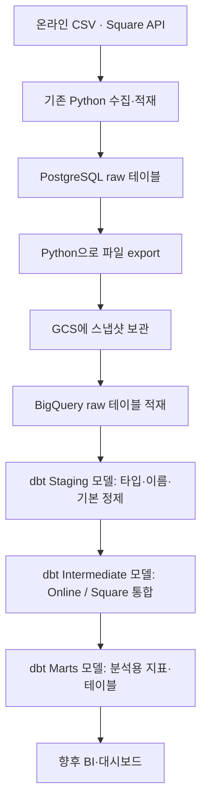
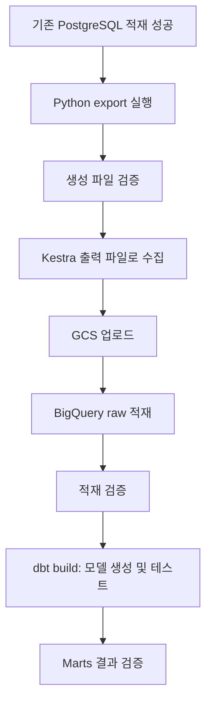

# ☁️ Phase 4 — GCS · BigQuery 적재 및 dbt 모델링

Charlie’s Chocolate Factory — Omnichannel Retail Data Platform

> 시작일: 2026-10-31  
> 최종 업데이트: 2026-11-06  
> 현재 상태: 🟡 학습·설계 진행 / 클라우드 및 dbt 구현 전  
> 이번 업데이트: dbt 계층 설계 결정, Kestra Logging 개선 계획 및 GCP 학습 내용 반영

이 문서는 Charlie’s Chocolate Factory의 **Phase 4 구현 방향, 학습 기록, 실제 완료 여부**를 함께 관리한다.
기존 문서에서는 Phase 4를 GCS·BigQuery raw 적재까지만 다루고 dbt 모델링을 Phase 5로 분리했으나,
**2026-11-05 이후의 결정에 따라 Phase 4를 `4A. Cloud Ingestion`과 `4B. dbt Transformation & Modeling`으로 확장**한다.

> **진행 상태 주의:** 현재 PostgreSQL 원본 적재와 Kestra 실행까지 완료했으며,
> PostgreSQL → GCS → BigQuery 이동, `dbt init`, dbt SQL 모델 실행은 **아직 실제 구현·검증하지 않았다**.
> Kestra Logging용 개선 Patch도 준비했지만 **아직 로컬 소스에 적용하지 않았다**.
> `dbt`, BigQuery, IAM, Federated Query 강의·실습에서 배운 내용은 프로젝트 구현 완료로 표시하지 않는다.

---

## 1. Phase 4를 시작하는 시점

### 이전 단계에서 완료한 작업

- [x] 온라인 CSV 데이터를 Python으로 선별하여 PostgreSQL에 적재
- [x] Square API에서 상품·고객·매장·주문을 조회하여 PostgreSQL에 적재
- [x] 적재 메타데이터 `ingested_at`, `orchestrator`, `pipeline_run_id` 추가
- [x] 온라인 5개와 Square 4개 테이블의 개별 Kestra Flow 실행 확인
- [x] Kestra 상위 Flow에서 9개 적재 작업의 전체 순차 실행 성공 확인

위 실행 성공은 이전 작업과 대화에서 확인한 결과다. 이번 설계 기록을 작성하면서 DB·API·Kestra를 다시 실행한 것은 아니다.

### 2026-11-06 기준 상태 요약

| 항목 | 상태 | 근거 및 다음 작업 |
|---|---|---|
| Online / Square → PostgreSQL 적재 | ✅ 완료(기존 기록 기준) | 9개 테이블 raw 보유 |
| Kestra 개별 Flow 및 상위 Flow | ✅ 완료(기존 기록 기준) | 전체 적재 흐름 구성·실행 기록 |
| Kestra Python 공통 Logging | 🟠 개선 Patch 준비, 미적용 | 적용 전 `git status`, `git apply --check` 필요 |
| PostgreSQL → export 파일 | ⬜ 미구현 | Python export 개발 |
| GCS 파일 업로드 | ⬜ 미구현 | 인증·버킷·Kestra 연동 |
| BigQuery raw 적재 | ⬜ 미구현 | 데이터셋·스키마·행 수 검증 |
| dbt 초기화 및 BigQuery 연결 | ⬜ 미구현 | `dbt init`, `dbt debug` |
| dbt Staging → Intermediate → Marts | 🟡 설계 결정, 미구현 | SQL 모델 및 데이터 테스트 작성 |
| GCP/BigQuery 및 dbt 강의 | 📚 학습 중 | 이해한 개념을 구현 때 적용 예정 |

### 현재 PostgreSQL 저장 범위

| 스키마 | 테이블 | 저장 형태 |
|---|---|---|
| `raw_online` | `products` | 상품 전체를 컬럼 형태로 저장 |
| `raw_online` | `customers` | ONLINE 가입 고객 선별 |
| `raw_online` | `customer_addresses` | 선별된 고객에 속한 주소 |
| `raw_online` | `orders` | ONLINE 채널 주문 선별 |
| `raw_online` | `order_items` | 선별된 주문에 속한 주문상품 |
| `raw_square` | `catalog_objects` | ITEM 객체와 하위 variations를 JSONB payload로 저장 |
| `raw_square` | `customers` | 고객 JSONB payload |
| `raw_square` | `locations` | 매장 JSONB payload |
| `raw_square` | `orders` | 주문 및 중첩 주문상품 등을 JSONB payload로 저장 |

두 영역 모두 적재 메타데이터를 기록한다. 온라인의 선별과 일부 타입 적용은 이미 수행했지만, 두 채널의 분석용 정제·표준화·통합이 완료된 상태는 아니다.

---

## 2. 이번에 확정한 데이터 이동 방향

**기존 PostgreSQL raw 테이블을 클라우드 수집 원천으로 사용한다.**



- **현재 구현 범위:** 온라인·Square → Python → PostgreSQL 및 Kestra 실행 관리
- **Phase 4A (Cloud Ingestion):** PostgreSQL → 파일 export → GCS → BigQuery raw 및 적재 검증
- **Phase 4B (dbt Transformation):** BigQuery raw → Staging → Intermediate → Marts 및 데이터 품질 테스트
- **후속 작업:** 완성된 Marts를 활용한 분석·시각화 및 포트폴리오 정리

Kestra는 기존 수집뿐 아니라 새 export·업로드·BigQuery 적재 작업을 관리하도록 확장한다. 이후 dbt 실행도 Kestra와 연결할 수 있다. **실행 연동은 아직 계획 단계**다.

---

## 3. 질문을 통해 정리한 핵심 개념

### 3.1 PostgreSQL은 GCS 업로드의 필수 중간 단계인가

**아니다.** 원본 CSV를 GCS에 직접 올리거나, Python으로 Square API를 조회한 결과를 바로 GCS에 저장하는 경로도 가능하다.

Zoomcamp는 로컬 PostgreSQL 적재와 Docker 실행 환경을 먼저 다루고, Kestra로 실행 관리·스케줄·과거 기간 재처리 등을 학습한 뒤 클라우드로 확장하는 구성이다. 따라서 로컬 PostgreSQL 단계는 GCS 사용의 기술적 필수 조건이 아니라, 수집·저장·실행 관리를 학습하고 검증한 단계로 이해한다.

이 프로젝트에서는 이미 만든 로컬 파이프라인을 활용하여 **PostgreSQL을 다음 클라우드 파이프라인의 수집 원천으로 삼는 설계**를 선택했다. 이 선택이 모든 e-commerce DE 프로젝트에 필수라는 뜻은 아니다.

### 3.2 운영 DB와 이번 PostgreSQL은 같은 역할인가

구분해야 한다. 온라인 서비스와 POS에는 주문을 접수하고 관리하는 원천 시스템이 있다. 이번 로컬 PostgreSQL은 그곳에서 이미 발생한 데이터를 가져와 저장하는 수집·분석용 영역이다.

“온라인·POS 주문은 반드시 이 PostgreSQL에 적재해야 하므로 만들었다”는 설명 대신, **“로컬 수집·적재를 구현한 뒤 그 결과를 클라우드 분석 환경으로 확장한다”**고 설명한다.

### 3.3 GCS에 보관할 파일은 어떤 의미의 원본인가

이번 설계에서 GCS에 올리는 파일은 **PostgreSQL raw 테이블에서 추출한 스냅샷**이다.

| 비교 | 최초 수집 CSV 또는 API 응답 | 이번 Phase 4의 export 파일 |
|---|---|---|
| 추출 출처 | 원천 파일 또는 Square API | PostgreSQL raw 테이블 |
| 온라인 선별 | 원천에 여러 채널이 함께 있을 수 있음 | 기존 ONLINE 선별 결과 반영 |
| 적재 메타데이터 | 원천 자체에는 없을 수 있음 | PostgreSQL에 기록한 값 포함 |
| 설명 방식 | 수집 당시 원본 | DB 추출 시점의 스냅샷 |

따라서 export 파일을 “최초의 손대지 않은 원본 CSV”라고 부르지 않는다. **분석용 정제 전 데이터에 가깝지만, 기존 수집 과정의 선별·타입 적용·메타데이터가 반영된 데이터**다.

현재 테이블은 온라인 전체 교체 및 Square ID Upsert 방식이다. 이번에 export하는 데이터는 그 시점의 테이블 상태이며, 이전 실행의 모든 데이터 버전을 자동으로 복원한 이력은 아니다.

### 3.4 메타데이터를 추가하면 클리닝 완료 데이터인가

아니다. `ingested_at`, `orchestrator`, `pipeline_run_id`는 데이터를 언제 어떤 실행으로 적재했는지 설명하는 정보다. 이 컬럼을 붙였다는 것과 결측·중복·금액·ID 기준을 정리했다는 것은 별개다.

PostgreSQL에 있는 기존 메타데이터는 원래 적재 실행을 설명한다. **export 실행 ID나 GCS 업로드 시각과는 다른 의미**이므로 export할 때 기존 값을 새 실행 정보로 무조건 덮어쓰지 않는다. export 시점과 실행 정보는 별도 파일 경로나 manifest 등으로 기록하는 방향을 검토한다.

### 3.5 원본 보관과 Python·Kestra는 서로 다른 선택인가

아니다. 원본에 가까운 파일을 보관하면서 Python으로 수집·업로드를 수행하고 Kestra로 실행을 관리할 수 있다.

| 구성 요소 | 이번 설계에서 맡는 역할 |
|---|---|
| PostgreSQL | export할 현재 raw 데이터 보관 |
| Python | DB 조회 및 export 파일 생성 |
| Kestra | 단계 실행·의존 순서·성공과 실패 관리 |
| GCS | export 파일 보관 |
| BigQuery | raw 적재 및 dbt SQL 변환 결과(View/Table 등) 저장·실행 |
| dbt | BigQuery 위에서 SQL 기반 정제·모델 의존성·테스트 관리 |
| Git / GitHub | Python·Kestra·dbt 프로젝트 소스 버전 관리 |

---

## 4. CSV export와 Square JSONB 처리 방향

### 온라인 데이터

온라인 테이블은 이미 일반 컬럼으로 구성되어 있어 CSV export를 우선 검토한다. ID의 문자열 표현, 날짜·시각, 숫자, NULL, 인코딩과 CSV 구분자 규칙을 명시해야 한다.

### Square 데이터

**Square 테이블도 CSV로 export하여 GCS에 올릴 수 있다.**

예를 들어 CSV에는 Square ID, `payload`, 적재 메타데이터를 함께 담을 수 있다. 이때 `payload` JSON은 CSV 한 칸 안에 문자열로 저장되고, 내부의 주문상품 배열이나 금액이 자동으로 별도 컬럼으로 펼쳐지지는 않는다.

| 확인 항목 | 필요한 처리 |
|---|---|
| CSV quoting | JSON의 따옴표·쉼표·줄바꿈이 필드를 깨뜨리지 않도록 처리 |
| JSON 직렬화 | 유효한 JSON 문자열로 보존하고 Python dict의 단순 문자열 표현과 구분 |
| BigQuery payload 타입 | STRING으로 적재 후 JSON 해석할지 등 실제 적재 방식 결정 |
| 중첩 구조 | 이후 SQL에서 필요한 필드·배열을 추출 |
| 대안 형식 | 필요하면 newline-delimited JSON 등과 비교 |

**현재 결정:** 온라인·Square 모두 PostgreSQL에서 export하는 경로를 채택한다. CSV는 두 영역 모두 가능한 방식으로 검토하되, Square payload의 실제 export·재적재 결과를 확인한 뒤 최종 파일 형식과 BigQuery 타입을 확정한다.

CSV에는 PostgreSQL의 컬럼 타입·기본키·제약조건이 그대로 전달되지 않는다. PostgreSQL 스키마를 참고하여 **BigQuery용 스키마를 별도로 정의**해야 한다.

---

## 5. 데이터 클리닝은 언제 진행하는가

클리닝은 반드시 GCS 업로드 뒤에만 수행해야 하는 작업은 아니다. ETL은 적재 전에 변환하고, ELT는 적재 후 대상 시스템에서 변환한다.

**이번 프로젝트는 BigQuery 적재 후 본격적인 분석용 정제·통합을 수행하는 ELT 방향으로 진행한다.** 다만 export와 업로드 전에 기본적인 데이터 및 파일 검증은 수행한다.

| 시점 | 수행할 작업 | 범위 |
|---|---|---|
| PostgreSQL export 전후 | 조회 성공, 필수 컬럼, 행 수, 파일 생성, 형식 확인 | Phase 4A |
| GCS 업로드 후 | 객체 존재·크기 및 필요 시 무결성 확인 | Phase 4A |
| BigQuery raw 적재 후 | 행 수·스키마·NULL·금액·날짜·payload 손실 확인 | Phase 4A |
| dbt Staging 모델 | 데이터 타입·컬럼 이름·NULL 표현 정리, 기본 정제 | Phase 4B |
| dbt Intermediate 모델 | Online / Square 통합, 비즈니스 로직 | Phase 4B |
| dbt Marts 모델 | 매출·상품·고객 지표와 분석용 데이터셋 | Phase 4B |
| dbt Tests | `not_null`, `unique`, `relationships` 등 데이터 품질 검증 | Phase 4B |

**GCS는 저장 공간이지 클리닝 엔진이 아니다.** 이번 설계에서는 GCS 파일을 BigQuery에 적재한 뒤 SQL로 가공한다. 다른 설계에서는 Python이 GCS 파일을 읽고 변환할 수도 있지만 지금은 그 경로를 기본으로 삼지 않는다.

---

## 6. Kestra로 자동화할 실행 흐름



### 파일을 직접 다운로드할 필요는 없음

사용자가 CSV를 컴퓨터에 내려받아 다시 업로드하는 수동 작업을 필수 단계로 두지 않는다.

1. Kestra가 Python export 코드를 실행한다.
2. Python이 PostgreSQL을 조회하여 작업 공간에 파일을 생성한다.
3. 작업 컨테이너가 종료되기 전에 파일을 Kestra 출력으로 수집한다.
4. 다음 GCS 업로드 작업이 해당 파일을 전달받는다.
5. 업로드 성공 후 BigQuery 적재와 검증으로 이어진다.

기존 프로젝트 소스 마운트는 읽기 전용이므로 export 파일을 그 안에 쓰는 것으로 가정하지 않는다. **작업용 쓰기 가능 디렉터리와 Kestra 출력 수집 설정**을 함께 설계한다.

GCS 업로드는 Kestra 전용 태스크 또는 Python GCS 클라이언트로 구현할 수 있다. 현재 Kestra·플러그인 버전과 인증 방식을 확인하고 한 방식을 선택한다. 아직 구체적인 Flow YAML을 구현한 상태는 아니다.

### 실행 성공과 데이터 정확성을 구분

- 태스크가 SUCCESS여도 export한 행과 적재한 행이 일치하는지 확인한다.
- 온라인 고객 가입 채널과 주문 채널의 차이를 데이터 오류로 단정하지 않는다.
- PostgreSQL에서 여러 테이블을 차례로 export한다고 자동으로 동일 시점의 스냅샷이 보장되지는 않는다. 우선 동시 적재를 피하는 실행 순서를 검토하고, 필요하면 트랜잭션 일관성을 설계한다.

---

## 7. Phase 범위와 dbt 도입 결정 (2026-11-05 업데이트)

| 구간 | 목표 | 상태 |
|---|---|---|
| Phase 3 — Workflow Orchestration | Kestra에서 Online / Square → PostgreSQL 적재 자동화 | ✅ 기존 구현 기록 |
| Phase 3 보완 — Observability | 기존 Python의 공통 Logging / 에러 추적 강화 | 🟠 Patch 준비, 미적용 |
| Phase 4A — Cloud Ingestion | PostgreSQL → GCS → BigQuery raw | ⬜ 미구현 |
| Phase 4B — Transformation & Modeling | **BigQuery + dbt**로 Staging → Intermediate → Marts 구성 | 🟡 설계 결정, 미구현 |
| 후속 분석 단계 | Marts 기반 매출·고객·상품 분석 및 시각화 | ⬜ 미구현 |

기존 2026-10-31 문서는 모델링을 Phase 5로 구분했다. 이후 **Phase 4에서 dbt 세 계층을 직접 구현**하기로 방향을 바꿨으므로 이 문서에서는 **Phase 4B**로 기록한다. 최종 전체 프로젝트 문서의 후속 Phase 번호는 나중에 일괄 정리한다.

**용어 주의:** `staging` 모델 계층은 환경 구분인 `dev → staging → production`의 staging 환경과 다른 개념이다.
`stg_` 모델은 **원본을 분석 가능하게 표준화하는 SQL 변환 계층**을 뜻한다.

---

## 8. 구현 계획과 완료 기준

### 8.0 Phase 3 보완 — Kestra Logging 우선 적용

- [x] `print()` 위주 실행 기록만으로는 장애 원인 추적이 불충분하다는 문제 발견
- [x] 공통 Logger와 단계별 Logging을 반영할 개선 Patch 준비
- [ ] 로컬 `git status`로 미커밋 작업 확인 및 보호
- [ ] `git apply --check`로 Patch 적용 가능 여부 확인
- [ ] `git apply`로 기존 Python 파일에 변경사항 적용
- [ ] `src/pipelines/run_logging.py` 및 기존 5개 파이프라인 변경 내용 검토
- [ ] `python -m compileall -q src/pipelines`로 구문 확인
- [ ] 민감정보 출력 여부와 예외 시 종료 코드 확인
- [ ] 실제 데이터에 영향을 주지 않는 환경에서 Kestra UI의 성공/실패 로그 검증
- [ ] Git commit으로 변경 이력 기록

> `.patch`는 실행 중 로그를 저장하는 파일이 아니다. **기존 `.py` 파일을 일괄 수정하기 위한 변경 내역**이다.
> Patch를 적용한 후에도 실제 관리 대상은 Python 소스와 Git 이력이다.
> Logging 형식·stdout 출력·실행 ID·단계별 소요시간 등 공통 동작은 `run_logging.py`로 재사용하고,
> 데이터별 `Extracted rows`, `Loaded rows` 등 업무 로그는 각 파이프라인에서 기록한다.
> 개선 Patch의 오류 문자열 마스킹은 완전한 보안을 보장하지 않으므로 API 키·고객 데이터는 애초에 로그에 남기지 않는다.

### 8.1 GCP 환경 준비

- [ ] 프로젝트 및 결제 설정 확인
- [ ] 저장·분석 리소스의 리전과 위치 호환성 결정
- [ ] GCS 버킷 생성
- [ ] BigQuery raw 데이터셋 생성
- [ ] 실행 주체·인증 방식·필요 권한 구성
- [ ] 인증정보를 코드·문서·공개 저장소에 포함하지 않는 방식 적용

### 8.2 온라인 상품 테이블 하나로 경로 검증

- [ ] PostgreSQL `raw_online.products` 조회
- [ ] Python export 코드 작성
- [ ] CSV 컬럼 순서·인코딩·구분자·NULL·날짜 표현 결정
- [ ] 원본 적재 메타데이터 보존
- [ ] DB 조회 행 수와 export 행 수 대조
- [ ] Kestra 작업 디렉터리 및 출력 파일 수집 연결
- [ ] GCS 경로에 업로드
- [ ] BigQuery 스키마 정의 및 raw 테이블 적재
- [ ] PostgreSQL → 파일 → BigQuery의 행 수와 주요 값 대조

> 최초 성공 기준: 상품 테이블 하나가 수동 실행으로 전체 경로를 통과하고, 파일과 테이블에서 컬럼·행 수·값이 의도대로 보존되는 것.

### 8.3 Square 데이터 하나로 JSON 보존 검증

- [ ] `raw_square` 테이블 하나를 선정
- [ ] payload 직렬화와 CSV quoting 확인
- [ ] STRING/JSON 처리 방식과 파일 형식 결정
- [ ] JSON의 중첩 구조와 메타데이터 보존 확인
- [ ] BigQuery에서 필요한 필드를 정상적으로 읽는지 확인

### 8.4 나머지 테이블로 확장

- [ ] 온라인 5개 및 Square 4개 테이블로 확장
- [ ] 테이블별 스키마와 export 규칙 정리
- [ ] 수집 시점·실행 ID를 구분할 경로 또는 manifest 규칙 결정
- [ ] 재실행 시 파일 덮어쓰기·이력 보존·BigQuery 중복 적재 정책 결정
- [ ] 기존 적재 → export → 업로드 → BigQuery 적재의 상위 Flow 연결
- [ ] 실패 후 재실행 범위와 동시 실행 정책 검토
- [ ] 수동 전체 실행 검증 후 필요에 따라 스케줄 추가

### 8.5 dbt BigQuery 프로젝트 준비 (Phase 4B)

- [x] 강의에서는 DuckDB를 사용하지만 **실제 초콜릿 프로젝트는 BigQuery를 dbt 실행 대상으로 선택**
- [x] 기존 `chocolate-commerce-data-platform` GitHub 저장소 하위에 dbt 폴더 추가하기로 결정
- [x] `Staging → Intermediate → Marts` 3개 계층 도입 결정
- [ ] `dbt-bigquery` 어댑터와 현재 Python 환경의 버전 호환성 확인
- [ ] 기존 저장소 루트에서 `dbt init chocolate_dbt` 실행
- [ ] GCP Project ID / BigQuery Dataset / 인증 방식 결정
- [ ] `profiles.yml` 연결 설정 준비(인증정보 Git 커밋 금지)
- [ ] `dbt debug`로 BigQuery 연결 테스트
- [ ] `models/staging`, `models/intermediate`, `models/marts` 폴더 및 프로젝트 설정
- [ ] BigQuery raw 테이블을 dbt `source()`로 등록
- [ ] 각 계층의 `ref()` 의존 관계 및 materialization(View/Table 등) 정하기
- [ ] 초기 모델 생성·테스트·실행 결과를 Git에 기록

예상 저장소 구조(아직 생성하지 않음):

```text
chocolate-commerce-data-platform/
├── src/                         # 수집·적재 및 공통 logging
├── sql/                         # PostgreSQL 원본 스키마·마이그레이션
├── (기존 Kestra 설정 위치)/      # 실제 저장소 경로 확인 후 유지
├── chocolate_dbt/               # 새 dbt 프로젝트 (예정)
│   ├── dbt_project.yml
│   ├── models/
│   │   ├── staging/
│   │   ├── intermediate/
│   │   └── marts/
│   ├── macros/
│   └── tests/
└── README.md
```

### 8.6 dbt 모델링과 데이터 품질 검증 (Phase 4B)

- [ ] `stg_online_*`, `stg_square_*`: 테이블/컬럼명·타입·금액 단위·시간대 및 JSON 필드 표준화
- [ ] `int_*`: Online·Square의 주문/상품/고객을 공통 구조로 통합
- [ ] `fct_orders`와 필요 차원 테이블 등 `marts` 후보 검토 후 모델 구현
- [ ] `not_null`, `unique`, `relationships`, `accepted_values` 등 적절한 dbt 데이터 테스트 작성
- [ ] NULL·중복·누락 등 테스트 실패 시 원인 파악 및 모델/원천 데이터 수정
- [ ] BigQuery에 생성된 결과 View/Table, 모델 건수, 대표 지표 검증
- [ ] Kestra에서 BigQuery 적재 완료 후 `dbt build`를 실행하는 연동 검토
- [ ] 매출 중복 집계 방지를 위해 주문/주문상품 Grain을 문서화

**주의:** dbt는 데이터를 로컬에서 클리닝한 뒤 BigQuery에 다시 업로드하는 방식이 아니다.
dbt가 **BigQuery에 SQL을 실행**하고 결과 View/Table을 **BigQuery 안에 생성**한다.
`dbt test`는 품질 조건을 검사할 뿐 자동으로 결측·중복을 고치지 않는다.

### 설계상 아직 미확정인 항목

| 항목 | 다음에 결정할 내용 |
|---|---|
| export 코드 배치 | 모듈명과 공통 함수 분리 방식 |
| 파일 형식 | 온라인 CSV 우선 검토, Square payload 실습 후 확정 |
| GCS 경로 | 테이블·추출 날짜·실행 단위를 구분하는 규칙 |
| BigQuery 스키마 | 숫자·시각·NULL·payload 타입과 로드 옵션 |
| 업로드 구현 | Kestra 플러그인 또는 Python 클라이언트 |
| 재실행 정책 | GCS 이력 보존과 BigQuery append/replace 등 |
| BigQuery 적재 방식 | Native raw Table 적재 vs GCS External Table 활용 범위 |
| dbt 출력 대상 | dev용 Dataset, 스키마 명명 규칙 및 모델별 View/Table |
| 채널 통합 기준 | 상품/고객/주문 ID 맵핑, 통화·세금·시간대 기준 |
| 오케스트레이션 | Kestra에서 dbt 실행 환경·인증·실패 정책 구성 |

---

## 9. 진행 로그

### 2026-10-31 — 설계 질문 정리와 Phase 4 방향 확정

#### 완료한 결정

- [x] GCS 업로드에 PostgreSQL이 필수 경유지는 아니라는 점 이해
- [x] Zoomcamp 로컬 실습과 최종 클라우드 구조의 목적 구분
- [x] 현재 PostgreSQL 데이터를 클라우드 파이프라인의 수집 원천으로 사용하기로 결정
- [x] GCS 보관 파일을 “PostgreSQL raw 테이블에서 export한 스냅샷”으로 정의
- [x] Square JSONB도 CSV로 export 가능하지만 중첩 구조가 자동으로 펼쳐지지 않음을 확인
- [x] 기존 적재 메타데이터와 export 실행 메타데이터의 의미 구분
- [x] Python export와 Kestra 출력 수집·GCS 업로드의 연결 방식 이해
- [x] BigQuery raw 적재 후 분석용 정제·통합을 수행하는 방향 결정
- [x] **당시 결정:** 클라우드 적재를 Phase 4에, 본격적인 모델링을 Phase 5로 구분
  - 2026-11-05에 dbt 모델링을 **Phase 4B에 포함**하도록 계획 갱신

#### 아직 수행하지 않은 구현

- GCP 프로젝트·버킷·데이터셋·권한 준비
- PostgreSQL export Python 코드 작성
- export 및 GCS 업로드 Kestra Flow 작성
- BigQuery raw 스키마와 적재 작업 구성
- 클라우드 경로 실행 및 데이터 검증

#### 다음 시작 지점

**Kestra Logging Patch를 먼저 검증·적용한 뒤, `raw_online.products` 하나로 PostgreSQL → export 파일 → GCS → BigQuery 경로를 구현한다. 이후 `chocolate_dbt`를 초기화하고 BigQuery raw를 참조하는 첫 Staging 모델을 만든다.**

학습 참고: [Build Data Lakes and Data Warehouses on Google Cloud](https://www.coursera.org/learn/data-lakes-data-warehouses-gcp) — 실습 경험은 프로젝트 구현과 구분하여 기록

---

## 10. 최근 학습 기록과 프로젝트 연결

### 2026-11-01 ~ 11-03 — GCP / BigQuery 강의 및 Federated Query 실습

- Coursera의 GCP 데이터 레이크·웨어하우스 개념을 학습함.
- Data Lake / Data Warehouse / Lakehouse, OLTP vs OLAP, IAM 등의 개념을 정리함.
- 별도의 **BigQuery Federated Query 교육용 실습**에서 BigQuery와 AlloyDB for PostgreSQL 연결을 설정하고,
  `EXTERNAL_QUERY`로 AlloyDB의 `web_log`를 조회해 BigQuery 측 고객 데이터와 조인해봄.
- 이 실습은 **외부 운영 데이터베이스의 데이터를 BigQuery에서 직접 조회하는 방법**을 배운 것이지,
  **우리 초콜릿 프로젝트에 AlloyDB를 도입하거나 GCS 적재를 완료했다는 뜻이 아님**.
- 프로젝트에서는 우선 계획대로 PostgreSQL → GCS → BigQuery **적재형 ELT**를 구현한다.

### 2026-11-05 — dbt 모델링 방향 결정

- 예전 pandas 데이터 클리닝 학습과 비교해 **이번에는 BigQuery SQL + dbt 기반 ELT**를 수행하기로 결정.
- dbt `Staging → Intermediate → Marts`를 **Phase 4B**에서 실제로 구현할 예정.
- `Staging` 모델 계층과 `dev/stg/prod` 배포 환경은 구별함.
- `source()`는 BigQuery raw 데이터 출처 정의, `ref()`는 dbt 모델 간 의존 관계 관리라는 개념을 학습함.

### 2026-11-06 — dbt 강의 이해 정리

| 학습 주제 | 이해한 내용 | 프로젝트에 적용할 내용 |
|---|---|---|
| DuckDB와 BigQuery | 강의의 DuckDB는 가벼운 실습 환경이며 dbt는 BigQuery와도 연결 가능 | 실 구현은 `dbt-bigquery` |
| `dbt init` | 프로젝트 및 대상 플랫폼 연결 구성을 시작하는 명령어 | `dbt init chocolate_dbt` 예정 |
| dbt 저장소 관리 | dbt SQL/YAML도 소스코드이므로 Git으로 관리 | 기존 모노레포의 하위 폴더 사용 |
| `dbt run` | 대상 SQL 모델을 실행해 View/Table 등을 생성 | BigQuery 결과 데이터셋에 생성 |
| `dbt test` | 선언된 데이터 품질 규칙을 검증 | NULL·중복·참조 무결성 등 |
| `dbt build` | 의존성 순서에 따라 모델 빌드와 테스트 등을 실행 | Kestra와 후속 연계 검토 |
| dbt 결과 위치 | 변환 결과는 BigQuery 내에 생성됨 | 별도 재업로드 불필요 |
| dbt vs pandas | pandas도 클리닝 가능하지만 이번 ELT의 중심은 SQL 모델 | BigQuery에서 클리닝과 통합 |

**명령어 사용 메모:** `dbt run`을 매번 수행한 다음 반드시 `dbt test`를 실행해야만 하는 것은 아니다.
`dbt build`로 모델 생성과 테스트를 한 번의 명령 흐름에서 처리할 수 있다.
단, 실제 모델/테스트 의존 관계와 오류 정책을 확인해야 한다.

### 2026-11-06 — Kestra Logging 중요성 인식과 개선 계획

#### 회고

Phase 3에서는 **데이터를 PostgreSQL에 정상 저장하는 것**에 집중했다.
기존 Python 파이프라인은 주로 `print()`로 실행 상황을 표시했고, 실패 구간·예외 정보·실행시간을
일관되게 추적하는 Logging 설계를 충분히 고려하지 못했다.

Kestra로 여러 개의 Flow를 관리하면서 **실행 성공 여부만으로는 어디에서 왜 실패했는지
빠르게 설명하기 어렵다**는 문제를 인식했다. 운영 가능한 파이프라인은 실행만 되는 것이 아니라
**관찰 가능하고(Observable), 오류를 진단하고, 재실행을 판단할 수 있어야 한다**.

#### 정한 개선 방식

1. **Patch 일괄 적용:** 개선된 `kestra-pipeline-logging-improved.patch`로 기존 Python 5개 파이프라인에 공통 Logging 구조를 일괄 반영한다.
2. **공통 모듈 재사용:** `src/pipelines/run_logging.py`의 `log_stage()`, `run_metadata()`, `run_cli()` 기능을 공통으로 사용한다.
3. **업무 로그는 개별 코드에서:** Extract / Transform / Load 단계의 건수 및 상태는 각 파이프라인에서 기록한다.
4. **Kestra UI 검증:** stdout 로그, 오류 위치·종류, 실패 종료 코드, 데이터 건수 검증을 수행한다.
5. **Git 관리:** Patch 적용 후에는 `.py` 파일이 실제 변경되므로 그 변경을 검토하고 Git에 커밋한다. Patch를 장기 Logging 저장소로 사용하지 않는다.

**현재 완료 상태:** 개선 Patch 파일 생성·검토까지 진행. **로컬 적용, 실제 Kestra 재실행 및 검증은 아직 안 함.**

추가 회고 문서: [`phase-3-kestra-logging-retrospective-ko.md`](phase-3-kestra-logging-retrospective-ko.md)

---

## 11. 다음 실행 순서 (우선순위)

- [ ] **1. 기존 미커밋 Markdown 문서 정리 및 Git 상태 확인** — 현재 진행 중
- [ ] **2. Logging Patch 검사 및 적용** — 기존 변경사항 보호, `git apply --check` → `git apply`
- [ ] **3. Logging 테스트** — 변경 diff 확인, Python 구문 검사, Kestra UI 확인
- [ ] **4. GCP IAM·GCS·BigQuery raw 리소스 준비**
- [ ] **5. `raw_online.products`를 통한 GCS 및 BigQuery 최초 End-to-End 적재**
- [ ] **6. Online/Square 나머지 데이터로 클라우드 파이프라인 확장**
- [ ] **7. `dbt init chocolate_dbt` 및 BigQuery 연결 확인**
- [ ] **8. Staging → Intermediate → Marts 개발과 `dbt build` / 테스트 검증**
- [ ] **9. Kestra와 BigQuery/dbt 파이프라인 연결 및 재실행·스케줄 정책 설계**

---

## 12. 이후 작업 기록 양식

```markdown
### YYYY-MM-DD — 작업 제목

#### 변경한 파일
- 실제 파일 경로와 변경 이유

#### 수행한 작업
- 구현 또는 설정한 내용

#### 실행·검증 결과
- 실행 도구와 대상 테이블
- export 행 수 및 BigQuery 적재 행 수
- GCS 객체 경로 또는 실행 ID
- 날짜·금액·NULL·JSON 보존 확인 결과
- dbt 모델·테스트 실행 상태 (해당 시)

#### 오류와 해결
- 오류 원인과 적용한 변경

#### 남은 작업
- 다음 실행에서 확인할 항목
```

> 본 문서의 체크 상태는 현재까지 대화·파일에 확인된 내용에 한정한다.
> 새 코드와 인프라가 실제 실행·검증된 뒤에만 체크리스트를 완료 처리한다.
