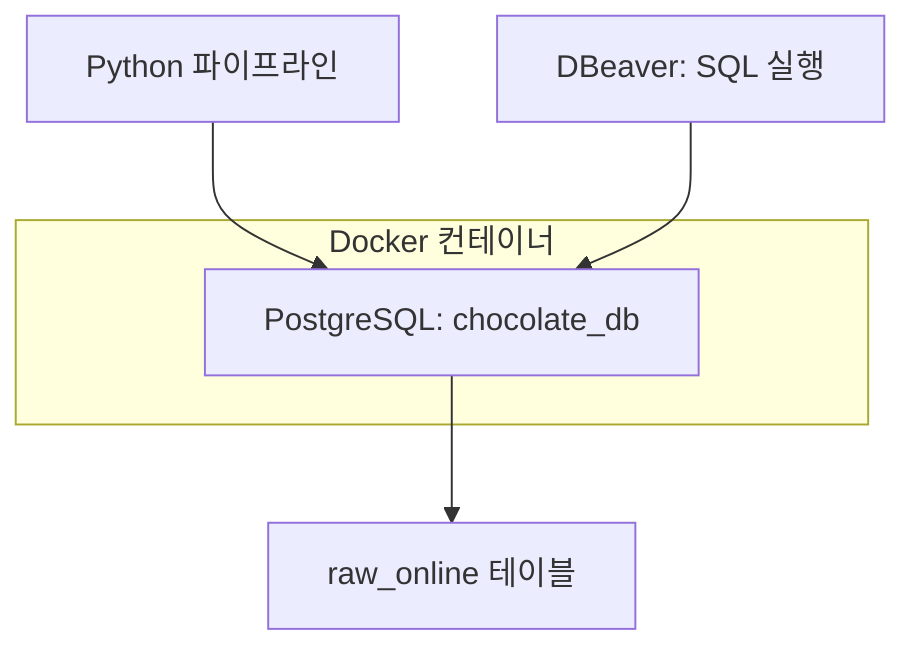
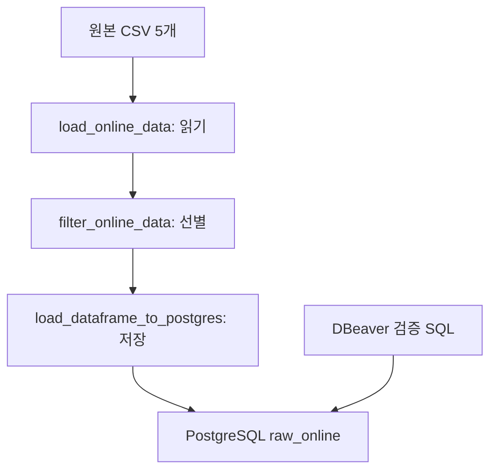

# 🚚 Phase 2 — Online → PostgreSQL Data Ingestion

> 업데이트: 2026-10-22 · 온라인 적재 및 리팩토링 반영 · 다음 작업: Square API 수집

이 문서는 **Charlie’s Chocolate Factory — Omnichannel Retail Data Platform** 프로젝트의 Phase 2에서 구현한  
**Online Store 데이터 → PostgreSQL 적재 과정**을 정리한 문서이다.

나중에 프로젝트를 다시 열었을 때도

- 왜 PostgreSQL을 사용했는지
- 어떤 데이터를 적재했는지
- ONLINE 데이터만 어떻게 분리했는지
- PostgreSQL Schema를 왜 직접 정의했는지
- Python Pipeline이 어떻게 동작하는지
- Extract / Transform / Load를 왜 분리했는지
- 저장 스키마 문제를 어떻게 해결했는지
- 다음 Square 수집 단계로 어떻게 이어지는지

를 쉽게 이해할 수 있도록 기록한다.

---

# 1. 🎯 이번 단계의 목표

Phase 1에서는 실제 리테일 환경을 시뮬레이션하기 위해 다음 Source System을 만들었다.

| 채널 | 원천 시스템 |
|---|---|
| ONLINE | Online Store (Lovable) |
| RETAIL | POS Simulator → Square Sandbox |

Phase 2에서는 각 Source System에서 발생한 데이터를 Data Platform으로 수집한다.

이번 작업에서는 먼저 **Online Channel 데이터**를 대상으로 Local PostgreSQL ingestion pipeline을 구현했다.

**흐름:** Online Store → CSV Export → Python / Pandas → ONLINE Data Filtering → PostgreSQL → SQL Validation

PostgreSQL은 최종 Data Warehouse가 아니라  
**Cloud 환경으로 이동하기 전에 ingestion 과정을 개발하고 테스트하기 위한 Local Database**로 사용한다.

최종 Data Warehouse는 이후 **BigQuery**를 사용할 예정이다.

---

# 2. 🐳 Local Data Environment

PostgreSQL은 Docker Container에서 실행한다.

**흐름:** Docker Desktop → PostgreSQL Container → chocolate_db

현재 PostgreSQL 접속 정보:

```text
Host     : localhost
Port     : 5432
Database : chocolate_db
User     : chocolate
```

DBeaver를 PostgreSQL Client로 사용한다.

DBeaver에서 PostgreSQL에 접속해 테이블을 확인하고 SQL로 검증한다.

DBeaver 자체가 데이터를 저장하는 것은 아니다.

실제 데이터는 PostgreSQL에 저장된다.



Python과 DBeaver는 각각 PostgreSQL에 연결한다. Python이 DBeaver를 거쳐 적재하는 것은 아니다. 컨테이너 재생성 시 데이터 보존 방식은 `docker-compose.yml`의 볼륨 설정을 확인한다. 이미지 버전·컨테이너 이름·볼륨 값은 이 문서에서 임의로 지정하지 않는다.

---

# 3. 📦 Python PostgreSQL 연결

Python Pipeline에서 PostgreSQL과 연결하기 위해 다음 라이브러리를 사용한다.

```text
Pandas
SQLAlchemy
psycopg2-binary
```

연결 구조:

**흐름:** Python → SQLAlchemy → psycopg2 → PostgreSQL

PostgreSQL 연결 코드는 다음 파일에서 관리한다.

```text
src/
└── load/
    └── postgres/
        └── connection.py
```

---

# 4. 📂 현재 관련 프로젝트 구조

```text
chocolate-commerce-data-platform/
│
├── data/
│   └── raw/
│       ├── products_export.csv
│       ├── customers_export.csv
│       ├── customer_addresses_export.csv
│       ├── orders_export.csv
│       └── order_items_export.csv
│
├── src/
│   ├── extract/
│   │   ├── load_csv.py
│   │   └── online/
│   │       ├── __init__.py
│   │       └── load_online_data.py
│   │
│   ├── transform/
│   │   └── online/
│   │       ├── __init__.py
│   │       └── filter_online_data.py
│   │
│   ├── load/
│   │   └── postgres/
│   │       ├── connection.py
│   │       └── load_table.py
│   │
│   └── pipelines/
│       └── online_to_postgres.py
│
├── sql/
│   ├── schema/
│   │   └── create_raw_online_tables.sql
│   │
│   └── validation/
│       └── validate_online_ingestion.sql
│
└── docker-compose.yml
```

---

# 5. 📥 Online Source Data

현재 Online Pipeline에서 사용하는 데이터는 다음과 같다.

```text
products
customers
customer_addresses
orders
order_items
```

원본 CSV에는 ONLINE과 RETAIL 데이터가 함께 존재하는 경우가 있기 때문에  
Pipeline에서 대상 데이터를 선별해서 적재한다. 상품은 공통 마스터 전체, 고객은 온라인 가입 고객, 주문은 온라인 주문을 사용한다.

---

# 6. 🍫 Products

상품 데이터는 Online Store와 POS에서 공통으로 사용하는 Product Master 성격의 데이터이다.

현재는 전체 상품 데이터를 적재한다.

**흐름:** products_export.csv → Pandas → raw_online.products

주요 컬럼:

```text
id
product_id
sku
product_name
category
price
description
is_best_seller
active_status
created_at
updated_at
```

Square 연동 과정에서 생성된 다음 컬럼도 원본에 포함되어 있다.

```text
square_catalog_object_id
square_sync_status
square_synced_at
square_sync_error
```

현재 파이프라인은 상품 컬럼을 별도로 제거하지 않으므로, 원본 CSV에 포함된 해당 컬럼들도 함께 전달한다. 실제 테이블 컬럼과 데이터 타입은 `create_raw_online_tables.sql`을 기준으로 관리한다.

---

# 7. 👤 Customers

`customers_export.csv`에는 POS 가입 고객과 ONLINE 가입 고객이 함께 존재한다.

구분 컬럼:

```text
signup_channel
```

예:

```text
POS
ONLINE
```

Online Pipeline에서는 다음 조건으로 필터링한다.

```python
online_customers_df = customers_df[
    customers_df["signup_channel"]
    .str.strip()
    .str.upper()
    == "ONLINE"
].copy()
```

**흐름:** customers_export.csv → signup_channel == ONLINE → Online Customers → raw_online.customers

> **가입 채널과 구매 채널은 다르다.** 현재는 `signup_channel`로 고객을 고르므로 매장 가입 고객이 온라인으로 구매하면 주문은 포함되지만 고객은 제외될 수 있다. 이번 리팩토링에서는 기존 조건을 유지했다. 다음 고객 통합 설계에서 온라인 주문 고객까지 수집할지 검토한다.

---

# 8. 🏠 Customer Addresses

`customer_addresses_export.csv`에는 ONLINE / POS 채널 정보가 직접 존재하지 않는다.

대신 Customer와 다음 관계를 가지고 있다.

**연결 기준:** `customers.id = customer_addresses.customer_id`

따라서 먼저 ONLINE Customer의 ID를 가져온다.

```python
online_customer_ids = online_customers_df["id"]
```

그리고 해당 Customer ID를 가진 주소만 선택한다.

```python
online_addresses_df = addresses_df[
    addresses_df["customer_id"].isin(
        online_customer_ids
    )
].copy()
```

**흐름:** ONLINE Customers → Customer ID 목록 → customer_addresses → customer_id 비교 → Online Customer Addresses → raw_online.customer_addresses

---

# 9. 🛒 Orders

`orders_export.csv`에는 ONLINE 주문과 RETAIL 주문이 함께 존재한다.

구분 컬럼:

```text
channel
```

Online 주문만 다음 조건으로 선택한다.

```python
online_orders_df = orders_df[
    orders_df["channel"]
    .str.strip()
    .str.upper()
    == "ONLINE"
].copy()
```

**흐름:** orders_export.csv → channel == ONLINE → Online Orders → raw_online.orders

---

# 10. 🍫 Order Items

`order_items_export.csv`에는 `channel` 컬럼이 존재하지 않는다.

따라서 Online Order와의 관계를 이용한다.

여기서 중요한 점은 Orders 테이블에 ID가 두 종류 존재한다는 것이다.

```text
orders.id
= UUID

orders.order_id
= Business Order ID
  예: CCF-WEB-000001
```

`order_items.order_id`는 UUID인 `orders.id`가 아니라  
**`orders.order_id`와 연결된다.**

정확한 관계:

**연결 기준:** `orders.order_id = order_items.order_id`

따라서 Online Order Items 필터링은 다음과 같이 한다.

```python
online_order_ids = online_orders_df["order_id"]

online_order_items_df = order_items_df[
    order_items_df["order_id"].isin(
        online_order_ids
    )
].copy()
```

**흐름:** Online Orders → order_id 목록 → Order Items → order_id 비교 → Online Order Items → raw_online.order_items

---

# 11. 🗄️ PostgreSQL Raw Schema

처음에는 Pandas의 `to_sql()`이 자동으로 PostgreSQL 테이블을 생성하도록 사용했다.

하지만 이 방식은 Pandas가 데이터 타입을 자동 추론하기 때문에  
원하는 Database Schema를 명확하게 관리하기 어렵다.

예:

```text
price
→ NUMERIC

quantity
→ INTEGER

created_at
→ TIMESTAMPTZ

phone
→ VARCHAR
```

따라서 PostgreSQL Schema를 SQL로 직접 정의하도록 변경했다.

Schema 생성 파일:

```text
sql/schema/create_raw_online_tables.sql
```

PostgreSQL에는 별도의 Raw Schema를 생성한다.

```text
raw_online
```

현재 구조:

```text
PostgreSQL
└── raw_online
    ├── products
    ├── customers
    ├── customer_addresses
    ├── orders
    └── order_items
```

DBeaver SQL Editor에서 SQL 파일을 실행해 이 구조를 생성했다.

여기서 `raw_online`은 PostgreSQL의 네임스페이스인 **스키마**, 각 테이블의 컬럼·타입은 **테이블 구조**다. 위 타입 목록은 설계 예시이며 정확한 정의는 실제 SQL 파일을 기준으로 확인한다.

---

# 12. 🔄 적재 방식과 스키마 오류 수정

초기 적재 함수는 `schema`를 생략하고 `if_exists="replace"`를 사용했다.

```python
df.to_sql(
    name=table_name,
    con=engine,
    if_exists="replace",
    index=False,
)
```

이 코드에는 두 가지 문제가 있었다.

| 항목 | 동작 및 문제 | 현재 수정 |
|---|---|---|
| 스키마 생략 | 연결의 기본 스키마 사용. 의도한 raw_online과 다를 수 있음 | `schema="raw_online"` 명시 |
| replace | 기존 테이블 삭제 후 다시 생성. 미리 정의한 타입·제약조건·인덱스가 유지되지 않을 수 있음 | 행만 DELETE한 뒤 append |

실제로 성공 로그가 출력됐지만 DBeaver에서 `raw_online` 데이터가 보이지 않는 상황을 겪었다. 스키마를 명시한 뒤 사용자가 `raw_online`에 데이터가 들어간 것으로 확인했다. 최초 데이터가 `public`에 저장됐는지는 쿼리 결과가 공유되지 않아 확정하지 않는다.

**현재 코드는 `DELETE + APPEND` 방식이다. 기존 문서의 `TRUNCATE + APPEND` 설명을 실제 코드에 맞게 수정했다.**

파일: `src/load/postgres/load_table.py`

```python
import pandas as pd
from sqlalchemy import text
from sqlalchemy.engine import Engine


ALLOWED_TABLES = {
    "products",
    "customers",
    "customer_addresses",
    "orders",
    "order_items",
}


def load_dataframe_to_postgres(
    df: pd.DataFrame,
    table_name: str,
    engine: Engine,
) -> None:
    """raw_online 테이블의 기존 데이터를 새 데이터로 교체한다."""

    if table_name not in ALLOWED_TABLES:
        raise ValueError(f"Unsupported table: {table_name}")

    with engine.begin() as connection:
        connection.execute(
            text(f'DELETE FROM raw_online."{table_name}"')
        )

        df.to_sql(
            name=table_name,
            schema="raw_online",
            con=connection,
            if_exists="append",
            index=False,
        )

    print(
        f"[SUCCESS] raw_online.{table_name} loaded "
        f"({len(df)} rows)"
    )
```

`engine.begin()` 안에서 같은 연결로 기존 행 삭제와 새 행 삽입을 실행한다. 정상 종료하면 커밋하고, 오류가 나면 해당 테이블의 변경을 롤백한다. 테이블은 미리 생성되어 있어야 한다.

| 관점 | 현재 동작 |
|---|---|
| 적재 방식 | 매번 대상 테이블 데이터를 전체 교체하는 Full Refresh |
| 테이블 구조 | 유지 |
| 재실행 | 같은 입력이면 이전 실행 데이터 위에 계속 누적하지 않음 |
| 원본 중복 | 원본에 이미 있는 중복을 제거해주는 것은 아님 |
| 트랜잭션 범위 | 테이블 하나의 DELETE + INSERT |
| 실행 실패 | 앞서 커밋된 다른 테이블은 되돌리지 않음 |

외래 키 제약조건을 적용하면 부모 행 삭제가 막힐 수 있다. 그때는 테이블 간 삭제·삽입 순서와 전체 트랜잭션 범위를 함께 설계해야 한다. 이 함수는 현재 온라인 테이블에 맞춰져 있으므로 Square 적재에 그대로 사용하지 말고 목적 스키마와 테이블 범위를 확장할지 검토한다.

---

# 13. 🧱 Raw Layer 설계 원칙

현재 `raw_online`은 **온라인 수집 범위에 해당하는 데이터를 원본 컬럼 중심으로 저장하는 로컬 영역**이다.

- 상품은 전체를 저장한다.
- 고객·주문은 채널 조건으로 선별한다.
- 주소·주문상품은 연결된 ID로 선별한다.
- 별도의 집계나 통합 모델링은 아직 수행하지 않는다.

따라서 모든 원본을 무가공으로 보존하는 저장소는 아니다. 원본 CSV 스냅샷은 `data/raw/`에 있고, PostgreSQL 테이블은 최신 적재 데이터로 교체된다. 현재 방식만으로는 변경 이력이 누적 보존되지 않는다.

기존 설계에서는 Raw 테이블의 강한 제약조건을 최소화하고 적재 후 SQL로 품질을 확인하는 방향을 택했다. 실제 적용된 제약조건은 테이블 생성 SQL에서 확인한다.

더 엄격한 정제·표준화·통합은 이후 Staging / Transformation 단계에서 수행할 예정이다. Raw 단계에서도 ID 누락, 중복, 관계 오류는 검증해 기록한다.

---

# 14. 🔎 Post-load Validation

현재는 Source 데이터를 먼저 PostgreSQL에 적재한 뒤  
DBeaver SQL Editor에서 Validation을 수행한다.

Validation 파일:

```text
sql/validation/validate_online_ingestion.sql
```

주요 검증 항목:

```text
Row Count
ID NULL 확인
ID 중복 확인
ONLINE Channel 확인
Customer 관계 확인
Order 관계 확인
```

예:

```sql
SELECT channel, COUNT(*)
FROM raw_online.orders
GROUP BY channel;
```

필터는 공백 제거·대문자 변환 후 ONLINE인지 비교하지만 원본 `channel` 값을 직접 바꾸지는 않는다. 따라서 표시값에는 대소문자·공백 차이가 남을 수 있다. 정규화 기준으로 확인하려면 다음 SQL을 사용한다.

```sql
SELECT UPPER(TRIM(channel)) AS normalized_channel, COUNT(*)
FROM raw_online.orders
GROUP BY UPPER(TRIM(channel));
```

현재 필터 기준이라면 정규화된 값은 ONLINE이어야 한다.

Order Item 관계 검증:

```sql
SELECT oi.*
FROM raw_online.order_items oi
LEFT JOIN raw_online.orders o
    ON oi.order_id = o.order_id
WHERE o.order_id IS NULL;
```

결과가 0건이면 저장된 주문상품 중 주문번호가 주문 테이블에 없는 행이 없다는 뜻이다. 주문번호의 유일성이나 원본 대비 누락까지 보장하는 검사는 아니므로 별도 중복·행 수 검사도 필요하다.

검증 SQL 파일 작성과 실행 결과 통과는 구분한다. 이번 대화에서는 정확한 검증 쿼리 결과 전체가 공유되지 않았으므로 모든 품질 검사를 통과했다고 기록하지 않는다.

---

# 15. 🔁 리팩토링한 Online Ingestion Pipeline

기존 `online_to_postgres.py`에 모여 있던 읽기·필터링을 각각 파일로 분리했다. 이제 파이프라인은 전체 실행 순서를 담당한다.

| 파일 | 역할 |
|---|---|
| `src/extract/load_csv.py` | 기존 공통 CSV 읽기 함수 |
| `src/extract/online/load_online_data.py` | CSV 5개를 읽어 딕셔너리로 반환 |
| `src/transform/online/filter_online_data.py` | 온라인 데이터와 관련 행 선별 |
| `src/load/postgres/connection.py` | SQLAlchemy Engine 생성 |
| `src/load/postgres/load_table.py` | raw_online 테이블 데이터 교체 |
| `src/pipelines/online_to_postgres.py` | Extract → Transform → Load 실행 |



`load_online_data()`는 이름에 load가 있지만 여기서는 파일을 읽는 Extract 함수다. DB 저장은 `load_dataframe_to_postgres()`가 담당한다.

### 데이터 전달 구조

```python
source_data = load_online_data()
online_data = filter_online_data(source_data)

# 테이블 이름을 키로, DataFrame을 값으로 사용하는 딕셔너리
source_data["orders"]  # 전체 주문
online_data["orders"]  # 선별한 온라인 주문
```

새 읽기 파일은 폴더 한 단계 아래에 있으므로 프로젝트 루트 경로는 다음처럼 계산한다.

```python
# src/extract/online/load_online_data.py
BASE_DIR = Path(__file__).resolve().parents[3]
```

두 `online` 폴더에는 빈 `__init__.py`를 추가했다. 폴더가 일반 Python 패키지임을 표시하며 초기화 코드가 없으면 빈 파일로 두어도 된다.

### 현재 파이프라인

```python
from src.extract.online.load_online_data import load_online_data
from src.transform.online.filter_online_data import filter_online_data
from src.load.postgres.connection import get_postgres_engine
from src.load.postgres.load_table import load_dataframe_to_postgres


LOAD_ORDER = (
    "products",
    "customers",
    "customer_addresses",
    "orders",
    "order_items",
)


def run():
    print("[START] Online → PostgreSQL ingestion")

    source_data = load_online_data()
    online_data = filter_online_data(source_data)

    engine = get_postgres_engine()

    try:
        for table_name in LOAD_ORDER:
            df = online_data[table_name]

            load_dataframe_to_postgres(
                df=df,
                table_name=table_name,
                engine=engine,
            )

            print(f"[LOAD] {table_name} rows: {len(df)}")

    finally:
        engine.dispose()

    print("[DONE] Online → PostgreSQL ingestion")


if __name__ == "__main__":
    run()
```

모든 CSV 읽기·필터링을 마친 후 적재를 시작한다. `engine.dispose()`는 연결 풀 정리이며 커밋을 대신하지 않는다.

### 실행 방법

Docker와 PostgreSQL 컨테이너가 실행 중이고, 테이블이 준비된 상태에서 가상환경을 활성화한다. 프로젝트 루트에서 실행한다.

```powershell
python -m src.pipelines.online_to_postgres
```

### 공유된 실행 로그

| 테이블 | CSV 행 수 | 필터링 후 행 수 | 적재 로그 행 수 |
|---|---:|---:|---:|
| products | 15 | 15 | 15 |
| customers | 20 | 10 | 10 |
| customer_addresses | 20 | 10 | 10 |
| orders | 36 | 14 | 14 |
| order_items | 92 | 37 | 37 |

위 수치는 공유된 실행 로그 기준이다. 이후 스키마 지정 수정 뒤 사용자가 raw_online 적재를 확인했다. 아래 SQL로 수정 후 실제 DB 행 수와 대조한다. CSV가 바뀌면 예상값도 바뀐다.

```sql
SELECT 'products' AS table_name, COUNT(*) AS row_count
FROM raw_online.products
UNION ALL
SELECT 'customers', COUNT(*) FROM raw_online.customers
UNION ALL
SELECT 'customer_addresses', COUNT(*) FROM raw_online.customer_addresses
UNION ALL
SELECT 'orders', COUNT(*) FROM raw_online.orders
UNION ALL
SELECT 'order_items', COUNT(*) FROM raw_online.order_items;
```

`[SUCCESS]`와 `[LOAD]`는 두 함수에서 각각 출력한 로그다. 두 줄이 보인다는 사실만으로 두 번 적재된 것은 아니다. 성공 로그 외에 실제 DB·스키마·데이터를 확인하는 습관이 필요하다.

---

# 16. 📌 주요 설계 결정

## Online / Retail 데이터를 분리한다

최종 프로젝트에서는 Online Channel과 Square POS 데이터를 처음부터 섞지 않는다.

| 원천 | 저장 구역 |
|---|---|
| ONLINE | raw_online |
| RETAIL / Square | raw_square (예정) |

나중에 BigQuery Transformation 단계에서 두 데이터를 통합한다.

온라인과 Square 수집 데이터를 이후 Unified Model로 통합한다.

---

## Raw Layer에서는 원본을 최대한 보존한다

이 단계에서는 선택한 수집 범위의 원본 컬럼을 최대한 유지한다. 채널 필터링과 전체 교체가 있으므로 전체 소스와 변경 이력을 모두 보존하는 구조는 아니다.

**흐름:** Raw → Staging → Intermediate → Mart

Data Cleaning과 Standardization은 이후 Transformation 단계에서 수행한다.

---

## PostgreSQL은 최종 목적지가 아니다

PostgreSQL은 Local Data Engineering 환경이다.

향후 목표 구조는 다음과 같다. GCS·BigQuery 경로는 아직 구현 전이며, 현재 PostgreSQL이 반드시 클라우드 수집의 중간 경유지가 되는 것은 아니다.

**흐름:** Online Store → Python Pipeline → GCS → BigQuery Raw Layer → Transformation → Unified Omnichannel Model → Power BI

---

# 17. ✅ 현재 완료 상태

## 구현·진행한 작업

- [x] Docker 기반 PostgreSQL 로컬 환경 구성
- [x] chocolate_db 및 DBeaver 연결
- [x] Python → PostgreSQL 연결
- [x] 상품 전체 및 온라인 고객·주문 수집
- [x] 고객 주소·주문상품 관계 기반 필터링
- [x] raw_online 테이블 생성 SQL 작성·실행
- [x] Post-load 검증 SQL 작성
- [x] Extract / Transform / Pipeline 역할 분리
- [x] 리팩토링한 파이프라인 실행 완료 로그 확인
- [x] 저장 스키마 raw_online 명시
- [x] DELETE + APPEND 및 테이블별 트랜잭션 적용
- [x] 사용자에 의한 raw_online 적재 확인

## 남은 확인·개선 사항

- [ ] 수정 후 테이블별 행 수와 기존 검증 SQL 결과 최종 대조
- [ ] 가입 채널과 구매 채널이 다른 고객의 수집 범위 결정
- [ ] 잘못된 스키마에 테이블이 생성됐는지 확인 후 필요시 별도 정리
- [ ] 향후 외래 키 도입 및 전체 적재의 트랜잭션 범위 검토

---

# 18. ▶️ 다음 단계 — Square API Extraction

**Pipeline 리팩토링은 완료했다. 다음은 Square Sandbox에 저장된 데이터를 조회해 수집하는 단계다.**

| 구분 | 이전 Square 작업 | 다음 Square 작업 |
|---|---|---|
| 방향 | 시뮬레이션 데이터 → Square | Square → Python → PostgreSQL |
| 목적 | 오프라인 원천 시스템에 데이터 준비 | 외부 시스템에서 분석용 데이터 수집 |

처음에는 상품 데이터부터 진행한다.

1. 기존 `src/square/client.py`와 `src/square/catalog.py` 확인
2. Square 상품 목록 조회 구현 및 페이지네이션 처리 확인
3. 실제 응답에서 상품·변형·SKU·가격 구조 확인
4. 응답 구조에 맞춰 `raw_square` 저장 테이블 설계
5. 상품 데이터 적재와 검증
6. 고객·주문 등으로 수집 범위 확장

`raw_square`는 다음 단계의 목적지 계획이다. 아직 생성·적재가 완료된 것으로 표시하지 않는다. 전체 Square 주문 연동 완료 여부도 해당 작업을 시작하기 전에 확인한다.

이후 클라우드 수집 환경과 모델링으로 확장한다.

| 단계 | 상태 및 방향 |
|---|---|
| Phase 1 — Source System Simulation | 온라인 스토어·POS/Square 환경을 기반으로 진행. 전체 세부 연동 완료 여부는 별도 확인 |
| Phase 2 — Online → PostgreSQL | 적재 확인 및 리팩토링 완료, 검증 결과 최종 대조 |
| Phase 2 — Square API → raw_square | **다음 작업** |
| Phase 2 — GCP / GCS / BigQuery Raw | 예정 |
| Phase 3 — Transformation & Modeling | 온라인·오프라인 정제·표준화·통합 모델 예정 |
| Phase 4 — Analytics & BI | 통합 데이터를 활용한 분석 및 Power BI 예정 |

---

# 🎯 현재 위치

**온라인 CSV를 로컬 PostgreSQL의 raw_online에 적재하고, 읽기·필터링·저장 역할을 분리했다. 저장 스키마 누락 문제도 수정했으며, 다음은 Square의 상품 데이터를 조회하는 작업이다.**
