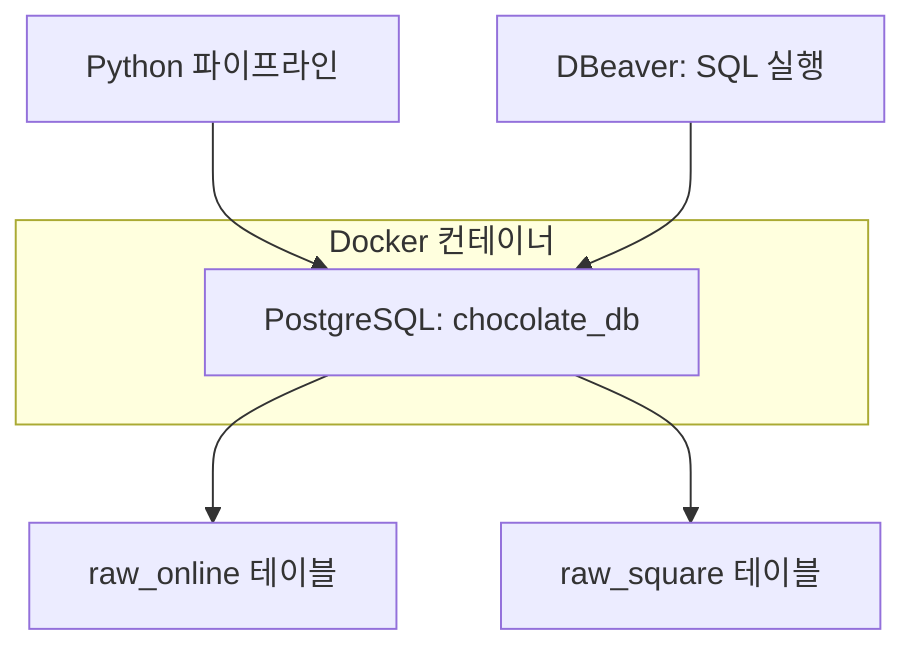
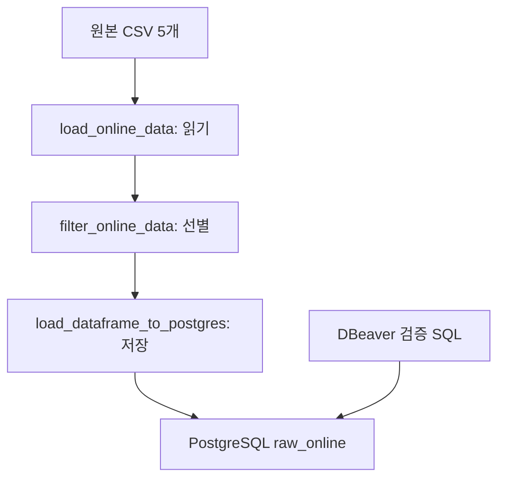

# 🚚 Phase 2 — Online & Square → PostgreSQL Data Ingestion

> 업데이트: 2026-10-22 · 온라인 리팩토링 및 Square 상품·고객·주문 수집 반영 · 매장 적재 코드 작성

이 문서는 **Charlie’s Chocolate Factory — Omnichannel Retail Data Platform** 프로젝트의 Phase 2에서 구현한  
**Online CSV 및 Square API 데이터 → PostgreSQL 적재 과정**을 정리한 문서이다.

나중에 프로젝트를 다시 열었을 때도

- 왜 PostgreSQL을 사용했는지
- 어떤 데이터를 적재했는지
- ONLINE 데이터만 어떻게 분리했는지
- PostgreSQL Schema를 왜 직접 정의했는지
- Python Pipeline이 어떻게 동작하는지
- Extract / Transform / Load를 왜 분리했는지
- 저장 스키마 문제를 어떻게 해결했는지
- Square API 응답을 JSONB로 저장하는 방법
- 온라인과 Square의 적재 방식이 다른 이유
- 현재 확인된 결과와 남은 작업

를 쉽게 이해할 수 있도록 기록한다.

---

# 1. 🎯 이번 단계의 목표

Phase 1에서는 실제 리테일 환경을 시뮬레이션하기 위해 다음 Source System을 만들었다.

| 채널 | 원천 시스템 |
|---|---|
| ONLINE | Online Store (Lovable) |
| RETAIL | POS Simulator → Square Sandbox |

Phase 2에서는 각 Source System에서 발생한 데이터를 Data Platform으로 수집한다.

먼저 **Online Channel 데이터**를 대상으로 로컬 적재 파이프라인을 구현했고, 이어서 **Square 상품·고객·주문 API 수집 및 저장**을 진행했다. 매장 수집·저장 코드는 작성했으며 실행·저장 확인은 아직 공유되지 않았다.

**흐름:** Online Store → CSV Export → Python / Pandas → ONLINE Data Filtering → PostgreSQL → SQL Validation

PostgreSQL은 최종 Data Warehouse가 아니라  
**Cloud 환경으로 이동하기 전에 ingestion 과정을 개발하고 테스트하기 위한 Local Database**로 사용한다.

최종 Data Warehouse는 이후 **BigQuery**를 사용할 예정이다.

---

# 2. 🐳 Local Data Environment

PostgreSQL은 Docker Container에서 실행한다.

**흐름:** Docker Desktop → PostgreSQL Container → chocolate_db

현재 PostgreSQL 접속 정보:

```text
Host     : localhost
Port     : 5432
Database : chocolate_db
User     : chocolate
```

DBeaver를 PostgreSQL Client로 사용한다.

DBeaver에서 PostgreSQL에 접속해 테이블을 확인하고 SQL로 검증한다.

DBeaver 자체가 데이터를 저장하는 것은 아니다.

실제 데이터는 PostgreSQL에 저장된다.



Python과 DBeaver는 각각 PostgreSQL에 연결한다. Python이 DBeaver를 거쳐 적재하는 것은 아니다. 컨테이너 재생성 시 데이터 보존 방식은 `docker-compose.yml`의 볼륨 설정을 확인한다. 이미지 버전·컨테이너 이름·볼륨 값은 이 문서에서 임의로 지정하지 않는다.

---

# 3. 📦 Python PostgreSQL 연결

Python Pipeline에서 PostgreSQL과 연결하기 위해 다음 라이브러리를 사용한다.

```text
Pandas
SQLAlchemy
psycopg2-binary
```

연결 구조:

**흐름:** Python → SQLAlchemy → psycopg2 → PostgreSQL

PostgreSQL 연결 코드는 다음 파일에서 관리한다.

```text
src/
└── load/
    └── postgres/
        └── connection.py
```

---

# 4. 📂 현재 관련 프로젝트 구조

```text
chocolate-commerce-data-platform/
│
├── data/
│   └── raw/
│       ├── products_export.csv
│       ├── customers_export.csv
│       ├── customer_addresses_export.csv
│       ├── orders_export.csv
│       └── order_items_export.csv
│
├── src/
│   ├── square/
│   │   ├── client.py
│   │   ├── catalog.py
│   │   ├── customers.py
│   │   ├── orders.py
│   │   └── location.py
│   │
│   ├── extract/
│   │   ├── load_csv.py
│   │   └── online/
│   │       ├── __init__.py
│   │       └── load_online_data.py
│   │
│   ├── transform/
│   │   └── online/
│   │       ├── __init__.py
│   │       └── filter_online_data.py
│   │
│   ├── load/
│   │   └── postgres/
│   │       ├── connection.py
│   │       ├── load_table.py
│   │       ├── load_square_catalog.py
│   │       ├── load_square_customers.py
│   │       ├── load_square_orders.py
│   │       └── load_square_locations.py
│   │
│   └── pipelines/
│       ├── online_to_postgres.py
│       ├── inspect_square_catalog.py
│       ├── inspect_square_customers.py
│       ├── inspect_square_orders.py
│       ├── square_catalog_to_postgres.py
│       ├── square_customers_to_postgres.py
│       ├── square_orders_to_postgres.py
│       └── square_locations_to_postgres.py
│
├── sql/
│   ├── schema/
│   │   ├── create_raw_online_tables.sql
│   │   └── create_raw_square_tables.sql
│   │
│   └── validation/
│       └── validate_online_ingestion.sql
│
└── docker-compose.yml
```

---

# 5. 📥 Online Source Data

현재 Online Pipeline에서 사용하는 데이터는 다음과 같다.

```text
products
customers
customer_addresses
orders
order_items
```

원본 CSV에는 ONLINE과 RETAIL 데이터가 함께 존재하는 경우가 있기 때문에  
Pipeline에서 대상 데이터를 선별해서 적재한다. 상품은 공통 마스터 전체, 고객은 온라인 가입 고객, 주문은 온라인 주문을 사용한다.

---

# 6. 🍫 Products

상품 데이터는 Online Store와 POS에서 공통으로 사용하는 Product Master 성격의 데이터이다.

현재는 전체 상품 데이터를 적재한다.

**흐름:** products_export.csv → Pandas → raw_online.products

주요 컬럼:

```text
id
product_id
sku
product_name
category
price
description
is_best_seller
active_status
created_at
updated_at
```

Square 연동 과정에서 생성된 다음 컬럼도 원본에 포함되어 있다.

```text
square_catalog_object_id
square_sync_status
square_synced_at
square_sync_error
```

현재 파이프라인은 상품 컬럼을 별도로 제거하지 않으므로, 원본 CSV에 포함된 해당 컬럼들도 함께 전달한다. 실제 테이블 컬럼과 데이터 타입은 `create_raw_online_tables.sql`을 기준으로 관리한다.

---

# 7. 👤 Customers

`customers_export.csv`에는 POS 가입 고객과 ONLINE 가입 고객이 함께 존재한다.

구분 컬럼:

```text
signup_channel
```

예:

```text
POS
ONLINE
```

Online Pipeline에서는 다음 조건으로 필터링한다.

```python
online_customers_df = customers_df[
    customers_df["signup_channel"]
    .str.strip()
    .str.upper()
    == "ONLINE"
].copy()
```

**흐름:** customers_export.csv → signup_channel == ONLINE → Online Customers → raw_online.customers

> **가입 채널과 구매 채널은 다르다.** 현재는 `signup_channel`로 고객을 고르므로 매장 가입 고객이 온라인으로 구매하면 주문은 포함되지만 고객은 제외될 수 있다. 이번 리팩토링에서는 기존 조건을 유지했다. 다음 고객 통합 설계에서 온라인 주문 고객까지 수집할지 검토한다.

---

# 8. 🏠 Customer Addresses

`customer_addresses_export.csv`에는 ONLINE / POS 채널 정보가 직접 존재하지 않는다.

대신 Customer와 다음 관계를 가지고 있다.

**연결 기준:** `customers.id = customer_addresses.customer_id`

따라서 먼저 ONLINE Customer의 ID를 가져온다.

```python
online_customer_ids = online_customers_df["id"]
```

그리고 해당 Customer ID를 가진 주소만 선택한다.

```python
online_addresses_df = addresses_df[
    addresses_df["customer_id"].isin(
        online_customer_ids
    )
].copy()
```

**흐름:** ONLINE Customers → Customer ID 목록 → customer_addresses → customer_id 비교 → Online Customer Addresses → raw_online.customer_addresses

---

# 9. 🛒 Orders

`orders_export.csv`에는 ONLINE 주문과 RETAIL 주문이 함께 존재한다.

구분 컬럼:

```text
channel
```

Online 주문만 다음 조건으로 선택한다.

```python
online_orders_df = orders_df[
    orders_df["channel"]
    .str.strip()
    .str.upper()
    == "ONLINE"
].copy()
```

**흐름:** orders_export.csv → channel == ONLINE → Online Orders → raw_online.orders

---

# 10. 🍫 Order Items

`order_items_export.csv`에는 `channel` 컬럼이 존재하지 않는다.

따라서 Online Order와의 관계를 이용한다.

여기서 중요한 점은 Orders 테이블에 ID가 두 종류 존재한다는 것이다.

```text
orders.id
= UUID

orders.order_id
= Business Order ID
  예: CCF-WEB-000001
```

`order_items.order_id`는 UUID인 `orders.id`가 아니라  
**`orders.order_id`와 연결된다.**

정확한 관계:

**연결 기준:** `orders.order_id = order_items.order_id`

따라서 Online Order Items 필터링은 다음과 같이 한다.

```python
online_order_ids = online_orders_df["order_id"]

online_order_items_df = order_items_df[
    order_items_df["order_id"].isin(
        online_order_ids
    )
].copy()
```

**흐름:** Online Orders → order_id 목록 → Order Items → order_id 비교 → Online Order Items → raw_online.order_items

---

# 11. 🗄️ PostgreSQL Raw Schema

처음에는 Pandas의 `to_sql()`이 자동으로 PostgreSQL 테이블을 생성하도록 사용했다.

하지만 이 방식은 Pandas가 데이터 타입을 자동 추론하기 때문에  
원하는 Database Schema를 명확하게 관리하기 어렵다.

예:

```text
price
→ NUMERIC

quantity
→ INTEGER

created_at
→ TIMESTAMPTZ

phone
→ VARCHAR
```

따라서 PostgreSQL Schema를 SQL로 직접 정의하도록 변경했다.

Schema 생성 파일:

```text
sql/schema/create_raw_online_tables.sql
```

PostgreSQL에는 별도의 Raw Schema를 생성한다.

```text
raw_online
```

현재 구조:

```text
PostgreSQL
└── raw_online
    ├── products
    ├── customers
    ├── customer_addresses
    ├── orders
    └── order_items
```

DBeaver SQL Editor에서 SQL 파일을 실행해 이 구조를 생성했다.

여기서 `raw_online`은 PostgreSQL의 네임스페이스인 **스키마**, 각 테이블의 컬럼·타입은 **테이블 구조**다. 위 타입 목록은 설계 예시이며 정확한 정의는 실제 SQL 파일을 기준으로 확인한다.

---

# 12. 🔄 적재 방식과 스키마 오류 수정

초기 적재 함수는 `schema`를 생략하고 `if_exists="replace"`를 사용했다.

```python
df.to_sql(
    name=table_name,
    con=engine,
    if_exists="replace",
    index=False,
)
```

이 코드에는 두 가지 문제가 있었다.

| 항목 | 동작 및 문제 | 현재 수정 |
|---|---|---|
| 스키마 생략 | 연결의 기본 스키마 사용. 의도한 raw_online과 다를 수 있음 | `schema="raw_online"` 명시 |
| replace | 기존 테이블 삭제 후 다시 생성. 미리 정의한 타입·제약조건·인덱스가 유지되지 않을 수 있음 | 행만 DELETE한 뒤 append |

실제로 성공 로그가 출력됐지만 DBeaver에서 `raw_online` 데이터가 보이지 않는 상황을 겪었다. 스키마를 명시한 뒤 사용자가 `raw_online`에 데이터가 들어간 것으로 확인했다. 최초 데이터가 `public`에 저장됐는지는 쿼리 결과가 공유되지 않아 확정하지 않는다.

**현재 코드는 `DELETE + APPEND` 방식이다. 기존 문서의 `TRUNCATE + APPEND` 설명을 실제 코드에 맞게 수정했다.**

파일: `src/load/postgres/load_table.py`

```python
import pandas as pd
from sqlalchemy import text
from sqlalchemy.engine import Engine


ALLOWED_TABLES = {
    "products",
    "customers",
    "customer_addresses",
    "orders",
    "order_items",
}


def load_dataframe_to_postgres(
    df: pd.DataFrame,
    table_name: str,
    engine: Engine,
) -> None:
    """raw_online 테이블의 기존 데이터를 새 데이터로 교체한다."""

    if table_name not in ALLOWED_TABLES:
        raise ValueError(f"Unsupported table: {table_name}")

    with engine.begin() as connection:
        connection.execute(
            text(f'DELETE FROM raw_online."{table_name}"')
        )

        df.to_sql(
            name=table_name,
            schema="raw_online",
            con=connection,
            if_exists="append",
            index=False,
        )

    print(
        f"[SUCCESS] raw_online.{table_name} loaded "
        f"({len(df)} rows)"
    )
```

`engine.begin()` 안에서 같은 연결로 기존 행 삭제와 새 행 삽입을 실행한다. 정상 종료하면 커밋하고, 오류가 나면 해당 테이블의 변경을 롤백한다. 테이블은 미리 생성되어 있어야 한다.

| 관점 | 현재 동작 |
|---|---|
| 적재 방식 | 매번 대상 테이블 데이터를 전체 교체하는 Full Refresh |
| 테이블 구조 | 유지 |
| 재실행 | 같은 입력이면 이전 실행 데이터 위에 계속 누적하지 않음 |
| 원본 중복 | 원본에 이미 있는 중복을 제거해주는 것은 아님 |
| 트랜잭션 범위 | 테이블 하나의 DELETE + INSERT |
| 실행 실패 | 앞서 커밋된 다른 테이블은 되돌리지 않음 |

외래 키 제약조건을 적용하면 부모 행 삭제가 막힐 수 있다. 그때는 테이블 간 삭제·삽입 순서와 전체 트랜잭션 범위를 함께 설계해야 한다. 이 함수는 현재 온라인 테이블에 맞춰져 있으므로 Square 적재에 그대로 사용하지 말고 목적 스키마와 테이블 범위를 확장할지 검토한다.

---

# 13. 🧱 Raw Layer 설계 원칙

현재 `raw_online`은 **온라인 수집 범위에 해당하는 데이터를 원본 컬럼 중심으로 저장하는 로컬 영역**이다.

- 상품은 전체를 저장한다.
- 고객·주문은 채널 조건으로 선별한다.
- 주소·주문상품은 연결된 ID로 선별한다.
- 별도의 집계나 통합 모델링은 아직 수행하지 않는다.

따라서 모든 원본을 무가공으로 보존하는 저장소는 아니다. 원본 CSV 스냅샷은 `data/raw/`에 있고, PostgreSQL 테이블은 최신 적재 데이터로 교체된다. 현재 방식만으로는 변경 이력이 누적 보존되지 않는다.

기존 설계에서는 Raw 테이블의 강한 제약조건을 최소화하고 적재 후 SQL로 품질을 확인하는 방향을 택했다. 실제 적용된 제약조건은 테이블 생성 SQL에서 확인한다.

더 엄격한 정제·표준화·통합은 이후 Staging / Transformation 단계에서 수행할 예정이다. Raw 단계에서도 ID 누락, 중복, 관계 오류는 검증해 기록한다.

---

# 14. 🔎 Post-load Validation

현재는 Source 데이터를 먼저 PostgreSQL에 적재한 뒤  
DBeaver SQL Editor에서 Validation을 수행한다.

Validation 파일:

```text
sql/validation/validate_online_ingestion.sql
```

주요 검증 항목:

```text
Row Count
ID NULL 확인
ID 중복 확인
ONLINE Channel 확인
Customer 관계 확인
Order 관계 확인
```

예:

```sql
SELECT channel, COUNT(*)
FROM raw_online.orders
GROUP BY channel;
```

필터는 공백 제거·대문자 변환 후 ONLINE인지 비교하지만 원본 `channel` 값을 직접 바꾸지는 않는다. 따라서 표시값에는 대소문자·공백 차이가 남을 수 있다. 정규화 기준으로 확인하려면 다음 SQL을 사용한다.

```sql
SELECT UPPER(TRIM(channel)) AS normalized_channel, COUNT(*)
FROM raw_online.orders
GROUP BY UPPER(TRIM(channel));
```

현재 필터 기준이라면 정규화된 값은 ONLINE이어야 한다.

Order Item 관계 검증:

```sql
SELECT oi.*
FROM raw_online.order_items oi
LEFT JOIN raw_online.orders o
    ON oi.order_id = o.order_id
WHERE o.order_id IS NULL;
```

결과가 0건이면 저장된 주문상품 중 주문번호가 주문 테이블에 없는 행이 없다는 뜻이다. 주문번호의 유일성이나 원본 대비 누락까지 보장하는 검사는 아니므로 별도 중복·행 수 검사도 필요하다.

검증 SQL 파일 작성과 실행 결과 통과는 구분한다. 이번 대화에서는 정확한 검증 쿼리 결과 전체가 공유되지 않았으므로 모든 품질 검사를 통과했다고 기록하지 않는다.

---

# 15. 🔁 리팩토링한 Online Ingestion Pipeline

기존 `online_to_postgres.py`에 모여 있던 읽기·필터링을 각각 파일로 분리했다. 이제 파이프라인은 전체 실행 순서를 담당한다.

| 파일 | 역할 |
|---|---|
| `src/extract/load_csv.py` | 기존 공통 CSV 읽기 함수 |
| `src/extract/online/load_online_data.py` | CSV 5개를 읽어 딕셔너리로 반환 |
| `src/transform/online/filter_online_data.py` | 온라인 데이터와 관련 행 선별 |
| `src/load/postgres/connection.py` | SQLAlchemy Engine 생성 |
| `src/load/postgres/load_table.py` | raw_online 테이블 데이터 교체 |
| `src/pipelines/online_to_postgres.py` | Extract → Transform → Load 실행 |



`load_online_data()`는 이름에 load가 있지만 여기서는 파일을 읽는 Extract 함수다. DB 저장은 `load_dataframe_to_postgres()`가 담당한다.

### 데이터 전달 구조

```python
source_data = load_online_data()
online_data = filter_online_data(source_data)

# 테이블 이름을 키로, DataFrame을 값으로 사용하는 딕셔너리
source_data["orders"]  # 전체 주문
online_data["orders"]  # 선별한 온라인 주문
```

새 읽기 파일은 폴더 한 단계 아래에 있으므로 프로젝트 루트 경로는 다음처럼 계산한다.

```python
# src/extract/online/load_online_data.py
BASE_DIR = Path(__file__).resolve().parents[3]
```

두 `online` 폴더에는 빈 `__init__.py`를 추가했다. 폴더가 일반 Python 패키지임을 표시하며 초기화 코드가 없으면 빈 파일로 두어도 된다.

### 현재 파이프라인

```python
from src.extract.online.load_online_data import load_online_data
from src.transform.online.filter_online_data import filter_online_data
from src.load.postgres.connection import get_postgres_engine
from src.load.postgres.load_table import load_dataframe_to_postgres


LOAD_ORDER = (
    "products",
    "customers",
    "customer_addresses",
    "orders",
    "order_items",
)


def run():
    print("[START] Online → PostgreSQL ingestion")

    source_data = load_online_data()
    online_data = filter_online_data(source_data)

    engine = get_postgres_engine()

    try:
        for table_name in LOAD_ORDER:
            df = online_data[table_name]

            load_dataframe_to_postgres(
                df=df,
                table_name=table_name,
                engine=engine,
            )

            print(f"[LOAD] {table_name} rows: {len(df)}")

    finally:
        engine.dispose()

    print("[DONE] Online → PostgreSQL ingestion")


if __name__ == "__main__":
    run()
```

모든 CSV 읽기·필터링을 마친 후 적재를 시작한다. `engine.dispose()`는 연결 풀 정리이며 커밋을 대신하지 않는다.

### 실행 방법

Docker와 PostgreSQL 컨테이너가 실행 중이고, 테이블이 준비된 상태에서 가상환경을 활성화한다. 프로젝트 루트에서 실행한다.

```powershell
python -m src.pipelines.online_to_postgres
```

### 공유된 실행 로그

| 테이블 | CSV 행 수 | 필터링 후 행 수 | 적재 로그 행 수 |
|---|---:|---:|---:|
| products | 15 | 15 | 15 |
| customers | 20 | 10 | 10 |
| customer_addresses | 20 | 10 | 10 |
| orders | 36 | 14 | 14 |
| order_items | 92 | 37 | 37 |

위 수치는 공유된 실행 로그 기준이다. 이후 스키마 지정 수정 뒤 사용자가 raw_online 적재를 확인했다. 아래 SQL로 수정 후 실제 DB 행 수와 대조한다. CSV가 바뀌면 예상값도 바뀐다.

```sql
SELECT 'products' AS table_name, COUNT(*) AS row_count
FROM raw_online.products
UNION ALL
SELECT 'customers', COUNT(*) FROM raw_online.customers
UNION ALL
SELECT 'customer_addresses', COUNT(*) FROM raw_online.customer_addresses
UNION ALL
SELECT 'orders', COUNT(*) FROM raw_online.orders
UNION ALL
SELECT 'order_items', COUNT(*) FROM raw_online.order_items;
```

`[SUCCESS]`와 `[LOAD]`는 두 함수에서 각각 출력한 로그다. 두 줄이 보인다는 사실만으로 두 번 적재된 것은 아니다. 성공 로그 외에 실제 DB·스키마·데이터를 확인하는 습관이 필요하다.

---

# 16. 📌 주요 설계 결정

## Online / Retail 데이터를 분리한다

최종 프로젝트에서는 온라인 CSV와 Square API 데이터를 출처별로 나누어 저장한다. Square의 상품·고객은 공통 마스터일 수 있으므로, Square에서 조회됐다는 이유만으로 오프라인 전용 데이터라고 분류하지 않는다.

| 원천 | 저장 구역 |
|---|---|
| ONLINE | raw_online |
| Square API | raw_square |

나중에 BigQuery Transformation 단계에서 두 데이터를 통합한다.

온라인과 Square 수집 데이터를 이후 Unified Model로 통합한다.

---

## Raw Layer에서는 원본을 최대한 보존한다

이 단계에서는 선택한 수집 범위의 원본 컬럼을 최대한 유지한다. 채널 필터링과 전체 교체가 있으므로 전체 소스와 변경 이력을 모두 보존하는 구조는 아니다.

**흐름:** Raw → Staging → Intermediate → Mart

Data Cleaning과 Standardization은 이후 Transformation 단계에서 수행한다.

---

## PostgreSQL은 최종 목적지가 아니다

PostgreSQL은 Local Data Engineering 환경이다.

향후 목표 구조는 다음과 같다. GCS·BigQuery 경로는 아직 구현 전이며, 현재 PostgreSQL이 반드시 클라우드 수집의 중간 경유지가 되는 것은 아니다.

**흐름:** Online Store → Python Pipeline → GCS → BigQuery Raw Layer → Transformation → Unified Omnichannel Model → Power BI

---

# 17. ✅ 현재 완료 상태

## 구현·진행한 작업

- [x] Docker 기반 PostgreSQL 로컬 환경 구성
- [x] chocolate_db 및 DBeaver 연결
- [x] Python → PostgreSQL 연결
- [x] 상품 전체 및 온라인 고객·주문 수집
- [x] 고객 주소·주문상품 관계 기반 필터링
- [x] raw_online 테이블 생성 SQL 작성·실행
- [x] Post-load 검증 SQL 작성
- [x] Extract / Transform / Pipeline 역할 분리
- [x] 리팩토링한 파이프라인 실행 완료 로그 확인
- [x] 저장 스키마 raw_online 명시
- [x] DELETE + APPEND 및 테이블별 트랜잭션 적용
- [x] 사용자에 의한 raw_online 적재 확인

## 남은 확인·개선 사항

- [ ] 수정 후 테이블별 행 수와 기존 검증 SQL 결과 최종 대조
- [ ] 가입 채널과 구매 채널이 다른 고객의 수집 범위 결정
- [ ] 잘못된 스키마에 테이블이 생성됐는지 확인 후 필요시 별도 정리
- [ ] 향후 외래 키 도입 및 전체 적재의 트랜잭션 범위 검토

---

# 18. 🔌 Square API 수집 — 이전 작업과의 차이

이전에 만든 코드는 CSV 데이터를 Square에 **등록**했다. 이번에는 외부 원천 시스템 역할을 하는 Square에서 데이터를 **조회해 우리 DB로 가져온다.**

| 구분 | Phase 1: 데이터 준비 | Phase 2: 데이터 수집 |
|---|---|---|
| 방향 | CSV → Python → Square | Square → Python → PostgreSQL |
| 주요 함수 | create_product / create_customer / create_order | list_catalog_items / list_customers / search_orders |
| 목적 | 테스트용 원천 시스템 구성 | 분석 플랫폼에 원천 데이터 수집 |

`src/square/client.py`는 `.env`에서 `SQUARE_ACCESS_TOKEN`을 읽고 공통 headers를 만든다. 이 프로젝트에서 사용 중인 `Square-Version` 값은 `2026-08-19`다. 토큰 자체는 문서와 Git에 기록하지 않는다.

상품·고객·주문·매장 파일은 공통 headers를 가져와 `requests`로 Sandbox API를 호출한다. 공통 설정을 import하는 것만으로 API가 호출되는 것은 아니다.

| 대상 | 요청 | 함수 | 목록을 꺼내는 응답 키 |
|---|---|---|---|
| 상품 | GET /v2/catalog/list, types=ITEM | list_catalog_items() | objects |
| 고객 | GET /v2/customers | list_customers() | customers |
| 주문 | POST /v2/orders/search | search_orders(location_ids) | orders |
| 매장 | GET /v2/locations | list_locations() | locations |

현재 함수 위치는 각각 `src/square/catalog.py`, `customers.py`, `orders.py`, **`location.py`**다. 매장 파일명은 `locations.py`가 아니다.

## 페이지네이션과 오류 처리

상품·고객·주문 조회 함수는 다음 순서로 동작한다.

1. 첫 페이지를 요청한다.
2. 응답의 목록을 Python 리스트에 추가한다.
3. `cursor`가 있으면 다음 요청에 넣어 반복한다.
4. `cursor`가 없으면 전체 목록을 반환한다.

상품·고객은 query parameter인 `params`, 주문 검색은 JSON 요청 본문인 `json=body`에 cursor를 넣는다. 현재 데이터는 모두 첫 페이지에서 조회됐으므로, 여러 페이지를 실제로 처리한 결과까지 검증된 것은 아니다.

요청에는 `timeout=30`을 지정하고 HTTP 실패 및 응답의 `errors`를 확인한다. 현재 자동 재시도·정기 스케줄 실행은 구현하지 않았다.

---

# 19. 🔍 저장 전 Inspect — 응답 구조 확인

처음부터 테이블 컬럼을 추측하지 않고 조회 전용 파일에서 응답을 확인했다.

```powershell
python -m src.pipelines.inspect_square_catalog
python -m src.pipelines.inspect_square_customers
python -m src.pipelines.inspect_square_orders
```

이 파일들은 첫 객체의 JSON과 전체 요약을 출력한다. PostgreSQL 적재는 별도의 `*_to_postgres.py`가 담당한다.

## 상품: ITEM 안에 ITEM_VARIATION이 포함됨

```text
ITEM: 상품 ID, 상품명, 설명
└── item_data.variations[]
    └── ITEM_VARIATION: 판매 단위 ID, SKU, 가격, 통화
```

실제 첫 상품은 Midnight Dark Chocolate Bar이며 SKU는 `CCF-BAR-002`, 가격 amount는 `725`, currency는 `CAD`였다. 이 금액은 CAD $7.25다.

조회 결과 ITEM 15개, 출력상 각 ITEM에 variation 1개가 있었다. 현재 저장 단위는 ITEM이므로 상품 테이블은 15행이며, variation은 각 행의 JSON 안에 보관한다.

## 고객: 원본 ID 및 주소 포함

고객 20명이 조회됐다. `id`는 Square 고객 ID이고 `reference_id`는 생성 시 전달했던 원본 고객 ID다. `address`는 고객 JSON 안에 포함되어 별도 주소 테이블 없이 원본을 저장한다.

온라인 파이프라인은 온라인 가입 고객 10명을 선별하지만 Square 조회는 계정에 등록된 고객 전체를 가져온다. 두 수가 다르다고 오류는 아니다. 가입 채널은 이후 원본 고객 데이터와 연결해 판단한다.

## 주문: 매장 ID를 먼저 조회

주문 검색에는 Square location ID가 필요하다. 기존 `list_locations()`로 매장 목록을 가져와 각 매장의 `id`를 `search_orders(location_ids=[location_id])`에 전달했다. 수동 ID 입력 대신 기존 코드를 재사용했다.

| 매장 | Square location ID | 조회 주문 수 |
|---|---|---:|
| Downtown Vancouver, 하이픈 이름 | L5N7N1ZAC22HV | 0 |
| Burnaby | LYSETCR8T15WQ | 8 |
| Downtown Vancouver, 긴 대시 이름 | L58P4HAMZ94P8 | 5 |
| Richmond | LQGF9X19AWAD3 | 6 |
| Default Test Account | L88A1JW54Y3RK | 0 |
| 합계 | | 19 |

이름이 비슷한 Downtown 매장도 ID가 다르므로 별도 매장이다. 현재는 임의로 합치거나 삭제하지 않았다.

주문에는 `id`, `reference_id`(예: CCF-000022), `location_id`, `customer_id`, `line_items`, 세금 및 금액 정보가 포함됐다. `line_items[].catalog_object_id`는 상품 ITEM ID가 아니라 판매 단위인 **variation ID**와 연결된다.

**중요: 조회한 주문 19건은 모두 OPEN이었다.** 원본 상태 그대로 저장했으며 완료된 매출이라고 간주하지 않는다. CSV에서 완료 주문을 골라 Square로 보냈더라도 Square에서 반환되는 상태가 동일하다고 단정할 수 없다. 원인 확인은 기존 주문 생성 payload·응답과 결제 처리 흐름을 확인하는 별도 작업이다.

공유된 요약의 주문상품 합계는 47행이다. 이는 `line_items` 요소 수이며 판매 수량 합계가 아니다.

---

# 20. 🗃️ raw_square 테이블 — JSONB 원본 저장

온라인 CSV는 처음부터 표 형태지만 Square 응답은 주소·variation·주문상품처럼 중첩된 JSON이다. 이번에는 필드를 모두 펼치지 않고 JSONB 컬럼에 저장한다.

| 컬럼 | 역할 |
|---|---|
| Square ID 기본 키 | 원천 시스템의 객체 식별자 |
| payload JSONB | 반환된 객체 전체와 하위 배열·객체 |
| ingested_at TIMESTAMPTZ | 우리 DB에서 해당 객체를 마지막으로 적재한 시각 |

`ingested_at`은 Square에서 생성된 시각이 아니다. 원천의 `created_at`, `updated_at`은 payload에 보존된다. JSONB는 JSON의 구조와 값을 저장하지만 응답 원문의 공백·키 순서·원본 바이트를 그대로 보관하는 형식은 아니다.

아래 SQL은 `sql/schema/create_raw_square_tables.sql`에 보관하고 DBeaver의 `chocolate_db` 연결에서 실행한다. 파일을 저장하는 것과 DB에 실행하는 것은 별개다. 수동 커밋 모드라면 실행 후 Commit한다.

```sql
CREATE SCHEMA IF NOT EXISTS raw_square;

CREATE TABLE IF NOT EXISTS raw_square.catalog_objects (
    square_object_id TEXT PRIMARY KEY,
    object_type TEXT NOT NULL,
    payload JSONB NOT NULL,
    ingested_at TIMESTAMPTZ NOT NULL DEFAULT CURRENT_TIMESTAMP
);

CREATE TABLE IF NOT EXISTS raw_square.customers (
    square_customer_id TEXT PRIMARY KEY,
    payload JSONB NOT NULL,
    ingested_at TIMESTAMPTZ NOT NULL DEFAULT CURRENT_TIMESTAMP
);

CREATE TABLE IF NOT EXISTS raw_square.orders (
    square_order_id TEXT PRIMARY KEY,
    payload JSONB NOT NULL,
    ingested_at TIMESTAMPTZ NOT NULL DEFAULT CURRENT_TIMESTAMP
);

CREATE TABLE IF NOT EXISTS raw_square.locations (
    square_location_id TEXT PRIMARY KEY,
    payload JSONB NOT NULL,
    ingested_at TIMESTAMPTZ NOT NULL DEFAULT CURRENT_TIMESTAMP
);
```

`IF NOT EXISTS`는 없는 테이블을 생성할 뿐, 기존 테이블의 컬럼 구조를 수정하지는 않는다.

---

# 21. 📥 Square 적재 함수 — Upsert와 트랜잭션

| 파일 | 적재 함수 | 테이블 |
|---|---|---|
| src/load/postgres/load_square_catalog.py | load_square_catalog(items, engine) | raw_square.catalog_objects |
| src/load/postgres/load_square_customers.py | load_square_customers(customers, engine) | raw_square.customers |
| src/load/postgres/load_square_orders.py | load_square_orders(orders, engine) | raw_square.orders |
| src/load/postgres/load_square_locations.py | load_square_locations(locations, engine) | raw_square.locations |

네 함수는 JSON 객체를 `json.dumps(..., ensure_ascii=False)`로 직렬화하고, SQLAlchemy의 바인딩 파라미터로 SQL에 전달한다. PostgreSQL에서는 `CAST(:payload AS JSONB)`로 변환한다.

대표 예시인 고객 적재 코드:

```python
import json

from sqlalchemy import text
from sqlalchemy.engine import Engine


def load_square_customers(customers: list[dict], engine: Engine) -> None:
    if not customers:
        print("[LOAD] 저장할 Square 고객이 없습니다.")
        return

    query = text("""
        INSERT INTO raw_square.customers (
            square_customer_id, payload, ingested_at
        )
        VALUES (
            :square_customer_id,
            CAST(:payload AS JSONB),
            CURRENT_TIMESTAMP
        )
        ON CONFLICT (square_customer_id)
        DO UPDATE SET
            payload = EXCLUDED.payload,
            ingested_at = EXCLUDED.ingested_at
    """)

    rows = [
        {
            "square_customer_id": customer["id"],
            "payload": json.dumps(customer, ensure_ascii=False),
        }
        for customer in customers
    ]

    with engine.begin() as connection:
        connection.execute(query, rows)

    print(
        "[SUCCESS] raw_square.customers "
        f"upsert completed ({len(rows)} customers)"
    )
```

`ON CONFLICT`는 같은 기본 키가 이미 있으면 UPDATE하도록 한다. `EXCLUDED`는 이번에 넣으려던 새 값을 뜻한다.

| 상황 | 동작 |
|---|---|
| 새로운 Square ID | INSERT |
| 이미 저장된 Square ID | payload와 ingested_at UPDATE |
| 동일 입력 재실행 | 같은 ID의 행 수는 증가하지 않음 |
| 이번 응답에 없는 기존 객체 | DB에 그대로 남음 |
| 빈 목록 | 적재 건너뛰기, 기존 행 유지 |
| 적재 중 오류 | 해당 함수 트랜잭션의 변경 롤백 |

전체 목록을 매번 조회해 Upsert하는 방식이다. 시간 기준 증분 수집이나 변경 이력 누적은 아직 아니다. 성공 로그의 건수는 처리한 객체 수이며 새로 INSERT된 행 수만 의미하지 않는다.

## 온라인 적재와 비교

| 항목 | raw_online | raw_square |
|---|---|---|
| 입력 | CSV → DataFrame | API → dict 리스트 |
| 저장 형식 | 원본 컬럼 중심의 관계형 테이블 | ID + JSONB + 수집 시각 |
| 기존 행 처리 | 테이블별 DELETE + APPEND | ID별 UPSERT |
| 소스에서 사라진 행 | 현재 선택 데이터로 전체 교체 | 자동 삭제되지 않음 |
| 이력 | 누적 보존하지 않음 | 최신 적재 값으로 갱신, 이력 누적 없음 |
| 트랜잭션 | 테이블 하나 | 적재 함수 한 번의 전체 객체 목록 |

기존 `load_table.py`는 raw_online 전용이므로 Square 적재에 사용하지 않았다.

---

# 22. ▶️ 실행 파이프라인

파이프라인은 조회 함수와 적재 함수를 연결한다. API 통신은 `src/square/`, DB 저장은 `src/load/postgres/`, 실행 순서는 `src/pipelines/`가 담당한다.

대표 매장 파이프라인:

```python
from src.square.location import list_locations
from src.load.postgres.connection import get_postgres_engine
from src.load.postgres.load_square_locations import load_square_locations


def run():
    print("[START] Square locations → PostgreSQL ingestion")
    locations = list_locations()
    print(f"[EXTRACT] total locations: {len(locations)}")

    engine = get_postgres_engine()
    try:
        load_square_locations(locations=locations, engine=engine)
    finally:
        engine.dispose()

    print("[DONE] Square locations → PostgreSQL ingestion")


if __name__ == "__main__":
    run()
```

주문 파이프라인은 매장 목록 조회 → 매장별 주문 조회 → 전체 주문 리스트 생성 → 주문 Upsert 순서다. 현재 모든 매장 조회가 끝난 뒤 적재를 시작하므로 조회 도중 오류가 나면 주문 DB 적재를 시작하지 않는다.

상품·고객·주문·매장은 각각 별도 실행이며 네 테이블을 하나의 트랜잭션으로 묶은 구조는 아니다. `engine.dispose()`는 연결 풀 정리이며 커밋은 `engine.begin()`이 담당한다.

프로젝트 루트에서 가상환경을 활성화하고 PostgreSQL 컨테이너가 실행 중인 상태로 실행한다.

```powershell
python -m src.pipelines.square_catalog_to_postgres
python -m src.pipelines.square_customers_to_postgres
python -m src.pipelines.square_orders_to_postgres
python -m src.pipelines.square_locations_to_postgres
```

이 명령은 각 파이프라인을 실행하는 방법이다. 매장 파이프라인은 이번 대화에서 코드만 전달했으며 실제 실행 성공은 아직 확인되지 않았다.

---

# 23. 🔎 Square 저장 검증 SQL

아래 쿼리는 `sql/validation/validate_square_ingestion.sql`로 저장해 재사용할 수 있다. 이 검증 파일의 실제 생성·전체 실행 결과는 아직 확인되지 않았다.

## 테이블별 행 수

매장 테이블까지 준비한 뒤 실행한다.

```sql
SELECT 'catalog_objects' AS table_name, COUNT(*) AS row_count
FROM raw_square.catalog_objects
UNION ALL
SELECT 'customers', COUNT(*) FROM raw_square.customers
UNION ALL
SELECT 'orders', COUNT(*) FROM raw_square.orders
UNION ALL
SELECT 'locations', COUNT(*) FROM raw_square.locations;
```

현재 소스가 그대로이고 기존 잔여 객체가 없다면 예상은 상품 15, 고객 20, 주문 19, 매장 5다. Upsert는 오래된 행을 자동 삭제하지 않으므로 향후 API 조회 수와 DB 행 수가 항상 같다고 보장하지 않는다.

## JSON에서 필요한 값 꺼내기

`->`는 JSON 값을 반환하고 `->>`는 텍스트를 반환한다.

```sql
SELECT
    square_object_id,
    payload -> 'item_data' ->> 'name' AS product_name
FROM raw_square.catalog_objects;

SELECT
    square_customer_id,
    payload ->> 'reference_id' AS source_customer_id
FROM raw_square.customers;

SELECT
    payload ->> 'state' AS order_state,
    COUNT(*) AS order_count
FROM raw_square.orders
GROUP BY payload ->> 'state';

SELECT
    SUM(jsonb_array_length(payload -> 'line_items')) AS line_item_count
FROM raw_square.orders;
```

조회 로그 기준 주문 상태는 OPEN 19건, 주문상품은 47행이다. 이는 DB 검증 쿼리 결과를 공유받은 것과는 구분한다.

## 주문과 매장 연결 검사

```sql
-- 예상: 0행
SELECT
    o.square_order_id,
    o.payload ->> 'location_id' AS missing_location_id
FROM raw_square.orders AS o
LEFT JOIN raw_square.locations AS l
    ON o.payload ->> 'location_id' = l.square_location_id
WHERE l.square_location_id IS NULL;
```

0행이면 저장된 주문의 매장 ID가 매장 테이블에 모두 있다는 뜻이다. 전체 원본 대비 주문 누락까지 보장하지는 않는다.

## 주문과 고객 연결 검사

고객 없는 주문도 있을 수 있으므로 customer_id가 기록된 주문만 검사한다.

```sql
-- 예상: 0행. 결과가 있으면 고객 수집 범위 또는 원본 연결 확인
SELECT
    o.square_order_id,
    o.payload ->> 'customer_id' AS missing_customer_id
FROM raw_square.orders AS o
LEFT JOIN raw_square.customers AS c
    ON o.payload ->> 'customer_id' = c.square_customer_id
WHERE NULLIF(o.payload ->> 'customer_id', '') IS NOT NULL
  AND c.square_customer_id IS NULL;
```

---

# 24. 🛠️ 이번에 해결한 오류

| 오류·상황 | 의미 | 해결 |
|---|---|---|
| cannot import name list_catalog_items | catalog.py에서 해당 함수를 가져오지 못함 | 함수 추가·이름·들여쓰기·문자열 밖 위치 확인 후 저장 |
| cannot import name search_orders | orders.py에서 조회 함수를 가져오지 못함 | create_order와 별도로 최상위에 search_orders 추가 |
| relation raw_square.customers does not exist | Python이 연결한 DB에서 고객 테이블을 찾지 못함 | DBeaver에서 생성 SQL 실행, 필요시 커밋 후 재실행 |

ImportError는 API 호출 전 단계에서 발생한 문제였다. 고객 테이블 오류에서는 API 조회 20명은 성공했지만 DB 적재가 중단됐으며, 테이블 준비 후 재실행해 성공 로그를 확인했다.

연결 대상과 테이블 존재 여부는 다음처럼 확인할 수 있다.

```sql
SELECT
    current_database() AS database_name,
    to_regclass('raw_square.customers') AS customer_table;
```

로그 출력뿐 아니라 실제 DB의 스키마·테이블·행 수도 확인한다.

---

# 25. ✅ 현재 위치와 다음 작업

| 항목 | 현재 확인 상태 |
|---|---|
| 온라인 CSV → raw_online | 사용자 저장 확인, 리팩토링 완료 |
| Square 상품 | API 15개 조회, 사용자 DB 저장 확인 |
| Square 고객 | API 20명 조회, 20명 Upsert 성공 로그 확인 |
| Square 주문 | API 19건 조회, 사용자 DB 저장 확인 |
| Square 매장 | API 5곳 조회 확인, 생성 SQL·적재 코드 전달. 실행·저장 확인 대기 |
| 전체 검증 SQL | 쿼리 제시, 모든 검사 통과 여부는 확인 전 |
| GCP / GCS / BigQuery Raw | 예정 |
| Phase 3 — Transformation & Modeling | 예정 |
| Phase 4 — Analytics & BI | 예정 |

다음 순서로 진행한다.

1. 매장 파이프라인 실행 및 DB 5행 확인.
2. 주문–매장·주문–고객 연결 및 각 테이블 행 수 검증.
3. Square 주문 OPEN 상태와 원본 CSV 상태 차이 확인.
4. 결제 데이터 수집 필요 범위를 결정하고 기존 Square 결제 생성·연동 여부 확인.
5. 로컬 수집 검증을 마친 뒤 GCP 저장·수집 환경으로 확장.

**현재는 여전히 Phase 2 — Data Ingestion & Storage다.** JSONB에 원본 객체를 저장한 것이며 온라인·Square 통합 모델이나 매출 집계를 만든 것은 아니다. 고객·상품 중복 통합, variation 펼치기, 주문상품 모델링 및 완료 매출 기준 정의는 이후 변환·모델링에서 진행한다.

