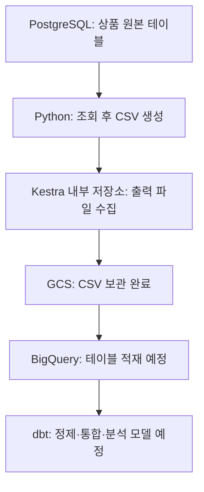

# 🍫 초콜릿 프로젝트 — PostgreSQL 데이터가 GCS에 도착하기까지

> 학습 정리일: 2026-11-08 (밴쿠버 기준)  
> 프로젝트: Charlie’s Chocolate Factory — Omnichannel Retail Data Platform  
> 목적: 명령어를 다시 따라 하기보다, 지금까지 만든 구성 요소가 왜 필요한지 이해하기  
> 현재 확인된 도착점: **Kestra를 통해 상품 CSV를 GCS 버킷에 업로드 완료**

## 1. 우리가 하려는 일을 가장 쉬운 말로 설명하면

온라인 스토어와 매장에서 발생한 데이터를 모아서, 나중에 “어떤 상품이 얼마나 팔렸을까?” 같은 질문에 답할 수 있는 분석용 데이터를 만드는 프로젝트다.

지금은 그중에서 **내 컴퓨터의 PostgreSQL에 있던 데이터를 클라우드로 보내는 길**을 만들고 있다. 아직 매출 지표나 대시보드를 만드는 단계는 아니다.

상품 데이터 하나를 먼저 옮기는 이유는, 모든 데이터를 한꺼번에 다루기 전에 작은 범위에서 연결·파일 형식·권한·실행 결과를 확인하기 위해서다.

## 2. 지금 어디까지 완성됐을까?

| 작업 | 현재 상태 | 확인 근거 |
|---|---|---|
| Online / Square → PostgreSQL | 완료 | 기존 수집·적재 파이프라인 |
| 공통 Logging 적용 후 전체 Flow 재실행 | 확인 완료 | 사용자가 전체 실행 검증 완료를 알림 |
| 초콜릿 전용 GCP 프로젝트 생성·결제 연결 | 완료 | 프로젝트 생성 및 연결 목록 확인 |
| GCS 버킷 생성 | 완료 | 버킷 화면 확인 |
| BigQuery `raw_online`, `raw_square` 데이터세트 생성 | 완료 | 사용자가 두 데이터세트 생성 완료를 알림 |
| PostgreSQL 상품 → 로컬 CSV | 완료 | `exports` 하위 파일 생성 확인 |
| Kestra에서 export 실행·GCS 업로드 | 완료 | 사용자가 GCS 파일 도착 확인 |
| PostgreSQL 컬럼명·타입 확인 | 완료 | 실제 스키마 조회 결과 공유 |
| BigQuery `raw_online.products` 생성 및 CSV 적재 | 안내까지 진행 | 실제 성공 결과는 아직 확인하지 않음 |
| PostgreSQL·CSV·BigQuery 값 대조 | 남은 작업 | 행 수·금액·날짜·NULL 검증 예정 |
| BigQuery + dbt 모델링 | 이후 작업 | Staging → Intermediate → Marts 구현 예정 |

**GCS에 파일이 있다는 것과 BigQuery 테이블에 데이터가 들어 있다는 것은 다른 상태다.** 현재는 전자까지 확인됐다.

## 3. 전체 지도를 먼저 보기



이 그림은 **데이터가 이동하는 순서**다. Kestra는 파일 수집뿐 아니라 Python 실행과 GCS 업로드의 순서도 관리한다. GCP 프로젝트는 GCS와 BigQuery 같은 클라우드 자원을 묶는 관리 단위다.

## 4. ① GCP 프로젝트를 만든 이유

GCP는 Google Cloud Platform의 약자다. Google이 제공하는 저장 공간, 데이터베이스, 분석 서비스 등을 사용할 수 있다.

그 안의 **프로젝트**는 관련 자원과 권한·비용을 묶어 관리하는 공간이다. 이번에 확인된 프로젝트 ID는 다음과 같다.

```text
chocolate-data-platform
```

기존 Mancouver와 분리한 이유는 테니스 사이트와 초콜릿 데이터 파이프라인의 자원을 각각 관리하기 위해서다. 새 Google 계정을 만든 것이 아니라, 개인 Google 계정 안에 초콜릿용 프로젝트를 하나 더 만든 것이다.

결제 계정 연결은 이 프로젝트의 서비스 사용료를 어느 결제 계정에서 처리할지 정하는 작업이다. 연결 자체가 특정 월정액 상품을 구매했다는 뜻은 아니며, 실제 비용은 서비스 사용량과 요금 조건에 따라 달라진다. 화면에서 봤던 $0.00은 당시 표시된 기간의 비용이며 이후 비용까지 보장하지 않는다.

## 5. ② GCS 버킷을 만든 이유

**GCS(Google Cloud Storage)는 파일을 보관하는 서비스**다. CSV, 이미지, JSON, Parquet 같은 파일을 객체(object)로 저장한다.

**버킷(bucket)**은 그 파일들을 담는 큰 보관함이다. 이번 버킷은 다음과 같다.

```text
mandy-chocolate-raw-2026
```

확인한 설정은 다음과 같다.

| 설정 | 실제 설정 또는 의도 | 쉬운 의미 |
|---|---|---|
| 위치 | `us-east1` — 사우스캐롤라이나 | 파일을 저장할 리전 |
| 스토리지 클래스 | Standard | 이번 파이프라인의 파일 저장에 선택한 클래스 |
| 공개 액세스 | 공개 아님 | 인터넷의 누구나 파일을 읽는 상태가 아님 |
| 보호 | 소프트 삭제 | 삭제 후 일정 기간 복구할 수 있는 보호 기능 |

처음 제안은 `us-west1`이었지만 실제 생성된 버킷은 `us-east1`이었다. **현재 작업 기준은 실제 버킷의 `us-east1`**이며, BigQuery 데이터세트도 이 위치로 맞추도록 안내했다. 데이터세트 상세 화면에서 두 개 모두 같은 위치인지 최종 확인하면 된다.

GCS에 둔 CSV는 PostgreSQL 테이블의 특정 조회 결과를 내보낸 파일이다. 원래 Online CSV를 그대로 복사한 것과는 다르다. PostgreSQL에 이미 추가된 적재 메타데이터도 포함한다.

### 왜 PostgreSQL에서 BigQuery로 바로 보내지 않았을까?

직접 적재하는 설계도 가능하다. 이번 프로젝트는 **원본 스냅샷을 파일로 보관하고, 그 파일을 BigQuery로 적재하는 과정**을 배우기 위해 GCS를 거치는 구조를 선택했다. GCS 파일을 남겨두면 어떤 입력 파일로 적재했는지 추적하거나 그 파일로 다시 적재하기도 편하다.

GCS는 파일 보관을 담당한다. 업로드만으로 중복 제거·결측값 처리 같은 클리닝이 자동으로 일어나지는 않는다.

## 6. ③ BigQuery 데이터세트를 미리 만든 이유

**BigQuery는 SQL로 데이터를 분석할 수 있는 데이터 웨어하우스**다. 우리는 GCS의 CSV 내용을 BigQuery 네이티브 테이블로 읽어 넣을 예정이다.

데이터세트(dataset)는 관련 테이블을 묶는 공간이다. PostgreSQL의 스키마와 비슷하게 생각하면 이해하기 쉽지만, 두 시스템의 기능이 완전히 같은 것은 아니다.

| PostgreSQL의 기존 공간 | BigQuery에 만든 공간 | 담을 데이터 |
|---|---|---|
| `raw_online` 스키마 | `raw_online` 데이터세트 | 온라인 스토어 원본 데이터 |
| `raw_square` 스키마 | `raw_square` 데이터세트 | Square 원본 데이터 |

앞으로 생성할 상품 테이블의 전체 이름은 다음과 같다.

```text
chocolate-data-platform.raw_online.products
```

왼쪽부터 **프로젝트 ID → 데이터세트 ID → 테이블 이름**이다.

데이터세트를 만들었다고 상품 테이블까지 자동 생성되는 것은 아니다. 지금은 테이블을 담을 공간을 준비한 상태이고, 실제 테이블 생성·적재 성공은 아직 확인하지 않았다.

## 7. ④ Python으로 PostgreSQL 데이터를 CSV로 만든 과정

새로 만든 진입점은 다음 파일이다.

```text
src/pipelines/postgres_to_file.py
```

기존 파일과 역할을 구분하면 다음과 같다.

| 파일 | 역할 |
|---|---|
| `online_to_postgres.py` | 온라인 데이터를 읽어 PostgreSQL에 적재 |
| `connection.py` | 환경변수로 PostgreSQL 연결 엔진 생성 |
| `run_logging.py` | 공통 로그 형식·단계 기록·오류 처리 제공 |
| `postgres_to_file.py` | PostgreSQL 상품 테이블을 조회해 CSV 생성 |

### 코드가 실제로 하는 일

1. `run_metadata()`로 이번 실행의 orchestrator와 실행 ID를 가져온다.
2. 파일을 쓸 디렉터리를 준비한다.
3. 기존 `get_postgres_engine()`으로 PostgreSQL에 연결한다.
4. `SELECT * FROM raw_online.products`로 상품을 조회한다.
5. 컬럼명을 CSV 첫 줄에 쓰고, 조회된 행을 순서대로 기록한다.
6. 먼저 `.tmp` 임시 파일로 만들고 다시 읽어 행 수를 확인한다.
7. 내보낸 행 수와 파일의 행 수가 같으면 `.csv`로 확정한다.
8. DB 연결 자원을 정리하고 완료 로그를 남긴다.

이 작업은 **조회와 파일 생성**이다. PostgreSQL 데이터를 지우거나 수정하지 않는다. 또한 현재 코드는 상품 테이블 하나를 대상으로 하며, 모든 Online/Square 테이블을 자동 export하는 범용 구현은 아직 아니다.

### 로컬에서 먼저 실행한 이유

```powershell
python -m src.pipelines.postgres_to_file --output-dir ./exports
```

`python -m`은 프로젝트 모듈을 실행한다는 뜻이고, `--output-dir`은 CSV 저장 위치를 전달하는 옵션이다.

이때 Python은 로컬에서 실행되고, PostgreSQL은 Docker 컨테이너에서 실행된다. 먼저 이 둘의 연결과 CSV 생성이 되는지 확인하면, 나중에 Kestra 문제와 Python 코드 문제를 구분하기 쉽다.

```powershell
docker compose up -d
```

이 명령은 Compose에 정의된 서비스를 백그라운드로 실행한다. 로컬 export 테스트에는 PostgreSQL이 필요하고, Kestra Flow 실행까지 하려면 Kestra도 필요하다.

## 8. CSV를 만들 때 보존하려고 한 것

### NULL과 빈 문자열 구분

DB의 `NULL`은 값이 없음을 뜻하고, 빈 문자열은 길이가 0인 문자열이다. 둘은 다르다.

이번 export 코드는 다음 규칙을 사용한다.

| PostgreSQL 값 | CSV 표현 | 의미 |
|---|---|---|
| NULL | `\N` | 값 없음 |
| 빈 문자열 | 빈 필드 | 값은 문자열이지만 내용이 비어 있음 |
| 날짜·시간 | ISO 형식 문자열 | 시간대 정보를 포함해 기록 |
| 기존 금액 | 문자열 형태의 소수 값 | 이후 BigQuery에서 NUMERIC으로 읽기 |

실제 문자열 값이 `\N`과 같으면 NULL과 구분할 수 없으므로 현재 코드는 오류를 발생시킨다. BigQuery 적재에서도 NULL 마커를 `\N`으로 지정해야 같은 의미로 읽을 수 있다.

CSV에 쉼표나 줄바꿈이 포함된 설명은 Python의 `csv.writer`가 필요한 따옴표 처리를 한다. BigQuery에서도 **인용된 줄바꿈 허용** 옵션을 맞춰야 한다.

### 기존 메타데이터와 이번 실행 ID 구분

CSV의 `ingested_at`, `orchestrator`, `pipeline_run_id`는 **PostgreSQL에 적재됐을 때의 기존 값**을 유지한다. 새 export 실행의 ID로 덮어쓰지 않는다.

이번 export의 실행 ID는 로그에 남고, GCS 경로의 실행 ID는 이번 Kestra 실행을 나타낸다. 따라서 CSV 안의 `pipeline_run_id`와 GCS 경로의 실행 ID가 달라도 이상한 것이 아니다.

## 9. ⑤ Kestra에서 같은 Python을 실행한 과정

로컬에서 실행한 코드를 Kestra가 대신 실행하도록 새 Flow를 만들었다.

```text
Flow ID: online_products_to_file
Namespace: chocolate
```

Flow 안에는 두 개의 태스크가 순서대로 있다.

| 순서 | 태스크 ID | 하는 일 |
|---|---|---|
| 1 | `export_products` | Python 실행 → CSV 생성 → Kestra 출력 파일 수집 |
| 2 | `upload_products_to_gcs` | 수집된 CSV를 GCS에 업로드 |

두 태스크의 `- id:`는 YAML에서 같은 들여쓰기 수준이다. `outputFiles` 아래에는 파일 패턴만 들어가며, 두 번째 태스크를 그 안에 넣으면 안 된다.

### Docker 설정을 풀어서 읽기

| 설정 | 의미 |
|---|---|
| `containerImage: python:3.14.0-slim` | Python을 실행할 컨테이너 이미지 |
| Docker Task Runner | Kestra가 Python용 작업 컨테이너를 띄움 |
| `networkMode: chocolate-commerce-data-platform_default` | 작업 컨테이너가 PostgreSQL과 같은 Docker 네트워크 사용 |
| `CHOCOLATE_DB_HOST: postgres` | 그 네트워크에서 PostgreSQL 서비스 이름으로 접속 |
| `/project:ro` 마운트 | 내 컴퓨터의 프로젝트 코드를 컨테이너에서 읽기 전용으로 사용 |
| `pip install -r /project/requirements.txt` | 작업에 필요한 Python 패키지 설치 |

로컬 Python에서는 DB 호스트가 보통 `localhost`이지만, 컨테이너 안에서 `localhost`는 그 컨테이너 자신을 가리킨다. 그래서 이 Flow는 호스트를 `postgres`로 지정한다.

### 왜 `./exports` 대신 `workingDir`을 썼을까?

```yaml
commands:
  - >-
    cd /project &&
    python -m src.pipelines.postgres_to_file
    --output-dir "{{ workingDir }}"

outputFiles:
  - "products_*.csv"
```

`/project`는 읽기 전용이므로 그 안에 CSV를 쓰지 않는다. **`workingDir`은 해당 Kestra 태스크에서 사용하는 작업 디렉터리**다.

`outputFiles`는 그 디렉터리에서 파일 패턴에 맞는 CSV를 찾아 Kestra 내부 저장소로 수집하라는 설정이다. 이 덕분에 작업 컨테이너가 끝난 뒤에도 다음 업로드 태스크가 파일을 전달받을 수 있다.

**로컬 `exports`, Kestra 작업 디렉터리, Kestra 내부 저장소, GCS는 서로 다른 위치**다. Python 코드가 같은 일을 하더라도 실행 위치와 출력 경로는 달라진다.

## 10. ⑥ 서비스 계정과 인증 키를 연결한 이유

내가 브라우저에 로그인한 것만으로 Docker 안의 Kestra가 자동으로 같은 권한을 갖는 것은 아니다. 그래서 프로그램이 사용할 **서비스 계정**을 만들었다.

```text
kestra-chocolate-pipeline
```

역할을 나누면 다음과 같다.

| 구성 요소 | 답하는 질문 | 이번 설정 |
|---|---|---|
| 서비스 계정 | 누가 작업하는가? | Kestra 전용 계정 |
| 버킷 IAM 역할 | 무엇을 할 수 있는가? | 해당 버킷의 Storage Object User |
| JSON 키 | 그 계정임을 어떻게 증명하는가? | 로컬에 보관한 인증 파일 |
| Kestra secret | Flow가 인증값을 어떻게 가져오는가? | `GCP_SERVICE_ACCOUNT` 참조 |

Storage Object User는 업로드만 허용하는 역할이 아니라 객체 생성·읽기·수정·삭제를 포함한다. 이번에는 프로젝트 전체가 아닌 **해당 버킷에 부여**하도록 안내했다. 이 역할만으로 BigQuery 작업 권한까지 생기는 것은 아니다.

### JSON 키에서 Flow까지 이어지는 과정

1. GCP에서 서비스 계정의 JSON 키를 다운로드했다.
2. PowerShell로 JSON 내용을 Base64 문자열로 변환했다.
3. `.env.kestra`에 아래 이름으로 저장하도록 설정했다.

```text
SECRET_GCP_SERVICE_ACCOUNT=<Base64로 변환한 JSON>
```

4. Compose의 Kestra 서비스에 `env_file`로 연결했다.
5. `docker compose up -d kestra`로 컨테이너 설정을 반영하도록 안내했다.
6. Flow에서는 아래 표현식으로 인증값을 참조한다.

```yaml
serviceAccount: "{{ secret('GCP_SERVICE_ACCOUNT') }}"
```

환경변수에는 `SECRET_` 접두사가 붙지만, Flow의 `secret()`에는 접두사를 뺀 이름을 쓴다. Kestra가 Base64를 해독해 GCP 태스크에 JSON 인증정보를 전달한다.

**Base64는 암호화가 아니다.** JSON 키와 `.env.kestra`는 모두 비밀정보이므로 Git이나 채팅에 올리지 않는다. 이 문서에는 실제 키 내용을 포함하지 않았다.

## 11. ⑦ GCS 업로드 태스크를 이해하기

```yaml
  - id: upload_products_to_gcs
    type: io.kestra.plugin.gcp.gcs.Upload
    serviceAccount: "{{ secret('GCP_SERVICE_ACCOUNT') }}"
    from: "{{ outputs.export_products.outputFiles | jq('.[]') | first }}"
    to: "gs://mandy-chocolate-raw-2026/raw_online/products/{{ execution.id }}/products.csv"
```

| 항목 | 의미 |
|---|---|
| `type` | GCS 업로드를 담당하는 Kestra 플러그인 |
| `serviceAccount` | GCP에 접근할 인증정보 |
| `from` | 앞 태스크가 수집한 출력 파일의 위치 |
| `to` | GCS에 저장할 최종 경로 |

`jq('.[]')`는 출력 파일 맵의 값들을 꺼내고 `first`는 첫 파일을 고른다. **현재 상품 CSV 하나만 생성하는 구조를 전제로 한다.** 나중에 여러 테이블을 한 태스크에서 export한다면 모든 파일을 다루도록 업로드 구조도 확장해야 한다.

### GCS 경로를 한 조각씩 읽기

```text
gs://mandy-chocolate-raw-2026/raw_online/products/실행ID/products.csv
```

| 조각 | 의미 |
|---|---|
| `gs://` | GCS 객체를 가리키는 URI 형식 |
| `mandy-chocolate-raw-2026` | 버킷 이름 |
| `raw_online/products` | 데이터 출처와 테이블을 구분하는 경로 |
| 실행 ID | 어느 Kestra 실행에서 만든 파일인지 구분 |
| `products.csv` | 저장한 파일 이름 |

실행 ID가 달라지면 경로가 달라져서 별도 실행의 파일을 구분할 수 있다. 같은 실행에서 같은 경로로 재시도하는 경우의 덮어쓰기 동작까지 이력 보존으로 보장하는 것은 아니다.

GCS 화면에 파일이 있다는 것을 확인했으므로 **이 실행에서 export → 파일 수집 → 인증을 사용한 업로드 경로가 동작했다는 것**은 확인됐다. 다만 모든 값이 정확한지는 별도 대조가 필요하다.

## 12. ⑧ BigQuery 스키마를 왜 확인했을까?

CSV에는 컬럼명과 값은 있지만 PostgreSQL처럼 타입 선언이 들어 있지 않다. `00123`은 숫자일 수도 있지만, 앞자리 0을 유지해야 하는 상품 코드일 수도 있다.

그래서 원본 테이블을 아래처럼 조회했다.

```sql
SELECT
    column_name,
    data_type,
    udt_name,
    is_nullable,
    numeric_precision,
    numeric_scale
FROM information_schema.columns
WHERE table_schema = 'raw_online'
  AND table_name = 'products'
ORDER BY ordinal_position;
```

이 쿼리는 상품 데이터 자체가 아니라 **테이블의 설계 정보**를 읽는다. `ordinal_position`으로 정렬한 이유는 CSV 헤더와 같은 컬럼 순서로 보기 위해서다.

### 실제 컬럼과 예정된 BigQuery 타입

| 컬럼 | PostgreSQL | BigQuery 예정 타입 |
|---|---|---|
| `id` | varchar | STRING |
| `product_id` | varchar | STRING |
| `sku` | varchar | STRING |
| `product_name` | varchar | STRING |
| `category` | varchar | STRING |
| `price` | numeric(12,2) | NUMERIC |
| `image_key` | varchar | STRING |
| `description` | text | STRING |
| `is_best_seller` | boolean | BOOLEAN |
| `active_status` | boolean | BOOLEAN |
| `square_catalog_object_id` | varchar | STRING |
| `created_at` | timestamptz | TIMESTAMP |
| `updated_at` | timestamptz | TIMESTAMP |
| `square_sync_status` | varchar | STRING |
| `square_synced_at` | timestamptz | TIMESTAMP |
| `square_sync_error` | text | STRING |
| `ingested_at` | timestamptz | TIMESTAMP |
| `orchestrator` | varchar | STRING |
| `pipeline_run_id` | varchar | STRING |

전체 19개 컬럼은 원본에서 NULL을 허용하므로, 제안한 BigQuery 스키마도 모두 `NULLABLE`이다. 일반 `NUMERIC`을 지정하면 원본 값은 다룰 수 있지만, 원본의 `numeric(12,2)` 자릿수 제약 자체를 동일하게 복제한 것은 아니다. TIMESTAMP는 시점을 저장하며, 원래 표시된 시간대 문자열 자체를 보관하는 타입은 아니다.

### JSON을 매번 손으로 만들어야 할까?

그렇지 않다. 이번 JSON은 BigQuery에 “각 컬럼을 어떤 타입으로 읽을지” 알려주는 스키마 정의다. 별도 JSON 파일을 반드시 생성해야 하는 것은 아니며, UI 입력란에 붙여 넣는 방법을 안내했다.

| 방법 | 어떻게 타입을 결정하는가? | 이번 작업과의 관계 |
|---|---|---|
| 자동 감지 | 파일의 값을 보고 추정 | 편리하지만 의도와 다를 수 있음 |
| 명시적 스키마 | JSON·SQL·코드로 지정 | 이번에 선택한 방식 |
| Parquet 등 타입을 포함한 형식 | 파일 안의 타입 정보 활용 | 이후 검토 가능한 방식 |

현재 코드가 이미 CSV를 생성하도록 되어 있으므로 CSV로 첫 경로를 완성하려는 것이다. 이후에는 스키마를 코드로 관리해서 반복 실행에 재사용하고, 원본 구조가 바뀔 때 함께 수정하면 된다.

## 13. BigQuery 적재에서 맞춰야 할 옵션 — 아직 실행 확인 전

다음 설정은 **안내한 계획**이며, 실제 적재 성공은 아직 확인하지 않았다.

| 항목 | 값 | 이유 |
|---|---|---|
| 소스 | GCS의 특정 `products.csv` 한 개 | 여러 실행의 파일 중복 적재 방지 |
| 대상 | `chocolate-data-platform.raw_online.products` | 온라인 상품 원본 테이블 |
| 테이블 유형 | 네이티브 테이블 | 데이터를 BigQuery 저장소로 적재 |
| 헤더 건너뛰기 | 1행 | 컬럼명 줄을 데이터로 읽지 않기 |
| 구분자 | 쉼표 | export 코드와 일치 |
| 인용 문자 | 큰따옴표 | 설명의 쉼표·줄바꿈 처리 |
| 인코딩 | UTF-8 | export 코드와 일치 |
| NULL 마커 | `\N` | NULL과 빈 문자열 구분 |
| 인용된 줄바꿈 허용 | 켜기 | 여러 줄 설명 처리 |
| 허용 오류 수 | 0 | 잘못된 행을 조용히 건너뛰지 않기 |

GCS 파일은 그대로 남고, BigQuery 네이티브 테이블에 별도의 데이터가 적재된다. GCS 파일을 나중에 변경해도 기존 BigQuery 테이블이 자동으로 최신화되는 구조는 아니다. 새로운 적재 작업을 실행해야 한다.

## 14. 성공 로그와 데이터 검증은 무엇이 다를까?

성공 로그는 프로그램이 예외 없이 완료됐는지 알려준다. 데이터 검증은 원하는 데이터가 손실·변형 없이 도착했는지 확인한다.

현재 export 코드의 `exported_rows == file_rows`는 **조회해서 기록한 행 수와 CSV를 다시 읽은 행 수**를 비교한다. PostgreSQL의 별도 `COUNT(*)`와 대조한 것 또는 모든 필드의 정확성을 확인한 것까지 의미하지는 않는다.

BigQuery 적재 후에는 다음을 확인할 예정이다.

1. CSV 행 수와 BigQuery 행 수가 같은지 확인한다.
2. 동일한 상품 ID를 골라 금액·문자열·불리언을 비교한다.
3. NULL과 빈 문자열이 구분돼 있는지 확인한다.
4. 날짜가 같은 시점을 나타내는지 확인한다. UTC 표시와 현지 시각 표시가 달라도 같은 시점일 수 있다.
5. 설명의 쉼표·줄바꿈과 적재 메타데이터가 유지됐는지 확인한다.

원본 DB가 export 후 바뀌면 나중에 조회한 값과 스냅샷이 달라질 수 있으므로, 비교 시점을 함께 고려한다.

## 15. dbt는 이 흐름의 어디에 들어갈까?

BigQuery raw 적재가 끝난 뒤 분석용 변환을 dbt로 구현하기로 했다.

| 계층 | 할 일 예시 |
|---|---|
| Staging | 컬럼명·타입·기본 표현을 표준화 |
| Intermediate | Online과 Square 데이터를 공통 구조로 연결·통합 |
| Marts | 주문·상품·고객 분석에 사용할 테이블 구성 |

dbt는 GCS로 파일을 업로드하는 도구가 아니다. 이 프로젝트에서는 **BigQuery 안에서 SQL 변환을 실행하고 모델의 의존 관계와 테스트를 관리**한다. Kestra는 그 전후 작업의 실행 순서를 관리한다.

BigQuery raw에 적재하면서 타입을 지정하는 것은 분석용 클리닝 전체를 끝냈다는 뜻이 아니다. 시스템이 값을 제대로 읽도록 타입을 맞추는 작업과, 비즈니스 규칙에 맞춰 정제·통합하는 작업은 구분한다.

## 16. 이해 확인 질문

문서를 다시 볼 때 아래 질문을 자기 말로 설명해보면 좋다.

1. GCP 프로젝트, GCS 버킷, BigQuery 데이터세트는 각각 무엇을 담는가?
2. 로컬 `exports`에 생성한 파일과 Kestra가 생성한 파일은 어디에 저장되는가?
3. 왜 컨테이너에서는 DB 호스트를 `postgres`로 지정했는가?
4. 왜 `/project` 대신 `workingDir`에 CSV를 썼는가?
5. 서비스 계정의 권한과 JSON 인증 키는 어떻게 다른가?
6. GCS 업로드 완료와 BigQuery 적재 완료는 왜 다른가?
7. CSV의 컬럼명만으로 타입을 확정하기 어려운 이유는 무엇인가?
8. CSV 안의 실행 ID와 GCS 경로의 실행 ID가 다른 경우를 설명할 수 있는가?

### 답을 확인하기

1. 프로젝트는 클라우드 자원을, 버킷은 파일 객체를, 데이터세트는 BigQuery 테이블 등을 묶는다.
2. 전자는 내 컴퓨터의 폴더, 후자는 작업 디렉터리에 생성된 후 Kestra 내부 저장소를 거쳐 GCS로 업로드된다.
3. `localhost`는 실행 중인 컨테이너 자신이고, 같은 Docker 네트워크의 DB 서비스 이름은 `postgres`이기 때문이다.
4. 프로젝트 마운트는 읽기 전용이고, 작업 디렉터리는 파일 생성과 출력 수집을 위해 사용하기 때문이다.
5. 권한은 할 수 있는 일을 정하고, 키는 그 서비스 계정임을 증명한다.
6. 파일 보관과 분석 테이블로 읽어 넣기는 별도 작업이기 때문이다.
7. CSV에는 타입 선언이 없고, 값만으로 코드·숫자·날짜 등을 확실히 구분하기 어렵기 때문이다.
8. CSV에는 과거 PostgreSQL 적재의 메타데이터가 남고, 경로에는 이번 Kestra export·업로드 실행 ID가 들어가기 때문이다.

## 17. 다음 시작 지점

**다음 실제 작업은 BigQuery `raw_online.products`의 최초 생성·적재와 데이터 검증이다.** 성공을 확인한 뒤 Kestra에 BigQuery 적재를 연결한다. 현재 서비스 계정에는 버킷 권한을 부여했으므로, 자동화 시 BigQuery 작업·대상 데이터세트 권한도 별도로 설계한다.

그다음 Online/Square 나머지 테이블로 확장하고, BigQuery + dbt 모델링으로 넘어간다. 지금 모든 확장 작업을 한꺼번에 진행할 필요는 없다.

## 참고 자료

- [GCP 프로젝트 만들기 — Google 공식 문서](https://docs.cloud.google.com/resource-manager/docs/creating-managing-projects)
- [GCS 버킷 만들기 — Google 공식 문서](https://docs.cloud.google.com/storage/docs/creating-buckets)
- [GCS의 CSV를 BigQuery로 적재 — Google 공식 문서](https://docs.cloud.google.com/bigquery/docs/loading-data-cloud-storage-csv)
- [서비스 계정 키 관리 — Google 공식 문서](https://docs.cloud.google.com/iam/docs/keys-create-delete)
- [Kestra Python Commands](https://kestra.io/plugins/plugin-script-python/io.kestra.plugin.scripts.python.commands)
- [Kestra Secrets 설정](https://kestra.io/docs/how-to-guides/secrets)

> 이 문서는 대화에서 공유한 코드·화면·완료 보고를 기준으로 작성했다. 실제 저장소나 현재 클라우드 자원을 직접 점검한 결과는 아니다. 세부 행 수·실행 ID·최종 Git 반영 상태처럼 공유되지 않은 값은 확정하지 않았다.
