# 🍫 dbt Learning Notes — Chocolate Commerce Data Platform

> **최초 학습 기록:** 2026-11-06  
> **최종 업데이트:** 2026-11-08  
> **학습 환경:** Looker Ecommerce 실습(dbt Core 1.8.4 + DuckDB 1.8.2) / 이전 실습(dbt 1.9.x)  
> **실전 적용 대상:** Charlie's Chocolate Factory — BigQuery 기반 분석 모델링 계획  
> **목적:** 처음 배운 개념부터 오늘 막혔던 **파일 관계·명령 실행 흐름·YAML 오류·Macro**까지 반복 복습할 수 있는 개인 학습 노트

> [!IMPORTANT]
> **프로젝트 진행 상황과 설명용 예시를 구분한다.** 온라인·Square → Python → PostgreSQL 적재 및 Kestra 실행·로깅 작업은 진행했지만, **GCS 업로드 · BigQuery Raw 적재 · dbt 모델 구축은 아직 구현 전**이다. BigQuery 프로젝트 ID, 버킷·컬럼·테이블, 상품 가격과 상태 코드는 실제 데이터 확인 전까지 **가상 예시**다. 특히 강의의 DuckDB/dbt 1.8.x 문법과 향후 BigQuery 환경의 버전 차이를 명시한다.

> [!NOTE]
> **이번 업데이트에 추가한 내용:** GCS → BigQuery Load Job, Seed와 Source 구분, SQL 파일 직접 생성, `dbt seed/run/test/build` 파싱·선택 순서, `accepted_values`·`relationships` YAML 에러, Macro 연습, Looker Ecommerce 실습 파일 읽는 법, PyCharm Mermaid Preview.

---

## 📚 목차

1. [오늘 배운 내용 한눈에 보기](#1-오늘-배운-내용-한눈에-보기)
2. [dbt는 무슨 일을 할까?](#2-dbt는-무슨-일을-할까)
3. [Staging → Intermediate → Marts](#3-staging-intermediate-marts)
4. [dbt 프로젝트 파일 구조와 YAML의 역할](#4-dbt-프로젝트-파일-구조와-yaml의-역할)
5. [GCS 파일을 BigQuery Raw로 적재하기](#5-gcs-파일을-bigquery-raw로-적재하기)
6. [Seed: 프로젝트 CSV를 데이터베이스에 적재하기](#6-seed-프로젝트-csv를-데이터베이스에-적재하기)
7. [Source: 원본 데이터 위치를 등록하기](#7-source-원본-데이터-위치를-등록하기)
8. [Model: SQL로 분석용 데이터 만들기](#8-model-sql로-분석용-데이터-만들기)
9. [Jinja, `ref()`, `source()`, Macro](#9-jinja-ref-source-macro)
10. [Test: Generic Test와 Singular Test](#10-test-generic-test와-singular-test)
11. [YAML 파싱 오류와 Generic Test 문법 디버깅](#11-yaml-파싱-오류와-generic-test-문법-디버깅)
12. [테스트 실패 로그와 컴파일 SQL 디버깅](#12-테스트-실패-로그와-컴파일-sql-디버깅)
13. [Snapshot: 변경 이력 남기기](#13-snapshot-변경-이력-남기기)
14. [dbt 명령어와 실제 실행 흐름](#14-dbt-명령어와-실제-실행-흐름)
15. [Documentation · Lineage · CI/CD와 Kestra](#15-documentation-lineage-cicd와-kestra)
16. [초콜릿 프로젝트에 적용할 설계 초안](#16-초콜릿-프로젝트에-적용할-설계-초안)
17. [강의 실습: Looker Ecommerce 파일 연결하기](#17-강의-실습-looker-ecommerce-파일-연결하기)
18. [헷갈렸던 질문 Q&A](#18-헷갈렸던-질문-qa)
19. [복습 체크리스트 & 다음 실습](#19-복습-체크리스트-다음-실습)
20. [공식 참고 링크](#20-공식-참고-링크)

---

## 1. 오늘 배운 내용 한눈에 보기

| 개념 | 한 문장 정의 | 초콜릿 프로젝트 예시 |
|---|---|---|
| **Seed** | dbt 프로젝트 안의 **작은 CSV를 DB에 테이블로 적재** | `order_status_mapping.csv` → BigQuery |
| **Source** | dbt 외부에서 이미 존재하는 원본 테이블의 **위치/메타데이터를 등록** | BigQuery `raw_online.orders` |
| **Model** | SQL로 원본/기존 모델을 **변환하여 분석용 결과를 만드는 로직** | `stg_online_orders`, `fct_daily_sales` |
| **Generic Data Test** | YAML에서 재사용 가능한 데이터 품질 규칙 선언 | `order_id`는 `not_null`, `unique` |
| **Singular Data Test** | `tests/*.sql`에 **문제 행을 반환하는 SELECT** 작성 | 음수 주문 금액 찾기 |
| **Snapshot** | 시간에 따라 **행의 값이 어떻게 바뀌었는지 버전별 보관** | 상품 가격 $5 → $6 기록 |
| **`source()`** | 등록된 원본 테이블 참조 | `source('raw_online', 'orders')` |
| **`ref()`** | 다른 dbt 모델 참조 및 의존 관계 생성 | `ref('stg_online_orders')` |
| **GCS → BigQuery Load Job** | GCS의 원본 파일을 BigQuery 테이블로 적재 | `orders.csv` → `raw_online.orders` |
| **`dbt seed`** | dbt 프로젝트의 CSV를 DB에 적재 | 코드 매핑 테이블 |
| **`dbt run`** | 모델 생성/갱신 | Staging → Intermediate → Marts |
| **`dbt test`** | 정의한 데이터 테스트 실행 | Generic + Singular Test |
| **`dbt snapshot`** | Snapshot 생성/갱신 | 상품 변경 이력 유지 |
| **`dbt build`** | 모델·테스트·Snapshot·Seed 등을 의존 순서에 맞춰 빌드 | 선택한 파이프라인 함께 실행 |

### 🗺️ 전체 데이터 흐름

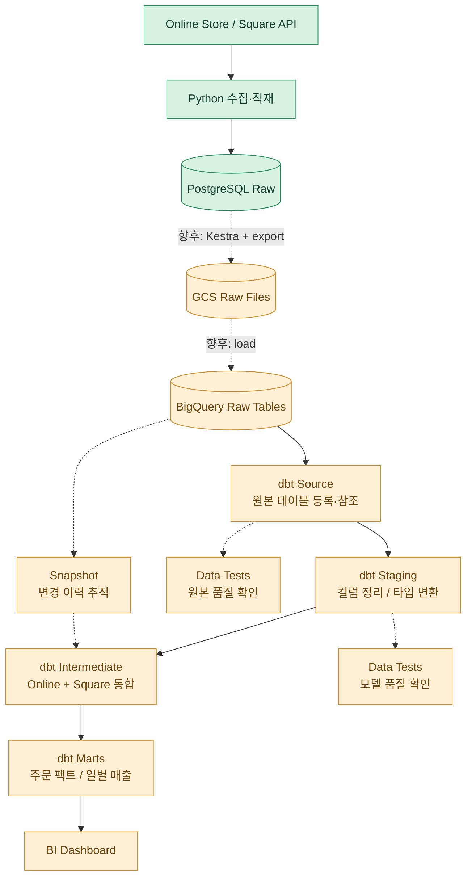

> **핵심:** GCS → BigQuery Load Job은 Raw 적재, Seed는 프로젝트 CSV 적재이며, Source는 데이터 저장 장소가 아니라 **이미 저장된 원본을 dbt에 알려주는 정의**다. Model은 **SQL 변환**, Test는 **검증**, Snapshot은 **변경 이력**이다.

### 🧩 오늘 새롭게 정리한 네 가지 핵심 질문

1. **GCS 파일을 BigQuery로 어떻게 옮기나?** → BigQuery Load Job(또는 External Table)을 사용한다.
2. **`dbt seed`가 BigQuery에 있는 CSV를 프로젝트로 가져오나?** → **아니다. 방향이 반대**다.
3. **`models.yml`과 `sources.yml` 중 무엇을 먼저 실행하나?** → YAML 실행 순서가 아니라 전체 파싱 후 **리소스 의존 관계**로 실행한다.
4. **YAML에 Source를 등록하면 `stg_*.sql`이 자동 생성되나?** → **아니다. SQL 파일은 직접 생성**한다.

---

## 2. dbt는 무슨 일을 할까?

### 2-1. dbt의 역할은 ELT의 **T(Transform)**

- **Extract / Load:** Python과 Kestra가 온라인 주문·Square 데이터를 가져와 저장한다.
- **Transform:** dbt가 BigQuery 안에서 SQL을 실행해 원본을 정리하고 분석용 테이블/뷰를 만든다.
- dbt 자체가 Square API를 호출해서 데이터를 수집하거나 GCS에 파일을 업로드하는 도구는 아니다.

**요리 비유**

- **Source:** 냉장고에 어떤 재료가 어느 칸에 있는지 적은 목록
- **Staging Model:** 재료 씻기, 손질하기, 단위 통일하기
- **Intermediate Model:** 여러 재료를 조합해 공통 중간 재료 만들기
- **Mart Model:** 손님에게 제공할 완성 요리
- **Test:** 재료와 완성 요리에 문제가 없는지 검사
- **Snapshot:** 재료 정보(예: 가격)가 언제 어떻게 바뀌었는지 기록

### 2-2. 그럼 pandas로 데이터 클리닝하는 것은 잘못된 방식일까?

아니야. **데이터의 위치와 처리 요구에 따라 다른 도구를 선택**하는 거야.

| pandas | dbt + BigQuery |
|---|---|
| Python 메모리 기반 정제·탐색에 유리 | 데이터 웨어하우스 안에서 SQL 기반 변환에 유리 |
| 외부 API 데이터 가공, 특수 로직에 적합 | 모델 의존성, 재사용, 테스트, 문서화에 강점 |
| Python 파이프라인으로 배포 | SQL 중심 ELT 모델로 배포 |

**이번 프로젝트의 선택:** 수집·적재는 Python/Kestra, **BigQuery에 적재된 후의 주요 변환은 dbt**로 진행한다.

---

## 3. Staging → Intermediate → Marts

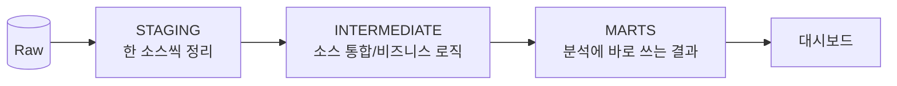

| 계층 | 핵심 목적 | 초콜릿 프로젝트 가상 예시 |
|---|---|---|
| **Staging** (`stg_`) | 컬럼명·데이터 타입·형식 표준화, 기본 정제 | `stg_online_orders`, `stg_square_orders` |
| **Intermediate** (`int_`) | 여러 Staging 모델을 조합, 공통 비즈니스 규칙 적용 | `int_unified_orders` |
| **Marts** (`fct_`, `dim_`) | 리포팅과 의사결정에 바로 사용할 Fact/Dimension | `fct_orders`, `fct_daily_sales`, `dim_products` |

### ⚠️ `staging`이라는 단어가 두 가지로 쓰인다!

| 구분 | 의미 |
|---|---|
| **배포 환경 `dev → stg → prod`** | 개발 → 운영 전 검증 → 실제 운영 환경 |
| **dbt 모델 계층 `staging → intermediate → marts`** | 데이터를 정리 → 통합 → 분석용으로 변환하는 논리적 구조 |

둘은 서로 다른 축이다. **운영 환경(prod) 안에도 Staging 모델이 존재할 수 있다.**

---

## 4. dbt 프로젝트 파일 구조와 YAML의 역할

### 4-1. 우리 프로젝트에 도입할 폴더 구조(계획)

```text
chocolate-commerce-data-platform/
└── chocolate_dbt/
    ├── dbt_project.yml             # 프로젝트 전체 설정
    ├── seeds/
    │   ├── order_status_mapping.csv # 작은 참조 데이터(필요 시)
    │   └── seeds.yml                # Seed 설명/데이터 테스트(선택)
    ├── models/
    │   ├── staging/
    │   │   ├── staging.yml          # Source/모델 속성/Generic Tests
    │   │   ├── stg_online_orders.sql
    │   │   ├── stg_square_orders.sql
    │   │   └── stg_online_products.sql
    │   ├── intermediate/
    │   │   ├── intermediate.yml     # 이 계층 모델 속성/테스트
    │   │   └── int_unified_orders.sql
    │   └── marts/
    │       ├── marts.yml            # 이 계층 모델 속성/테스트
    │       ├── fct_orders.sql
    │       └── fct_daily_sales.sql
    ├── tests/
    │   ├── assert_no_negative_order_amount.sql
    │   └── assert_order_totals_match.sql
    ├── macros/
    │   └── cents_to_dollars.sql
    └── snapshots/
        └── products_snapshot.yml
```

> **오늘 정한 운영 방식:** 모델 속성 YAML은 우선 `staging.yml`, `intermediate.yml`, `marts.yml` **세 파일**로 관리한다. **모델 SQL 파일마다 YAML을 하나씩 만들 필요는 없다.** Source 전용 `sources.yml`을 별도로 분리하는 방식도 가능하다.

### 4-2. 주요 파일 비교

| 파일 | dbt가 읽어서 하는 일 | 개발자가 수정하나? |
|---|---|---|
| `dbt_project.yml` | 프로젝트 이름, 모델 경로, 모델 기본 설정 등 | ✅ |
| `~/.dbt/profiles.yml` | BigQuery/DuckDB 등 데이터 플랫폼 연결 정보 | ✅ (비밀키는 주의) |
| `seeds/*.csv` | dbt Seed로 적재할 파일 자체 | ✅ |
| `seeds/*.yml` | Seed의 설명/테스트 속성(선택) | ✅ |
| `models/**/*.sql` | SQL 모델 정의 | ✅ |
| `models/**/*.yml` | Source, 모델 설명, Generic Test 등 | ✅ |
| `tests/*.sql` | Singular Test 정의 | ✅ |
| `snapshots/*.yml` | Snapshot 정의(dbt 1.9 이상) | ✅ |
| `target/compiled/**` | Jinja가 해석된 **컴파일 결과 SQL** | ❌ (자동 생성) |

**오해 교정:** SQL·YAML 파일은 개발자가 작성한다. `dbt init`은 프로젝트의 초기 틀을 만들 수 있지만, 실제 업무 모델 `.sql`이나 Source 설정 내용까지 자동 완성해 주지 않는다. 또한 dbt는 `staging.yml`을 위에서 아래로 읽으며 SQL을 차례대로 실행하는 프로그램이 아니다. 프로젝트 전체 리소스를 파싱하고, `ref()`·`source()`로 의존 관계(DAG)를 구성한 뒤 **명령어가 선택한 리소스**를 실행한다.

### 4-3. 프로젝트 처음 만들기(향후)

```bash
# 기존 GitHub 리포지토리 안에서 실행하는 계획
# dbt-bigquery 어댑터를 사용할 예정
dbt init chocolate_dbt

# 설정을 끝낸 다음 연결 확인
dbt debug
```

강의의 DuckDB는 **학습용 로컬 데이터베이스**이고, 우리 프로젝트의 목표 플랫폼은 **BigQuery**다. 실제 연결 방법과 `profiles.yml`은 실습 시 확정한다.

### 4-4. PyCharm에서 파일을 만들 때 기억할 점

- `.yml`은 **모델 설명과 테스트 등의 속성**을 선언한다. SQL 쿼리를 자동 작성해 주지 않는다.
- `stg_...sql`, `int_...sql`, `fct_...sql`은 **New → File**로 직접 작성한다.
- `target/compiled/`의 SQL은 dbt가 만드는 산출물이므로 **직접 수정하지 않는다**.
- `sources.yml`, `models.yml` 같은 이름은 관례일 뿐이다. **파일 이름의 알파벳 순서로 실행되지 않는다.**

---

## 5. GCS 파일을 BigQuery Raw로 적재하기

### 5-1. GCS에 파일이 있다는 것과 BigQuery 테이블이 있다는 것은 다르다

- **GCS(Cloud Storage):** `gs://chocolate-raw/online/orders.csv` 같은 **파일**을 저장한다.
- **BigQuery Dataset:** 테이블을 모아 두는 논리적 공간이다. 예: `raw_online`.
- **BigQuery Table:** SQL로 직접 조회 가능한 행·열 구조다. 예: `raw_online.orders`.
- GCS의 CSV가 자동으로 BigQuery 내부 테이블이 되는 것은 **아니다**. 별도의 **Load Job**이 필요하다. 또는 BigQuery **External Table**을 만들어 GCS 파일을 조회할 수 있다.

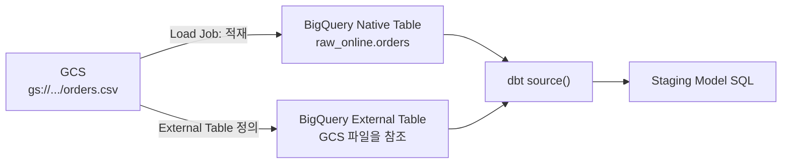

### 5-2. 실제로 GCS CSV를 BigQuery에 적재하는 방법

초콜릿 프로젝트의 주문 CSV를 예로 든 **학습용 절차**다(실제 버킷/테이블명 미정).

1. 먼저 GCS에 `gs://chocolate-raw/online/orders.csv` 파일을 업로드한다.
2. Google Cloud Console의 **BigQuery → Dataset `raw_online` → Create table**을 선택한다.
3. **Create table from: Google Cloud Storage**를 선택하고 `gs://...` 경로를 입력한다.
4. 파일 형식을 **CSV**로 지정하고 헤더 행/스키마/구분자를 설정한다. 자동 감지(Auto detect)도 가능하나, 실무에서는 타입 확인이 중요하다.
5. 대상 테이블 `orders`를 지정하고 생성하면 **BigQuery Load Job**이 데이터 행을 적재한다.
6. `SELECT * FROM `your-gcp-project-id.raw_online.orders` LIMIT 10`으로 적재 결과를 검증한다.

동일한 작업을 CLI로 자동화할 수도 있다(아래는 **예시 명령**이며 환경에 따라 인증·데이터셋·헤더 설정이 필요하다).

```bash
bq load \
  --source_format=CSV \
  --skip_leading_rows=1 \
  --autodetect \
  'your-gcp-project-id:raw_online.orders' \
  'gs://chocolate-raw/online/orders.csv'
```

> **중요:** 새 파일을 매번 적재할 때 기존 테이블에 **추가(append)**할지 **덮어쓰기(overwrite)**할지 파이프라인 정책을 정해야 한다. 중복 적재 위험도 검토한다. CSV는 중첩 JSON 표현에 한계가 있으므로 Square API 데이터는 JSONL 등의 형식도 고려할 수 있다.

### 5-3. BigQuery와 dbt의 경계

```text
Python/Kestra → GCS 파일 업로드 → BigQuery Load Job → BigQuery Raw 테이블
                                                      ↓
                                                 dbt Source 등록
                                                      ↓
                                                dbt Staging SQL
```

- BigQuery에 **이미 존재하는** Raw 테이블을 dbt로 가져오는 복사 작업은 필요하지 않다.
- dbt 프로젝트는 **데이터를 저장하는 별도 DB가 아니라**, SQL·YAML·CSV·매크로를 관리하는 **코드 프로젝트**다.
- GCS 자체는 필수 전제조건이 아니다. 다른 적재 방법으로 BigQuery Raw 테이블이 준비되어도 dbt를 사용할 수 있다.
- BigQuery Raw 적재 이후의 dbt 변환은 BigQuery에서 쿼리를 실행해 새로운 View/Table을 만드는 방식이다.

**공식 참고:** [Google Cloud — GCS CSV를 BigQuery에 Load](https://cloud.google.com/bigquery/docs/loading-data-cloud-storage-csv)

---

## 6. Seed: 프로젝트 CSV를 데이터베이스에 적재하기

### 6-1. Seed는 무엇을 읽는가?

**`dbt seed`는 dbt 프로젝트 안의 CSV 파일을 데이터 웨어하우스의 테이블로 적재하는 명령어**다. BigQuery에 있는 CSV를 거꾸로 프로젝트로 가져오는 명령어가 아니다.

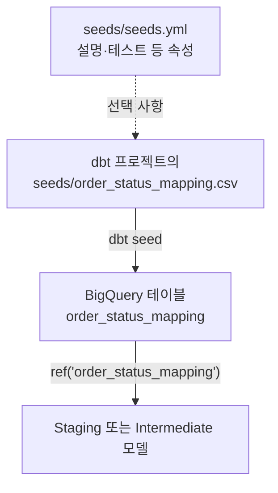

`seeds/order_status_mapping.csv` (학습용):

```csv
status_code,status_name
OPEN,In Progress
COMPLETED,Completed
CANCELED,Canceled
```

```bash
dbt seed
# 특정 파일만 적재
dbt seed --select order_status_mapping
```

다른 모델에서는 Seed를 `source()`가 아니라 **`ref()`**로 참조한다.

```sql
SELECT status_code, status_name
FROM {{ ref('order_status_mapping') }}
```

### 6-2. Seed YAML은 필수인가?

**아니.** CSV 자체가 Seed 리소스다. dbt는 `dbt_project.yml`의 `seed-paths`(기본값 `seeds/`)에서 CSV를 발견한다. `seeds/seeds.yml`은 Seed의 설명·컬럼·데이터 테스트 같은 **선택적 속성**을 작성하는 파일이다.

```yaml
version: 2
seeds:
  - name: order_status_mapping
    description: "주문 상태 코드와 표시 이름의 매핑"
    columns:
      - name: status_code
        data_tests:
          - not_null
          - unique
```

**실행 과정은 `seeds.yml`을 먼저 순서대로 실행하는 것이 아니다.** dbt가 프로젝트의 파일을 파싱해 Seed 리소스를 알아낸 다음, `dbt seed`에 해당하는 CSV를 적재한다. YAML 문법 자체가 깨져 있으면 적재 명령도 파싱 단계에서 실패할 수 있다.

### 6-3. Seed vs GCS → BigQuery Load Job vs Source

| 항목 | 입력 데이터 | 실제 DB 테이블 생성/적재? | 언제 사용? |
|---|---|---|---|
| **BigQuery Load Job** | GCS 등에 있는 외부 파일 | ✅ | 주문·고객·상품 Raw 데이터 적재 |
| **dbt Seed** | dbt 저장소의 작은 CSV | ✅ | 상태 코드 매핑 등 작고 안정적인 참조 데이터 |
| **dbt Source** | 이미 존재하는 DB Table/View | ❌ | Raw 데이터를 dbt SQL에서 참조 |

> **주의:** 두 로딩 방식의 차이는 '데이터 양'만이 아니라 **출처·용도·관리 방식**이다. 주문 CSV가 GCS에 이미 있다면 보통 BigQuery Load Job으로 적재하고, 그 결과를 `source()`로 참조한다. Seed는 작은 버전 관리용 참조 데이터에 적합하다.

**공식 참고:** [dbt Seeds](https://docs.getdbt.com/docs/build/seeds)

---

## 7. Source: 원본 데이터 위치를 등록하기

### 5-1. Source = 데이터를 dbt에 업로드하는 기능이 아님

GCS 파일 자체가 아니라, 보통 **BigQuery에 적재되었거나 외부 테이블로 등록된** 테이블을 대상으로 한다. 이미 BigQuery에 존재하는 테이블을 **이름, 위치, 설명, 품질 규칙과 함께 등록**하는 메타데이터다.

- `database`: BigQuery **GCP 프로젝트 ID**
- `schema`: BigQuery **Dataset 이름**
- `tables`: 그 Dataset 안의 **테이블 이름 목록**
- `name`: dbt SQL에서 `source()`로 부를 논리적 Source 이름

### 5-2. `models/staging/staging.yml` 예시

```yaml
version: 2

sources:
  - name: raw_online
    database: your-gcp-project-id  # 실제 GCP 프로젝트 ID로 교체
    schema: raw_online            # 예시 Dataset 이름
    description: "온라인 쇼핑몰의 원본 테이블"
    tables:
      - name: orders
        description: "온라인 주문 원본"
        columns:
          - name: id              # 실제 PK 컬럼명 확인 필요
            data_tests:
              - not_null
              - unique
      - name: customers
      - name: products

  - name: raw_square
    database: your-gcp-project-id
    schema: raw_square
    description: "Square API에서 추출한 원본 데이터"
    tables:
      - name: orders
      - name: customers
      - name: locations
      - name: catalog_objects
```

> 실제 `raw_square` 데이터는 JSON 구조를 포함할 수 있어. BigQuery 적재 후 스키마/중첩 필드를 확인하고 모델 SQL을 작성해야 한다.

### 5-3. 모델에서 원본 참조

```sql
-- models/staging/stg_online_orders.sql
SELECT *
FROM {{ source('raw_online', 'orders') }}
```

BigQuery에서 실행할 때는 dbt가 `source()`를 실제 테이블 식별자로 치환한다(예: `` `your-gcp-project-id.raw_online.orders` ``).

**추가 장점:** Source 자체에 데이터 테스트를 정의할 수 있고, 설정을 추가하면 **Source Freshness(원본이 얼마나 최근에 갱신되었는지)**도 검사할 수 있다. 강의의 dbt 1.9 계열에서는 `dbt source freshness`를 사용한다. Freshness는 자동으로 원본을 갱신하지 않는다.

> **강의 실습:** `models/_looker__sources.yml` 같은 파일은 일반적으로 직접 만들고 `sources:` 내용을 작성한다. 해당 파일에 Source가 등록되었다고 해서 `stg_looker__products.sql`이 자동 생성되지는 않는다.

---

## 8. Model: SQL로 분석용 데이터 만들기

### 6-1. Model은 단순한 테이블 설계도가 아니다

**SQL 변환 로직을 정의한 파일**이다. dbt는 해당 SQL을 실행해 설정에 따라 BigQuery **VIEW / TABLE / INCREMENTAL** 등의 형태로 결과를 만든다.

#### Staging SQL(설명용)

```sql
-- models/staging/stg_online_orders.sql
-- id, total_amount는 학습용 가상 컬럼명: 실제 스키마 확인 필요
SELECT
    id AS order_id,
    SAFE_CAST(total_amount AS NUMERIC) AS total_amount
FROM {{ source('raw_online', 'orders') }}
```

#### Intermediate SQL(개념 예시)

```sql
-- models/intermediate/int_unified_orders.sql
-- 실제 Square 모델 컬럼을 통일한 뒤 사용한다는 가정
SELECT 'online' AS sales_channel, order_id, total_amount
FROM {{ ref('stg_online_orders') }}

UNION ALL

SELECT 'square' AS sales_channel, order_id, total_amount
FROM {{ ref('stg_square_orders') }}
```

#### Mart SQL(개념 예시)

```sql
-- models/marts/fct_orders.sql
SELECT
    sales_channel,
    order_id,
    total_amount
FROM {{ ref('int_unified_orders') }}
```

### 6-2. `ref()`로 이어지는 DAG

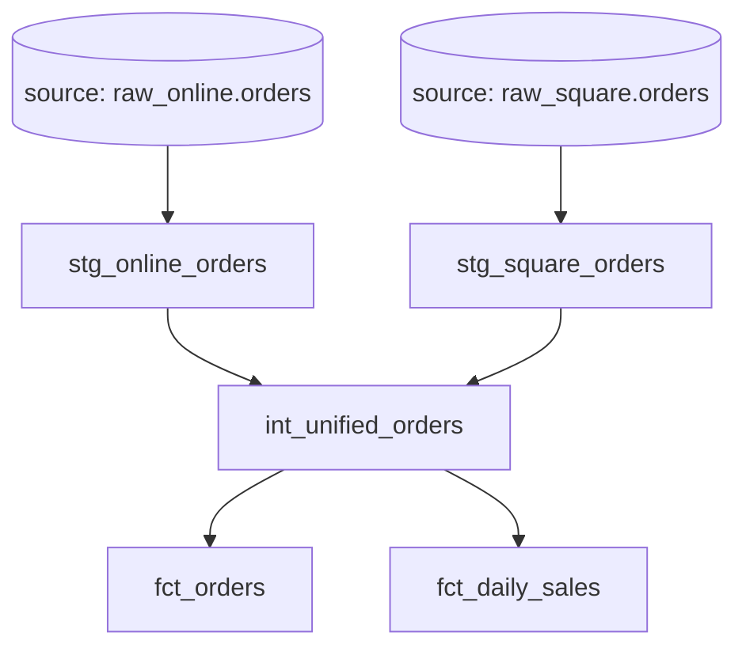

**중요:** `dbt run`은 YAML에 적힌 순서가 아니라 **이 의존 관계**를 이용해 실행한다. 서로 독립된 모델은 병렬 실행할 수 있다.

### 8-3. 한 SQL 파일에는 SELECT를 하나만 써야 할까?

하나의 dbt 모델 SQL은 **보통 하나의 최종 결과 데이터셋**을 정의한다. 여러 `WITH` CTE, `JOIN`, 집계식을 마음껏 조합할 수 있다. 중요하게 볼 것은 'SQL 파일 하나 = 모델 하나'와 '최종 결과의 의미가 명확한가'다.

```sql
-- 예시: 여러 CTE를 사용하지만 결과 모델은 하나
WITH filtered AS (
    SELECT order_id, total_amount
    FROM {{ ref('stg_online_orders') }}
    WHERE total_amount IS NOT NULL
),
summary AS (
    SELECT COUNT(*) AS order_count, SUM(total_amount) AS sales
    FROM filtered
)
SELECT * FROM summary
```

---

## 9. Jinja, `ref()`, `source()`, Macro

### 7-1. `{{ ... }}`는 SQL에 값을 끼워 넣는 Jinja 표현식

```sql
FROM {{ source('raw_online', 'orders') }}
FROM {{ ref('stg_online_orders') }}
```

| 문법 | 역할 |
|---|---|
| `{{ ... }}` | 식/함수 결과를 SQL에 삽입 |
| `` | macro, for, if 등 실행 제어/선언 |
| `{# ... #}` | Jinja 주석 |

### 7-2. `source()` vs `ref()`

| `source()` | `ref()` |
|---|---|
| **외부에서 이미 로드한** Raw 테이블 | **dbt가 관리하는** 다른 모델 |
| Source YAML에 선언되어야 함 | 해당 이름의 dbt 모델이 있어야 함 |
| 예: `source('raw_online', 'orders')` | 예: `ref('stg_online_orders')` |
| 계보상 **원본 진입점** 표시 | 계보상 **모델 간 의존성** 표시 |

### 7-3. Macro = 반복되는 SQL 로직의 재사용

```sql
-- macros/cents_to_dollars.sql

    ({{ column_name }} / 100.0)

```

```sql
-- 모델에서 사용
SELECT {{ cents_to_dollars('price_cents') }} AS price_cad
FROM {{ ref('stg_square_catalog') }}
```

- Macro는 **SQL을 생성하는 재사용 함수**이지 자체 데이터 테이블이 아니다.
- 위 코드는 `price_cents` 컬럼이 **정수 센트**이고 값의 통화가 **CAD**라는 가정이 있어야만 의미가 정확하다. Square의 실제 금액 필드/통화는 확인해야 한다.
- ``는 반복문이고 ``는 재사용 코드를 **정의**하는 문법이므로 다른 역할이다.

### 9-4. Macro 문법 연습 한 문제

**문제:** 다음 SQL 빈칸을 Macro 호출 구문으로 채워서 `price_cents`를 달러로 변환해 보자.

```sql
SELECT
    product_id,
    price_cents,
    ____________ AS price_dollars
FROM {{ ref('stg_square_products') }}
```

<details>
<summary>정답 확인</summary>

```sql
{{ cents_to_dollars('price_cents') }}
```

컴파일된 SQL 표현식은 `(price_cents / 100.0)`가 된다.

</details>

**기억법:** ``는 정의, `{{ 매크로명(...) }}`은 호출, ``는 정의 종료다. 이 예시는 `price_cents`를 센트 금액으로 저장한다는 가정에 한한다.

---

## 10. Test: Generic Test와 Singular Test

### 8-1. 핵심 원리

**dbt 데이터 테스트는 대개 '문제 있는 데이터'를 조회하는 SQL**이다.

- 결과가 **0행** → PASS
- 기본 설정에서 결과가 **1행 이상** → FAIL
- `dbt test`는 데이터를 **고치거나 자동 클리닝하지 않는다.**

### 8-2. Generic Test — YAML에 규칙 선언

```yaml
# models/staging/staging.yml (models 항목만 발췌)
models:
  - name: stg_online_orders
    description: "온라인 주문 기본 정리 모델"
    columns:
      - name: order_id
        description: "온라인 주문 식별자"
        data_tests:
          - not_null
          - unique
      - name: total_amount
        data_tests:
          - not_null
```

대표 내장 Generic Test:

| 테스트 | 검증할 것 |
|---|---|
| `not_null` | NULL이 없는가? |
| `unique` | 중복 값이 없는가? |
| `accepted_values` | 허용 목록에 없는 값이 존재하는가? |
| `relationships` | 참조 무결성이 유지되는가? |

**중요:** YAML은 **'어떤 모델의 어떤 컬럼에 어떤 테스트'**인지 정의한다. YAML 파일 한 개에 여러 모델의 테스트를 적어도 된다.

### 8-3. Singular Test — SQL 자체를 작성

파일: `tests/assert_no_negative_order_amount.sql`

```sql
SELECT order_id, total_amount
FROM {{ ref('stg_online_orders') }}
WHERE total_amount < 0
```

이 테스트는 `ref('stg_online_orders')`로 **검사 대상을 명시**한다. 특정 모델만 대상으로 할 수도 있고, 여러 모델/Source를 조인해 검사할 수도 있다.

> **비즈니스 규칙 주의:** 환불 등이 음수로 기록되는 모델이라면 '모든 음수 = 오류'는 틀릴 수 있다. 해당 컬럼의 의미와 취소/환불 정책을 확인하고 규칙을 정해야 한다.

### 8-4. 테스트를 실행하는 명령어

```bash
# 활성화된 Generic + Singular 데이터 테스트 모두 실행
dbt test

# 특정 테스트 하나만 실행
dbt test --select assert_no_negative_order_amount

# 특정 모델과 연결된 데이터 테스트 실행
dbt test --select stg_online_orders

# Source에 정의한 데이터 테스트만 실행
dbt test --select "source:*"
```

**오해 교정:** `tests/*.sql`을 만들었다고 해서 **별도의 실행 명령어가 필요한 것은 아니다.** `dbt test`가 자동으로 찾는다. 또한 테스트 SQL 파일을 YAML의 `data_tests:`에 다시 등록할 필요는 없다.

### 8-5. 테스트는 언제 실행할까?

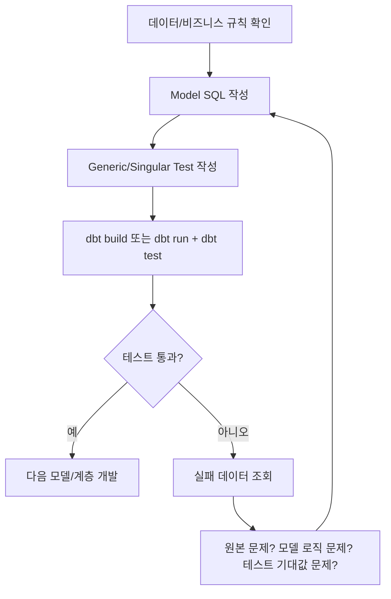

- 테스트는 **Staging에서만** 하는 것이 아니라 **Source / Staging / Intermediate / Marts** 각 단계에 걸쳐 작성할 수 있다.
- 매번 `dbt run` 후 `dbt test`를 **반드시** 따로 입력해야 하는 것은 아니다. 모델을 갱신하고 연결된 테스트도 실행하려면 `dbt build`를 쓸 수 있다.
- **주의:** `dbt test` 단독 실행은 이미 존재하는 DB 테이블/뷰를 검사한다. 모델 SQL을 고쳤다면 먼저 모델을 새로 빌드해야 수정 결과를 검사할 수 있다.

### 10-6. 강의에서 막혔던 두 가지 Generic Test 직접 써보기 (dbt 1.8.4)

```yaml
models:
  - name: customers
    columns:
      - name: traffic_source
        data_tests:
          - not_null
          - accepted_values:
              values: ['Display', 'Email', 'Facebook', 'Organic', 'Search']
      - name: user_id
        data_tests:
          - not_null
          - relationships:
              to: ref('stg_looker__users')
              field: id
```

> **중요:** 위는 YAML 문법을 보여주는 **가상 모델 구조**다. 실제 `customers.user_id`가 고유해야 하는지, `traffic_source` 값이 이 목록으로 제한되는지, 관계 대상 `id` 컬럼이 맞는지는 강의 모델 스키마와 비즈니스 규칙에 따라 확인해야 한다.

- `accepted_values`는 복수형이다.
- `relationships`의 `to`, `field`는 `relationships:` 아래에 들여쓴다.
- `relationships`는 NULL을 기본적으로 건너뛰므로 NULL 불가 정책이 있다면 `not_null`도 추가한다.
- **버전 주의:** 최신 문서에서 보이는 `arguments:` 중첩 예시는 dbt 1.10.5+에서 도입되었다. 강의 로그의 dbt 1.8.4에서는 위처럼 인자를 바로 둔다.

---

## 11. YAML 파싱 오류와 Generic Test 문법 디버깅

오늘 강의(DuckDB + **dbt 1.8.4**)에서 실제로 만난 YAML 파싱 오류를 정리한다. **Parsing Error는 데이터 품질 테스트가 FAIL한 것과 다르다.** SQL이 실행되기 전에 설정/구문을 해석하지 못한 상태다.

### 11-1. YAML 목록에는 `-` 다음에 공백이 필요하다

```yaml
# ❌ 잘못된 예
columns:
  - name: user_id
    data_tests:
      -unique
      -not_null
      -relationships:
        to: ref('stg_looker__users')
        field: id
```

```yaml
# ✅ dbt 1.8.4 강의 예제에서 쓸 문법
columns:
  - name: user_id
    data_tests:
      - unique
      - not_null
      - relationships:
          to: ref('stg_looker__users')
          field: id
```

- `-unique`는 YAML 리스트 항목이 아니다. **`- unique`**로 쓴다.
- `relationships:` 아래 `to`, `field`는 **한 단계 더 들여쓰기** 해야 한다.
- `ref('stg_looker__users')`의 이름과 `field: id` 컬럼은 실제 프로젝트에 존재해야 한다.

### 11-2. `accepted_values` 오타와 인자 누락

```yaml
# ❌ 오타 + 구조 오류
- accepted_value:
  ['Display', 'Email', 'Facebook', 'Organic', 'Search']
```

```yaml
# ✅ dbt 1.8.4 / 1.9 등 구버전 문법
- accepted_values:
    values: ['Display', 'Email', 'Facebook', 'Organic', 'Search']
```

- 내장 테스트 이름은 **`accepted_values`**(복수형)이다.
- 허용값 목록은 **`values:`** 인자로 전달한다.
- `relationships`는 `to:`와 `field:`를 인자로 전달한다.
- 최신 dbt 문서 일부는 `arguments:` 아래에 인자를 두지만, **현재 강의 버전 1.8.4에서는 위의 직접 인자 문법**을 사용한다. 최신 문법을 강의의 구버전에 그대로 복사하지 말 것.

### 11-3. 로그에 표시된 줄이 항상 오류의 시작점은 아니다

예를 들어 다음 컬럼인 `total_amount_spent`에서 에러가 표시되어도, 원인은 **바로 위 `accepted_values`의 들여쓰기**일 수 있다. YAML 파서는 앞부분 구조가 깨졌을 때 다음 항목을 읽으며 오류를 감지하기도 한다.

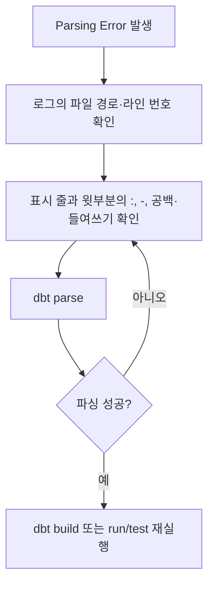

```bash
# SQL 모델을 만들거나 DB에 적재하지 않고 프로젝트 구문 확인
dbt parse
# 특정 모델과 그 상위 의존 리소스 포함해 빌드 (선택 범위에 따라 테스트 등 포함)
dbt build --select '+customers'
```

**`Unable to do partial parsing ... Starting full parse`는 보통 오류 메시지가 아니라 전체 파싱으로 전환했다는 안내**다. 그 뒤의 `Encountered an error: Parsing Error`가 실제 실패다.

### 11-4. Test FAIL과 Parsing Error 구분

| 로그 유형 | 어떤 단계? | 해결 방향 |
|---|---|---|
| `Parsing Error` | YAML/Jinja/프로젝트 파싱 | 구문·들여쓰기·이름 확인 후 `dbt parse` |
| `Compilation Error` | 참조·매크로 등 SQL 생성 | `ref()`/`source()`/매크로 참조 확인 |
| `Database Error` | SQL DB 실행 | 컬럼·타입·권한·테이블 존재 여부 확인 |
| `FAIL accepted_values...` | 테스트 SQL 실행 후 품질 검증 | 실패 값 조회, 원본/모델/규칙 확인 |

**공식 참고:** [dbt Data Tests](https://docs.getdbt.com/docs/build/data-tests), [dbt parse](https://docs.getdbt.com/reference/commands/parse)

---

## 12. 테스트 실패 로그와 컴파일 SQL 디버깅

### 9-1. 오늘 강의에서 본 실패 예시

```text
FAIL accepted_values_taxi_rides_raw_payment_type__1__2__3__4__5__6
PASS not_null_taxi_rides_raw_fare_amount
PASS not_null_taxi_rides_raw_payment_type

Failure in test accepted_values_... (models/taxi_rides/model_properties.yml)
Got 1 result, configured to fail if != 0
compiled code at target/compiled/.../accepted_values_....sql

[WARNING] Unused config path models.nyc_yellow_taxi
```

| 로그 | 해석 |
|---|---|
| `FAIL accepted_values...payment_type` | `payment_type`에 허용값 1~6 이외의 값이 존재했거나 테스트 기대값과 맞지 않음 |
| `PASS not_null...` | NULL 검사 통과 |
| `(models/taxi_rides/model_properties.yml)` | **테스트가 정의된 YAML 위치**. 이 파일 자체가 반드시 잘못된 건 아님 |
| `Got 1 result` | 테스트 SQL이 반환한 **실패 결과 1행**. 원본 데이터 딱 1건이 잘못됐다는 뜻은 아님 |
| `target/compiled/...sql` | dbt가 만들어낸 **실제 검사 SQL** 파일 |
| `Unused config path ...` | `dbt_project.yml`에 사용되지 않는 설정 경로가 있음. 테스트 실패와는 별개의 경고 |

> `accepted_values` 같은 테스트는 잘못된 값을 **그룹화해 출력**할 수도 있다. '결과 1행' 안에 실제 오류 원본 데이터는 수십 건이 들어 있을 수 있다.

### 9-2. 컴파일 SQL을 DB Tool에서 직접 실행해 보기

1. `dbt test` 로그에서 **FAIL 테스트 이름** 확인
2. `target/compiled/` 아래 **컴파일된 `.sql` 파일** 열기
3. DuckDB용 DB Tool 또는 BigQuery SQL Editor에 복사해서 실행
4. 잘못된 값과 발생 건수를 추가로 확인

```sql
-- 강의의 DuckDB 테이블 경로에 맞게 수정한 디버깅 SQL 예시
SELECT
    payment_type,
    COUNT(*) AS row_count
FROM main.taxi_rides_raw
WHERE payment_type NOT IN (1, 2, 3, 4, 5, 6)
  AND payment_type IS NOT NULL
GROUP BY payment_type
ORDER BY row_count DESC
```

**가상 결과:**

| payment_type | row_count |
|---:|---:|
| 0 | 23 |
| 7 | 5 |

→ 허용되지 않은 **두 종류의 값**이 있고, **원본 행 총 28건**이 해당한다는 뜻이다.

### 9-3. 실패를 발견했다고 바로 데이터를 고칠까?

아니. **실패 원인을 구분**해야 한다.

1. **원본 오류:** 실제로 데이터에 비정상 코드가 들어옴
2. **모델 로직 오류:** 잘못된 CAST, JOIN, 필터 등이 발생
3. **테스트 기대값 오류:** 업무상 유효한 새로운 상태/코드인데 허용 목록이 오래됨

### 9-4. 재실행하면 컴파일 SQL은 어떻게 될까?

- 모델 또는 테스트를 수정한 후 `dbt test`를 다시 실행하면 **선택된 테스트 SQL이 다시 컴파일**된다.
- **같은 경로의 결과물은 일반적으로 갱신/덮어쓰기**된다.
- 테스트 이름이나 경로가 바뀌면 **이전 생성 파일이 남을 수 있으므로** `target/compiled/`를 변경 이력 보관 장소로 생각하면 안 된다.
- **직접 고칠 파일은 `models/*.sql`, `models/*.yml`, `tests/*.sql`** 등 소스 파일이다.
- `target/`은 일반적으로 Git 추적에서 제외한다.

---

## 13. Snapshot: 변경 이력 남기기

### 10-1. Snapshot은 왜 필요할까?

원본 테이블의 한 행을 **UPDATE로 덮어쓰면 이전 값이 사라질 수 있다.** dbt Snapshot은 관측한 변경을 버전별로 기록한다. 흔히 **SCD Type 2** 방식이라고 한다.

**초콜릿 가격 변경 예시(가상):**

| 시점 | `products`의 상품 101 가격 |
|---|---:|
| 11/01 | $5.00 |
| 11/06 | $6.00 (UPDATE) |

일반적인 현재 상태 테이블에는 **$6.00만** 남을 수 있다.

Snapshot 결과 예시:

| product_id | price | dbt_valid_from | dbt_valid_to |
|---:|---:|---|---|
| 101 | $5.00 | 2026-11-01 | 2026-11-06 |
| 101 | $6.00 | 2026-11-06 | NULL (현재) |

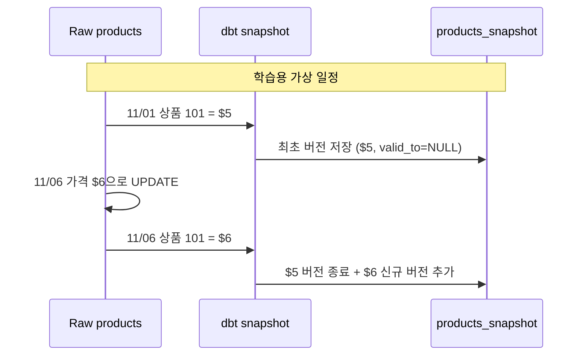

**주의:** 실제 `dbt_valid_from`/`dbt_valid_to` 값은 선택한 Snapshot 전략, 원본 `updated_at` 존재 여부, 관측 시점에 따라 달라진다. 위 표의 날짜는 개념 설명이다.

### 10-2. Snapshot은 반드시 원본 데이터로만 만드나?

아니. Snapshot은 **Source** 또는 **dbt Model**을 기반으로 만들 수 있다.

```yaml
relation: source('raw_online', 'products')
# 또는
relation: ref('stg_online_products')
```

보통 **Raw Source나 아주 가볍게 정리된 Staging 모델**을 기준으로 변경 이력을 관리하는 것이 이해하기 쉽다. Marts의 복잡한 계산 결과는 로직 수정만으로도 값이 달라질 수 있으므로 신중히 선택한다.

### 10-3. dbt 1.9+ YAML Snapshot 예시

파일: `snapshots/products_snapshot.yml`

```yaml
snapshots:
  - name: products_snapshot
    relation: source('raw_online', 'products')
    config:
      schema: snapshots
      unique_key: id        # 가상 상품 고유 컬럼
      strategy: check
      check_cols:
        - price             # 가상 가격 컬럼
```

```bash
# 최초 실행: 현재 데이터를 기준으로 이력 테이블 생성
# 다음 실행: 이전 버전과 비교해 변경/신규 행 반영
dbt snapshot
```

**두 가지 감지 전략**

| 전략 | 어떻게 변경을 찾나? | 언제 사용? |
|---|---|---|
| `timestamp` | 신뢰할 수 있는 `updated_at`이 바뀌었는지 확인 | `updated_at` 품질이 좋다면 우선 고려 |
| `check` | 지정한 컬럼(`check_cols`) 값을 비교 | 신뢰할 `updated_at`이 없을 때 |

**반드시 기억할 한계**

- Snapshot을 **처음 실행하기 전의 과거 변경 이력은 자동 복원되지 않는다.**
- 하루에 한 번 Snapshot을 실행하면, 그 사이에 여러 번 바뀌었다가 원래 값으로 돌아온 변경은 놓칠 수 있다.
- 변경을 관측하려면 **BigQuery Source의 데이터도 실제로 갱신되어야** 한다.
- 모든 테이블에 Snapshot이 필요한 것은 아니다. 상품 가격, 고객 등급, 주문 상태처럼 **과거 상태가 분석에 중요할 때** 선택한다.
- 주문 당시 단가가 `order_items`에 정확히 보관되어 있다면, 과거 매출 계산에 상품 가격 Snapshot이 반드시 필요하지 않을 수 있다.

### 10-4. GCS Raw Snapshot과 dbt Snapshot은 다른 것!

| GCS에 저장하는 Raw 파일 스냅샷 | dbt Snapshot |
|---|---|
| 특정 시점의 **파일 전체 복사본/적재 기록** | **행별 컬럼 값 변경 이력** |
| 보통 파일·배치 단위 | 보통 키(`unique_key`)별 버전 관리 |
| 수집·재처리·백업 용도 | SCD Type 2 / 이력 분석 용도 |

### 13-5. 강의와 프로젝트의 dbt 버전 차이: Snapshot 주의!

오늘 Looker Ecommerce 실습 로그는 **dbt 1.8.4**이고, 위 **YAML Snapshot 정의는 dbt 1.9 이상**에서 사용하는 방식이다. **dbt 1.8.x의 레거시 SQL Snapshot**은 아래처럼 정의한다(설명용).

```sql
-- snapshots/products_snapshot.sql  (dbt Core 1.8 계열 스타일)


{{ config(
    target_schema='snapshots',
    unique_key='id',
    strategy='check',
    check_cols=['price']
) }}

SELECT *
FROM {{ source('raw_online', 'products') }}


```

실제 BigQuery 프로젝트에서 Snapshot을 구현할 때는 **그때 설치한 dbt/어댑터 버전을 확인한 뒤 문법을 선택**한다.

---

## 14. dbt 명령어와 실제 실행 흐름

| 명령어 | 무엇을 하나? | 주의할 점 |
|---|---|---|
| `dbt init chocolate_dbt` | 새 dbt 프로젝트 생성 | 연결/프로젝트 설정 필요 |
| `dbt parse` | SQL/YAML/Jinja 프로젝트 파싱과 구문 검증 | DB에 Table/View를 만들지 않음 |
| `dbt ls --resource-type model` | dbt가 인식한 모델 목록 확인 | DB에 Table/View를 만들지 않음 |
| `dbt seed` | 프로젝트 CSV를 DB 테이블에 적재 | 기존 외부 Raw CSV와 혼동 금지 |
| `dbt debug` | 프로필과 연결 상태 점검 | 데이터 모델 생성 아님 |
| `dbt run` | SQL Model 실행하여 Relation 생성/갱신 | **데이터 테스트 자동 실행 X** |
| `dbt test` | Generic + Singular Data Test 실행 | 기존 Relation 검사, **모델 재생성 X** |
| `dbt build` | 모델·테스트·Snapshot·Seed 등 선택된 리소스 빌드 | DAG에 따라 실행, Snapshot도 포함될 수 있음 |
| `dbt snapshot` | 변경 이력 스냅샷 반영 | 주기적으로 실행해야 변경 관측 가능 |
| `dbt compile` | Jinja가 반영된 SQL 생성/검토 | 별도의 선행 필수 단계 아님 |
| `dbt source freshness` | Source의 최신 적재 시점 점검(dbt 1.9 계열) | 적절한 Freshness 설정 필요 |
| `dbt docs generate` | 프로젝트 문서/계보 메타데이터 생성 | 파일만 만들고 온라인에 자동 공개 X |
| `dbt docs serve` | 로컬 문서 웹 화면 실행 | 기본 포트가 다른 서비스와 충돌할 수 있음 |

### 🧭 `dbt run`과 `dbt test`를 꼭 매번 따로 해야 할까?

**아니야.**

```bash
# 방법 1: 수동으로 나누기
dbt run
dbt test

# 방법 2: 모델 빌드와 관련 테스트를 연결해 실행
dbt build
```

단, `dbt build`는 **프로젝트에 정의한 Snapshot/Seed 등도 포함할 수 있으므로** 전체 또는 선택 범위를 확인하는 습관이 좋다.

### 🧭 특정 테스트/모델만 실행

```bash
dbt run --select stg_online_orders
dbt test --select stg_online_orders
dbt test --select assert_no_negative_order_amount
dbt build --select stg_online_orders
```

### 🧭 SQL 한 파일 = 실행 쿼리 한 개?

- 보통 `models/*.sql` 한 개가 **dbt 모델 하나**다.
- 한 모델 SQL 내부에 여러 **CTE(`WITH`)**나 JOIN이 있을 수 있다.
- dbt가 모델 간 실행 순서를 결정하는 핵심은 **파일 이름순이 아니라 `ref()`로 연결한 DAG**다.

### 14-4. **YAML 무엇을 먼저 읽나?** — 명령어별 진짜 실행 단계

1. `dbt_project.yml`과 연결 프로필 등의 **프로젝트 설정**을 확인한다.
2. `models/**/*.sql`, `models/**/*.yml`, `seeds/*.csv`, `tests/*.sql`, `macros/*.sql` 등의 **해당 프로젝트 리소스를 발견·파싱**한다. 성능을 위해 바뀐 부분만 파싱할 수 있다.
3. YAML에 적힌 Source/Model/Seed 속성과 SQL의 `ref()`·`source()`를 연결해 **Manifest/DAG**를 구성한다.
4. 입력한 명령(`seed`, `run`, `test`, `build`)과 `--select` 조건을 기준으로 **실제 수행할 리소스를 선택**한다.
5. `ref()` 의존 관계에 맞춰 필요한 **실행 순서**를 결정하고 DB에서 작업을 실행한다. Source는 외부의 기존 데이터를 참조할 뿐 DB에 자동 적재하지 않는다.

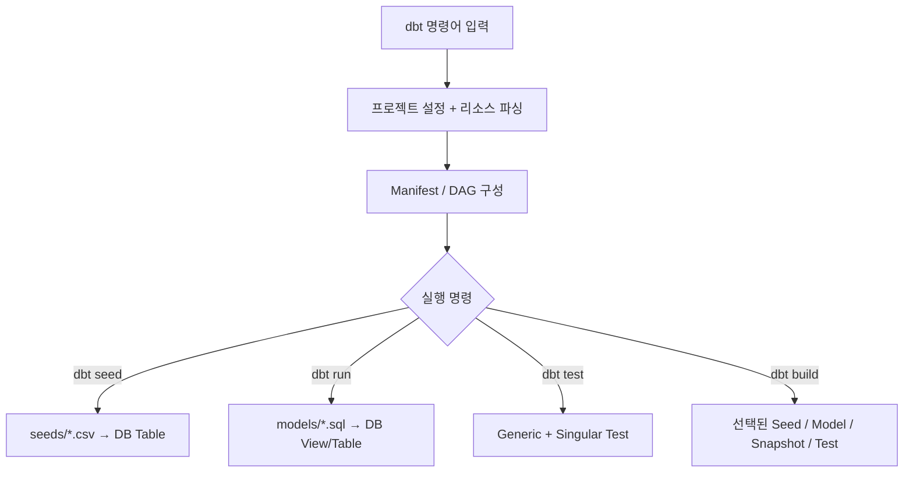

> **중요:** `sources.yml`과 `models.yml` 중 어느 YAML이 먼저 읽히는지에 따라 실행 결과가 결정되지 않는다. 반대로 **무관한 YAML 하나의 문법이 틀려도** 파싱 전체가 실패해 `dbt seed`나 `dbt run`이 시작되지 않을 수 있다.

### 14-5. `--select`와 `+`의 의미

```bash
# 선택된 모델 하나만 실행
dbt run --select stg_looker__products

# 특정 모델과 상위 의존 노드(ancestors) 선택
dbt build --select '+customers'

# 모델 아래쪽에 연결된 후속 모델(descendants)까지 선택
dbt run --select 'stg_looker__products+'

# dbt가 인식한 리소스 확인 (DB 적재 없이 조회)
dbt ls --resource-type seed
dbt ls --resource-type source
dbt ls --resource-type model
```

`dbt run`은 모델만 실행하므로 `+`로 Source를 함께 선택하더라도 Source에서 원본 데이터를 수집/적재하지 않는다. 반면 `dbt build`는 선택된 Seed·Snapshot·모델·테스트를 의존 관계와 실행 범위에 맞춰 처리한다.

---

## 15. Documentation · Lineage · CI/CD와 Kestra

### 12-1. dbt Documentation

`models/*.yml`에 모델과 컬럼의 의미를 기록할 수 있다.

```yaml
models:
  - name: stg_online_orders
    description: "온라인 주문 Raw 데이터를 정리한 Staging 모델"
    columns:
      - name: order_id
        description: "온라인 주문을 식별하는 ID"
      - name: total_amount
        description: "분석에서 사용할 주문 총액(단위/환불 기준은 확인 필요)"
```

```bash
dbt docs generate
dbt docs serve
```

- 문서는 **프로젝트가 끝난 뒤 한 번에 작성하기보다 모델을 만들면서 함께 작성**한다.
- dbt Docs는 모델 설명, 컬럼, 테스트, **Lineage 그래프(DAG)**를 이해하는 데 유용하다.
- `docs generate` 결과가 GitHub에 자동 공개되는 것은 아니다. 별도 배포/호스팅이 필요하다.

### 12-2. Kestra와 CI/CD 역할 분리

| 도구 | 주로 하는 일 |
|---|---|
| **Kestra** | 매일/매월 **데이터 파이프라인 실행 일정과 작업 순서** 관리 |
| **dbt** | BigQuery에서 SQL 모델 변환·검증·변경 이력 기록 |
| **Git/GitHub** | SQL/YAML/Python 등 **소스코드 버전 관리** |
| **GitHub Actions(CI/CD)** | 코드 변경 시 자동 검증, 배포 프로세스 등 |
| **Power BI / Looker Studio** | Mart를 연결해 대시보드 표시/새로고침 |

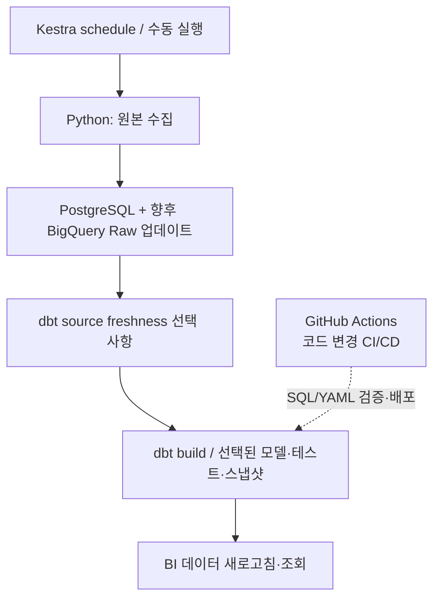

> BI 대시보드가 **어떤 시점에 실제로 새 데이터를 표시하는지**는 BI 도구의 연결 방식과 새로고침 설정에 달려 있다.

---

## 16. 초콜릿 프로젝트에 적용할 설계 초안

### 13-1. Phase 4를 둘로 나눠 생각하기

| 구간 | 할 일 | 상태 |
|---|---|---|
| **Phase 4A — Cloud Ingestion** | PostgreSQL export → GCS → BigQuery Raw | 🔜 아직 구현 전, 잠시 보류 |
| **Phase 4B — dbt Transformation** | BigQuery Raw → Staging → Intermediate → Marts | 📖 개념 학습 중 |

### 13-2. 우선 모델링할 만한 데이터(안)

| 계층 | 모델 후보 | 변환 목적 |
|---|---|---|
| Source | `raw_online.orders` | 온라인 주문 원본 등록 |
| Source | `raw_square.orders` | Square 주문 원본 등록 |
| Staging | `stg_online_orders` | 주문 ID/날짜/금액 형식 통일 |
| Staging | `stg_square_orders` | Square 주문 JSON 구조 파악, 필요한 필드 추출 |
| Intermediate | `int_unified_orders` | 온라인·오프라인 주문 결합 및 중복/취소 정책 정의 |
| Marts | `fct_orders` | 채널별 주문 팩트 |
| Marts | `fct_daily_sales` | 날짜·채널별 매출 집계 |

### 13-3. 계층별 테스트 후보

| 위치 | 테스트 예시 | 주의할 점 |
|---|---|---|
| Source | 주문 PK `not_null`, `unique` | Raw에 중복 수집이 허용되는 설계인지 먼저 확인 |
| Staging | 날짜/금액 변환 실패 시 NULL 점검 | 원본 타입과 빈 문자열 규칙 고려 |
| Intermediate | 온라인·Square 주문 통합 시 중복 키 검사 | 채널이 다르면 같은 주문 ID가 가능할 수 있음 → 복합 키 필요 |
| Marts | 주문 상세 합계와 일별 매출 합계 대조 | 취소·환불·세금·배송비 포함 범위 정의 |
| Snapshot | 상품 가격·상태 변경 이력 | 실제 Raw 갱신 방식 확인 |

### 13-4. 우리 프로젝트에서 미리 결정해야 할 비즈니스 질문

1. **주문 총액**은 세금·할인·배송비를 포함할까?
2. **취소 및 환불**은 매출에 어떻게 반영할까?
3. **Square 주문과 온라인 주문**의 ID 중복 가능성은 없을까?
4. **상품 가격 변경 이력**을 별도로 보관할 필요가 있을까?
5. **원본 적재 방식**이 `TRUNCATE + INSERT`라면, Snapshot 실행 시 원본 테이블에 어떤 레코드들이 관측되는가?

> dbt를 잘 쓰려면 **SQL 기술뿐 아니라 원본 구조와 비즈니스 규칙을 먼저 이해하는 것**이 중요하다.

### 16-5. 오늘 확정한 방향과 아직 미확정인 사항

**확정한 이해/방향**

- Raw 데이터는 Python/Kestra가 수집·적재하며, dbt는 **BigQuery 안에서 분석용 변환**을 수행한다.
- `sources:`는 BigQuery Raw 테이블을 **등록**한다. CSV 적재 기능이 아니다.
- `seeds/`는 작은 매핑 CSV에만 필요할 때 사용한다. 프로젝트에 Seed가 없어도 dbt 모델 개발이 가능하다.
- 모델 SQL은 직접 만들며, YAML에는 설명·테스트·설정을 작성한다.
- Phase 4B에서는 **Staging → Intermediate → Marts** 3계층을 구현한다.

**아직 확인/구현할 사항**

- GCS 파일 이름·버킷·CSV vs JSONL 형식, BigQuery Load Job과 중복 적재 정책
- BigQuery의 프로젝트 ID, Raw Dataset, 실제 Square JSON/주문 컬럼
- dbt 프로젝트 생성, BigQuery 연결, Source·모델·테스트의 실제 실행
- Snapshot 도입 여부 및 대상 컬럼은 나중에 필요성을 검토

---

## 17. 강의 실습: Looker Ecommerce 파일 연결하기

### 17-1. 지금 강의의 파일 구성 읽기

강의의 프로젝트는 `looker_ecommerce`이며 **dbt 1.8.4 / DuckDB 1.8.2** 로그를 봤다. 아래 파일 이름은 강의에서 등장한 예시이고, 일부 SQL 내용은 연결 관계를 보여주기 위한 **설명용 예시**다.

```text
looker_ecommerce/
├── dbt_project.yml
├── seeds/
│   ├── _looker__distribution_centers.csv      # 예시: CSV Seed
│   └── _looker__seeds.yml                     # Seed 속성(선택)
├── models/
│   ├── staging/
│   │   ├── _looker__sources.yml              # 외부 원본 위치 정의
│   │   ├── _looker__models.yml               # Staging 속성·Tests
│   │   ├── stg_looker__products.sql           # 직접 생성해야 하는 SQL
│   │   └── stg_looker__distribution_centers.sql
│   └── marts/
│       ├── _looker__models.yml               # Mart 속성·Tests
│       └── customers.sql                     # 예시 모델
└── target/
    └── compiled/                            # 실행 후 자동 생성되는 SQL 결과
```

> **중요:** 위 트리는 학습용으로 정리한 구조다. 업로드된 실제 강의 프로젝트 전체 파일 목록을 검사한 것은 아니므로, 현재 PyCharm 디렉터리 구조와 다를 수 있다. 특히 `models/staging/` 등 정확한 경로를 직접 확인한다.

### 17-2. `stg_looker__products.sql`은 왜 직접 만들어야 하나?

강의 질문: **“Did you create the file `looker_ecommerce/models/stg_looker__products.sql`?”**

- 이 질문은 **모델 SQL 파일을 직접 새로 만들었는지** 확인하는 것이다.
- `sources.yml`에 products를 등록해도 `stg_looker__products.sql`이 자동 생성되지는 않는다.
- PyCharm에서 **New → File → `stg_looker__products.sql`**을 직접 만들고 SQL을 작성한다.
- `dbt run`은 `models/`에 SQL 파일을 만들어 주는 명령이 아니라, 작성한 SQL을 DB에서 실행하여 **Table/View 등 결과를 생성**하는 명령이다.

```sql
-- 등록된 source 이름·테이블명이 아래와 같다고 가정
SELECT *
FROM {{ source('looker', 'products') }}
```

### 17-3. Seed → Source → Model의 두 갈래

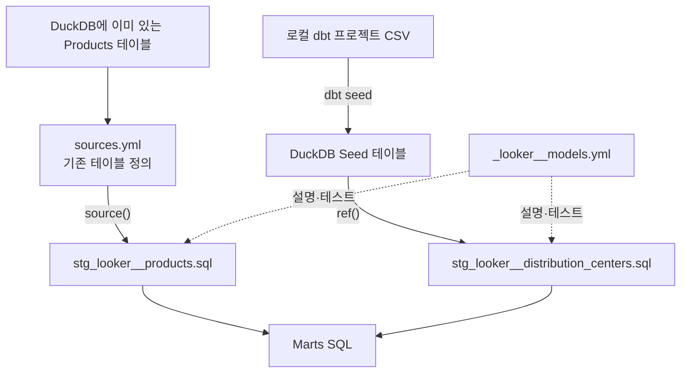

### 17-4. 명령어별 어떤 작업이 실제로 일어나나?

| 명령어 | 무엇을 실행하나? | 무엇을 하지 않나? |
|---|---|---|
| `dbt seed` | 프로젝트 CSV를 DuckDB 테이블에 적재 | GCS 또는 DB의 CSV를 거꾸로 프로젝트로 가져오지 않음 |
| `dbt run` | 모델 SQL을 실행해 DuckDB View/Table 등 생성 | `models/`에 `.sql` 파일을 자동 생성하지 않음 |
| `dbt test` | 선언된 Generic + Singular 테스트 실행 | 모델을 새로 만들거나 원본을 고치지 않음 |
| `dbt build --select '+customers'` | `customers`와 연결된 상위 노드 중 빌드 가능한 리소스 및 선정된 테스트 실행 | dbt 외부 Source 테이블을 새로 수집·적재하지 않음 |

핵심은 **실행 순서가 `sources.yml → models.yml → SQL`처럼 YAML 파일명으로 정해지지 않는다는 것**이다. 각 리소스의 종류와 `source()`/`ref()` 의존성, 그리고 실행 명령이 결정한다.

### 17-5. PyCharm에서 Mermaid 그래프 보기

- Markdown 원본 편집창에서 `flowchart TD`가 텍스트로 보이는 것은 정상이다.
- **Mermaid 플러그인**을 활성화하고 Markdown **Preview / Editor and Preview**에서 렌더링한다.
- 이 기능을 활성화했으므로 앞으로도 학습 노트와 GitHub README에 Mermaid를 그대로 사용할 수 있다.

---

## 18. 헷갈렸던 질문 Q&A

<details>
<summary><strong>Q1. dbt Model은 분석용 테이블을 구조화한다는 뜻인가?</strong></summary>

**거의 맞다.** 정확하게는 어떤 데이터를 읽고 어떤 SQL 변환을 수행해 어떤 분석용 결과(Table/View 등)를 생성할지 정의한 **실행 로직**이다.
</details>

<details>
<summary><strong>Q2. Source는 원본 데이터를 dbt에 올리는(업로드하는) 건가?</strong></summary>

**아니다.** BigQuery 등에 이미 존재하는 원본의 **위치와 이름을 등록**하고 `source()`로 참조한다.
</details>

<details>
<summary><strong>Q3. dbt는 YAML을 맨 먼저 읽고 적힌 대로 SQL을 순서대로 실행하나?</strong></summary>

**그렇게 실행되지 않는다.** 프로젝트의 YAML·SQL 등을 파싱하고 의존성을 구성한 뒤 `run`/`test`/`build`에 맞는 리소스를 실행한다.
</details>

<details>
<summary><strong>Q4. Singular Test를 작성하면 어떤 SQL 모델이 테스트 대상인지 알아야 하나?</strong></summary>

**그렇다.** 테스트 작성자는 대상 데이터와 비즈니스 규칙을 알아야 한다. 보통 `{{ ref('모델명') }}` 또는 `{{ source('소스명', '테이블명') }}`를 사용해서 SQL에서 검사 대상을 지정한다.
</details>

<details>
<summary><strong>Q5. `dbt test`는 YAML에 적힌 Generic Test만 실행하나?</strong></summary>

**아니다.** `models/*.yml`에 정의한 Generic Data Test와 `tests/*.sql`에 작성한 Singular Data Test를 모두 실행한다.
</details>

<details>
<summary><strong>Q6. `dbt test` 전에 항상 `dbt run`을 해야 하나?</strong></summary>

**항상은 아니다.** 대상 모델이 이미 DB에 존재하면 `dbt test`를 단독 실행할 수 있다. 모델 변경을 반영해 검사하려면 먼저 갱신하거나 `dbt build`를 사용한다.
</details>

<details>
<summary><strong>Q7. FAIL 로그의 YAML 경로가 잘못된 파일이라는 뜻인가?</strong></summary>

**반드시 그렇지는 않다.** 보통 **실패한 테스트가 선언된 위치**를 뜻한다. 실제 원본 데이터, 모델 SQL, 테스트 기대값 중 어디가 문제인지 추가로 조사해야 한다.
</details>

<details>
<summary><strong>Q8. 정확히 어떤 데이터 때문에 실패했는지 확인하려면?</strong></summary>

`target/compiled/`에 생성된 테스트 SQL을 살펴보고 **DB Tool 또는 BigQuery SQL Editor에서 직접 실행**한다. 필요하면 원본 행 확인용 SELECT를 추가로 작성한다.
</details>

<details>
<summary><strong>Q9. `dbt test`를 다시 실행하면 컴파일 SQL은 덮어쓰기 되나?</strong></summary>

**일반적으로 선택된 테스트의 같은 경로 결과물은 갱신된다.** 다만 테스트의 이름/경로가 바뀌면 오래된 산출물이 남을 수 있다. **컴파일 결과물이 아닌 소스 SQL/YAML을 수정**한다.
</details>

<details>
<summary><strong>Q10. Snapshot은 반드시 원본 데이터 기준인가?</strong></summary>

**아니다.** `source()` 또는 `ref()`로 Source나 Model을 참조할 수 있다. 과거 값 보존 목적이라면 보통 원본 또는 가볍게 정리된 Staging 모델을 우선 고려한다.
</details>

<details>
<summary><strong>Q11. Snapshot을 쓰면 모든 과거 데이터를 복원할 수 있나?</strong></summary>

**아니다.** Snapshot을 실행하면서 **관측한 변경**만 저장한다. 실행 이전의 이력이나 실행 간 놓친 변경은 자동 복구할 수 없다.
</details>

<details>
<summary><strong>Q12. 문서는 언제 작성하나?</strong></summary>

모델을 만들면서 **설명과 데이터 품질 기준을 함께 기록**한다. `dbt docs generate`/`serve`로 로컬에서 확인할 수 있다.
</details>

<details>
<summary><strong>Q13. GCS에 CSV가 있으면 dbt가 바로 읽어 변환하나?</strong></summary>

보통은 **BigQuery Load Job**으로 CSV를 적재하거나 **BigQuery External Table**을 정의한다. 그 후 BigQuery 테이블을 `source()`로 참조한다. GCS 파일만 있다고 dbt에 Raw 테이블이 자동 등록되지는 않는다.
</details>

<details>
<summary><strong>Q14. dbt Seed는 이미 BigQuery에 있는 CSV를 프로젝트로 가져오나?</strong></summary>

**아니다.** 로컬 dbt 프로젝트의 작은 CSV **→ DB 테이블** 방향이다. 별도 CSV 참조 자료가 없다면 Seed는 생략해도 된다.
</details>

<details>
<summary><strong>Q15. `dbt seed`를 실행하면 `seeds.yml`부터 읽고 지시대로 진행하나?</strong></summary>

아니다. CSV가 Seed 리소스이고 YAML은 선택적 속성이다. dbt가 **프로젝트 전체를 파싱**해 CSV를 인식한 뒤 해당 명령의 작업을 실행한다.
</details>

<details>
<summary><strong>Q16. `sources.yml`과 `models.yml` 중 무엇을 먼저 실행하나?</strong></summary>

둘 다 실행할 작업 목록이 아니라 **선언/설정**이다. 실행 순서의 중심은 SQL의 `ref()` 의존 관계와 명령어 선택이다.
</details>

<details>
<summary><strong>Q17. `sources.yml`에 테이블을 적으면 `stg_...sql`이 자동으로 생기나?</strong></summary>

아니다. `models/stg_...sql`은 **개발자가 파일을 직접 생성하고 SQL을 작성**해야 한다. `dbt run`은 그 결과를 DB에 생성한다.
</details>

<details>
<summary><strong>Q18. `-unique`, `-not_null`이라고 적으면 왜 Parsing Error가 나나?</strong></summary>

YAML 리스트의 `-` 뒤에는 **공백**이 필요하다: `- unique`, `- not_null`.
</details>

<details>
<summary><strong>Q19. `accepted_value`와 `relationships` 인자는 어떻게 쓰나?</strong></summary>

`accepted_values`(복수형) 아래 `values:`를 쓰고, `relationships` 아래 `to:`와 `field:`를 **들여쓰기** 한다. 강의의 dbt 1.8.4 문법과 최신 버전 문법을 혼동하지 말 것.
</details>

<details>
<summary><strong>Q20. Macro는 언제 SQL로 변하나?</strong></summary>

모델을 컴파일할 때 Jinja가 `{{ cents_to_dollars('price_cents') }}`를 `(price_cents / 100.0)` 같은 **실제 SQL 표현식**으로 확장한다.
</details>

---

## 19. 복습 체크리스트 & 다음 실습

### ✅ 오늘 이해했는지 스스로 확인하기

- [ ] GCS 파일과 BigQuery Native/External Table의 차이를 설명할 수 있다.
- [ ] `dbt seed`의 CSV가 **어디서 어디로 이동하는지** 설명할 수 있다.
- [ ] `sources.yml`과 `models.yml`을 순차적으로 실행하지 않는 이유를 설명할 수 있다.
- [ ] Source는 원본 업로드가 아닌 **원본 테이블 등록**이라는 차이를 설명할 수 있다.
- [ ] `source()`와 `ref()`의 역할을 설명할 수 있다.
- [ ] Staging/Intermediate/Marts와 dev/stg/prod 환경을 구분할 수 있다.
- [ ] `models/*.sql`, `models/*.yml`, `tests/*.sql`의 역할을 구분할 수 있다.
- [ ] Generic Test와 Singular Test를 각각 하나씩 작성할 수 있다.
- [ ] `accepted_values`와 `relationships`의 올바른 YAML 들여쓰기를 작성할 수 있다.
- [ ] `dbt parse`로 Parsing Error를 진단할 수 있다.
- [ ] `macros/`에 Macro를 정의하고 `{{ ... }}`로 호출할 수 있다.
- [ ] FAIL 로그에서 테스트 이름·선언 파일·컴파일 SQL 경로를 찾을 수 있다.
- [ ] 컴파일된 테스트 SQL을 DB에서 실행해 실패 값을 조사할 수 있다.
- [ ] `dbt run`, `dbt test`, `dbt build`, `dbt snapshot`의 차이를 말할 수 있다.
- [ ] Snapshot이 현재 값뿐 아니라 **관측한 과거 값**을 보존하는 방식을 이해한다.
- [ ] Snapshot과 GCS 파일 스냅샷의 차이를 설명할 수 있다.

### 🚀 초콜릿 프로젝트 적용 순서(학습 계획)

1. **강의의 DuckDB 예제로 `seed`·`source()`·`ref()`·YAML 테스트·Macro 반복 실습**
2. 기존 GitHub 리포지토리 내부에 `chocolate_dbt/` 프로젝트 초기화
3. `staging.yml`, `intermediate.yml`, `marts.yml` 세 파일 규칙 적용
4. **BigQuery Raw 준비 시점에** GCS → Load Job/External Table 방식을 구현하고 실제 컬럼 구조 확인 후 `sources:` 등록
5. `stg_online_orders` → `stg_square_orders` → `int_unified_orders` → Marts 순서로 모델 구현
6. 계층별 Generic/Singular Test 작성, 실패 SQL 직접 조회해 확인
7. 필요할 때만 상품 등 변경 이력 Snapshot 추가
8. dbt Docs와 Kestra 실행 흐름 연결

---

## 20. 공식 참고 링크

이 문서는 **오늘 학습한 질문과 초콜릿 프로젝트 설계 방향**을 중심으로 정리했고, dbt 기능/명령어는 공식 문서를 참고해 점검했다.

- [Google Cloud — CSV를 Cloud Storage에서 BigQuery로 적재](https://cloud.google.com/bigquery/docs/loading-data-cloud-storage-csv)
- [dbt 공식 문서 — Seeds](https://docs.getdbt.com/docs/build/seeds)
- [dbt 공식 문서 — dbt parse](https://docs.getdbt.com/reference/commands/parse)
- [dbt 공식 문서 — Graph selection](https://docs.getdbt.com/reference/node-selection/graph-operators)
- [dbt 공식 문서 — Sources](https://docs.getdbt.com/docs/build/sources)
- [dbt 공식 문서 — Data Tests (Generic / Singular)](https://docs.getdbt.com/docs/build/data-tests)
- [dbt 공식 문서 — Snapshots (dbt 1.9+ YAML)](https://docs.getdbt.com/docs/build/snapshots)
- [dbt 공식 문서 — `dbt build`](https://docs.getdbt.com/reference/commands/build)
- [dbt 공식 문서 — `dbt compile`](https://docs.getdbt.com/reference/commands/compile)
- [dbt 공식 문서 — `dbt init`](https://docs.getdbt.com/reference/commands/init)

---

> ### ✨ 오늘의 한 줄 결론
> **GCS에서 BigQuery Raw로 적재하고 → Source로 기존 테이블을 등록하고 → Model로 정리·통합·집계하고 → Test로 검증한다. Seed는 작은 참조 CSV가 필요할 때, Snapshot은 변경 이력이 필요할 때 선택한다.**  
> 이 모든 작업을 dbt가 이해할 수 있는 **SQL + YAML + 의존 관계(DAG)**로 관리하는 것이 핵심이다. 🍫

---

