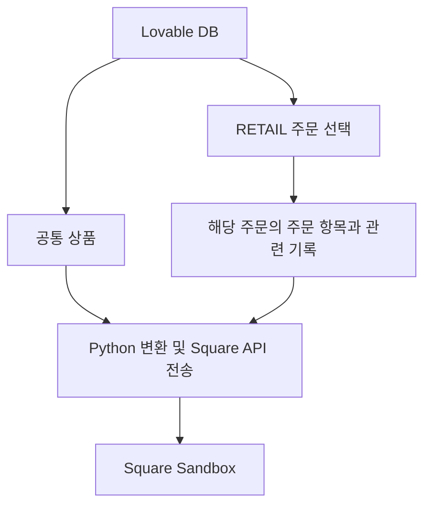
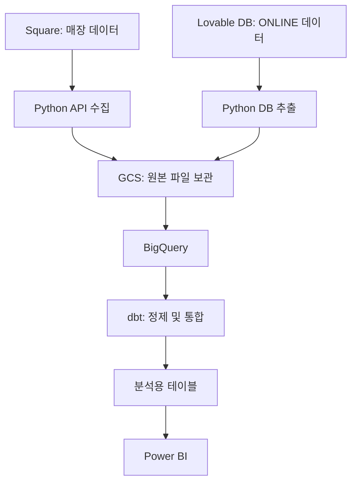

# 📝 Learning Notes

This file documents what I learned while building the project.

이 프로젝트를 진행하며 내가 직접 이해한 내용과, 왜 이런 방식으로 구현했는지를 내 언어로 정리합니다.

완성된 기능을 소개하는 README와 달리, 이 문서에는 프로젝트를 시작한 이유와 작업하면서 배운 내용을 기록합니다.

---

## 🍫 캐나다에서 Purdys에 관심을 갖게 된 이유

캐나다에 와서 흥미롭게 느낀 것 중 하나는 특별한 날에 초콜릿을 주고받는 문화와, 초콜릿을 전문적으로 판매하는 브랜드 매장을 일상에서 쉽게 볼 수 있다는 점이었습니다.

한국에서도 초콜릿을 많이 먹고 선물하지만, 제가 한국에서 생활할 때는 초콜릿 전문 매장보다 마트나 편의점에서 여러 제과회사와 해외 브랜드의 제품을 구매하는 방식이 더 익숙했습니다.

반면 캐나다에서는 여러 쇼핑몰에 초콜릿 전문 브랜드 매장이 있는 것이 눈에 들어왔습니다.

이것은 두 나라의 시장 전체를 비교한 결론이라기보다, 제가 생활하면서 느낀 차이입니다.

마침 집 근처에 Purdys 매장이 있어서 자연스럽게 관심이 생겼습니다.

> “초콜릿만 전문적으로 판매하는 브랜드는 여러 매장과 온라인몰을 어떻게 운영할까?”

처음에는 초콜릿 문화에 대한 궁금증이었지만, 점점 상품·주문·고객 데이터를 관리하는 방식도 궁금해졌습니다.

---

## 🔎 Purdys의 Square 도입을 조사하면서

Purdys를 찾아보던 중, 2025년 Square를 새로운 기술 파트너로 선정했다는 발표를 보았습니다.

### 확인한 사실

2025년 8월 21일 공식 발표에 따르면:

- 캐나다 전역 80개 이상 매장의 POS와 매장 운영에 Square를 도입했습니다.
- 다른 업무 시스템과 연결할 수 있는 Open API가 Square를 선택한 이유 중 하나였습니다.

출처: [Purdys의 Square 도입 공식 발표](https://investors.block.xyz/investor-news/news-details/2025/Purdys-Chocolatier-Elevates-In-Store-Experience-Across-Canada-With-Square/default.aspx)

### 여기서 내가 생각한 가능성

처음에는 기존 POS를 Square로 바꾸는 작업이라고 생각했습니다.

그런데 API로 다른 시스템과 연결할 수 있다는 부분을 보고 다음과 같은 생각이 들었습니다.

> “매장 데이터를 외부에서 가져올 수 있다면, 온라인몰 데이터와 함께 분석할 수도 있지 않을까?”

다만 공식 발표만으로는 다음 내용을 확인할 수 없었습니다.

- 현재 온라인몰이 어떤 플랫폼을 사용하는지
- 온라인몰에도 Square를 사용하는지
- 내부 통합 데이터 플랫폼이 어떤 구조인지
- 실제로 어떤 데이터 분석을 수행하고 있는지

따라서 아래에서 설명하는 통합 구조는 Purdys의 실제 내부 시스템이 아니라, 이 사례에서 영감을 받아 제가 프로젝트용으로 설계한 구조입니다.

---

## 🌐 내가 이해한 옴니채널 데이터 통합

온라인몰과 오프라인 매장은 서로 다른 시스템으로 운영될 수 있습니다.

중요한 것은 모든 주문을 하나의 운영 시스템에 넣는 것보다, 서로 다른 시스템의 데이터를 연결해서 같은 기준으로 볼 수 있도록 만드는 것이라고 이해했습니다.

예를 들어:

| 데이터 | 연결해서 분석해볼 내용 |
|---|---|
| 매장 주문 + 온라인 주문 | 채널별 매출과 평균 주문 금액 |
| 상품 + 주문 항목 | 채널별 인기 상품 |
| 매장 + 판매 데이터 | 지역 및 매장별 판매 차이 |
| 고객 + 주문 | 식별 가능한 고객의 채널 간 구매 행동 |
| 날짜 + 판매 데이터 | 시즌별 판매 변화 |
| 재고 + 판매 데이터 | 재고 부족 및 보충 필요 상품 |

옴니채널은 고객 경험과 운영의 연결까지 포함하는 더 넓은 개념입니다.

제 프로젝트에서는 그중 **온라인·오프라인 데이터를 연결하는 분석 기반**에 집중하려고 합니다.

---

## 🎄 초콜릿과 시즌별 데이터

초콜릿이라는 상품에서 흥미롭게 느낀 부분은 기념일과 시즌입니다.

밸런타인데이, 부활절, 크리스마스 같은 시기에 어떤 상품이 얼마나 팔리는지 비교해보고 싶었습니다.

이런 데이터를 분석하면 다음과 같은 질문으로 확장할 수 있다고 생각했습니다.

> “어떤 시기에, 어느 매장에, 어떤 상품을 얼마나 준비해야 할까?”

다만 현재 프로젝트의 데이터는 제가 만든 가상 데이터입니다.

따라서 분석 결과를 실제 초콜릿 시장의 수요나 Purdys의 판매 패턴으로 해석할 수는 없습니다.

우선 매출 데이터를 일관되게 수집하고 통합하는 것부터 구현하고, 시즌별 데이터 생성과 수요 분석은 이후에 확장할 계획입니다.

---

## 💡 프로젝트 아이디어로 연결하기

이런 내용을 조사하면서 다음 질문이 생겼습니다.

> “여러 매장과 온라인몰에서 발생하는 데이터를 하나의 분석 플랫폼으로 연결하려면 어떻게 설계해야 할까?”

실제 기업의 데이터에 접근할 수는 없기 때문에, 가상의 초콜릿 브랜드인 **Charlie's Chocolate Factory**를 만들기로 했습니다.

Lovable을 사용해서 온라인몰과 여러 매장의 POS를 흉내 낸 애플리케이션을 만들었습니다.

### 🍫 가상의 비즈니스 환경

| 구성 | 역할 |
|---|---|
| 오프라인 매장 | Vancouver, Burnaby, Richmond |
| 온라인몰 | 고객의 온라인 주문 |
| 상품 | 온라인·매장 공통 상품 |
| 고객 | 회원 정보 및 구매 기록 |
| 리워드 | 가상의 적립·사용 기록 |
| POS | 가상의 매장 주문과 결제 데이터 생성 |

[🍫 Charlie's Chocolate Factory 둘러보기](https://choco-magic-shop.lovable.app/)

웹사이트 자체가 프로젝트의 최종 목표는 아닙니다.

리테일과 비슷한 데이터가 발생하는 환경을 만들고, 그 데이터를 수집·변환·통합하는 과정을 직접 구현하는 것이 목적입니다.

---

## 🏗️ 현재 정리한 데이터 흐름

### 1. Lovable에서 두 채널의 데이터 만들기

현재 애플리케이션은 온라인 주문과 매장 주문을 같은 원본 DB에 저장합니다.

주문의 `channel` 값으로 두 종류를 구분합니다.

| `channel` | 의미 |
|---|---|
| `ONLINE` | 온라인몰 주문 |
| `RETAIL` | 오프라인 매장 주문 |

매장 주문에는 `VAN001`, `BUR001` 같은 `store_id`가 연결됩니다.

온라인 주문에는 오프라인 매장 ID가 없을 수 있고, 비회원 주문에는 고객 ID가 없을 수 있습니다.

### 2. Square에 가상의 매장 데이터 준비하기

상품은 두 채널에서 공통으로 사용하므로 Square에도 등록합니다.

주문은 `RETAIL`인 데이터만 선택해서 Square에 등록할 예정입니다.

주문 항목과 결제 데이터도 선택한 매장 주문에 해당하는 기록만 가져옵니다.



이 과정은 **분석에 사용할 가상의 매장 데이터 소스를 준비하는 단계**입니다.

현재는 공통 상품을 Square에 전송하는 부분까지 완료했습니다.

### 3. 분석할 때는 두 소스에서 따로 수집하기



이 부분은 앞으로 구현할 계획입니다.

- 매장 데이터는 Square API에서 가져옵니다.
- 온라인 주문은 Lovable DB에서 직접 가져옵니다.
- 두 데이터를 공통 구조로 정리해서 BigQuery에서 함께 분석합니다.

### 이번에 명확해진 점

처음에는 Lovable에 있는 모든 데이터를 Square로 옮겨야 한다고 생각했습니다.

하지만 프로젝트 목적을 다시 정리하면서, 온라인 주문까지 Square로 보낼 필요는 없다는 것을 이해했습니다.

**Square로 데이터를 보내는 작업과, 여러 소스에서 분석용 데이터를 수집하는 작업은 목적이 다릅니다.**

| 작업 | 목적 |
|---|---|
| Lovable → Square | 가상의 매장 운영 데이터 준비 |
| Square → 분석 플랫폼 | 매장 데이터 수집 |
| Lovable DB → 분석 플랫폼 | 온라인 데이터 수집 |
| 두 소스 통합 | 채널을 비교할 수 있는 분석 데이터 생성 |

---

## ⚙️ 구현한 작업: Lovable 상품을 Square로 전송하기

### 1️⃣ 상품 CSV 내보내기

Lovable DB의 상품 데이터를 CSV 파일로 내보냈습니다.

현재는 원본 DB에서 Python이 자동으로 데이터를 가져오는 방식이 아니라, 내보낸 CSV를 입력으로 사용하는 방식입니다.

CSV를 읽을 때는 파일에서 실제로 사용하는 구분자를 확인해야 했습니다.

### 2️⃣ Pandas로 읽고 데이터 확인하기

CSV를 Pandas DataFrame으로 읽은 뒤 다음 내용을 확인했습니다.

- 어떤 컬럼이 있는지
- 각 컬럼의 자료형이 무엇인지
- 값이 제대로 읽혔는지
- 비어 있는 값이나 중복이 있는지
- Square에 보낼 때 변환해야 하는 값이 무엇인지

이 과정에서 데이터를 읽는 것과, 그 데이터를 사용할 수 있는 상태인지 확인하는 것은 별개의 작업이라는 것을 느꼈습니다.

### 3️⃣ Square 형식으로 변환하기

Lovable의 상품 컬럼 구조와 Square API의 요청 구조는 다릅니다.

따라서 원본 값을 꺼내서 Square가 요구하는 중첩 구조로 구성해야 했습니다.

| 원본 의미 | Square 필드 |
|---|---|
| 상품명 | `item_data.name` |
| 상품 설명 | `item_data.description` |
| SKU | `item_variation_data.sku` |
| 가격 | `price_money.amount` |
| 통화 | `price_money.currency` |

예를 들어 CAD 7.25는 Square 요청에서 다음과 같이 표현합니다.

```json
{
  "amount": 725,
  "currency": "CAD"
}
```

단순히 컬럼 이름만 바꾸는 것이 아니라, 금액 단위와 데이터 구조까지 맞춰야 한다는 것을 배웠습니다.

이 작업을 **Data Transformation**과 **Source-to-Target Mapping**으로 이해했습니다.

### 4️⃣ API 요청 보내기

변환한 데이터를 Square API 요청에 사용할 수 있는 구조로 구성해서 전송했습니다.

Python에서 요청 데이터를 구성하고, API로 전송할 때 JSON 형식으로 전달하는 흐름입니다.

처음에는 상품을 하나씩 보내면서 결과를 확인했고, 이후 전체 상품을 등록했습니다.

Square에서도 생성된 상품을 확인했습니다.

### 5️⃣ 중복 상품 확인하기

기존 Square 상품의 SKU를 확인해서 같은 SKU의 상품을 다시 생성하지 않도록 처리했습니다.

다만 이 방식은 현재 **중복 생성을 피하기 위한 처리**입니다.

이미 존재하는 상품의 가격이나 설명이 바뀌었을 때 자동으로 수정하는 기능까지 구현했다는 의미는 아닙니다.

상품 업데이트는 이후 별도로 고려할 부분입니다.

### 6️⃣ Square ID 저장하기

상품 생성 후 Square가 반환한 ID를 원본 상품 ID 및 SKU와 연결해서 저장했습니다.

이 매핑이 있어야 다음 작업에서 원본 상품이 Square의 어떤 상품에 해당하는지 찾을 수 있습니다.

---

## 🔗 ID 매핑을 이해하기

두 시스템에 같은 상품이 있어도 ID는 다를 수 있습니다.

예를 들어 원본의 `p002`라는 상품과 Square가 발급한 상품 ID는 값이 다릅니다.

그래서 다음 관계를 저장해야 합니다.

| 원본 시스템 | Square |
|---|---|
| 상품 ID / SKU | Item ID |
| 상품의 판매 단위 | Item Variation ID |
| 매장 ID | Location ID |
| 고객 ID | Customer ID |
| 주문 ID | Order ID |

### Item과 Item Variation

제가 이해한 차이는 다음과 같습니다.

- **Item:** 상품 자체를 나타내는 정보
- **Item Variation:** SKU와 가격 등이 연결되는 판매 단위

현재처럼 상품에 `Regular` 옵션 하나만 있어도 Item과 Item Variation은 구분됩니다.

주문에 상품을 연결하려면 해당 **Item Variation ID**가 필요하므로, 다음 주문 작업 전에 매핑 파일에 이 값도 저장되어 있는지 확인해야 합니다.

상품 등록이 성공했다는 것과, 다음 단계에서 필요한 연결 정보가 모두 준비되었다는 것은 별도로 확인해야 한다는 점을 배웠습니다.

---

## 💻 현재 코드 역할 구분

현재는 모든 작업을 하나의 파일에 넣는 대신 역할별로 나누어 작업하고 있습니다.

| 경로 | 역할 |
|---|---|
| `src/extract/` | CSV 로드 및 원본 데이터 검증 |
| `src/transform/products.py` | 상품을 Square 요청 구조로 변환 |
| `src/square/catalog.py` | Square Catalog API 호출 |
| `src/pipelines/products_pipeline.py` | 로드·변환·전송·매핑 저장 흐름 연결 |
| `src/config/` | 설정 및 매핑 규칙 관리 |

소스 코드:

- [상품 변환](./src/transform/products.py)
- [Square Catalog API 연동](./src/square/catalog.py)
- [상품 파이프라인](./src/pipelines/products_pipeline.py)

Learning Notes에는 코드를 전부 복사하기보다, 무엇을 했고 왜 그렇게 나누었는지를 기록하려고 합니다.

---

## 🧠 중복 생성과 중복 집계는 다른 문제

이번에 구조를 정리하면서 두 종류의 중복을 구분하게 되었습니다.

### 1. Square에 같은 데이터를 다시 만드는 문제

스크립트를 다시 실행했을 때 동일한 상품이나 주문이 추가로 생성되는 문제입니다.

현재 상품은 SKU 확인으로 중복 생성을 방지하고 있습니다.

주문 연동에서도 재실행 시 같은 주문이 다시 만들어지지 않도록 처리할 계획입니다.

### 2. 분석에서 같은 주문을 두 번 계산하는 문제

Lovable의 `RETAIL` 주문을 Square에 전송하면, 같은 거래가 두 시스템에 남게 됩니다.

이 두 기록을 모두 매출로 합치면 한 주문이 두 번 집계됩니다.

따라서 분석용 주문 수집 기준을 다음과 같이 정했습니다.

| 주문 채널 | 분석에 사용할 소스 |
|---|---|
| `RETAIL` | Square |
| `ONLINE` | Lovable DB |

원본 Lovable 매장 주문은 나중에 전송 결과를 대조하는 데 활용할 수 있지만, 추가 매출로 합산하지 않습니다.

---

## 🧱 분석용 데이터 구조에 대해 새로 이해한 점

원본 시스템의 테이블을 그대로 모으는 것만으로 분석이 끝나는 것은 아닙니다.

두 시스템의 컬럼명과 ID를 맞추고, 한 행이 무엇을 의미하는지도 정해야 합니다.

현재 판매 분석 테이블인 `fact_sales`는 **주문 항목 1개당 1행**으로 만드는 방향을 생각하고 있습니다.

예를 들어 한 주문에 서로 다른 상품 두 개가 있으면 판매 테이블에는 두 행이 생깁니다.

이때 주의할 점은 다음과 같습니다.

- 판매 테이블의 행 수가 주문 수와 같지는 않습니다.
- 주문 총액을 각 상품 행에 붙인 뒤 모두 더하면 매출이 중복될 수 있습니다.
- 평균 주문 금액은 주문 단위로 계산해야 합니다.
- 고객 ID가 없는 비회원 주문도 매출 분석에는 포함해야 합니다.
- 온라인 주문을 임의의 오프라인 매장에 연결하면 안 됩니다.

구체적인 모델은 BigQuery와 dbt를 공부하면서 구현할 예정입니다.

---

## 🚦 현재 위치와 다음 작업

### 완료한 부분

- Lovable로 가상 온라인몰과 POS 구성
- 온라인·매장 주문 채널 구분
- 가상 상품 및 주문 데이터 준비
- 상품 CSV 읽기와 데이터 확인
- Square 상품 요청 형식으로 변환
- Square Sandbox에 상품 등록
- SKU 기반 중복 생성 확인
- 초기 상품 ID 매핑 저장

### 바로 다음에 할 부분

1. 상품 매핑에 Item Variation ID가 포함되어 있는지 확인
2. 매장 주문에 필요한 고객 연동
3. 내부 매장 ID와 Square Location ID 연결
4. `RETAIL` 주문 및 관련 주문 항목 선택
5. Square에 주문 생성
6. Sandbox 결제 처리 방식 구현
7. ID 매핑과 전송 결과 확인

고객·매장 연결을 준비한 다음 주문을 처리하는 이유는, 주문이 다른 데이터의 ID를 참조하기 때문입니다.

### 이후 학습하면서 구현할 부분

- Square API에서 분석용 데이터 추출
- Lovable DB에서 온라인 데이터 직접 추출
- GCS에 원본 데이터 저장
- BigQuery 적재
- dbt를 통한 정제 및 통합
- 데이터 품질 확인
- Kestra 실행 자동화
- Power BI 대시보드

---

## 🎯 이 프로젝트에서 배우고 싶은 것

> Build a simplified omnichannel commerce data platform that integrates physical-store and online transaction data.

여러 기술을 사용했다는 사실보다 다음 질문에 직접 답할 수 있는 것이 목표입니다.

| 질문 | 내가 이해하고 싶은 내용 |
|---|---|
| 왜 수집하는가? | 어떤 비즈니스 질문에 답하기 위한 데이터인지 |
| 어디서 가져오는가? | 채널별 원본 시스템과 수집 범위 |
| 어떻게 연결하는가? | ID 매핑과 공통 데이터 구조 |
| 어떻게 믿을 수 있는가? | 누락·중복·금액 오류 검증 |
| 어떻게 반복 실행하는가? | 증분 수집과 실행 자동화 |
| 어떻게 활용하는가? | 매장·상품·채널별 분석 |

현재 완료한 상품 연동은 전체 프로젝트의 기초 단계입니다.

앞으로는 데이터를 보내는 작업에서 더 나아가, 여러 소스에서 데이터를 가져와 같은 기준으로 분석할 수 있도록 만드는 과정을 배우려고 합니다.

---

## 🚀 프로젝트를 시작한 흐름

1. 캐나다의 초콜릿 문화와 전문 매장에 관심이 생겼습니다.
2. 집 근처 Purdys를 찾아보다 Square 도입 사례를 알게 되었습니다.
3. 매장과 온라인몰 데이터를 연결하는 방식이 궁금해졌습니다.
4. Lovable로 가상의 초콜릿 판매 환경을 만들었습니다.
5. Python으로 상품 데이터를 Square에 전송했습니다.
6. 이제 두 채널을 통합하는 데이터 파이프라인으로 확장하려고 합니다.

이 프로젝트는 비즈니스에 대한 궁금증에서 시작해서, 직접 만든 가상 데이터를 활용하며 데이터 엔지니어링을 배우는 학습 프로젝트입니다.

---

## 🔗 Project Links

🍫 **Live Demo**  
[Charlie's Chocolate Factory](https://choco-magic-shop.lovable.app/)

💻 **Data Engineering Repository**  
[chocolate-commerce-data-platform](https://github.com/smmhk/chocolate-commerce-data-platform)

📖 **Project Overview**  
[English README](./README.md) · [한국어 README](./README.ko.md)