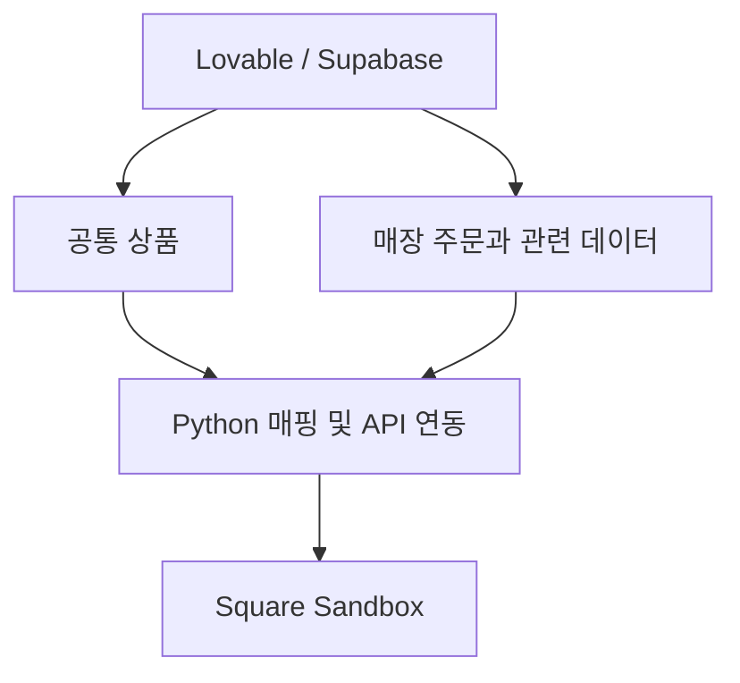
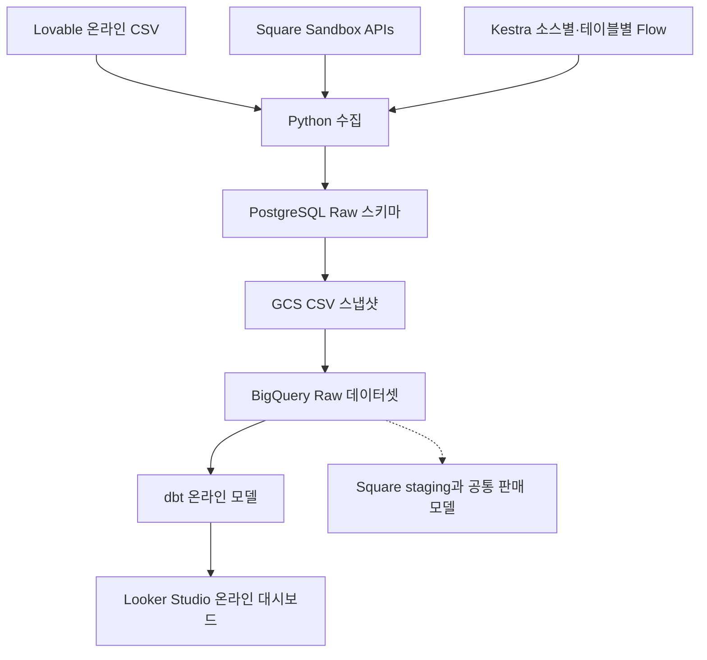
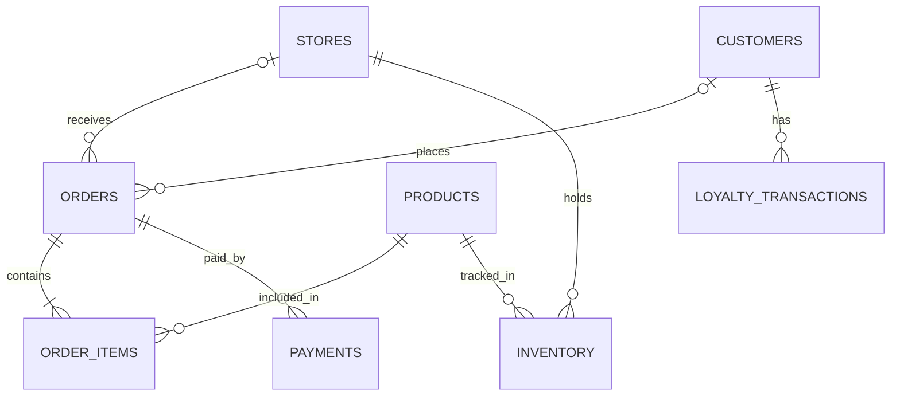
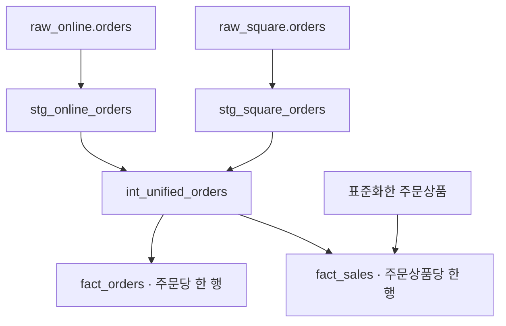

# 🍫 Charlie’s Chocolate Factory — 옴니채널 리테일 데이터 플랫폼

> 초콜릿 쇼핑몰과 매장 POS로 만들어 보는 리테일·이커머스 데이터 엔지니어링 포트폴리오

이커머스 백엔드 일을 하면서 주문이 만들어지는 쪽을 다뤘는데, 이번에는 **그 주문이 분석 데이터로 쓰이기까지 어떤 과정을 거치는지** 직접 만들어보고 싶었어요. 그래서 Purdys Chocolatier처럼 온라인과 오프라인 매장이 있는 리테일 사례를 참고해, 가상의 초콜릿 가게를 만들었어요.

온라인 주문은 Lovable에서 CSV로 내보내고, 매장 주문은 Square Sandbox API로 가져와요. 두 데이터를 Python, PostgreSQL, Kestra를 거쳐 BigQuery까지 적재했고, 온라인 쪽은 dbt 모델과 Looker Studio 대시보드까지 연결했어요.

> 이 프로젝트는 실제 기업과 무관한 개인 포트폴리오예요. 주문·고객·결제 기록은 모두 합성 데이터이고 Square 연동에는 Sandbox를 사용해요.

## 🚀 지금 어디까지 왔나요?

- ☁️ **수집·적재** — 온라인 5개와 Square 4개, 총 **9개 Raw 테이블**을 BigQuery에 적재했어요.
- 📊 **온라인 분석** — 첫 dbt staging 뷰를 검증했고, 상품 판매량 mart를 Looker Studio에 연결했어요.
- 🏪 **다음 작업** — 가상 매장 3곳의 완료 주문과 판매일을 확인하고, 온라인과 매장을 같은 기준으로 비교할 수 있도록 dbt 모델을 만들고 있어요.

[📊 온라인 판매 대시보드 보기](https://datastudio.google.com/s/mVx1mF2GxU4)
[🌐 프로젝트 둘러보기](https://chocolate-commerce-v0-1-en.vercel.app/) · [📊 온라인 판매 대시보드 보기](https://datastudio.google.com/s/mVx1mF2GxU4)

_진행 상황 기준일: 2026년 11월 20일, 밴쿠버. 데이터 건수는 아래에 표시한 조회 시점의 스냅샷이에요._

---

## ✨ 어떤 프로젝트인가요?

**Charlie’s Chocolate Factory**는 온라인 쇼핑몰과 오프라인 매장을 운영하는 가상의 캐나다 초콜릿 브랜드예요. 쇼핑몰에는 상품 조회, 장바구니, 주문, 회원 계정과 적립 포인트를 넣었고, 매장 주문은 별도 POS 화면에서 만들 수 있게 했어요.

| 채널 | 데이터가 들어오는 곳 | 분석용 적재 경로 |
|---|---|---|
| `ONLINE` | Lovable 온라인 쇼핑몰 | CSV → PostgreSQL → GCS → BigQuery `raw_online` |
| `RETAIL` | Lovable POS에서 준비한 Square Sandbox 주문 | Square API → PostgreSQL → GCS → BigQuery `raw_square` |

### 🎯 이 데이터로 보고 싶은 것

- 온라인과 매장 매출은 얼마나 차이가 날까?
- 매장별로 잘 팔리는 상품이 다를까?
- 채널별 평균 주문 금액은 얼마일까?
- 같은 고객이 온라인과 매장에서 각각 어떻게 구매할까?
- 시즌이나 날짜에 따라 판매량은 어떻게 달라질까?

재고 모니터링과 수요 예측은 이후에 확장해보고 싶은 주제예요.

## 🗺️ 6단계 로드맵

| 단계 | 작업 | 진행 상황 |
|---|---|---|
| 1. 🛍️ 소스 만들기 | 온라인 쇼핑몰, POS 시뮬레이터, Square ID 매핑 | ✅ 초기 범위 구현 |
| 2. 🐘 로컬 적재 | 온라인 CSV와 Square API 데이터를 PostgreSQL에 저장 | ✅ 두 소스 적재 |
| 3. ⚙️ 워크플로 | Kestra에서 소스별 상위 Flow와 테이블별 Flow 실행 | ✅ Raw 적재 Flow 검증 |
| 4. ☁️ 클라우드 적재 | PostgreSQL → GCS → BigQuery | ✅ Raw 9개 테이블 적재 |
| 5. 🧱 dbt 모델링 | Staging부터 공통 주문·상품·고객 모델까지 구축 | 🚧 온라인 첫 staging 뷰와 상품 mart 확보 |
| 6. 📊 리포트 | Looker Studio에서 주문과 상품 지표 시각화 | 🚧 온라인 데모 공개용 리포트 확보, POS 비교 준비 중 |

[프로젝트 진행 기록](docs/PROJECT_PROGRESS_KO.md) · [Kestra 작업 노트](docs/phase-3-kestra-orchestration-ko.md)

---

## 🏗️ 데이터 흐름

### 1. Square에 매장 테스트 데이터 준비하기

Lovable에서 두 채널의 테스트 데이터를 만들어요. Square에는 공통 상품과 `RETAIL` 주문, 그리고 그 주문에 필요한 관련 데이터를 보내요. 이 단계에서 받은 Square ID는 이후에 상품이나 고객, 주문을 연결할 때 다시 사용해요.



### 2. 분석용 데이터 수집하기



Kestra에서는 Online과 Square를 각각 상위 Flow로 관리해요. 상위 Flow가 호출하는 테이블별 Flow에서 CSV 내보내기, GCS 업로드, BigQuery 로드, 검증을 진행해요. 점선으로 표시한 Square staging과 공통 판매 모델은 다음 작업 범위예요.

### 📌 채널을 나누는 기준

- 온라인 주문은 Lovable의 `ONLINE` CSV를 기준으로 가져와요. 원본 DB에서 직접 추출하는 방식은 이후에 검토해요.
- 매장 주문은 Square API를 기준으로 가져와요. 처음 POS에서 만든 주문과 Square에 보낸 주문이 매출에 두 번 잡히지 않도록 채널별 분석 소스를 지정했어요.
- 주문과 관련 상품행·결제 기록을 선택할 때는 원본 주문 ID를 기준으로 연결해요. 원본 ID와 Square ID 매핑은 대사에 쓸 수 있도록 보관해요.

---

## 🛍️ 1단계 — 온라인 쇼핑몰과 POS 만들기

### 온라인 쇼핑몰

Lovable로 상품 상세 페이지, 장바구니, 주문, 회원 계정, 주문 내역, 포인트 적립을 만들었어요. 이 과정에서 주문과 주문상품 외에 고객, 고객 주소, 결제, 적립 기록도 생겨요. 현재 온라인 파이프라인에는 필요한 데이터를 CSV로 내보내서 전달해요.

### 매장 POS

POS 화면에서 만든 매장 데이터를 Python으로 골라 Square 요청 형식으로 바꾼 뒤 API로 전송해요. 테스트 주문을 준비할 때는 Square가 데이터를 받는 쪽이고, 분석 파이프라인을 실행할 때는 Square가 원천이 돼요.

| 가상 매장 | 내부 매장 ID |
|---|---|
| 🏙️ 다운타운 밴쿠버 | `VAN001` |
| 🌆 버나비 | `BUR001` |
| 🌉 리치몬드 | `RIC001` |

내부 매장 ID는 Square Location ID와 연결해요. 프로젝트에서 비교할 가상 매장은 3곳이고, Square에서 조회한 Location 스냅샷에는 테스트 위치를 포함해 5개가 있었어요.

### 원천 데이터와 테스트 파일

| 데이터 | 역할 |
|---|---|
| `stores` | 오프라인 매장 기준 정보 |
| `products` | 두 채널에서 함께 쓰는 상품 정보 |
| `customers`, `customer_addresses` | 회원 정보와 주소 |
| `orders`, `order_items` | 채널별 주문과 주문 안의 상품행 |
| `payments` | 합성 결제 기록 |
| `inventory` | 재고 기록 |
| `loyalty_transactions`, `loyalty_settings` | 포인트 거래 내역과 적립 설정 |
| `tax_settings` | 원천 시스템 세금 설정 |

합성 데이터는 `products.csv`, `customers.csv`, `customer_addresses.csv`, `stores.csv`, `orders.csv`, `order_items.csv`, `payments.csv`, `loyalty_settings.csv`, `loyalty_transactions.csv`, `tax_settings.csv` 등으로 준비해요. 온라인 주문의 `store_id`와 비회원 주문의 `customer_id`는 비어 있을 수 있어요. 초기 웨어하우스 범위는 주문·상품·고객 중심이에요.

## 🔌 Square Sandbox 연동

| 원천 데이터 | Square API | 현재 범위 |
|---|---|---|
| 상품 | Catalog API | 공통 카탈로그 연동 |
| 매장 | Locations API | Square Location과 내부 매장 ID 매핑 |
| 고객 | Customers API | 테스트 고객 연동과 고객 ID 매핑 |
| 매장 주문·주문상품 | Orders API | API 추출과 PostgreSQL·BigQuery 적재 확인 |
| 매장 결제 | Payments API | 후속 Sandbox 시나리오 |
| 재고 | Inventory API | 이후 확장 |

### 🍫 상품을 Square에 넣는 과정

1. 상품 CSV를 Pandas로 읽고 필요한 값을 확인해요.
2. 상품과 옵션을 Square Catalog 요청 형식으로 변환해요.
3. 기존 SKU를 확인한 뒤 필요한 상품을 Square Sandbox에 전송해요.
4. 응답으로 받은 Item ID와 Item Variation ID를 저장해요. 주문상품을 카탈로그에 붙일 때는 **Variation ID**가 필요해요.

| 원본 값 | Square 필드 | 예시 |
|---|---|---|
| 상품명 | `item_data.name` | Midnight Dark Chocolate Bar |
| SKU | `item_variation_data.sku` | `CCF-BAR-002` |
| 가격 | `price_money.amount` | `7.25` CAD → `725`센트 |
| 통화 | `price_money.currency` | `CAD` |

상품 ID/SKU, 내부 매장 ID, 원본 고객 ID, 원본 주문 ID를 각각 대응하는 Square ID와 연결해요.

### 🧩 원천 데이터 관계

아래는 프로젝트에서 사용하는 논리적 관계예요. 온라인 주문과 비회원 주문을 표현할 수 있도록 매장이나 회원 연결은 선택적으로 둬요.



---

## 🐘 2단계 — PostgreSQL에 원천 데이터 적재하기

Docker에서 실행하는 PostgreSQL의 `chocolate_db` 안에 온라인과 Square Raw 스키마를 따로 뒀어요.

| 온라인 입력 파일 | PostgreSQL 테이블 | 가져오는 기준 |
|---|---|---|
| `products_export.csv` | `raw_online.products` | 전체 상품 |
| `customers_export.csv` | `raw_online.customers` | 기존 내보내기 규칙의 온라인 가입 고객 |
| `customer_addresses_export.csv` | `raw_online.customer_addresses` | 선택한 고객의 주소 |
| `orders_export.csv` | `raw_online.orders` | `channel = ONLINE` |
| `order_items_export.csv` | `raw_online.order_items` | 선택한 주문의 비즈니스 `order_id` |

CSV 읽기, 채널 필터링, PostgreSQL 적재를 분리했어요. 온라인 테이블은 **테이블마다 한 트랜잭션에서 `DELETE + INSERT`**를 실행해 스키마를 유지하면서 데이터를 새로 채워요. 여러 테이블을 실행할 때도 트랜잭션 범위는 각 테이블이고, 원천에 있는 중복은 그대로 들어올 수 있어요.

Square에서는 Catalog Objects, Customers, Locations, Orders를 `raw_square`에 저장해요. 주문상품은 주문 payload에 있는 배열을 보존하고, 분석용으로 펼치는 작업은 dbt staging에서 진행해요.

### 로컬에서 실행하기

저장소 루트에서 PostgreSQL 스키마와 마이그레이션을 적용하고 입력 CSV를 준비해요.

```bash
pip install -r requirements.txt

# 지원하는 온라인 테이블 전체
python -m src.pipelines.ingestion.online.load_tables_to_postgres

# 상품 테이블만
python -m src.pipelines.ingestion.online.load_tables_to_postgres --tables products
```

`--tables`는 적재할 테이블을 고르는 옵션이에요. 상품만 지정해도 현재 코드는 입력 CSV 5개를 모두 읽어요. 실행하면 선택한 PostgreSQL 테이블의 행이 CSV 기준으로 교체돼요.

## ⚙️ 3단계 — Kestra로 실행하기

처음에는 온라인 상품 적재부터 붙였어요. Docker Desktop을 실행하고 Compose로 프로젝트 서비스를 올린 뒤, 로컬 Kestra의 `chocolate` 네임스페이스에서 `online_products_to_postgres`를 실행했어요. Kestra가 Python 3.14.0 작업 컨테이너에서 기존 Python 모듈을 실행했고, PostgreSQL에 상품 **15행**이 들어간 걸 확인했어요.

```bash
python -m src.pipelines.ingestion.online.load_tables_to_postgres --tables products
```

```text
[SUCCESS] raw_online.products loaded (15 rows)
[DONE] Online → PostgreSQL ingestion
Command succeed with exit code 0
```

작업 컨테이너는 Compose 네트워크에서 `postgres`로 접속하고, Windows에서 Python을 직접 실행할 때는 `localhost`를 사용해요. 프로젝트 DB와 Kestra 메타데이터 DB는 별도 서비스예요. 이후에는 `chocolate.online_raw_ingestion`과 `chocolate.square_raw_ingestion`을 만들어 소스별로 테이블 Flow를 묶었어요.

| 적재 메타데이터 | 의미 |
|---|---|
| `ingested_at` | 이번 적재의 UTC 시각 |
| `orchestrator` | `local` 또는 `kestra` |
| `pipeline_run_id` | 로컬 UUID 또는 Kestra 실행 ID |

온라인 5개 테이블에 메타데이터를 추가하는 SQL은 `sql/migrations/001_add_ingestion_metadata.sql`에 있어요. 원본 주문의 `created_at`·`updated_at`은 그대로 두고, 적재 시각은 별도로 기록해요. 전체 갱신 후 테이블에는 마지막 적재의 메타데이터가 남아요.

[Kestra 초기 실행 기록](docs/phase-3-kestra-orchestration-ko.md) · [상위 Flow 작업](https://smmhk21.atlassian.net/browse/CHOC-20)

## ☁️ 4단계 — GCS와 BigQuery로 보내기

PostgreSQL 데이터를 CSV 스냅샷으로 내보내 GCS에 올린 뒤, BigQuery의 `raw_online`과 `raw_square`에 적재해요. 적재 검증에서는 GCS CSV와 BigQuery 테이블을 비교해요.

### 📦 BigQuery에서 확인한 테이블

**2026년 11월 15일** 조회 기준이에요. 합성 데이터를 다시 적재하면 건수는 달라질 수 있어요.

| `raw_online` | 행 수 | `raw_square` | 행 수 |
|---|---:|---|---:|
| `orders` | 600 | `orders` | 19 |
| `order_items` | 1,544 | `catalog_objects` | 15 |
| `products` | 15 | `customers` | 175 |
| `customers` | 88 | `locations` | 5 |
| `customer_addresses` | 88 | | |

새 데이터가 들어올 때는 건수와 키 관계를 다시 확인하고, 문제가 생겼을 때 어느 실행인지 찾을 수 있도록 원본 ID와 실행 메타데이터를 남겨요. 재실행, 오류 복구, 로깅 개선은 리팩토링 일감에서 관리하고 있어요. [CHOC-28](https://smmhk21.atlassian.net/browse/CHOC-28)

---

## 🧱 5단계 — dbt로 분석 모델 만들기

`chocolate_dbt/`에서 작업해요. 먼저 `dbt_dev.stg_online_orders`를 만들고 BigQuery에서 확인했어요. 온라인 상품 리포트에는 `mart_online_product_sales`를 연결했어요.

| 계층 | 여기서 하는 일 |
|---|---|
| Raw | 소스에서 가져온 값과 ID 보존 |
| Staging | 타입, 컬럼명, 상태값을 소스별로 정리 |
| Intermediate | 고객·상품 ID 연결, 주문과 주문상품 기준 맞추기 |
| Marts | 판매 분석에 필요한 fact, dimension, 집계 모델 제공 |

### Online과 Square를 합치는 방식

소스별 staging에서 필드를 맞춘 다음 공통 주문 모델로 합칠 계획이에요. 원본 주문 ID, 상품행 ID, `source_system`, `channel`을 남겨 어느 소스에서 들어왔는지 추적할 수 있게 해요.



| 예정 모델 | 한 행의 의미 또는 용도 |
|---|---|
| `fact_orders` | 주문 1건. 주문 수, 주문 금액, 평균 주문 금액 계산 |
| `fact_sales` | 주문상품 1줄. 상품 수량과 판매 분석 |
| `dim_product` | 두 채널에서 공통으로 쓰는 상품 정보 |
| `dim_customer` | 명시적인 키로 연결한 고객 정보 |
| `dim_store` | 매장별 정보 |
| `dim_date` | 달력과 시즌 분석에 필요한 날짜 정보 |

주문 모델에는 `order_key`, `source_system`, `source_order_id`, `customer_key`, `store_key`, `channel`, `order_date`, `order_status`, `subtotal`, `tax`, `total` 같은 필드를 둘 계획이에요. 온라인 주문은 매장 키 없이, 비회원 주문은 고객 키 없이도 집계에 남겨요. 주문당 여러 상품행이나 결제 기록을 붙일 때 주문 금액이 반복 합산되지 않도록 주문 건수와 평균 주문 금액은 주문 단위로 계산해요. 할인·세금·배송비·환불·주문 상태의 처리 기준도 채널 비교 전에 맞춰야 해요.

### 🧪 실제 데이터를 보면서 확인한 것

- **온라인 주문상품 키** — 1,544줄 모두 주문의 비즈니스 `order_id`와 상품의 `product_id`에 연결됐어요. 고객 주소 88행도 모두 `customers.id`로 연결됐어요.
- **Square 주문상품 키** — 상품행 47줄이 모두 Catalog의 Variation ID에 연결됐어요. `(square_order_id, line_item_uid)` 조합도 47줄에서 중복이 없었어요.
- **고객 ID 불일치** — 온라인 주문 600건 중 직접 연결된 주문이 278건, 고객 테이블에 ID가 없던 회원 주문이 262건, 비회원 주문이 60건이었어요. 회원 주문 262건이 참조한 서로 다른 ID 78개를 Square 고객의 `reference_id`에서 모두 찾았어요. 이 키를 사용해 `unified_customer_id`를 만드는 게 다음 작업이에요.
- **POS 완료 매출** — 당시 Square 주문 19건은 모두 `OPEN`이어서 완료 매출 집계에서 제외해요. 매장별 판매 추이를 내려면 테스트 데이터에서 의도한 판매일도 확인해야 해요.

[고객 ID 조사](https://smmhk21.atlassian.net/browse/CHOC-41) · [고객 동기화 후속 작업](https://smmhk21.atlassian.net/browse/CHOC-42)

## 📊 6단계 — Looker Studio 대시보드

온라인 대시보드에서 주문 수와 주문 금액, 월별 추이, 판매 수량 상위 상품, 카테고리별 판매 수량을 볼 수 있어요. 상품 리포트는 BigQuery의 `mart_online_product_sales`를 사용해요.

데모에서는 스토어 주문 `CCF-WEB-000014`를 BigQuery에서 찾아봤어요. 조회 결과는 `COMPLETED`, 주문 총액은 **CAD 80.72**였어요. 별도 dbt 쿼리에서는 **2026년 9월 8일**의 상품별 판매 수량을 확인했어요. 주문 총액은 주문 단위로 보고, 판매 수량은 주문상품 단위에서 집계해요.

[🍫 Looker Studio 대시보드 열기](https://datastudio.google.com/s/mVx1mF2GxU4)

| 계획 중인 집계 모델 | 보고 싶은 내용 |
|---|---|
| `mart_daily_sales` | 날짜별 매출 추이 |
| `mart_store_sales` | 매장별 성과 |
| `mart_online_sales` | 온라인 주문과 매출 |
| `mart_product_performance` | 두 채널의 상품별 판매 성과 |
| `mart_customer_metrics` | 연결된 고객의 구매 패턴 |
| `mart_channel_performance` | 온라인과 매장의 주문 수·매출·평균 주문 금액 비교 |

---

## 🛠️ 사용한 도구

| 영역 | 도구 |
|---|---|
| 쇼핑몰과 POS | Lovable, React, Supabase |
| API 연동과 데이터 처리 | Square Sandbox API, Python, Pandas |
| 로컬 환경과 적재 | PyCharm, Docker Compose, PostgreSQL, SQLAlchemy, psycopg2 |
| 파이프라인 실행 | Kestra |
| 클라우드 저장소와 웨어하우스 | Google Cloud Storage, BigQuery |
| 모델링과 시각화 | dbt, Looker Studio |
| 버전과 작업 관리 | Git, GitHub, Jira |

## 📁 저장소 구조

소스 시스템 준비, 수집, 내보내기, 검증 코드를 데이터가 이동하는 방향에 따라 나눴어요.

```text
chocolate-commerce-data-platform/
├── src/
│   ├── clients/square/           # Square API 통신과 인증 설정
│   ├── common/logging.py        # 공통 로그와 실행 메타데이터
│   ├── config/paths.py          # 프로젝트 기준 경로
│   ├── extract/                 # CSV 읽기
│   │   ├── csv_reader.py
│   │   └── online/read_source_tables.py
│   ├── transform/
│   │   ├── online/select_channel_records.py
│   │   └── square/*_payload.py  # Square 요청 데이터 변환
│   ├── load/postgres/
│   │   ├── connection.py
│   │   ├── online/replace_table.py
│   │   └── square/upsert_*.py
│   ├── snapshots/               # CSV 추출·BigQuery 비교 공통 구현
│   │   ├── online.py
│   │   └── square.py
│   └── pipelines/              # 실행 진입점
│       ├── source_to_square/   # CSV → Square 시뮬레이션 데이터 준비
│       ├── ingestion/          # 원천 → PostgreSQL
│       │   ├── online/
│       │   └── square/
│       ├── export/             # PostgreSQL → CSV
│       │   ├── online/
│       │   └── square/
│       └── validation/         # GCS CSV ↔ BigQuery 검증
│           ├── online/
│           └── square/
├── scripts/
│   ├── inspect/square/         # API 응답 조사
│   └── manual/square/          # 실제 API·CSV 변경이 있는 수동 연동 확인
├── tests/                      # 외부 서비스 없이 실행하는 자동 검사
├── data/sample/
├── sql/
├── chocolate_dbt/
├── docs/
├── docker-compose.yml
└── requirements.txt
```

PostgreSQL을 새로 띄울 때는 초기 스키마와 마이그레이션을 순서대로 적용해요. 기존 DB에는 적용하지 않은 마이그레이션만 실행하면 돼요. 로컬 Raw 파일과 생성된 payload는 Git에서 제외하고, 공유할 합성 예제 데이터는 `data/sample/`에 둬요. [저장소 구조와 마이그레이션 가이드](docs/REPOSITORY_STRUCTURE_KO.md)

## ▶️ 첫 dbt 모델 실행하기

BigQuery adapter가 설치된 Python 환경과 Google Cloud 기본 애플리케이션 사용자 인증(ADC), 프로젝트에 맞는 로컬 dbt 프로필이 필요해요. 작업 기록에서 사용한 개발 데이터셋은 `us-east1`의 `dbt_dev`예요.

```bash
python -m pip install dbt-bigquery
gcloud auth application-default login
cd chocolate_dbt
dbt debug
dbt run --select stg_online_orders
```

## 🔐 인증 정보

Square Sandbox 토큰과 DB 접속 정보는 환경변수나 로컬 `.env`에 넣어요. Kestra 컨테이너는 bind mount로 프로젝트의 설정을 읽고, 컨테이너 네트워크에서 접속할 때는 DB 호스트를 `postgres`로 지정해요.

```text
SQUARE_ACCESS_TOKEN=your_sandbox_token
CHOCOLATE_DB_PASSWORD=your_local_database_password
CHOCOLATE_DB_HOST=localhost
CHOCOLATE_DB_PORT=5432
CHOCOLATE_DB_USER=chocolate
CHOCOLATE_DB_NAME=chocolate_db
```

실제 인증 정보가 담긴 `.env`는 Git에서 제외해요. `.env.example`을 커밋할 때는 예시 값만 넣어요.

## 💡 하면서 배운 점

처음에는 상품 15행을 Kestra로 적재하는 것부터 시작했어요. 그때는 실행이 성공하고 데이터가 들어오는 것부터 확인했는데, 주문과 고객을 붙이면서는 **어떤 키를 쓰고 어떤 행을 남길지**를 결정하는 일이 더 중요해졌어요.

온라인 주문상품은 컬럼 이름이 비슷한 내부 `id`에 붙이면 연결이 안 됐고, 실제로 맞는 키는 비즈니스 `order_id`였어요. 고객도 온라인 고객 테이블만 보면 빠지는 주문이 많았는데, Square의 `reference_id`까지 확인하니 어디에서 연결할 수 있는지 보였어요. 이런 결정과 시행착오는 `docs/study/`에 정리하고 있어요.

## 🎯 v1.0.0까지 남은 일

1. **매장 데이터 확인** — 3개 매장용 테스트 주문을 적재한 뒤 완료 상태, 판매일, 상품 키를 확인해요.
2. **공통 모델 검증** — Online과 Square staging을 테스트하고, 주문·상품행의 단위를 맞추고, 고객 ID 매핑을 적용해요.
3. **대시보드 대사** — 온라인과 POS의 주문 수와 매출이 쿼리 결과와 맞는지 비교해요.
4. **실행 과정 문서화** — 원천부터 대시보드까지 다시 실행할 수 있게 정리한 뒤 첫 릴리스를 남겨요.

결제·환불 분석, 재고와 수요 예측, Pub/Sub나 Kafka를 활용한 준실시간 수집은 이후에 더 해보고 싶은 작업이에요.

### 🍫 초콜릿 주문 한 건에서 시작한 데이터 프로젝트
