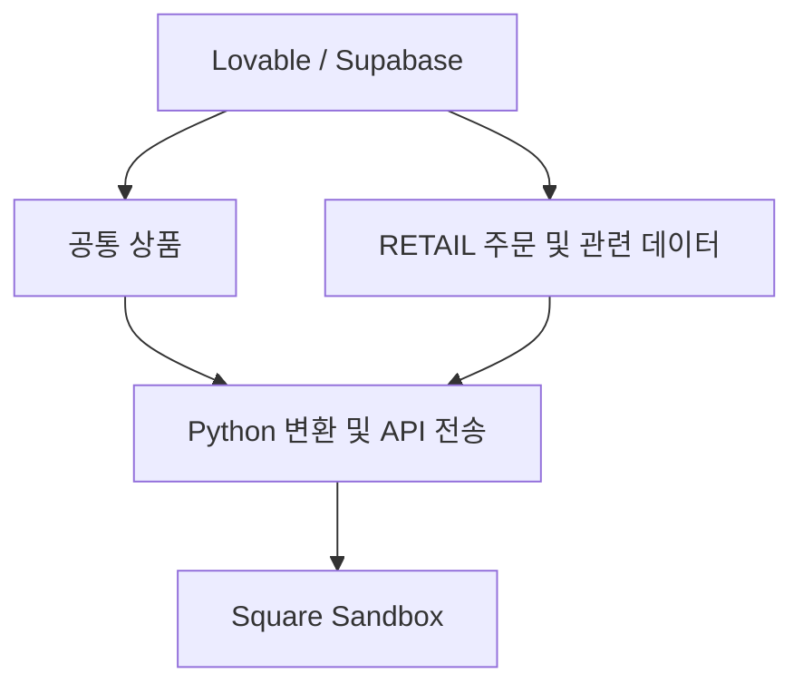
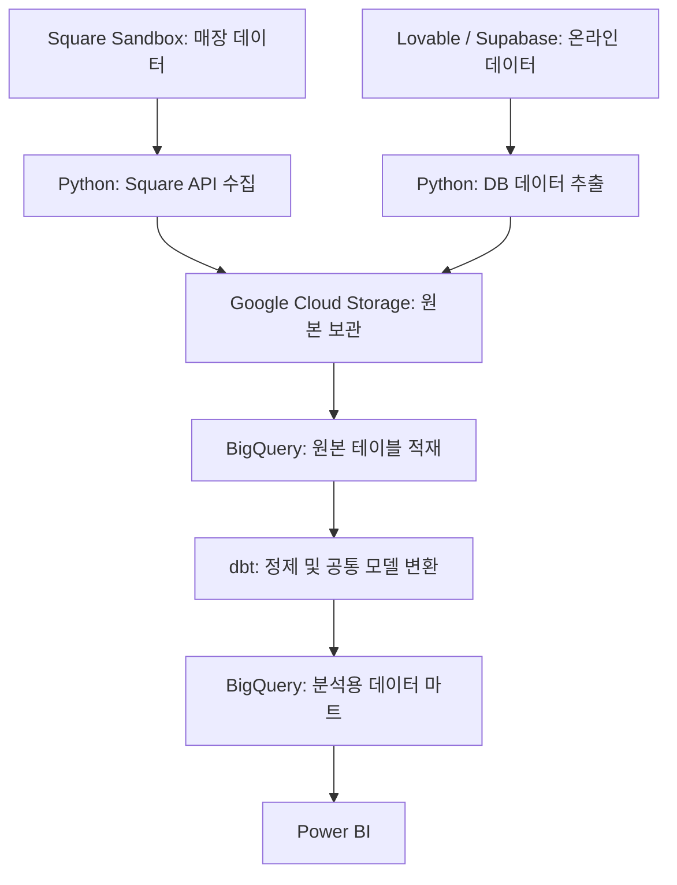
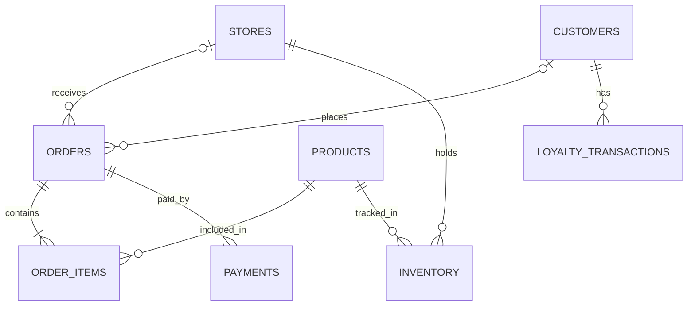

# 🍫 Charlie's Chocolate Factory — 옴니채널 리테일 데이터 플랫폼

> **오프라인 매장과 온라인몰 데이터를 통합하는 데이터 엔지니어링 포트폴리오**

가상의 초콜릿 브랜드를 바탕으로, 오프라인 매장과 온라인몰에서 발생하는 데이터를 수집하고 통합하여 분석에 활용하는 프로젝트입니다.

Lovable로 만든 온라인몰·POS 시스템과 Square Sandbox를 데이터 소스로 사용하고, 앞으로 GCP와 BigQuery를 활용해 분석용 데이터 파이프라인을 구축할 예정입니다.

> **안내**
> 이 프로젝트는 가상의 데이터만 사용하는 개인 포트폴리오입니다.
> Purdys Chocolatier 또는 다른 기업과 관련이 없으며, 특정 기업의 실제 내부 시스템을 그대로 재현한 프로젝트가 아닙니다.

---

## ✨ 프로젝트 소개

**Charlie's Chocolate Factory**는 다음과 같은 기능을 갖춘 가상의 캐나다 초콜릿 브랜드입니다.

- 🏪 여러 지역의 오프라인 매장
- 🛒 고객이 직접 주문하는 온라인몰
- 👥 고객 계정과 리워드
- 📦 상품과 재고 관리
- 💳 가상의 주문 및 결제 기록

Lovable로 만든 애플리케이션에는 온라인 주문과 오프라인 매장 주문이 함께 저장됩니다. 주문의 `channel` 값으로 두 경로를 구분합니다.

| 주문 채널 | 의미 | 향후 분석용 데이터를 가져올 곳 |
|---|---|---|
| `RETAIL` | 오프라인 매장 POS 주문 | Square Sandbox API |
| `ONLINE` | 온라인몰 주문 | Lovable / Supabase 데이터베이스 |

먼저 Python으로 공통 상품과 매장 주문 관련 데이터를 Square Sandbox에 등록합니다.

이후 분석 단계에서는 **매장 데이터는 Square에서, 온라인 데이터는 Lovable DB에서 각각 수집**하고 하나의 분석 구조로 통합합니다.

### 🎯 분석하고 싶은 질문

- 온라인과 오프라인 중 어느 채널의 매출이 더 높은가?
- 어느 오프라인 매장의 실적이 가장 좋은가?
- 채널별로 잘 팔리는 상품은 무엇인가?
- 채널별 평균 주문 금액은 얼마인가?
- 동일한 고객이 온라인과 매장에서 어떻게 구매하는가?
- 날짜나 시즌에 따라 매출이 어떻게 달라지는가?

재고 모니터링과 수요 예측은 향후 확장할 계획입니다.

---

## 🏗️ 전체 아키텍처

### 1. 가상의 매장 데이터를 Square에 준비하기

Lovable에서 생성한 데이터 중 매장 주문과 관련된 데이터만 골라 Square에 등록합니다.

상품은 온라인과 매장에서 공통으로 사용하므로 Square에도 등록합니다.



이 단계는 **Square를 가상의 매장 POS 데이터 소스로 사용할 수 있도록 준비하는 과정**입니다.

### 2. 두 채널의 데이터를 수집하고 통합하기 — 구현 예정



각 도구의 역할은 다음과 같습니다.

| 도구 | 이 프로젝트에서 하는 일 |
|---|---|
| Python | API나 DB에서 데이터를 가져오고 필요한 형태로 처리 |
| Google Cloud Storage | 수집한 원본 파일을 보관 |
| BigQuery | 데이터를 테이블로 저장하고 SQL로 조회 |
| dbt | BigQuery 데이터를 정제하고 분석용 테이블로 변환 |
| Power BI | 분석 결과를 차트와 대시보드로 표현 |
| Kestra | 위 작업을 정해진 순서와 시간에 실행하도록 관리 |

### 데이터 처리 범위

- 공통 상품은 Square에 등록합니다.
- Square로 보낼 주문은 `RETAIL`만 선택합니다.
- 주문 항목과 결제 기록도 선택한 매장 주문에 해당하는 데이터만 처리합니다.
- `ONLINE` 주문은 Square로 보내지 않고 원본 DB에서 직접 수집합니다.
- 최종 분석에서 매장 매출은 Square에서 수집한 데이터를 사용합니다.
- Lovable에 남아 있는 동일한 매장 주문을 다시 합산하지 않습니다.
- 원본 ID와 Square ID의 연결 정보를 저장해 데이터 관계를 유지합니다.

---

## 🛍️ 원본 시스템

### 오프라인 매장

| 매장 | 내부 매장 ID |
|---|---|
| 🏙️ Downtown Vancouver | `VAN001` |
| 🌆 Burnaby | `BUR001` |
| 🌉 Richmond | `RIC001` |

내부 매장 ID는 Square에서 사용하는 Location ID와 연결합니다.

예를 들어 `VAN001`과 Square Location ID가 서로 달라도, 매핑 정보를 통해 같은 매장으로 인식할 수 있도록 합니다.

### 주요 원본 데이터

| 테이블 | 역할 |
|---|---|
| `stores` | 오프라인 매장 정보 |
| `products` | 온라인·매장 공통 상품 정보 |
| `customers` | 회원 고객 정보 |
| `orders` | `RETAIL` 또는 `ONLINE` 주문 |
| `order_items` | 주문에 포함된 상품과 수량 |
| `payments` | 가상의 결제 기록 |
| `inventory` | 재고 정보 |
| `loyalty_transactions` | 고객 리워드 적립·사용 내역 |

온라인 주문에는 오프라인 매장을 뜻하는 `store_id`가 없을 수 있습니다. 비회원 주문에는 `customer_id`가 없을 수 있습니다.

원본 시스템에 존재하는 모든 테이블을 처음부터 Square나 분석 플랫폼에 연동하는 것은 아닙니다. 상품과 매출 분석에 필요한 데이터부터 진행합니다.

---

## 🔌 Square Sandbox 연동

Square Sandbox는 실제 결제가 발생하지 않는 테스트 환경이며, 이 프로젝트에서는 외부 매장 POS 시스템 역할을 합니다.

### 연동 범위

| 원본 데이터 | Square 연결 대상 | 진행 상태 / 범위 |
|---|---|---|
| 상품 | Catalog API | 구현 완료 |
| 매장 | Square Locations | 매장 ID 매핑 예정 |
| 고객 | Customers API | 매장 주문에 필요한 고객부터 연동 |
| `RETAIL` 주문과 주문 항목 | Orders API | 구현 예정 |
| 매장 결제 시나리오 | Payments API | Sandbox 처리 방식 구현 예정 |
| 재고 | Inventory API | 향후 확장 |
| `ONLINE` 주문 | Square로 전송하지 않음 | 분석 단계에서 원본 DB로부터 직접 수집 |

결제는 Square Sandbox에서 지원하는 테스트 방식으로 구현할 예정입니다. 원본의 가상 결제 기록을 실제 결제로 처리하지 않습니다.

### 상품 연동 — 구현 완료

1. 원본 상품 CSV를 Pandas DataFrame으로 읽습니다.
2. 컬럼과 상품 값을 확인하고 전송할 데이터를 준비합니다.
3. 원본 필드를 Square Catalog API 필드에 맞게 변환합니다.
4. 기존 SKU를 확인해 상품 중복 생성을 방지합니다.
5. Square Sandbox에 상품 생성 요청을 보냅니다.
6. 응답으로 받은 Square ID를 저장합니다.

### 상품 필드 변환 예시

| 원본 데이터 | Square 필드 | 예시 |
|---|---|---|
| 상품명 | `item_data.name` | Midnight Dark Chocolate Bar |
| SKU | `item_variation_data.sku` | `CCF-BAR-002` |
| 가격 | `price_money.amount` | `7.25`달러 → `725`센트 |
| 통화 | `price_money.currency` | `CAD` |

### ID 매핑이 필요한 이유

원본 시스템의 ID와 Square에서 발급하는 ID는 서로 다릅니다.

주문을 만들 때 올바른 상품·고객·매장을 연결하려면 두 시스템의 ID 대응 관계를 저장해야 합니다.

| 원본 ID | 연결할 Square ID |
|---|---|
| 상품 ID / SKU | Item ID 및 Item Variation ID |
| 매장 ID | Location ID |
| 고객 ID | Customer ID |
| 주문 ID | Order ID |

특히 주문에 상품을 연결할 때 사용할 **Item Variation ID**가 상품 매핑에 포함되어 있는지 확인해야 합니다.

---

## 🧩 원본 데이터의 관계

아래는 데이터의 논리적인 관계를 설명한 그림입니다. 실제 DB의 제약 조건을 검증한 결과를 의미하지는 않습니다.



- 하나의 주문에는 여러 주문 항목이 포함될 수 있습니다.
- 각 주문 항목은 특정 상품을 가리킵니다.
- 주문에 결제 기록이 연결됩니다.
- 재고는 매장과 상품을 기준으로 관리합니다.
- 온라인·비회원 주문을 허용하기 때문에 주문의 매장 또는 회원 고객 연결은 선택적입니다.

---

## 🧱 분석용 데이터 모델 — 설계 예정

매장 데이터와 온라인 데이터는 먼저 각각 정제한 뒤 공통 구조로 통합합니다.

### 처리 단계

| 단계 | 역할 |
|---|---|
| Raw | 가져온 원본 데이터를 보관 |
| Staging | 자료형·컬럼명 등을 정리하고 원본 ID 유지 |
| Intermediate | ID 매핑, 주문 항목 연결, 채널별 구조 통일 |
| Marts | 매출 분석에 사용할 최종 테이블 제공 |

### 주요 모델

| 모델 | 저장할 내용 |
|---|---|
| `fact_sales` | 주문 항목 1개당 1행으로 구성한 판매 데이터 |
| `dim_product` | 상품명·SKU 등 공통 상품 정보 |
| `dim_customer` | 식별 및 연결이 가능한 고객 정보 |
| `dim_store` | 오프라인 매장 정보 |
| `dim_date` | 날짜·월·연도·시즌 정보 |

`fact_sales`는 판매 수량과 금액처럼 분석할 값을 담습니다. `dim_` 테이블은 그 판매가 어떤 상품·고객·매장·날짜와 관련 있는지 설명합니다.

예를 들어 한 주문에 초콜릿 바와 선물 세트가 각각 하나씩 있으면, `fact_sales`에는 주문 항목 기준으로 2행이 들어갑니다.

### 모델링 규칙

- `source_system`, `channel`, 원본 주문 ID, 원본 주문 항목 ID를 유지합니다.
- 상품 ID 매핑을 사용해 두 채널의 동일 상품을 연결합니다.
- 온라인 주문에 임의의 오프라인 매장을 배정하지 않습니다.
- 고객 ID가 없어도 비회원 주문을 분석 대상에 포함합니다.
- 고객은 명확한 ID 매핑이 있을 때 두 시스템 간 연결합니다.
- 주문 수와 평균 주문 금액은 주문 단위로 계산합니다.
- 주문 항목이나 결제 기록을 연결하면서 주문 총액이 중복 합산되지 않도록 합니다.
- 할인·세금·배송비·환불·주문 상태의 처리 기준을 정한 후 매출을 비교합니다.

온라인과 매장을 오가는 고객 행동 분석은 고객을 확실하게 연결할 수 있는 주문에 한해 진행합니다.

---

## 📊 분석용 데이터 마트 — 구현 예정

데이터 마트는 특정 분석 목적에 맞게 정리한 테이블입니다.

| 데이터 마트 | 분석 질문 |
|---|---|
| `mart_daily_sales` | 날짜별 매출은 어떻게 변화하는가? |
| `mart_store_sales` | 어느 매장의 실적이 좋은가? |
| `mart_online_sales` | 온라인몰의 실적은 어떤가? |
| `mart_product_performance` | 어느 상품이 잘 팔리는가? |
| `mart_customer_metrics` | 식별 가능한 고객의 구매 패턴은 어떤가? |
| `mart_channel_performance` | 온라인과 매장의 실적은 어떻게 다른가? |

재고 분석은 재고 데이터 수집과 모델링을 구현한 이후 추가합니다.

---

## 🛠️ 기술 스택

| 영역 | 기술 | 상태 |
|---|---|---|
| 원본 애플리케이션 | Lovable / React / Supabase | 사용 중 |
| 데이터 처리 및 연동 | Python / Pandas | 사용 중 |
| 매장 시스템 시뮬레이션 | Square Sandbox APIs | 상품 연동 완료 |
| 로컬 개발 환경 | PyCharm | 사용 중 |
| 버전 관리 | Git / GitHub | 사용 중 |
| 컨테이너 환경 | Docker | 예정 |
| 클라우드 원본 저장소 | Google Cloud Storage | 예정 |
| 데이터 웨어하우스 | BigQuery | 예정 |
| 데이터 변환 | dbt | 예정 |
| 실행 순서 및 일정 관리 | Kestra | 예정 |
| 시각화 | Power BI | 예정 |

---

## 🚦 진행 상황

### ✅ 완료

- 가상의 여러 매장 POS 애플리케이션
- 고객용 온라인 쇼핑몰
- 가상 상품 및 거래 데이터
- `RETAIL` / `ONLINE` 주문 채널 구분
- 원본 DB에서 상품 CSV 내보내기
- Python / Pandas 상품 데이터 처리
- Square Sandbox 연결
- 상품 필드 및 구조 변환
- Square Catalog API 연동
- SKU 기반 중복 확인
- Python을 통한 상품 일괄 등록
- 초기 상품 ID 매핑 저장

### 🚧 다음 단계: Square 매장 데이터 준비

- 상품 매핑에 Item Variation ID가 포함되어 있는지 확인
- 내부 매장과 Square Location 연결
- 매장 주문에 필요한 고객 연동
- `channel = 'RETAIL'` 주문만 선택
- 해당 주문의 주문 항목과 결제 기록 선택
- Square Sandbox에 매장 주문 생성
- Sandbox 결제 처리 구현
- 관련 ID 매핑 저장 및 연결 결과 확인

### 🗺️ 이후 단계: 분석 파이프라인 구축

- Square API로 매장 데이터 추출
- Lovable / Supabase에서 온라인 데이터 직접 추출
- 공통 상품 및 고객 기준 데이터 수집
- Google Cloud Storage에 원본 파일 저장
- BigQuery에 원본 테이블 적재
- dbt로 두 채널의 데이터를 정제하고 통합
- 판매 사실 테이블과 차원 테이블 구성
- 분석용 데이터 마트 생성
- 새로 생성되거나 변경된 데이터를 가져오는 증분 수집 구현
- 재실행해도 데이터가 중복되지 않도록 처리
- 누락·중복·ID 연결·매출 합계 검증
- Kestra로 실행 일정과 순서 관리
- Power BI 대시보드 제작

### 🌱 향후 확장

- 재고 데이터 수집 및 보충 필요 상품 확인
- 시즌별 수요 분석
- 수요 예측
- Pub/Sub 또는 Kafka를 활용한 실시간에 가까운 데이터 수집

---

## 📁 저장소 구조

현재 Python 연동 프로젝트의 구조를 유지하고, 클라우드 수집·dbt·자동 실행 관련 폴더는 진행하면서 추가합니다.

```text
chocolate-commerce-data-platform/
├── data/
│   ├── raw/
│   ├── processed/
│   └── sample/
├── src/
│   ├── config/
│   ├── extract/
│   ├── transform/
│   ├── square/
│   └── pipelines/
├── README.md
├── README.ko.md
├── LEARNING_NOTES.md
├── LEARNING_NOTES_en.md
├── requirements.txt
├── .env.example
└── .gitignore
```

### 현재 폴더 역할

| 폴더 | 역할 |
|---|---|
| `data/raw/` | 원본 CSV 등 로컬 입력 데이터 |
| `data/processed/` | 변환한 JSON 등 처리 결과 |
| `data/sample/` | GitHub에 공개할 가상 샘플 데이터 |
| `src/config/` | 설정 및 필드 매핑 규칙 |
| `src/extract/` | 원본 데이터 읽기 및 검증 |
| `src/transform/` | 원본 데이터를 Square 요청 형식으로 변환 |
| `src/square/` | Square API 호출 |
| `src/pipelines/` | 읽기·변환·전송·결과 저장을 하나의 흐름으로 연결 |

### 추가 예정 폴더

| 폴더 | 역할 |
|---|---|
| `src/ingestion/` | 분석용 Square 및 온라인 데이터 수집 |
| `dbt/` | 정제·중간 모델·데이터 마트·데이터 테스트 |
| `orchestration/kestra/` | 파이프라인 실행 일정과 순서 정의 |
| `dashboards/` | Power BI 파일 및 화면 이미지 |
| `docs/` | 아키텍처·매핑 규칙·지표 정의 문서 |

로컬 원본 파일과 생성된 요청 데이터는 버전 관리에서 제외합니다. 공개 가능한 가상 샘플은 `data/sample/`에서 관리합니다.

---

## 🔐 인증 정보 관리

API 인증 정보는 환경 변수로 불러옵니다.

```text
SQUARE_ACCESS_TOKEN=your_sandbox_token
```

실제 토큰이 들어 있는 `.env` 파일은 `.gitignore`로 제외합니다.

GitHub에 올리는 `.env.example`에는 실제 인증 정보 대신 예시 값만 작성합니다.

---

## 💡 학습 내용

데이터 엔지니어링을 공부하면서 배운 내용을 프로젝트에 단계별로 적용합니다.

| 학습 주제 | 프로젝트 적용 |
|---|---|
| Python / Pandas | 원본 데이터 읽기·검증·변환 |
| API 연동 | Square Sandbox에 데이터 등록 및 조회 |
| GCP | 클라우드에 원본 데이터 저장 |
| BigQuery | 데이터를 테이블로 적재하고 SQL로 분석 |
| dbt | 서로 다른 소스를 공통 분석 모델로 변환 |
| 데이터 품질 | 누락·중복·매출 합계 확인 |
| Kestra | 파이프라인 실행 자동화 |
| Power BI | 채널별·매장별 실적 시각화 |

직접 이해한 내용과 구현 과정에서 내린 결정은 `LEARNING_NOTES.md`와 `LEARNING_NOTES_en.md`에 기록합니다.

---

## 🎯 최종 목표

**Square의 매장 데이터와 온라인몰 DB의 데이터를 각각 수집하고, 일관된 기준으로 통합해 분석할 수 있는 재실행 가능한 파이프라인을 만드는 것**이 목표입니다.

단순히 데이터를 옮기는 데서 끝내지 않고, 서로 다른 시스템의 상품·고객·주문 정보를 연결하고 중복 없이 매출을 비교할 수 있도록 구성합니다.

**API·DB 수집 → 클라우드 저장 → 데이터 웨어하우스 → 정제·통합 → 비즈니스 분석**

### 🍫 데이터와 API, 클라우드 도구에 초콜릿을 조금 더한 프로젝트