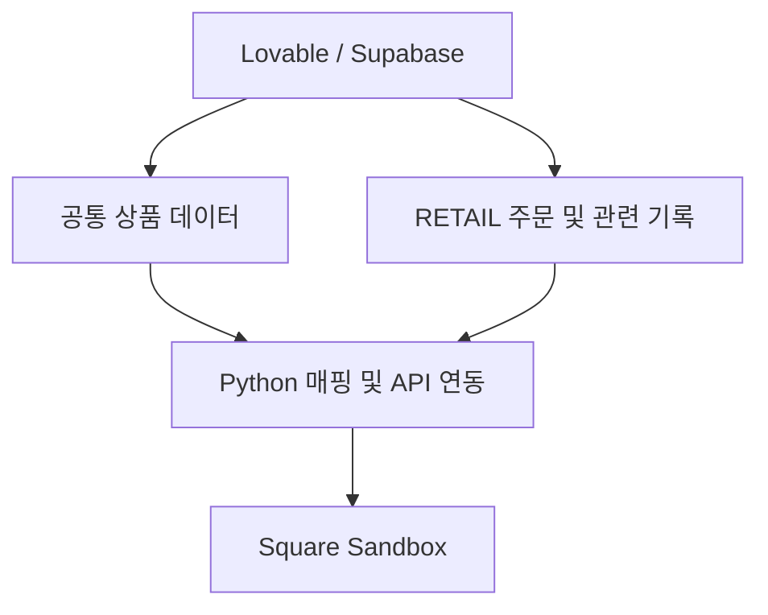
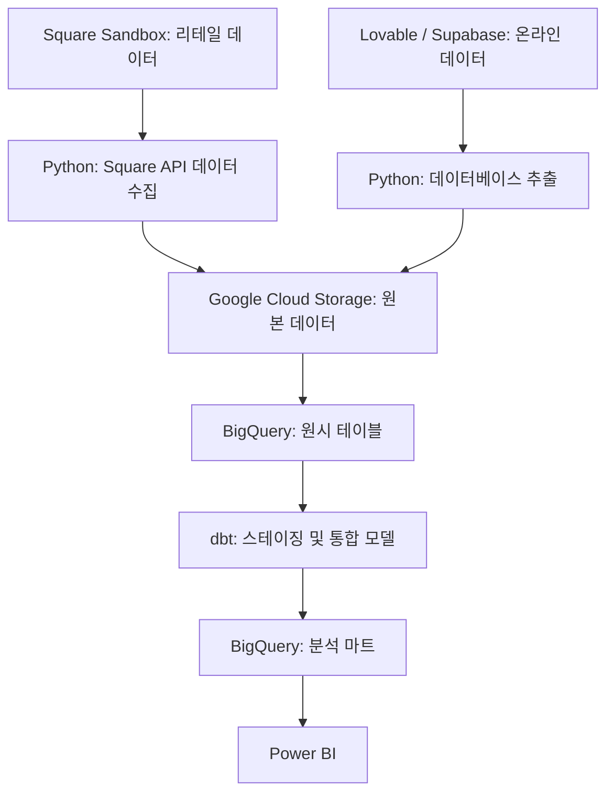
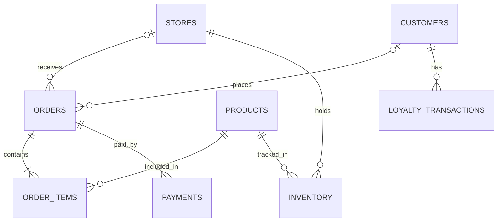
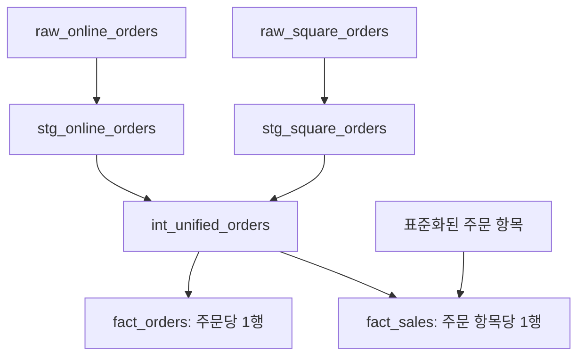

# 🍫 Charlie's Chocolate Factory — 옴니채널 리테일 데이터 플랫폼

> **리테일·이커머스 분석을 위한 데이터 엔지니어링 포트폴리오 프로젝트**

오프라인 매장과 온라인 쇼핑몰의 판매 데이터를 하나의 분석 플랫폼으로 통합하는 과정을 구현하는 엔드투엔드 데이터 엔지니어링 프로젝트입니다. 현재 개발을 진행하고 있습니다.

가상의 초콜릿 브랜드를 바탕으로 Lovable 온라인 스토어와 POS 시뮬레이터, Square Developer Sandbox를 활용합니다. 이후 GCP 데이터 파이프라인을 구축하여 채널별 데이터를 수집·변환·분석할 계획입니다.

Purdys Chocolatier와 같은 옴니채널 초콜릿 리테일 환경에서 영감을 받아, 온라인 커머스 데이터와 오프라인 POS 데이터를 각각 수집한 뒤 하나의 분석 플랫폼으로 통합하는 방법을 탐구합니다.

> **안내**
> 이 프로젝트는 전적으로 합성 데이터를 사용하는 독립적인 포트폴리오 프로젝트입니다.
> Purdys Chocolatier 또는 다른 기업과 제휴되어 있지 않으며, 특정 기업의 실제 내부 시스템 구조를 재현하지 않습니다.

---

## ✨ 프로젝트 개요

**Charlie's Chocolate Factory**는 다음 요소를 갖춘 가상의 캐나다 초콜릿 리테일 브랜드입니다.

- 🏪 여러 지역의 오프라인 매장
- 🛒 고객용 온라인 쇼핑몰
- 👥 고객 계정 및 리워드
- 📦 상품 및 재고 데이터
- 💳 가상의 주문 및 결제 기록

원천 애플리케이션은 Lovable로 구축했으며, 온라인과 오프라인 거래를 모두 저장합니다. 주문은 `channel` 값으로 구분합니다.

| 채널 | 의미 | 분석용 데이터 수집 원천 — 예정 |
|---|---|---|
| `RETAIL` | 오프라인 매장의 POS 거래 | Square Sandbox APIs |
| `ONLINE` | 온라인 쇼핑몰 주문 | Lovable / Supabase 데이터베이스 |

Python 스크립트로 공통 상품 데이터와 리테일 관련 테스트 데이터를 Square Sandbox에 적재합니다. 이후 분석 파이프라인에서는 리테일 데이터를 Square에서, 온라인 데이터를 원천 데이터베이스에서 직접 수집합니다.

### 🌍 실제 리테일 환경과 프로젝트의 시뮬레이션

기업의 내부 시스템에 접근할 수 없으므로, 프로젝트에서 자체적인 원천 시스템 환경을 구성합니다.

| 리테일 구성 요소 | 프로젝트 구현 | 역할 |
|---|---|---|
| 고객용 온라인 스토어 | Lovable Online Store | 온라인 커머스 데이터 생성 |
| 오프라인 매장 POS 화면 | Lovable POS Simulator | 가상의 리테일 거래 생성 |
| 외부 리테일 POS 플랫폼 | Square Developer Sandbox | API 연동을 통해 리테일 테스트 데이터 저장 |
| 중앙 분석 플랫폼 | GCS / BigQuery / dbt — 예정 | 두 채널의 데이터 수집·표준화·통합 |

Square Sandbox는 테스트 환경입니다. 이 프로젝트에서 실제 매장 운영 환경을 의미하지 않으며, 실제 금액을 청구하지 않습니다.

### 🎯 분석으로 답하고 싶은 질문

- 오프라인과 온라인 채널의 매출은 어떻게 다른가?
- 어떤 오프라인 매장의 실적이 가장 좋은가?
- 두 채널 전체에서 가장 잘 팔리는 상품은 무엇인가?
- 채널별 평균 주문 금액은 얼마인가?
- 식별 가능한 고객은 여러 채널을 어떻게 이용하는가?
- 날짜와 시즌 이벤트에 따라 매출은 어떻게 달라지는가?

재고 모니터링과 수요 예측은 향후 확장 범위입니다.

---

## 🗺️ 프로젝트 로드맵 — 4단계

| 단계 | 핵심 작업 | 주요 결과물 | 상태 |
|---|---|---|---|
| 1. 🏪 원천 시스템 시뮬레이션 | 원천 애플리케이션 구축 및 가상 POS 플랫폼에 데이터 적재 | 온라인 스토어, POS 시뮬레이터, 합성 데이터, Square API 연동 | 🚧 진행 중 |
| 2. ☁️ 클라우드 데이터 수집·적재 | 채널별 데이터를 분리하여 GCP로 수집 | Python 추출, GCS 원본 파일, BigQuery 원시 테이블 | 📋 예정 |
| 3. 🧱 데이터 변환 및 모델링 | 원천 데이터 표준화 및 통합 | dbt 모델, 매출 팩트, 차원 테이블, 품질 검증 | 📋 예정 |
| 4. 📊 분석 및 시각화 | 통합 데이터를 비즈니스 지표로 제공 | 분석 마트 및 Power BI 대시보드 | 📋 예정 |

**현재 집중하는 작업:** 클라우드 분석 파이프라인을 구축하기 전에 1단계의 리테일 주문 연동을 완료합니다.

---

## 🏗️ 아키텍처

### 1. 가상의 리테일 환경 준비

Lovable 애플리케이션에서 두 채널의 합성 데이터를 생성합니다. Square 연동 대상으로는 리테일 주문과 관련 기록만 선택합니다.

두 채널이 공유하는 상품 데이터도 Square에 적재합니다.



이 단계는 가상의 POS 환경을 준비하는 과정입니다. 이후에 구축할 분석용 데이터 수집 파이프라인과는 별도의 작업입니다.

### 2. 두 판매 채널의 데이터 수집 및 통합 — 예정



> **핵심 개념:** 온라인 커머스 데이터와 Square 기반 POS 데이터를 각각 수집한 뒤, BigQuery에서 하나의 옴니채널 데이터 모델로 통합합니다.

두 채널 모두 GCS와 BigQuery 원시 테이블을 거쳐 변환됩니다. 원천 데이터가 Power BI로 바로 연결되는 구조는 아닙니다.

### 데이터 처리 범위와 경계

- 리테일 주문에서 상품을 참조할 수 있도록 공통 상품 데이터를 Square에 적재합니다.
- 주문은 `RETAIL` 채널만 Square로 전송합니다.
- 선택한 리테일 주문 ID를 기준으로 관련 주문 항목과 결제 기록을 선택합니다.
- `ONLINE` 주문은 원천 데이터베이스에 유지하고 직접 추출합니다.
- 통합 매출 데이터셋을 구축할 때 리테일 매출은 Square에서만 수집합니다.
- 원본 Lovable 리테일 주문을 별도의 추가 매출로 중복 수집하지 않습니다.
- 원천 ID와 Square ID 매핑을 보존하여 데이터 대조에 활용합니다.

---

## 🛍️ 1단계 — 원천 시스템 시뮬레이션

### 온라인 스토어

Lovable로 가상의 초콜릿 쇼핑몰을 구축했습니다. 상품 탐색, 상품 상세 페이지, 장바구니, 체크아웃, 고객 계정, 주문 내역, 리워드·포인트 기능을 포함합니다.

고객, 상품, 주문, 주문 항목, 결제 기록, 고객 주소, 리워드 거래 데이터를 생성합니다. 온라인 커머스 데이터는 이후 직접 추출할 수 있도록 원천 데이터베이스에 유지합니다.

### POS 시뮬레이터

Lovable POS Simulator는 오프라인 매장 거래를 입력하는 화면 역할을 합니다. Python 스크립트로 리테일 기록을 선택하고 Square 요청 데이터 형식으로 변환한 뒤 Square API를 통해 전송합니다.

이 과정은 **원천 시스템 준비 작업**입니다. 이 단계에서 Square는 데이터를 보내는 목적지이며, 2단계에서는 분석 파이프라인이 데이터를 가져오는 원천이 됩니다.

### 오프라인 매장

| 매장 | 내부 ID |
|---|---|
| 🏙️ Downtown Vancouver | `VAN001` |
| 🌆 Burnaby | `BUR001` |
| 🌉 Richmond | `RIC001` |

내부 매장 ID는 Square Location ID와 매핑합니다.

### 주요 원천 엔티티

| 엔티티 | 용도 |
|---|---|
| `stores` | 오프라인 매장 정보 |
| `products` | 공통 상품 마스터 데이터 |
| `customers` | 등록 고객 프로필 |
| `customer_addresses` | 고객 주소 정보 |
| `orders` | `RETAIL` 또는 `ONLINE` 채널의 주문 |
| `order_items` | 주문별 상품과 수량 |
| `payments` | 가상의 결제 기록 |
| `inventory` | 재고 기록 |
| `loyalty_transactions` | 고객 리워드 활동 |
| `loyalty_settings` | 리워드 설정 |
| `tax_settings` | 원천 시스템의 세금 설정 |

온라인 주문에는 오프라인 매장에 해당하는 `store_id`가 없을 수 있습니다. 비회원 주문에는 `customer_id`가 없을 수 있습니다.

이 엔티티들은 원천 환경에 존재하지만, 모두가 초기 Square 연동이나 데이터 웨어하우스 구축 범위에 포함되는 것은 아닙니다.

---

### 합성 데이터 생성

다음 테스트 데이터셋으로 `ONLINE`과 `RETAIL` 시나리오를 구성합니다.

| 데이터셋 | 내용 |
|---|---|
| `products.csv` | 공통 상품 카탈로그 |
| `customers.csv` / `customer_addresses.csv` | 고객 프로필 및 주소 |
| `stores.csv` | 오프라인 매장 기준 정보 |
| `orders.csv` / `order_items.csv` | 주문, 판매 채널, 주문 항목 |
| `payments.csv` | 가상의 결제 기록 |
| `loyalty_settings.csv` / `loyalty_transactions.csv` | 리워드 설정 및 활동 |
| `tax_settings.csv` | 세금 설정 |

---

## 🔌 Square Sandbox 연동

Square Sandbox는 외부 리테일 POS 플랫폼의 역할을 합니다.

### 연동 범위

| 원천 데이터 | Square 매핑 | 상태 / 범위 |
|---|---|---|
| 상품 | Catalog API | 구현 완료 |
| 매장 | Locations API | Location 생성 및 매핑; 주문 적재 전 전체 매장 매핑 여부 확인 |
| 고객 | Customers API | 구현 완료; 리테일 시나리오에 필요한 고객 사용 |
| `RETAIL` 주문 및 주문 항목 | Orders API | 진행 중; 전체 흐름 검증 필요 |
| 리테일 결제 시나리오 | Payments API | Sandbox 결제 처리 흐름 구현 예정 |
| 재고 | Inventory API | 향후 확장 |
| `ONLINE` 주문 | Square로 전송하지 않음 | 분석용으로 원천에서 직접 추출 |

결제 연동은 Sandbox에서 지원하는 처리 흐름을 사용합니다. 원천 결제 기록은 합성 데이터이며 실제 청구 내역이 아닙니다.

### 상품 연동 — 구현 완료

1. 원천 상품 CSV를 Pandas DataFrame으로 불러옵니다.
2. 원천 필드를 확인하고 상품 값을 준비합니다.
3. 원천 필드를 Square Catalog 구조에 맞게 매핑합니다.
4. 기존 SKU를 확인하여 상품 중복 생성을 방지합니다.
5. 상품 요청 데이터를 Square Sandbox에 전송합니다.
6. 응답으로 받은 Square ID를 저장하여 이후 동기화에 활용합니다.

### 상품 매핑 예시

| 원천 필드 | Square 필드 | 예시 |
|---|---|---|
| 상품명 | `item_data.name` | Midnight Dark Chocolate Bar |
| SKU | `item_variation_data.sku` | `CCF-BAR-002` |
| 가격 | `price_money.amount` | `7.25` → `725` |
| 통화 | `price_money.currency` | `CAD` |

### 관련 기록의 ID 매핑

현재 유지하거나 향후 확장할 ID 매핑은 다음과 같습니다.

- 원천 상품 ID / SKU → Square Item 및 Item Variation ID
- 내부 매장 ID → Square Location ID
- 원천 고객 ID → Square Customer ID
- 원천 주문 ID → Square Order ID

상품 매핑에는 리테일 주문에서 상품 옵션을 참조할 때 사용하는 Item Variation ID가 포함되어야 합니다.

---

## 🧩 원천 데이터 관계

아래 다이어그램은 설계상 의도한 논리적 관계를 나타냅니다. 실제 데이터베이스 제약 조건을 검증한 결과는 아닙니다.



온라인 주문과 비회원 구매를 허용하므로, 주문에 매장이나 등록 고객이 반드시 연결되어야 하는 것은 아닙니다.

---

## ☁️ 2단계 — 클라우드 데이터 수집·적재 · 예정

### 수집 범위

| 원천 | 추출 방식 | 채널 / 용도 |
|---|---|---|
| Square Sandbox | Python으로 Square API 호출 | 리테일 주문, 고객, 상품 및 지원되는 결제 기록 |
| Lovable / Supabase | Python으로 데이터베이스에서 추출 | 온라인 주문 및 관련 기록 |
| 공통 원천 기준 정보 | 데이터베이스 또는 관리된 데이터 내보내기 | 상품·고객·매장 ID 대조 |

추출한 원본 데이터는 먼저 Google Cloud Storage에 저장한 뒤, 원천별로 분리된 BigQuery 원시 테이블에 적재합니다. 채널을 통합하기 전부터 각 기록의 출처를 추적할 수 있도록 유지합니다.

### BigQuery 원시 테이블 예시

| 온라인 원천 | Square 원천 |
|---|---|
| `raw_online_orders` | `raw_square_orders` |
| `raw_online_order_items` | `raw_square_order_items` |
| `raw_online_customers` | `raw_square_customers` |
| `raw_online_payments` | `raw_square_payments` |
| `raw_online_products` | `raw_square_products` |

위 표는 예정된 논리적 테이블 구조입니다. 중첩된 API 응답은 원본 형태로 보존한 뒤 스테이징 단계에서 펼쳐 처리할 수 있습니다.

### 파이프라인 요구 사항

- 원천 ID와 데이터 추출 시각을 보존합니다.
- API 페이지네이션, 오류, 재시도를 처리합니다.
- 반복 적재해도 매출이 중복되지 않도록 구현합니다.
- 최초 전체 적재가 정상 작동한 후 증분 수집을 추가합니다.
- 원천별 기록 수와 매출 합계를 대조합니다.
- Kestra로 반복 실행 일정을 설정하고 파이프라인을 모니터링합니다.

---

## 🧱 3단계 — 데이터 변환 및 모델링 · 예정

리테일과 온라인 데이터를 먼저 각각 스테이징한 뒤, 공통 판매 모델로 표준화합니다.

| 계층 | 용도 |
|---|---|
| Raw | 각 원천에서 추출한 원본 기록 보존 |
| Staging | 자료형 정리, 필드 표준화, 원천 식별자 유지 |
| Intermediate | ID 매핑, 주문 항목 연결, 채널별 스키마 정렬 |
| Marts | 매출 팩트, 차원 테이블, 비즈니스 지표 제공 |

### 채널 통합

온라인 주문과 Square 주문을 각각 정제하고 공통 스키마로 맞춘 뒤, 하나의 통합 주문 모델로 결합합니다.



모든 판매 기록은 원천 식별자와 함께 `ONLINE` 또는 `RETAIL`의 `channel` 값을 유지합니다. 아래 모델명은 설계 예정안을 나타냅니다.

### 핵심 모델

| 모델 | 행의 기준 단위 / 용도 |
|---|---|
| `fact_orders` | 주문당 1행; 주문 총액, 주문 수, 평균 주문 금액 계산 |
| `fact_sales` | 주문 항목당 1행; 채널 및 원천 식별자 포함 |
| `dim_product` | 공통 상품 속성 |
| `dim_customer` | 고객 식별이 가능한 경우 매핑된 고객 속성 |
| `dim_store` | 오프라인 매장 속성 |
| `dim_date` | 달력 및 시즌 관련 속성 |

### 주문 단위 필드 예시

| 필드 | 용도 |
|---|---|
| `order_key` | 원천 시스템 간에도 중복되지 않는 웨어하우스 키 |
| `source_system` / `source_order_id` | 원본 주문의 출처 추적 |
| `customer_key` / `store_key` | 해당 차원 테이블 참조 |
| `channel` | `ONLINE` 또는 `RETAIL` |
| `order_date` / `order_status` | 거래 날짜 및 주문 진행 상태 |
| `subtotal` / `tax` / `total` | 주문 단위 금액 |

상품 수량은 주문 항목 단위 팩트에서 관리합니다. 하나의 주문에 여러 결제 기록이나 결제 수단이 연결될 수 있으므로, 필요한 경우 결제 기록은 별도로 모델링합니다.

### 모델링 규칙

- `source_system`, `channel`, 원천 주문 ID, 원천 주문 항목 ID를 보존합니다.
- 매핑된 상품 식별자를 사용하여 채널 간 상품 실적을 비교합니다.
- 온라인 주문을 임의의 오프라인 매장에 배정하지 않습니다.
- 고객 ID가 없는 비회원 구매도 유지합니다.
- 명시적인 ID 매핑으로 시스템 간 고객을 연결합니다.
- 주문 수와 평균 주문 금액은 주문 단위로 계산합니다.
- 주문 항목을 조인할 때 주문 총액이나 결제 기록이 중복 집계되지 않도록 합니다.
- 매출 비교 전에 할인, 세금, 배송비, 환불, 주문 상태에 대한 일관된 처리 기준을 정의합니다.

채널 간 고객 분석은 신뢰할 수 있는 고객 매핑이 존재하는 구매로 제한합니다.

---

## 📊 4단계 — 분석 및 시각화 · 예정

| 분석 마트 | 비즈니스 질문 |
|---|---|
| `mart_daily_sales` | 시간에 따라 매출은 어떻게 변화하는가? |
| `mart_store_sales` | 어떤 오프라인 매장의 실적이 가장 좋은가? |
| `mart_online_sales` | 온라인 쇼핑몰의 실적은 어떠한가? |
| `mart_product_performance` | 두 채널 전체에서 가장 잘 팔리는 상품은 무엇인가? |
| `mart_customer_metrics` | 식별 가능한 고객은 어떤 구매 패턴을 보이는가? |
| `mart_channel_performance` | 리테일과 온라인의 매출은 어떻게 다른가? |

Power BI 대시보드에는 채널별 매출, 매장 순위, 상품 실적, 주문 수, 평균 주문 금액, 매출 추이를 표시할 계획입니다. 두 채널의 지표에는 동일한 정의를 적용합니다.

재고 분석은 재고 데이터 수집과 모델링을 구현한 후 추가합니다.

---

## 🛠️ 기술 스택

| 영역 | 기술 | 상태 |
|---|---|---|
| 원천 애플리케이션 | Lovable / React / Supabase | 사용 중 |
| 데이터 연동 | Python / Pandas | 사용 중 |
| 리테일 시뮬레이션 | Square Sandbox APIs | Catalog 및 Customers 구현 완료; 리테일 주문 처리 흐름 진행 중 |
| 로컬 개발 | PyCharm | 사용 중 |
| 버전 관리 | Git / GitHub | 사용 중 |
| 컨테이너화 | Docker | 예정 |
| 클라우드 저장소 | Google Cloud Storage | 예정 |
| 데이터 웨어하우스 | BigQuery | 예정 |
| 데이터 변환 | dbt | 예정 |
| 오케스트레이션 | Kestra | 예정 |
| 시각화 | Power BI | 예정 |

---

## 🚦 프로젝트 진행 상태

### ✅ 완료

- 가상의 다중 매장 리테일 POS 애플리케이션
- 고객용 온라인 쇼핑몰
- 합성 상품 및 거래 데이터
- `RETAIL` / `ONLINE` 채널 구분
- 원천 데이터베이스의 상품 CSV 내보내기
- Python / Pandas 기반 상품 데이터 처리
- Square Sandbox 연결
- 상품 스키마 변환
- Square Catalog API 연동
- SKU 기반 중복 탐지
- Square 상품 자동 적재
- 초기 상품 ID 매핑 저장
- 고객 → Square Customers API 연동

### 🚧 다음 작업: 리테일 테스트 데이터 연동 완료

- 상품 매핑에 Square Item Variation ID가 포함되어 있는지 확인
- 내부 매장 → Square Location 매핑의 누락 여부 확인
- 리테일 주문에 필요한 고객 매핑 확인
- 원천 주문을 `channel = 'RETAIL'` 조건으로 필터링
- 관련 주문 항목 및 결제 기록 선택
- Square Sandbox에 리테일 주문 생성
- Sandbox 결제 처리 흐름 구현
- ID 매핑 확장 및 연결된 기록 검증

### 🗺️ 이후 작업: 분석 파이프라인 구축

- Square API를 통해 리테일 데이터 추출
- Lovable / Supabase에서 온라인 데이터 직접 추출
- 공통 상품 및 고객 기준 정보 수집
- 추출한 원본 데이터를 Google Cloud Storage에 저장
- BigQuery 원시 테이블에 적재
- dbt로 두 채널의 데이터를 표준화하고 통합
- 차원 모델과 분석 마트 구축
- 증분 수집 및 반복 가능한 적재 구현
- 데이터 완전성, 중복, 매핑, 매출 합계 검증
- Kestra로 파이프라인 실행 일정 설정
- Power BI 대시보드 구축

### 🌱 향후 확장

- 재고 데이터 수집 및 보충 필요 여부 모니터링
- 시즌별 수요 분석
- 수요 예측
- Pub/Sub 또는 Kafka를 활용한 준실시간 수집

---

## 📁 저장소 구조

Python 연동 코드는 기존 저장소 구조를 따릅니다. 클라우드 수집, dbt, 오케스트레이션 구성 요소는 프로젝트 진행에 따라 추가합니다.

```text
chocolate-commerce-data-platform/
├── data/
│   ├── raw/
│   ├── processed/
│   └── sample/
├── src/
│   ├── config/
│   ├── extract/
│   ├── transform/
│   ├── square/
│   └── pipelines/
├── README.md
├── LEARNING_NOTES.md
├── LEARNING_NOTES_en.md
├── requirements.txt
├── .env.example
└── .gitignore
```

추가 예정 디렉터리:

| 디렉터리 | 용도 |
|---|---|
| `src/ingestion/` | 분석용 Square 및 온라인 원천 데이터 추출 |
| `dbt/` | 스테이징, 중간 모델, 마트 및 데이터 테스트 |
| `orchestration/kestra/` | 파이프라인 실행 일정 및 워크플로 |
| `dashboards/` | Power BI 프로젝트 파일 및 스크린샷 |
| `docs/` | 아키텍처, 매핑 규칙, 지표 정의 |

로컬 원본 내보내기 파일과 생성된 API 요청 데이터는 버전 관리에서 제외합니다. 공유 가능한 합성 샘플은 `data/sample/`에 저장합니다.

---

## 🔐 인증 정보

API 인증 정보는 환경 변수에서 불러옵니다.

```text
SQUARE_ACCESS_TOKEN=your_sandbox_token
```

로컬 `.env` 파일은 `.gitignore`를 통해 버전 관리에서 제외합니다. 저장소에 커밋하는 `.env.example`에는 예시 값만 포함합니다.

---

## 💡 학습 내용

데이터 엔지니어링 학습과 병행하여 프로젝트를 진행하고 있습니다. 각 단계에서 배운 개념을 동일한 리테일 시나리오에 적용합니다.

| 주제 | 프로젝트 적용 |
|---|---|
| Python / Pandas | 원천 데이터 읽기, 검증 및 변환 |
| API 연동 | Square Sandbox 데이터 적재 및 추출 |
| GCP | 원본 데이터 저장 및 클라우드 웨어하우스 운영 |
| dbt | 원천 데이터 표준화 및 분석 모델 구축 |
| 데이터 품질 | 기록 대조 및 매출 중복 방지 |
| Kestra | 파이프라인 실행 일정 설정 및 모니터링 |
| Power BI | 리테일과 온라인의 비즈니스 실적 비교 |

구현 과정에서 내린 결정과 학습 진행 상황은 `LEARNING_NOTES.md`와 `LEARNING_NOTES_en.md`에 기록합니다.

---

## 🎯 프로젝트 목표

Square의 리테일 데이터와 온라인 쇼핑몰 데이터베이스의 온라인 데이터를 수집한 뒤, 일관성과 추적 가능성을 갖춘 데이터셋으로 통합하는 재현 가능한 옴니채널 분석 파이프라인을 구축합니다.

**API·데이터베이스 수집 → 클라우드 저장소 → 데이터 웨어하우스 → 데이터 변환 → 분석**

### 🍫 데이터, API, 클라우드 도구 — 그리고 약간의 초콜릿으로 만드는 프로젝트.
